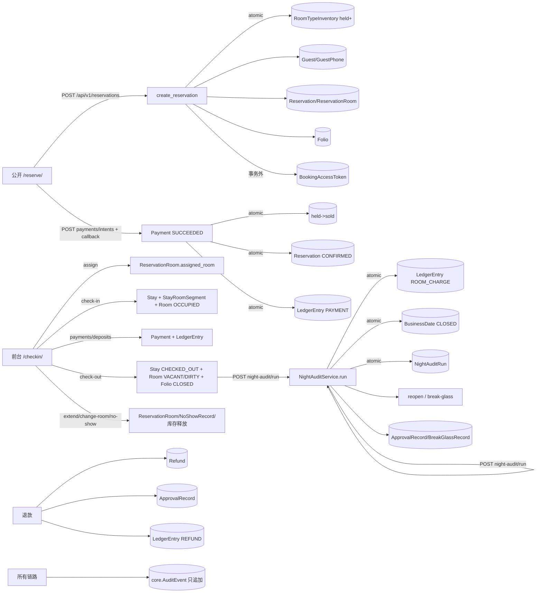

# Phase 0 工作流 E：业务数据流与链路审计（14-dataflows）

- 审计基线：`main @ 100a93a1382ca310aae588bc3a1734e4d67e94ba`（已 `git rev-parse` 确认）
- 审计方式：纯代码级追踪（只读，未执行任何业务写操作）
- 判定口径：
  - **闭环**：入口 → 服务 → 写表 → 事务 → 审计 → 回滚路径完整或风险可接受；
  - **缺口**：链路中缺失审计/缺失终态/存在跨事务不一致窗口等需要修复的问题。
- 缺口汇总：共 **11** 项（G1~G11，见 §8 缺口清单）。

---

## 0. 链路总览

---

## 1. 公开预订创建（含幂等重放 / PENDING 上限 / 限流三分支）

**触发入口**：`POST /api/v1/reservations`（`apps/api/urls.py:47`）→ `apps/api/views.py:153 reservations_create`（匿名可访问，`api_guard` 兜底）。

**分支 A：限流拦截**
1. `rate_limit.check(request, "public.reservation_create", phone=raw)`（views.py:162；策略 IP 10/10min + HMAC(phone) 3/10min，fail-closed，见 `apps/core/rate_limit.py:27`）；
2. 命中限流 → 写 `AuditEvent(public.reservation_blocked)`（views.py:163-165）→ `_throttle_deny` 再写 `AuditEvent(public.rate_limited)`（views.py:289-292）→ 429 + Retry-After。
   - 注：一次拦截写两条审计事件（blocked + rate_limited），语义重叠但可接受。
   - 写表：`RateLimitCounter`（计数，与审计分离）+ `AuditEvent`×2。

**分支 B：幂等重放**
1. `create_reservation`（`apps/reservations/services.py:177`）校验 Idempotency-Key 后进入 `transaction.atomic`（services.py:218）调用 `_create_reservation`；
2. 命中 `idempotency_key`（services.py:68-75）：指纹相同 → 返回 `(existing, False)` → HTTP 200 不再写库、**不写审计**；指纹不同 → `ReservationConflict` → 409，**亦无审计**；
3. 并发同 key：`IntegrityError` 由唯一约束 `uq_reservation_property_idempotency`（`apps/reservations/models.py:78-81`）仲裁，事务外重查返回（services.py:225-235）——回滚安全。

**分支 C：PENDING 上限**
1. 同手机号同物业 `PENDING` 计数 ≥ `PUBLIC_PENDING_RESERVATION_CAP`（默认 2，services.py:79-88）→ `ReservationConflict` → 409，无审计；
2. 上限检查位于 Guest/Reservation 创建之前，超限不产生任何业务写。

**主创建路径（atomic 内写入顺序）**（services.py:90-174）：
1. `RoomType` `select_for_update`（services.py:93）+ 人数/房价计划校验；
2. `get_room_type_availability`（只读，`apps/inventory/services.py:28`）；
3. `Guest.objects.create`（services.py:117）→ `GuestPhone.objects.create`（共享号码仅置 `shared_review_required`，services.py:113-127）；
4. `Reservation.objects.create`（PENDING，expires_at=now+15min，services.py:132-148）；
5. `ReservationRoom.objects.create × rooms`（services.py:155-165，含 nightly_rates 价格快照）；
6. `Folio.objects.create`（MASTER/OPEN，services.py:167-172）；
7. `hold_inventory_for_reservation`（services.py:173 → `apps/inventory/services.py:134-160`，`select_for_update` 锁库存行后二次校验 `available_count`，不足抛 `InventoryUnavailable` 整体回滚）。

**审计事件**：`public.reservation_created`（views.py:203-208）在**事务提交后**写入。
**失败回滚**：`ValueError`/`ReservationConflict`/`RoomType.DoesNotExist`/`InventoryUnavailable` 均在 atomic 内抛出 → Guest/GuestPhone/Reservation/ReservationRoom/Folio + 库存 held 全部回滚；仅库存校验有二次加锁保障。

| 判定项 | 结论 |
|---|---|
| 链路完整性 | **缺口 G1**：`BookingAccessToken.issue_for`（views.py:202）在 create_reservation 事务**提交之后**执行；签发若失败（如 DB 抖动），预订已创建且已扣 hold，但顾客永远拿不到明文 token → 无法自助查询/支付/取消。建议把 issue_for 纳入同一事务或提供重取机制 |
| 缺口 G2 | 幂等重放（created=False）、指纹冲突 409、PENDING 上限 409 三个分支均无审计事件，重放行为不可追溯 |
| 事务边界风险 R1 | `pending_cap` 计数为普通 count（无 select_for_update/加锁），并发窗口内同手机号可略超上限（弱约束，低危） |
| 事务边界风险 R2 | `AuditEvent.record` 在事务外，审计失败不影响业务（可接受方向），但要求 AuditEvent 写失败不能被 api_guard 静默吞掉（当前会以 500 暴露，可接受） |

---

## 2. 排房 → 入住（Stay / StayRoomSegment / 房态 OCCUPIED / Folio）

**排房**：`POST /api/v1/front-desk/reservation-rooms/<id>/assign`（`apps/api/urls.py:31`）→ `apps/api/front_desk.py:647 assign_room`（`_front_desk_write_required`：登录 + DEFAULT 物业任职 + view/change_accommodation 双权限）→ `assign_room_service`（`apps/reservations/front_desk_services.py:67-119`，`@transaction.atomic`）：
1. `ReservationRoom` sfl → `Reservation` sfl（NoShowRecord 排除、状态必须 CONFIRMED/CHECKED_IN、离店日未过、无 Stay）；
2. `Room` sfl + `is_sellable_now`（VACANT+CLEAN+NORMAL）→ 日期区间冲突查询（front_desk_services.py:55-64）；
3. 写：`ReservationRoom.assigned_room`（幂等：同房返回 changed=False）。
- 房态副作用：**无**（排房只占日期区间，不改 Room.occupancy_status）。
- 审计：仅 `hotel.audit` logger（front_desk_services.py:112-118），**无 DB AuditEvent**。

**入住**：`POST /api/v1/front-desk/reservation-rooms/<id>/check-in` → `front_desk.py:677 check_in` → `check_in_stay`（front_desk_services.py:122-203，atomic）：
1. 校验：未 No-Show、预订已确认、到达入住日、已排房、无重复 Stay、房间可售、无其他在住、Folio 已存在（front_desk_services.py:174-177）；
2. 写入顺序：`Stay.objects.create`（IN_HOUSE）→ `Room.occupancy_status=OCCUPIED` → `StayRoomSegment.objects.create`（初始房段，move_reason="初始入住房间"）→ `Reservation.status=CHECKED_IN`。

**Folio 开立时点**：Folio 并非入住时开立，而是**预订创建时**已开立（见 §1 第 6 步）；入住仅校验存在。

| 判定项 | 结论 |
|---|---|
| 链路完整性 | 业务闭环（状态机、幂等、锁完整）；**审计缺口 G3**：排房与入住两个前台核心动作只有日志无 DB 审计，不符 AuditEvent 模型注释"关键写操作必须落事件"（`apps/core/models.py:46-48`） |
| 事务边界 | 全 DB 操作、无外部调用，风险低；audit.info 在事务内但日志非事务性（可接受） |

---

## 3. 收款 / 押金（Payment / LedgerEntry / mock intent 门禁）

**3a. mock 支付意图（公开面）**：`POST /api/v1/payments/intents` → `views.py:302 payment_intent_create`：
1. 门禁：`_is_dev_env()`（DEBUG + DJANGO_ENV∈{dev,test}，views.py:281-282）——**生产环境直接 403**（AUTH-07/P0-12）；
2. `BookingAccessToken.validate`（token 失效 → `guest.booking_access_denied` 审计）→ 限流 `public.payment_intent`；
3. `create_mock_payment_intent`（`apps/billing/services.py:37-71`，atomic）：Reservation sfl 校验 PENDING/未过期/金额>0 → 复用已有 PENDING Payment（幂等）→ `Payment.objects.create`（MOCK/PENDING）。

**3b. mock 回调**：`POST /api/v1/payments/callback`（`csrf_exempt`，views.py:359-390；非 dev 环境直接 404）→ HMAC-SHA256 验签（`verify_mock_callback`，services.py:27-34）→ `process_mock_payment_callback`（services.py:74-139，atomic）：
1. Payment sfl → 金额一致校验 → `SUCCEEDED` 幂等返回 duplicate / 非 PENDING 拒绝；
2. Reservation sfl → 已过期分支：`release_inventory_hold` + 预订 EXPIRED + Payment FAILED（同事务）；
3. 正常分支：`confirm_inventory_for_reservation`（held→sold，`apps/inventory/services.py:163-187`）→ Reservation CONFIRMED → Payment SUCCEEDED+paid_at → `LedgerEntry.objects.create`（PAYMENT，负额，reference=`payment:<provider_ref>`）。
- **审计缺口 G4**：mock 支付成功/失败/过期三种资金状态变化**零审计事件**（仅 dev 可达，但资金语义无 DB 审计）。

**3c. 前台人工收款**：`POST /api/v1/front-desk/reservations/<booking_no>/payments` → `front_desk.py:702 collect_payment` → `collect_manual_payment`（front_desk_services.py:206-246，外层 atomic）→ `BillingService.collect_payment`（`apps/billing/services_v2.py:212-279`，嵌套 atomic=savepoint）：
1. 校验方式 CASH/CARD/TRANSFER、Idempotency-Key、预订 CONFIRMED/CHECKED_IN、Folio(MASTER/OPEN) sfl；
2. provider_ref=`FD<pk>-<key>` 幂等（重复引用且参数一致 → 返回已有 Payment）；
3. 应收余额校验（balance + 全部房费 - 已过房费，services_v2.py:244-257），超收拒绝；
4. 写入顺序：`Payment`（SUCCEEDED）→ `BillingService.post_entry` → `LedgerEntry`（PAYMENT 负额）→ `AuditEvent(billing.ledger_post)` → `AuditEvent(billing.collect)`。

**3d. 押金**：`POST /api/v1/front-desk/reservations/<booking_no>/deposits` → `front_desk.py:989 receive_deposit_api` → `receive_manual_deposit`（`apps/reservations/lifecycle_services.py:323-340`）→ `BillingService.record_deposit`（services_v2.py:281-338）：Payment（frontdesk_deposit）→ LedgerEntry(DEPOSIT 负额) → `Reservation.deposit_amount += amount` → 审计 `billing.ledger_post` + `billing.deposit_collect`；押金上限 = 房费总额。

| 判定项 | 结论 |
|---|---|
| 链路完整性 | 3a/3c/3d 闭环（幂等、余额校验、审计齐全）；**G4**：3b mock 回调无审计 |
| 事务边界 | 3b 回调验签在事务外（正确）；3c/3d 双层 atomic 为 savepoint 语义，安全；mock 无真实外部支付网关，无跨 atomic 外部调用风险 |
| 回滚路径 | 3b 库存确认失败 → PaymentConflict → 全事务回滚（Reservation/Payment/LedgerEntry 均回滚），可重试 |

---

## 4. 退款（申请 → 审批 → 执行，ApprovalRecord 状态机）

**申请**：`POST /api/v1/front-desk/payments/<payment_id>/refunds`（权限 `billing.refund_request`）→ `front_desk.py:1010 request_refund_api` → `request_refund`（lifecycle_services.py:343-353）→ `BillingService.request_refund`（services_v2.py:341-393，atomic）：
1. Payment sfl → 幂等键（同键同内容返回已有 Refund）→ 状态必须 SUCCEEDED/PARTIALLY_REFUNDED → 累计（PENDING+SUCCEEDED）不超原支付额；
2. 写入：`Refund`(PENDING) → `ApprovalService.request_approval`（services_v2.py:23-53）：`ApprovalRecord`(PENDING, action_code=billing.refund, 幂等键 sha256(prop:action:entity:requester)) + `AuditEvent(approval.request)` → 回写 `Refund.approval_record` → `AuditEvent(billing.refund_request)`。

**通用审批**：`POST /api/v1/approvals/<id>/approve` / `/reject`（`apps/api/approval.py:85/100`，权限 `billing.refund_approve`，`@idempotent` 装饰器写 IdempotencyRecord）→ `ApprovalService.approve/reject`（services_v2.py:55-111，atomic）：
- SoD：申请人≠审批人；PENDING 校验；过期 → EXPIRED + `approval.expire` 审计。
- ApprovalRecord 模型状态机守卫（`apps/billing/models.py:55-67`）：非 PENDING 不可改、只允许 PENDING→最终态、禁止删除 → `PENDING → APPROVED / REJECTED / EXPIRED` 单向。

**执行**：`POST /api/v1/front-desk/refunds/<refund_id>/approve`（权限 `billing.refund_approve` + 必须显式 `confirm_refund_paid=true`，front_desk.py:1031-1048）→ `approve_refund` → `BillingService.complete_refund`（services_v2.py:396-469，atomic）：
1. Refund sfl（SUCCEEDED 幂等返回）→ SoD（申请=执行人拒绝）→ approval 缺失则补建 → PENDING 则内联 `ApprovalService.approve`（savepoint）→ 校验 `approval.approved_by == 执行人`；
2. Payment sfl → 可退余额校验 → Folio 非 VOIDED 校验 → `post_entry` REFUND（正额，reference=`refund:<provider_ref>`）+ `billing.ledger_post` 审计 → Refund SUCCEEDED → Payment REFUNDED/PARTIALLY_REFUNDED → 押金类支付回补 `Reservation.deposit_amount` → `AuditEvent(billing.refund_completed)`。

| 判定项 | 结论 |
|---|---|
| 链路完整性 | 申请→审批→执行主链闭环（双人 SoD、金额守恒、幂等、审计完整）；**缺口 G5**：`Refund` 状态机没有 REJECTED/FAILED 终态——审批被 `reject` 后 ApprovalRecord=REJECTED 但 Refund 永远停在 PENDING，且继续占用"累计退款申请额度"（services_v2.py:369-373），无法关闭申请，需人工干预 |
| 事务边界 | complete_refund 嵌套调用 ApprovalService.approve 均在同一 atomic（savepoint），安全；无外部资金接口（人工线下退款），`confirm_refund_paid` 为人工确认门 |
| 回滚路径 | 任一校验失败（余额不足/账单作废/SoD）→ 全事务回滚，Refund 保持 PENDING |

---

## 5. 退房（Stay CHECKED_OUT / 房态释放 / 账单结算）

**入口**：`POST /api/v1/front-desk/stays/<stay_id>/check-out` → `front_desk.py:733 check_out` → `check_out_stay`（front_desk_services.py:249-347，atomic）：
1. Stay sfl（CHECKED_OUT 幂等返回 changed=False）→ line/Reservation/Folio sfl（Folio 必须 OPEN）；
2. 补记房费：`stay-room-charge:<stay.pk>` 幂等 reference，缺则 `BillingService.post_entry`（ROOM_CHARGE 正额）+ `billing.ledger_post` 审计；
3. 结算校验：balance>0（仍有应收）拒绝；balance<0 且为最后一间（客余）拒绝 → 必须先收款/退款；
4. 写入顺序：未关闭 `StayRoomSegment.ended_at`（active_stay_key 清空）→ `Stay`=CHECKED_OUT + actual_check_out → `Room`：OCCUPIED→**VACANT**、housekeeping→**DIRTY**（进入清洁链）→ 最后一间判定（total_lines vs 已退+no_show）：
   - 最后一间：`Reservation`=CHECKED_OUT、`Folio`=CLOSED（closed_at）；
   - 否则 Reservation 保持 CHECKED_IN。
- 审计：房费凭证有 `billing.ledger_post`；**退房状态变更本身仅 logger（front_desk_services.py:340-346），无 DB 审计 → 缺口 G6**。

| 判定项 | 结论 |
|---|---|
| 链路完整性 | 业务闭环（余额守恒、幂等、多间房部分退房正确）；**G6**：退房无 DB 审计 |
| 事务边界 | 全 DB、无外部调用；房费补记与状态变更同事务，回滚一致 |

---

## 6. 夜审（preview / run / reopen / break-glass）

**权限**：全部经 `_context`（`apps/api/night_audit.py:13-22`）：执行=`hotelapp.night_audit_execute`，重开=`hotelapp.business_date_reopen`，复核=`core.breakglass_review`。

**preview**（GET /api/v1/night-audit/preview → `NightAuditService.preview`，`apps/billing/night_audit.py:47-118`）：只读。逐在住 Stay 校验当日房价快照存在/合法（缺失→`NightAuditError` 阻断）；按 `night-audit:<prop>:<day>:stay:<id>` 检查已过租；No-Show 候选只列示不自动处理。无写入。

**run**（POST /api/v1/night-audit/run → `NightAuditService.run`，night_audit.py:121-225）：
- 事务 1（125-157）：Property sfl → `BusinessDate` get_or_create + sfl → 关账幂等（已有成功 run 直接返回）/关账无 run 报错/其他未关营业日互斥/RUNNING 互斥 → `NightAuditRun`(RUNNING) 创建并**提交**；
- 事务 2（160-219）：再次校验 bd 状态 → preview → 逐 stay `BillingService.post_entry`（ROOM_CHARGE，幂等 reference；零价跳过）→ `BusinessDate`=CLOSED（closed_by）→ `NightAuditRun`=SUCCESS+summary → `AuditEvent(night_audit.run)`；
- 失败路径：事务 2 抛错 → 全回滚（凭证/关账状态）→ 事务外 `NightAuditRun.update(FAILED, error_message)`（221-224）→ 可重试。
- **风险 G7**：事务 1 与事务 2 之间进程崩溃会遗留 `RUNNING` 记录，bd 仍 OPEN 但后续 run 全部被"该营业日已有夜审正在执行"拒绝——无超时/人工解锁链路。

**reopen**：`POST night-audit/business-dates/<id>/reopen-request` → `request_reopen`（229-246）→ ApprovalService（action_code=night_audit.reopen）；`.../approvals/<id>/approve` → `approve_reopen`（250-283）：审批人校验 → `BusinessDate`=REOPENED → `AuditEvent(night_audit.reopen)`。闭环。

**break-glass**（仅"唯一有效经理"场景）：
- request（288-354）：原因 8-240 字符 + **二次密码验证**（`check_password`）+ 唯一经理校验（其他有效重开经理存在则拒绝）→ `BreakGlassRecord`(GRANTED, 10min) + `night_audit.break_glass_requested` 审计；
- execute（358-406）：仅原申请人可执行、GRANTED 未过期 → `BusinessDate`=REOPENED + record=USED → `night_audit.break_glass_executed` 审计；过期 → record=EXPIRED + `break_glass_expired` 审计；
- review（410-449）：独立权限 + 非同一人 + 仅 USED 可复核 → REVIEWED + `night_audit.break_glass_reviewed` 审计。全链闭环。

| 判定项 | 结论 |
|---|---|
| 链路完整性 | preview/run/reopen/break-glass 四链闭环；**G7**：RUNNING 遗留无自动恢复（需人工 DB 介入，违反"失败可恢复"设计意图的程度视运维手段而定） |
| 事务边界 | run 采用"RUNNING 标记提交 → 业务事务"两段式，避免长事务但引入上述遗留窗口；AuditEvent(night_audit.run) 在事务 2 内，关账与审计同事务（一致性好） |

---

## 7. 异常路径：取消 / No-Show / 续住 / 换房 / 快速退房 / 反结账

### 7.1 顾客取消（token）
`POST /api/v1/reservations/<booking_no>/cancel` → views.py:404：限流 `public.reservation_cancel` → `BookingAccessToken.validate`（失败 → `guest.booking_access_denied` 审计，404）→ 已取消幂等直接 200 → `cancel_pending_reservation`（services.py:238-271，atomic）：Reservation sfl → 已 CANCELLED/EXPIRED 幂等 → PENDING：`release_inventory_hold`（不一致抛 InventoryUnavailable→409）→ 状态置 CANCELLED（或已过 expires_at 置 EXPIRED）→ 成功/被拒均写 `guest.booking_cancelled` 审计（views.py:436-448）。**闭环**（拒绝路径也有审计）。

### 7.2 预订过期（系统任务）
- 新命令 `apps/reservations/management/commands/expire_reservation_holds.py`：PENDING+超时 → release_inventory_hold + EXPIRED，**无审计**（G8a）；
- 旧命令 `hotelapp/management/commands/release_expired_reservations.py:50`：同样逻辑但写 `public.reservation_expired` 审计——两条并行过期链路审计口径不一致（G8b）；
- 支付回调 expired 分支（services.py:110-116）同样无审计。

### 7.3 No-Show
`POST /api/v1/front-desk/reservation-rooms/<id>/no-show`（权限 `hotelapp.no_show_handle`）→ `mark_reservation_room_no_show`（lifecycle_services.py:253-320，atomic）：状态/日期/Stay 互斥校验 → `release_sold_inventory_for_room_line`（sold-=1，inventory/services.py:219-242）→ `NoShowRecord.create` → `line.assigned_room=None` → 全部明细完成时收敛 Reservation 状态（全 No-Show→NO_SHOW，混合→CHECKED_OUT）。旧入口 `/no_show_one/` 已 410。**审计缺口 G9**：无 DB 审计。

### 7.4 续住
`POST /api/v1/front-desk/stays/<id>/extend` → `extend_stay`（lifecycle_services.py:52-169，atomic）：原因必填 → 冲突/房价计划覆盖/min/max stay/币种校验 → DailyRate+RoomTypeInventory sfl → `stocks sold+=1, version+=1` → `ReservationRoom.check_out/amount/nightly_rates` 扩展 → Reservation.check_out/total_amount 重算。新增夜过租由夜审自然覆盖。**审计缺口 G9**（同上，无 DB 审计）。

### 7.5 换房
`POST /api/v1/front-desk/stays/<id>/change-room` → `change_stay_room`（lifecycle_services.py:172-250，atomic）：同房型限制、目标房可售、无在住冲突 → 旧 StayRoomSegment 关段（ended_at+reason+moved_by）→ 新段创建 → 旧房 VACANT+DIRTY → 新房 OCCUPIED → Stay.room / line.assigned_room 更新。**审计缺口 G9**。

### 7.6 快速退房
旧 `/express_checkout/` 已永久 410（hotelapp/views.py:1303-1305，禁止绕过未结余额自动写账）。PMS2 无独立快速退房链路，唯一退房路径为 §5 `check_out_stay`（余额守恒）。**判定：能力收敛为闭环，无缺口**。

### 7.7 反结账
旧 `/uncheckout/` 已 410（hotelapp/views.py:2138-2140）。PMS2 侧：LedgerEntry 物理不可变（`ImmutableLedgerEntryQuerySet`，billing/models.py:170-174），错账唯一手段是 `BillingService.reverse_entry` 红字冲销（services_v2.py:473-506，审计 `billing.reverse_entry`）；但 **Folio CLOSED 后无重开链路**——冲销凭证无法改变账单状态，退房后发现错账只能挂账外处理。**判定：缺口 G10**（业务能力缺口：反结账/关账单重开无 PMS2 流程，需产品决策）。

### 7.8 旧写路由退役验证
`checkin_confirm/checkin_in/checkout/uncheckout/extend_stay/change_room/express_checkout/walkin_create/no_show_one/finance_add/room_status_change/night_audit_run` 共 12 个旧写入口全部 410（hotelapp/views.py，P1-05），不再产生任何旧表写入。旧 `/cancel_booking/`、`/booking/` 302 → `/reserve/`。

---

## 8. 缺口清单与链路判定汇总

| # | 链路 | 缺口/风险 | 证据（文件:行号） | 严重度 | 建议 |
|---|---|---|---|---|---|
| G1 | 预订创建 | token 签发在事务外，失败→预订无 token | apps/api/views.py:195-202 | 高 | issue_for 移入同一事务或提供凭 booking_no+手机号重取 token 的受控入口 |
| G2 | 预订创建 | 重放/上限/指纹冲突分支无审计 | services.py:68-88; views.py:209-216 | 低 | 409/200(created=False) 补 public.* 审计 |
| G3 | 排房/入住 | 无 DB 审计（仅 logger） | front_desk_services.py:112,196 | 高 | 调用 AuditEvent.record（front_desk.assign/checkin） |
| G4 | mock 支付回调 | 成功/失败/过期零审计 | apps/billing/services.py:74-139 | 中 | 至少对 SUCCEEDED/EXPIRED 分支补审计 |
| G5 | 退款 | Refund 无拒绝终态，被拒申请永久占用可退额度 | services_v2.py:369-373,409-411 | 中 | 增加 Refund.REJECTED 状态并在审批 reject 时联动关闭 |
| G6 | 退房 | 无 DB 审计 | front_desk_services.py:340 | 高 | 同 G3 |
| G7 | 夜审 | RUNNING 跨事务遗留→夜审被锁死，无超时恢复 | billing/night_audit.py:125-157,149-153 | 中 | run 启动时清理超时 RUNNING（如 >30min 视为失败并落审计） |
| G8 | 过期释放 | 新命令无审计；新旧两条过期链路并行且口径不一 | expire_reservation_holds.py 全文 vs hotelapp/release_expired_reservations.py:50 | 中 | 统一收敛到带审计的一条链路 |
| G9 | No-Show/续住/换房 | 无 DB 审计 | lifecycle_services.py:53,173,254 | 高 | 三个生命周期服务补 AuditEvent |
| G10 | 反结账 | Folio CLOSED 后无重开/反结账 PMS2 流程 | billing/models.py:170-174; services_v2.py:473 | 中（业务决策） | 明确"红字冲销+挂账"政策或设计关账单重开审批流 |
| R1 | 预订创建 | pending_cap 并发竞态（弱约束） | services.py:79-88 | 低 | 接受或对 guest 计数加锁 |
| R2 | 收款 | collect_manual_payment 双层 atomic（savepoint），语义正确但嵌套深 | front_desk_services.py:206; services_v2.py:212 | 信息 | 无需处理 |

**链路判定速览**：预订创建=闭环（含 G1/G2）；排房/入住=闭环（G3）；收款/押金=闭环（G4）；退款=主链闭环（G5）；退房=闭环（G6）；夜审=闭环（G7）；取消=完全闭环；过期=部分（G8）；No-Show/续住/换房=业务闭环（G9）；快速退房=已收敛闭环；反结账=G10。
