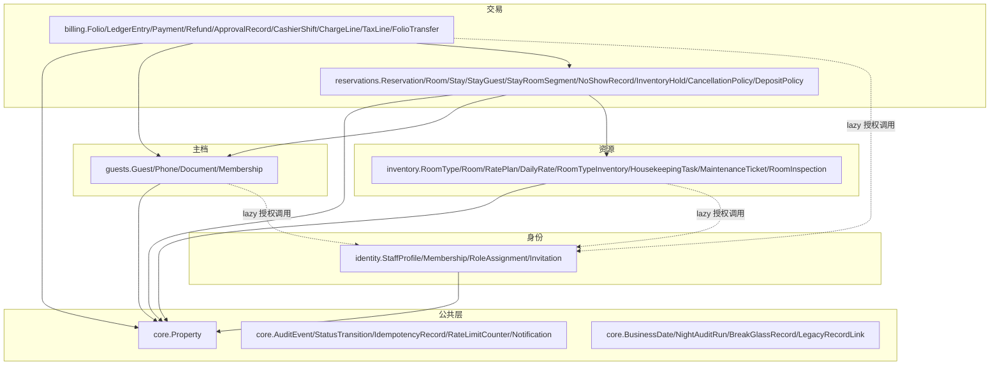

# PMS 架构现状审查报告（PMS 3.0 启动前 Phase 0）

> 文档性质：architecture-planning 流程产出——现状盘点 / 边界判定 / 漂移登记 / PMS3.0 就绪评估
> 审查基线 SHA：`635d9dd`（main，2026-11-07，"次级列表服务端分页+搜索 rate-calendar"）
> 审查方法：只读静态实证（grep import 矩阵、模型外键方向、URL 拓扑、MIDDLEWARE 栈、写入口调用图）；不改业务代码
> 关联输入：docs/PMS3.0全项目开发最终方案.md（审查对象）、docs/PMS2.0最终开发完成与上线验收标准.md、docs/PMS2全业务中心闭环补齐开发基线2.0.md、docs/acceptance/A16-final-acceptance-report.md
> 结论效力：本报告是 PMS3.0 方案修订（§3.4 约束继承、各任务包引注）的依据；登记项移交对应域，不在本报告内修复。

---

## 1. 现状盘点

### 1.1 App 边界与代码分布

| App | 职责 | 模型 | 服务层 | 备注 |
|---|---|---|---|---|
| `apps/core` | 物业、营业日、审计、幂等、限流、通知公共能力 | Property、AuditEvent（不可变 QuerySet）、LegacyRecordLink、BusinessDate、BreakGlassRecord、NightAuditRun、IdempotencyRecord、StatusTransition、RateLimitCounter、Notification、NotificationRead | `services_notifications.py`（待办派生）、`api_contract.py`（统一封套+幂等装饰器）、`rate_limit.py` | 公共层，含 2 处反向依赖（见 AR-02/AR-07） |
| `apps/identity` | 员工身份、任职、授权、邀请、平台面 | StaffProfile、PropertyStaffMembership、StaffRoleAssignment、Invitation | `EmployeeLifecycleService`、`AuthorizationService`、`EmployeeInvitationService`、`registry.py`（权限注册表）、`permission_center.py` | 依赖最干净：非测试代码只 import core |
| `apps/guests` | Guest 主档、联系方式、证件、会员 | Guest、GuestPhone、GuestDocument、GuestMembership、MembershipLevelHistory | `GuestService`、`GuestMembershipService` | GuestMergeRequest 不存在（GST-04 确认为 3.0 新建） |
| `apps/inventory` | 房型/房间/价格/库存/清洁维修 | RoomType、Room、RatePlan、DailyRate、RoomTypeInventory、HousekeepingTask、MaintenanceTicket、RoomInspection | 函数式服务（availability/hold/release/housekeeping/maintenance/rate） | 清洁维修三模型已在位，任务池为 API/UI 缺口 |
| `apps/reservations` | 预订、入住、房间段、生命周期 | Reservation、ReservationRoom、Stay、StayRoomSegment、NoShowRecord、ReservationGuest、StayGuest、InventoryHold、CancellationPolicy、DepositPolicy、BookingAccessToken | 函数式服务（`services.py` 公共预订、`front_desk_services.py` 排房/入住/退房、`lifecycle_services.py` 续住/换房/No-Show/退款审批） | CancellationPolicy/DepositPolicy 已在位且带 version，缺 Reservation 侧快照字段 |
| `apps/billing` | Folio、账本、收款、退款、审批、夜审、班次 | ApprovalRecord、Folio、FolioTransfer、LedgerEntry（不可变）、Payment、Refund、CashierShift、CashierShiftMovement、ChargeLine、TaxLine | `BillingService`、`ApprovalService`（services_v2）、`NightAuditService`（night_audit）、`ApprovalActionRegistry`、services.py（旧 V1 入口） | Payment 无 business_date/received_by（FIN-05 确认） |
| `apps/api` | 业务中心 API、OpenAPI、页面路由 | 无模型 | 各 `*_center.py` 编排视图 | 102 条 path（OpenAPI 97 paths）；非测试代码无业务模型直写（例外见 AR-08） |
| `hotelapp` | **PMS1 遗留模块（不在 apps/ 下）** | Accommodation、Client、Food、Order、Park、FinanceRecord、NightAudit、Folio（旧）、Room（旧）、Staff、Vip | `services/`（无调用方=死代码）、`events.py`/`handlers.py`（遗留事件）、`audit_middleware.py`（在役） | 35 条旧写路由 410 封死 + `test_module_gates` 护栏；`/no_show_one/` 例外活跃（AR-01） |

### 1.2 MIDDLEWARE 栈（hotel/settings.py:57-68）

```
SecurityMiddleware → WhiteNoise → identity.SplitSessionMiddleware（平台/业务双 Cookie 域）
→ Common → CSRF → Authentication → identity.PropertyContextMiddleware（物业上下文）
→ Messages → XFrame → hotelapp.audit_middleware.AuditMiddleware（POST 写操作日志）
```

漂移提示：请求级审计中间件住在遗留包 `hotelapp` 中（基础设施组件在遗留 App 内），退役 hotelapp 时必须先迁移该中间件（已并入 AR-10）。

### 1.3 URL 拓扑

- `/api/v1/` → `apps/api/urls.py`（102 path，97 OpenAPI operation，唯一正式业务 API 域）
- `/manage/<center>/`、`/manage/staff/*`、`/invite/accept/` → identity/api 页面与写工作台
- `/platform/*`、`/admin/` → 平台域（独立会话 Cookie，`is_admin_request` 跳过物业上下文）
- `/reserve/` → 公共预订页（写路径经 `apps.api.views` → `apps.reservations.services`，收口正确）
- 遗留路由（`/checkin*`、`/checkout/`、`/insert_*` 等 35 条）→ 410 Gone（RETIRED_410_ROUTES 测试护栏）；`/no_show_one/` 例外活跃（AR-01）；`/staff_accounts/` 写路由 302 → `/manage/staff/`

### 1.4 跨 App import 依赖矩阵（非测试、非 migration，grep 实证）

行=依赖方，列=被依赖方；数值=import 语句处数；**(lazy)**=函数级延迟 import。

| 从 \ 到 | core | identity | guests | inventory | reservations | billing | api |
|---|---|---|---|---|---|---|---|
| **api** | 58 | 34 | 21 | 22 | 27 | 36 | （自身） |
| **billing** | 13 | 3 (lazy) | 2 | 4 | **1 模块级**（night_audit）+3 (lazy) | — | **0** |
| **core** | — | 2（1 模块级+1 lazy） | 1 (lazy) | 2（1 模块级+1 lazy） | 3（1 模块级+2 lazy） | 3（1 模块级+2 lazy） | 0 |
| **guests** | 2 | 2 (lazy 授权) | — | 0 | 0 | 0 | 0 |
| **identity** | 28 | — | 0 | 0 | 0 | 0 | **0** |
| **inventory** | 8 | 3 (lazy 授权) | 0 | — | 0 | 0 | 0 |
| **reservations** | 5 | 0 | 3 | 9 | — | 14 | **0** |

要点：
1. **无任何服务层 import apps.api**（API→服务方向严格单向，2.0 约束守住）；
2. **identity 零反向依赖**（只依赖 core），是授权/身份底层；
3. **core 存在 1 处模块级反向依赖**：`core/services_notifications.py:36-40`（详见 AR-02）；`core/labels.py` 为函数级 lazy（AR-07）；
4. **billing↔reservations 服务层双向耦合**：`billing/night_audit.py:15` 模块级 import `reservations.models`；`reservations/lifecycle_services.py:12` 模块级 import `billing.services_v2`。因 billing 对 reservations 的引用在 services_v2 内是函数级 lazy，当前**无 import 时循环**，但逻辑双向（AR-09）；
5. 服务层横向调用 `identity.AuthorizationService`（guests/inventory/billing 共 7 处 lazy import）符合"唯一授权判断入口"设计（§8.2），登记为白名单模式，不计违例。

### 1.5 模型外键方向（模型层 DAG，无环）



实证：billing→core.Property(6)/guests.Guest(1)/reservations.Reservation(2)+Stay(1)；reservations→core.Property(6)/guests.Guest(3)/inventory.{RatePlan(3),Room(3),RoomType(2)}；inventory/guests/identity→仅 core.Property。**模型层无循环外键**；服务层 reservations↔billing 双向见 AR-09。

---

## 2. 边界判定

### 2.1 单一事实单写入口核对

| 权威实体 | 写入口现状 | 判定 |
|---|---|---|
| Reservation | 创建仅 `apps/reservations/services.py:132`（公共预订，含幂等键+请求指纹+15 分钟过期）；排房/入住/退房经 `front_desk_services`/`lifecycle_services` | **通过** |
| Guest | ①`apps/guests/services.py:163`（GuestService）；②`apps/reservations/services.py:117/127` 公共预订内联直写 Guest+GuestPhone | **双路径，AR-03** |
| Folio | ①创建：`apps/reservations/services.py:167`（公共预订开单）；②关闭：`apps/reservations/front_desk_services.py:364-366`（退房直写 status=CLOSED）；billing 服务只做过账不开关单 | **跨域写权威，AR-04/AR-05** |
| Payment/LedgerEntry/Refund/ApprovalRecord | `.create()` 仅出现在 `billing/services.py` 与 `billing/services_v2.py`；`front_desk_services` 收款委托 BillingService（注释明示"统一写入"） | **通过（收口最好）** |
| Room（状态） | ①`inventory/services.py` change_housekeeping_status/change_maintenance_status（含放行规则与库存同步）；②`front_desk_services.py:349-357` 退房直写 occupancy/housekeeping 状态 | **双路径，AR-06** |
| API 层直写 | 非测试代码仅 `apps/api/notification_center.py:178,201` NotificationRead get_or_create/bulk_create | **轻违例，AR-08** |

### 2.2 依赖方向单向性

- API→服务→模型：**成立**（§1.4 矩阵：无服务层反向 import api；api 层无业务写逻辑散落，写操作全部下沉）。
- 公共模块不反向依赖业务 App：**1 处违例**（core/services_notifications，AR-02）+ 1 处 lazy 渲染依赖（core/labels，AR-07）。
- 服务层互相 import：仅 billing↔reservations 双向（AR-09）；guests/inventory→identity.AuthorizationService 为授权白名单方向。

### 2.3 物业隔离三层一致性

| 层 | 机制 | 证据 | 判定 |
|---|---|---|---|
| 中间件 | `PropertyContextMiddleware`：员工按 DEFAULT 物业有效任职解析；无任职→`request.property=None`+`security.property_context_denied` 审计；不接受客户端切换（`active_property_id` 已移除） | apps/identity/middleware.py:15-85 | 通过（单店边界 P1-06 显式声明） |
| 视图/API | `request.property` 服务端注入；平台域 `/admin/`、`/platform/` 显式豁免并说明理由（缺口 F-10） | middleware.py:32-39 | 通过 |
| 服务 | 领域服务签名强制 `property_obj` 必参（billing/services_v2 107 处引用；inventory/guests/reservations 同模式）；模型层全表带 `property` FK | 各 services*.py | 通过 |
| 模型 | 物业范围唯一键含 property | 2.0 验收 A04 已核 | 通过 |

多物业切换未启用（`middleware.py:2-4` 单店边界注释）与 DEC-20 隔离口径一致，不计缺口。

### 2.4 领域事件与审计覆盖

- `AuditEvent.record` 70 个调用点、15 个文件（含 services_v2/night_audit/front_desk_services/lifecycle_services/guests services/identity services/middleware/API 层）；AuditEvent 采用不可变 QuerySet（core/models.py:46）。
- 状态迁移：`StatusTransition` 模型在位；夜审有 `NightAuditRun`+`BreakGlassRecord` 运行事实。
- 请求级：`hotelapp.audit_middleware`（log 文件级，位置漂移见 AR-10）。
- 待办派生：`core/services_notifications.py` 读源业务模型实时重算 + dedupe_key 数据库唯一（§4.6 口径），无 outbox（3.0 WN-04 为增强项）。
- 遗留事件总线 `hotelapp/events.py` 仍订阅活跃：唯一活跃发布点是 `no_show_one`（AR-01 关联），其余发布点均在 410 视图内为死代码。

---

## 3. 漂移/违例登记（决策建议，不在本报告内修复）

| 编号 | 严重度 | 位置 | 描述 | 建议决策 |
|---|---|---|---|---|
| AR-01 | **高（阻断性→移交代码/迁移域）** | `hotelapp/views.py:1357`（`no_show_one`，路由 `/no_show_one/`，hotel/urls.py:89） | **活跃旧写入口未退役**：POST 直写旧模型 `Accommodation`（state_machine+item.save），发布 `events.publish("no_show")` → `hotelapp/handlers.py:_on_no_show` 直写旧 `Room`；权限走旧 `hotelapp.no_show_handle` 未经 PMS2 AuthorizationService 九角色链；与 PMS2 权威命令 `/api/v1/reservation-rooms/<id>/no-show`（api/urls.py:33）并行。10-routes.md:54 将其登记为 ACTIVE，35 条 410 清单（test_module_gates.py:443）不含此路由。旧表与 PMS2 Reservation/Stay/Inventory 无外键，构成平行事实源 | 3.0 MIG-06（冻结旧写路径）必须显式包含 `/no_show_one/`：确认旧工作台 `/checkin/`、`/booking/` 页面无残留依赖后 410 封死，并补进 RETIRED_410_ROUTES 护栏；需业务确认（DEC-24） |
| AR-02 | 中 | `apps/core/services_notifications.py:36-40` | 公共层模块级反向依赖 4 个业务 App（billing.ApprovalRecord、identity.Group、inventory.Room、reservations.Reservation）；违反 PMS3.0 方案 §3.2"公共模块不得反向依赖具体业务 App" | 3.0 WN 任务包内重构：通知派生迁独立 notifications app，或改为业务侧注册"待办提供者"回调/事件订阅；不阻塞 2.0 验收 |
| AR-03 | 中 | `apps/reservations/services.py:117-137` | Guest 主档第二条写路径：公共预订流程内联 `Guest.objects.create`+`GuestPhone.objects.create`，共享号码标记逻辑与 GuestService 重复；同一手机号策略演化时两处易漂移 | 收口 `GuestService.ensure_for_booking(property_obj, payload)`，公共预订与员工端共用 |
| AR-04 | 中 | `apps/reservations/front_desk_services.py:361-366` | 退房流程直接 `folio.status=CLOSED; folio.save()` 关闭账单，Folio 状态迁移未经 BillingService（虽事务、select_for_update、余额校验完备） | `BillingService.close_folio()` 收口；可与退房事务保持同事务 |
| AR-05 | 低 | `apps/reservations/services.py:167-173` | 公共预订流程直接 `Folio.objects.create` 开单；Folio 创建权威实际在 reservations 而非 billing | 同 AR-04 收口 `BillingService.open_folio()`；一并登记 3.0 SVC-05 |
| AR-06 | 低 | `apps/reservations/front_desk_services.py:349-357` | 退房直写 `Room.occupancy_status/housekeeping_status`（VACANT/DIRTY），未走 inventory 服务（`change_housekeeping_status` 有净房放行规则）；DIRTY 状态应联动任务生成 | 统一走 RoomStatus/Housekeeping 服务；或登记为退房事务白名单例外并补联动断言 |
| AR-07 | 低 | `apps/core/labels.py:17,26,31,36,41,82,87` | 公共标签渲染 lazy import 业务模型（函数级，无加载风险） | 维持 lazy 或移至各业务 App 注册 label provider；P2 |
| AR-08 | 低 | `apps/api/notification_center.py:178,201` | API 层直写 `NotificationRead`（get_or_create/bulk_create），未过服务层 | `NotificationService.mark_read()` 收口，并入 3.0 WN-03；读回执非业务事实，不阻断 |
| AR-09 | 信息 | `billing/night_audit.py:15`；`reservations/lifecycle_services.py:11-12`、`billing/services_v2.py`（lazy 侧） | billing↔reservations 服务层双向耦合：夜审模块级 import reservations.models（NoShowRecord/Reservation/ReservationRoom/Stay）；reservations 生命周期模块级 import BillingService/ApprovalService。无 import 时循环，但领域上"夜审读交易、交易写审批"应单向 | 3.0 SVC 阶段引入领域事件/回调解耦（夜审经数据快照接口读取交易事实）；演进项，非缺陷 |
| AR-10 | 信息 | `hotelapp/`（整包）；`hotelapp/audit_middleware.py` | 旧模块 11 个模型仍在库；`hotelapp/services/*` 为死代码（无调用方）；请求审计中间件仍在遗留包内；`folio_api`、`show_*` 等活跃只读视图仍读旧表 | 3.0 Phase 5（MIG-08/09）先迁 audit_middleware，再按退役矩阵归档+Contract；账务历史数据按 §10 保留规则处理，不物理删除 |
| AR-11 | 信息 | `apps/identity/test_module_gates.py:443`；`docs/audit/phase0/10-routes.md:54` | 410 护栏与路由清单存在"清单外活跃写路由"盲区（即 AR-01），说明"测试护栏完备"与"旧写入口为零"不能画等号 | 3.0 API-08/G11 验收时增加"路由表全量 diff 权威清单"步骤，而非仅核对既登记清单 |

**统计**：违例/漂移登记 11 项（高 1、中 3、低 4、信息 3）；依赖矩阵违例 2 处模块级反向依赖（core→业务 ×1 文件、labels lazy ×1 文件）+ 1 处服务层双向耦合。

---

## 4. PMS3.0 就绪评估（2.0 遗留衔接）

### 4.1 A16 登记项逐条核对（现状 SHA 635d9dd）

| A16 登记项 | 核对结果 | 3.0 衔接 |
|---|---|---|
| Guest 合并提案模型（待业务决策） | `GuestMergeRequest` 不存在（grep 无命中）——**仍为缺口** | GST-04/DEC-03/DEC-06 维持"待业务决策"；3.0 §5.2"仅在模型不存在时设计"前提成立 |
| HousekeepingTask 任务池（§4.3 范围外） | `HousekeepingTask`/`MaintenanceTicket`/`RoomInspection` 模型**已存在**（inventory/models.py:295/355/399）；缺口是任务池 API/UI 与 SLA/超时队列 | HK-03/HK-05/HK-06 为 API/UI 任务而非建模任务；§5.8"字段已具备则复用"成立 |
| `billing.cashier_shift_manage` 独立权限码 | **已解决**：registry.py:474 已注册并绑定角色（commit 085e32b/42c25e2/247a7b7）；billing_center.py:85 经 AuthorizationService 强制 | 3.0 文档不再列为缺口；仅剩运营侧权限分配复核（IAM-04 九角色矩阵） |
| 审计读取不落审计（防递归，待业务确认） | 未决策；AuditEvent 查询侧无递归防护专门策略 | 纳入 3.0 DEC-23（本审查新增）+CMP-04 检索权限设计 |
| `apps/reservations/tests.py:621` 排序偶发 flake | 移交预订域 | 并入 RSV 任务包回归项；3.0 QA-01 覆盖 |

### 4.2 门禁状态衔接（对 PMS3.0 方案头部声明的影响）

A16（开发者申报版）自身后续更新：G10 性能容量已由 A11 压测完成（6 场景 PASS，waitress 16 线程 + 4000 预订数据集）；Redis 5.0.14 已部署验证（多进程共享/TTL/故障捕获）。剩余门禁：**阶段四本地业务验收（含空库全量迁移执行——DBA 授权问题）与 G14 独立签署**；G09 多 worker 证据需阶段四复核。PMS3.0 方案文头"G09 Redis、G10 性能容量…尚未完成"表述已滞后，需修订（见交付 B 修订引注）。

### 4.3 能力在位清单（避免 3.0 重复立项的实证）

| 3.0 文档条目 | 实证现状 | 修订口径 |
|---|---|---|
| §4.1 权威实体表 | 全部对应模型在位（§1.1 表），LegacyRecordLink 亦已在位（core/models.py:135） | §10.2 任务聚焦字段完整性核对+真实迁移，非新建 |
| GST-03 证件密钥版本 | `GuestDocument.key_version` 不存在；`retention_until` 已存在（guests/models.py:134） | GST-03 维持新建；GST-08 聚焦清理任务/法律保留例外 |
| RSV-03/04 政策快照 | `CancellationPolicy`/`DepositPolicy` 已在位且带 `version`（reservations/models.py:441/478，按 rate_plan 版本化）；Reservation 无 snapshot 字段 | 任务聚焦 Reservation 快照字段+创建时固化流程，政策模型不重建 |
| FIN-05 营业日归属 | `LedgerEntry.business_date` 已在位（billing/models.py:263+索引）；Payment 无 business_date/received_by | 任务聚焦 Payment/CashierShift 字段与口径对齐 |
| §5.11 WN | Notification/NotificationRead/dedupe_key 唯一已在位；派生服务反向依赖（AR-02）、读回执 API 直写（AR-08） | WN 任务包增加边界收口子项 |
| §7.1 API 封套/幂等 | `core/api_contract.py` 统一 {data,meta}/{error,meta}+IdempotencyRecord 装饰器在位；OpenAPI 97 paths | API-01/02 任务性质为"推广剩余路由+CI 漂移检查"，非从零建设 |
| 旧入口退役 | 35 条 410+护栏测试在位；AR-01 一条活跃残留 | MIG-06 显式补入 `/no_show_one/` |
| Apifox 交付 | 仅 `docs/接口文档/apifox-env-template.json`+openapi.json；实际导入/执行报告缺失 | API-07 为闭环任务；列为 2.0 遗留交付缺口（非阻断） |

### 4.4 结论

架构底盘满足 PMS3.0 启动前提：依赖方向单向性、写权威收口（4/6 权威实体完全干净）、物业隔离三层一致、审计覆盖广。3.0 启动前必须处理的架构项只有 1 项高优先级（AR-01 旧写入口，纳入 MIG-06+DEC-24）；其余为随任务包收口的登记项。PMS2 验收门禁（阶段四+G14）仍为正式开发启动的上位条件，本报告不改变该门禁。

---

## 5. 待业务决策隔离清单（不混入开发任务）

| 编号 | 事项 | 关联 |
|---|---|---|
| DEC-23（建议新增） | 审计读取是否落审计（防递归的安全事件策略） | A16 登记项、CMP-04 |
| DEC-24（建议新增） | `/no_show_one/` 旧工作台依赖确认与退役时点 | AR-01、MIG-06 |
| DEC-03/DEC-06 | Guest 合并权限/复核人、合并后撤销 | GST-04 |
| AR-04/05 收口时点 | Folio 开关单迁移 BillingService 的批次归属（建议 SVC-05） | PM-04 唯一写入口矩阵 |

---

## 6. 审查命令与可复现性

- 跨 App import 矩阵：`grep -rn "from apps\." apps --include="*.py"`（排除 `__pycache__|/migrations/|tests?\.py|/test_`）
- 外键方向：`grep -nA2 "ForeignKey\(|OneToOneField(" apps/*/models.py`
- 写入口调用图：`grep -rn "<Model>.objects.create(|= <Model>(" apps hotelapp`（Reservation/Guest/Folio/Room/Payment/LedgerEntry/Refund）
- 410 护栏：`apps/identity/test_module_gates.py:443 RETIRED_410_ROUTES` × `docs/audit/phase0/10-routes.md`
- 审计覆盖：`grep -rn "AuditEvent.record(" apps | grep -v test | wc -l` → 70 处
- 基线：main `635d9dd`，2026-11-07；审查过程零业务代码改动
