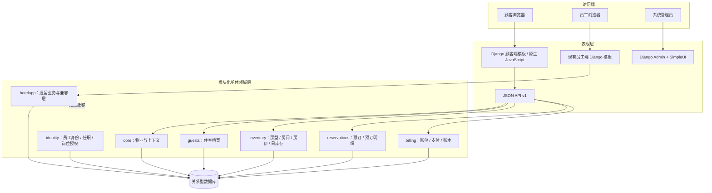
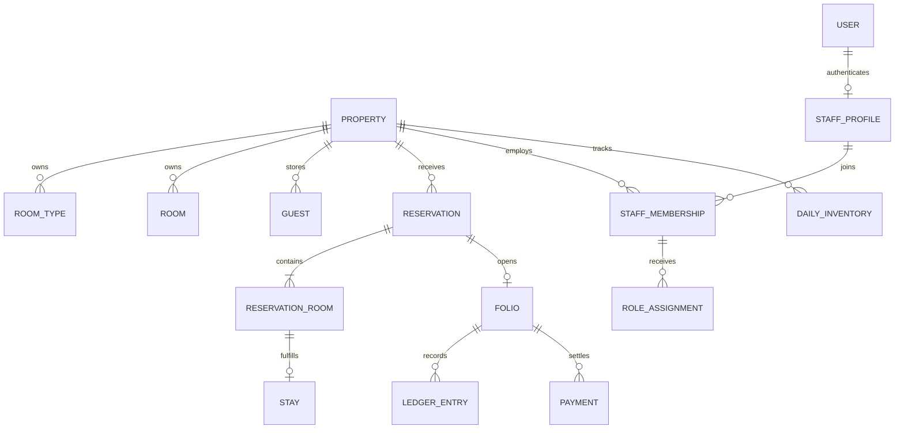
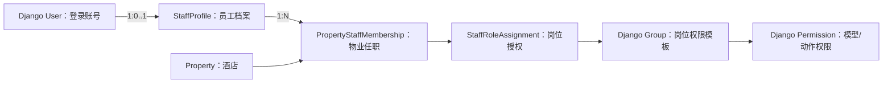
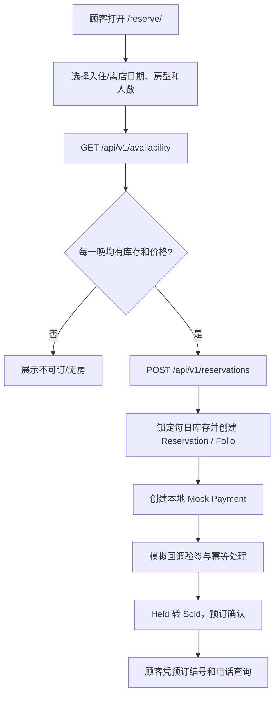
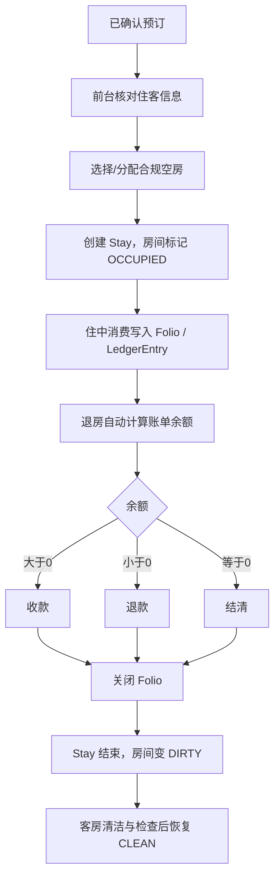

# PMS 2.0 技术架构说明

> 文档状态：随当前仓库代码更新  
> 当前交付：Phase 1 平台与员工权限底座、Phase 2 预订库存闭环及顾客端预订页  
> 版本策略：PMS 2.0 完成既定业务范围；3.0 只做已有功能完善、Bug 修复、性能/安全/兼容优化和回归，不新增业务功能。

## 1. 项目定位

本项目采用**单体酒店优先、预留多物业扩展**的酒店管理系统（PMS）。当前仍处于从历史 Django CRUD 原型向业务域模块化单体迁移的阶段。新业务不再以“单表增删改查”为中心，而围绕酒店物业、员工身份、房型/房间、日期库存、预订、实际入住、账单和账本建立边界。

当前实现与规划边界必须区分：

- 已实现：物业上下文、员工身份与任职关系、基础岗位授权模型、住客档案、房型/物理房间/每日房价/按日库存、预订与预订明细、支付模拟、账单与不可变账本、API v1、顾客端 `/reserve/`。
- 仍在旧系统：部分员工后台、旧入住/退房/财务/夜审页面及原有业务模型。旧页面暂时保留，不代表已全部迁移到新领域模型。
- 后续 PMS 2.0 阶段：前台入住/退房、客房清洁、夜审、财务报表等接入新模型。
- 不在当前范围：真实支付渠道、OTA、公安旅业系统、POS、停车系统、电子发票/数电票等第三方对接。

## 2. 总体架构

采用**模块化单体（Modular Monolith）+ Django B/S + API-First**，不是微服务。

### 架构原则

1. **模块化单体**：各业务域按 Django App 分包，使用领域服务封装事务和业务规则；当前部署仍是一个 Django 项目、一个应用进程体系和一个关系型数据库。
2. **API-First**：新顾客端页面只负责交互和展示，库存、金额、幂等、订单状态和支付结果由后端 API/领域服务决定。
3. **服务端渲染优先**：现阶段顾客端使用 Django Template + 原生 JavaScript，减少 Next.js 独立部署、跨域、双工程维护和认证复杂度。
4. **数据库约束兜底**：关键唯一性、金额范围、日期区间和关联完整性尽可能落在数据库约束；并发库存更新放在事务内锁定库存行。
5. **账务凭证不可篡改**：LedgerEntry 禁止常规更新/删除；纠错应新增红字冲销凭证并保留原因和原始凭证关联。
6. **渐进迁移**：新旧页面并存，按业务闭环逐步切换，不在一个阶段一次性推翻旧页面。

## 3. 技术栈

| 层次 | 当前采用 | 说明 |
|---|---|---|
| 后端框架 | Django 4.1 | 当前仓库锁定版本；框架升级应独立评估，不与业务重构混做 |
| 语言 | Python | Django 应用与领域服务 |
| 页面 | Django Template + 原生 JavaScript | 顾客端新页面；旧员工端页面暂时并存 |
| API | Django View + JsonResponse | 当前 API v1；尚未引入 Django REST Framework |
| 管理后台 | Django Admin + django-simpleui | 配置和基础数据管理 |
| 认证 | Django User / Session / Group / Permission | 新员工域将 User 与员工档案分离 |
| 数据库 | MySQL 默认；可配置 PostgreSQL / SQLite | 生产建议 MySQL 或 PostgreSQL；SQLite 主要用于测试/轻量本地验证 |
| 缓存 | Django LocMemCache | 当前默认本地内存缓存；多进程/多实例生产部署应评估 Redis |
| 自动化测试 | Django TestCase / CI 工作流 | 以仓库实际测试与 GitHub Actions 结果为准 |
| 静态资源 | Django staticfiles | 当前无独立前端构建链 |

依赖以 `requirements.txt` 为准。不要仅凭本说明升级 Django、数据库驱动或 UI 组件版本。

## 4. Django App / 领域边界

| App | 职责 | 关键实体/内容 |
|---|---|---|
| `apps.core` | 酒店物业主数据和请求物业上下文 | Property |
| `apps.identity` | 员工自然人、物业任职、岗位授权 | StaffProfile、PropertyStaffMembership、StaffRoleAssignment |
| `apps.guests` | 顾客/住客档案 | Guest |
| `apps.inventory` | 房型、物理房间、价格计划、每日价格、日库存 | RoomType、Room、RatePlan、DailyRate、RoomTypeInventory |
| `apps.reservations` | 预订合同、每间房明细、实际履约模型 | Reservation、ReservationRoom、Stay |
| `apps.billing` | 账单、支付流水、不可变账本 | Folio、Payment、LedgerEntry |
| `apps.api` | API 路由、参数校验、序列化响应、OpenAPI JSON | `/api/v1/*` |
| `hotelapp` | 历史系统与尚未迁移的页面/模型 | 旧员工、顾客、入住、餐饮、停车等 |

依赖方向建议：表现层 → API/应用服务 → 领域模块 → ORM/数据库。跨模块写操作应调用对方服务，不应在模板或视图中散落库存扣减、账务写入等规则。

## 5. 单体酒店与连锁扩展

当前按单体酒店落地，但核心业务表通过 `property_id` 关联 `Property`，为连锁扩展保留数据隔离基础。

现阶段只配置一个默认物业（`DEFAULT_PROPERTY_CODE`），不代表已经实现集团总部、跨店调拨、集团会员、跨店账务、集团报表或连锁 OTA 管理。未来增加集团组织/品牌/区域等实体时，应先明确集团级与门店级数据权限，不要把所有表简单加一个集团字段了事。

## 6. 员工 User 与 Staff 的关系 / RBAC

采用“登录身份”和“员工业务档案”分离：

- Django `User`：负责账号、密码、Session、认证状态。
- `StaffProfile`：员工自然人档案；可关联一个 User，也保留与旧 `hotelapp.Staff` 的迁移关联。
- `PropertyStaffMembership`：员工在具体酒店的任职关系，存店内工号、岗位代码、任职状态和任职日期。
- `StaffRoleAssignment`：某次任职获得的岗位权限组及生效时间；角色授权不直接写进全局 `User.groups`，避免员工跨物业时权限串店。
- Django `Group` / `Permission`：作为权限模板；实际请求授权还必须结合当前物业、任职有效状态和角色分配。

岗位职责以业务动作定义，例如前台办理入住/退房、客房更新清洁状态、财务查看/复核账务、夜审执行日结、店长审核冲销。当前运行时授权由 `AuthorizationService` 结合当前物业、有效员工档案、任职状态和生效中的 `StaffRoleAssignment` 判断；业务视图使用 `pms_permission_required`，前台 API 在每次请求中重新校验权限，不能只依赖菜单隐藏或 `is_staff`。

九个业务岗位目录集中在 `apps/identity/roles.py`，由权限矩阵、员工工作台和生命周期服务共用。员工/账号/任职/岗位变更必须通过 `EmployeeLifecycleService`；Django Admin 对身份模型仅开放审计查看，不提供直接增删改，避免绕过自我提权保护、角色白名单和审计。Django `User.groups` 不保存员工岗位分配；`Group` 只作为角色权限模板。平台超级用户是技术管理身份，不因此自动获得门店业务岗位权限。

## 7. 核心业务数据模型

### 7.1 房态与可售库存

Room 的三个状态维度相互独立：

- 占用：VACANT / OCCUPIED
- 清洁：CLEAN / DIRTY / CLEANING / INSPECTING
- 维修：NORMAL / OUT_OF_ORDER / OUT_OF_SERVICE

物理房间当前可售的基础条件：启用、空闲、净房、维修正常。日期库存另外按房型和住宿日管理，不能用当前物理房态代替未来日期库存。

### 7.2 每日房价与预订

- 入住日期包含，离店日期不包含；每一住宿晚必须有有效价格。
- 价格按每日明细返回，创建预订时将成交价快照保存到 ReservationRoom，后续调价不能篡改历史订单价格。
- RoomTypeInventory 按物业、房型、住宿日期保存 total / held / sold / out_of_service 等计数；查询可售量按每日计算。
- 创建预订必须在事务中锁定涉及的库存日期，任何一晚不足则整体回滚。
- Idempotency-Key 与请求指纹用于防止重复提交和同 Key 不同内容。

### 7.3 预订与入住分离

Reservation 是交易合同；ReservationRoom 是一间预订房的明细；Stay 是实际入住履约记录。预订不等于已分配物理房间，也不等于客人已经入住。

### 7.4 账单和支付

- Folio 是住客账单容器。
- Payment 是支付渠道流水；当前仅支持开发/测试 Mock，不是真实资金清算。
- LedgerEntry 是业务凭证。当前约定房费/消费为正，押金/收款/退款抵减为负；余额为正表示客人还需支付。
- 账本凭证不允许常规物理删除/直接修改；冲销必须有原因并关联原凭证。所有收款/退款必须保留 Payment 与 LedgerEntry 的对应关系。

## 8. 核心流程

### 顾客预订与模拟支付

### 当前未迁移完成的履约流程目标

该图为目标流程，不代表当前版本所有节点均已落地。

## 9. API 与顾客端

| 方法 | 路径 | 用途 |
|---|---|---|
| GET | `/api/v1/availability` | 查询房型、可订数量和逐晚价格 |
| POST | `/api/v1/reservations` | 创建预订，要求 Idempotency-Key |
| GET | `/api/v1/reservations/{booking_no}` | 预订查询，要求联系电话核验 |
| POST | `/api/v1/reservations/{booking_no}/cancel` | 取消待支付预订 |
| POST | `/api/v1/payments/intents` | 创建本地模拟支付意图 |
| POST | `/api/v1/payments/callback` | 本地模拟回调验签与幂等处理 |
| GET | `/api/v1/openapi.json` | 输出当前接口契约 |

顾客页面：`/reserve/`。页面使用 Django 模板与原生 JavaScript 调用 API。历史 `/booking/` 保留作为旧页面，不要将其截图或行为当作新顾客端页面。

## 10. 第三方系统集成边界

当前只保留未来适配器的架构位置，不开发模拟的假集成：

| 外部系统 | 当前状态 | 后续边界 |
|---|---|---|
| 支付服务商 | 本地 Mock | Payment Provider Adapter + webhook 验签 |
| OTA（携程/美团/飞猪/抖音） | 未接入 | Channel Manager / OTA Adapter，统一房态房价与订单映射 |
| 公安旅馆业治安管理系统 | 未接入 | 合规数据映射、身份信息保护、审计与专网/服务器要求 |
| POS 餐饮系统 | 未接入 | 外部消费单映射至住客 Folio，不自研餐厅 POS |
| 停车/车牌识别 | 未接入 | 停车系统 Adapter，按授权将停车费用映射至账单 |
| 电子发票/数电票 | 未接入 | Invoice Adapter，关联已结算账单与开票状态 |

第三方接口的密钥、证书、Webhook Secret 只能从环境变量或密钥管理服务注入，不得提交到 Git。

## 11. 环境与配置

主要环境变量：

| 变量 | 用途 |
|---|---|
| `DJANGO_ENV` | dev / test / prod 环境标识 |
| `DJANGO_DEBUG` | DEBUG 开关；生产必须关闭 |
| `DJANGO_SECRET_KEY` | Django 密钥；生产必须显式配置 |
| `DJANGO_ALLOWED_HOSTS` | 允许的 Host 列表 |
| `DJANGO_DB_ENGINE` | mysql / postgresql / sqlite |
| `DJANGO_DB_NAME` / `USER` / `PASSWORD` / `HOST` / `PORT` | 数据库连接 |
| `DJANGO_TIME_ZONE` | Django 默认时区 |
| `DEFAULT_PROPERTY_CODE` | 默认酒店物业编码，当前默认 DEFAULT |
| `PAYMENT_WEBHOOK_SECRET` | Mock/未来支付回调签名密钥 |

生产部署必须设置安全密钥、关闭 DEBUG、限制 ALLOWED_HOSTS、启用 HTTPS，并根据真实部署拓扑配置 Secure Cookie、CSRF、反向代理和日志策略。

## 12. 当前已知限制

1. 历史 `hotelapp` 仍与新领域模块并存，不能把项目描述为已经完成全面领域迁移。
2. 当前没有独立 Next.js 前端、DRF、Celery、Redis、消息队列或微服务。
3. 本地 Mock 支付不代表真实资金到账，也不具备银行/支付渠道对账能力。
4. 单物业上下文已预留，但集团总部、跨店数据授权与集团运营尚未实现。
5. 当前页面截图资产主要是历史界面；新 `/reserve/` 页面应在实际运行环境中重新截图后，才可作为最新 UI 证据。
