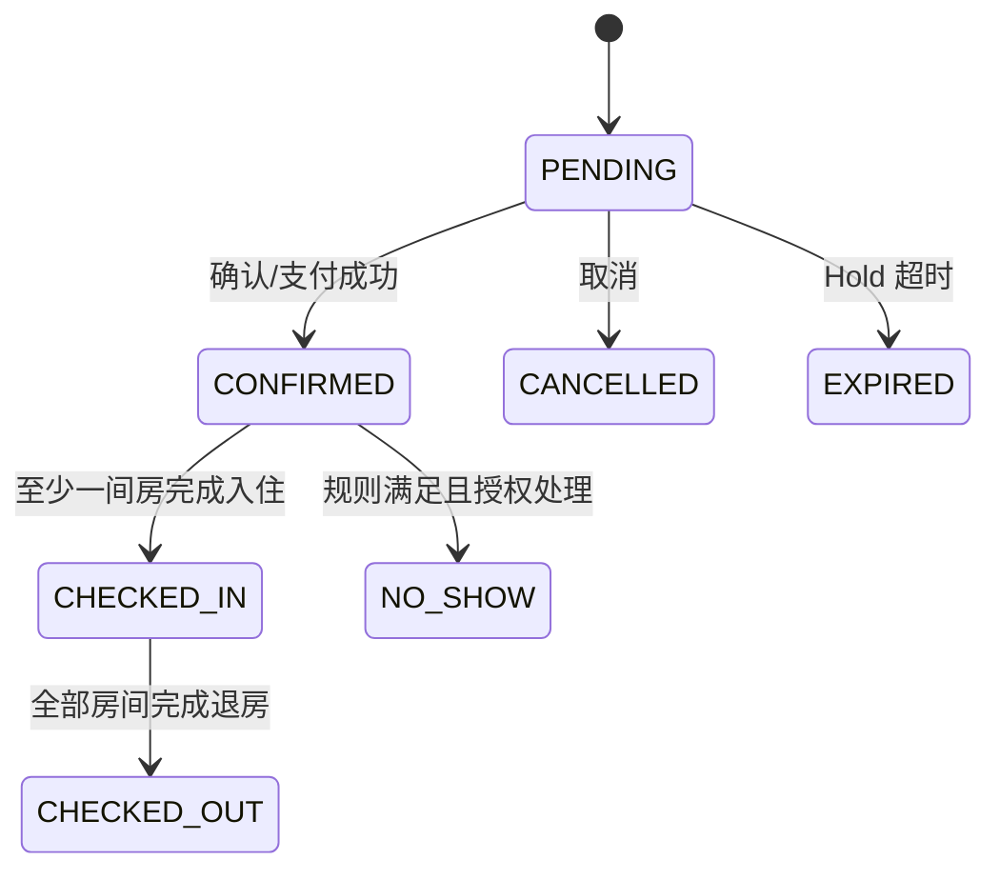
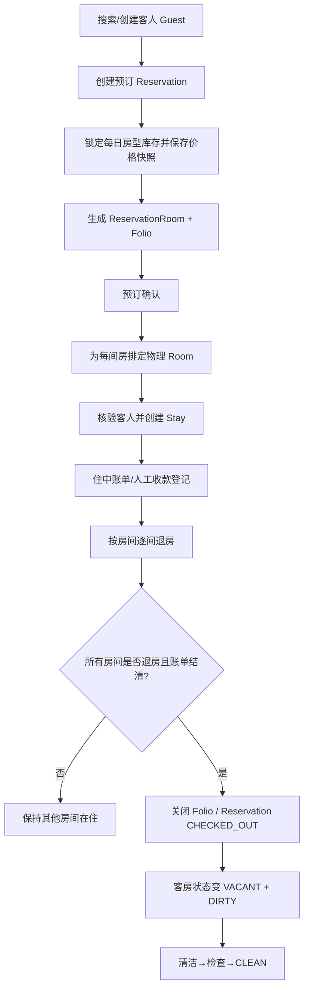

# PMS 五大模块重构需求设计方案：客人中心、房态中心与员工中心

> 文档版本：1.0（需求基线草案）  
> 编制日期：2026-11-02  
> 仓库：`wulei0214/django-hotel2`  
> 审查基线：`main@0abc31d2919773f4cb24ce67f2d365a346de4f6b`  
> 文档状态：基于现有代码审查形成的开发需求与验收基线；不是功能已上线的声明。  
> 适用范围：员工管理、顾客管理、客房管理、会员信息管理、客房订单管理，以及它们与前台入住、账单、房价库存的关联。

---

## 0. 本次重构的产品决策

### 0.1 核心决策

本次工作不按五张旧表分别美化页面，而是建立三个有明确职责的业务工作区：

1. **员工中心**：员工档案、物业任职、账号、岗位授权和旧员工资料映射。员工属于酒店组织内部主体，不与住客业务混合。
2. **客人中心**：以一份 `Guest` 住客档案聚合会员关系、预订、实际入住、账单和历史服务。顾客、会员、客房订单不再作为互不相干的孤立菜单。
3. **客房与库存中心**：以 `RoomType`、`Room`、`DailyRate`、`RoomTypeInventory` 为数据基础，提供房态看板、楼层视图、清洁任务、维修停用和未来日期库存视图。

五个旧菜单可以继续保留业务入口的名称，但后台页面和 API 应按上述业务域统一组织。页面互相跳转、共享上下文和展示关联数据；不得为方便展示而合并不相同的业务事实。

### 0.2 设计目标

- 员工可以从客人搜索进入客人档案，再进入该客人的预订、入住、账单；从订单可反向打开客人档案和所住房间。
- 前台能够围绕“今天要做什么”工作，而不是在顾客、会员、订单、房间四张互不关联的 CRUD 表之间反复跳转。
- 客房人员围绕清洁任务和房态工作，前台围绕可排房、抵店、在住、离店工作；两个岗位看到同一份房间事实，但操作权限不同。
- 所有五个模块的新接口采用同一响应结构、分页、错误、权限和审计规范。
- 新旧数据来源必须可辨认；在迁移完成前，不允许同一张列表无标识地混算两套数据。
- 所有关键业务写操作通过领域服务执行，前端不能直接修改库存、订单状态、房间状态或账务凭证。

### 0.3 非目标（本阶段不顺手扩张）

本次只建立统一页面、API 和迁移边界，不默认增加真实支付、OTA 自动同步、公安旅业系统、发票、复杂集团会员、积分商城、营销自动化或餐饮 POS。会员积分、积分兑换、权益包和等级自动升级必须另立业务规则，不在只有“普通/高级会员”两个旧等级的基础上凭空扩充。

---

## 1. 现有代码审查结论

### 1.1 当前主干事实

本方案基于 `main@0abc31d2919773f4cb24ce67f2d365a346de4f6b`。以下是代码现状，不等同于目标设计：

| 页面 / 路由 | 当前主要读写模型 | 当前情况 | 规划处理 |
|---|---|---|---|
| `/staff_accounts/` | `StaffProfile`、`PropertyStaffMembership`、`StaffRoleAssignment`、Django `User` | 新员工生命周期入口已具备建档、账号、岗位授权和状态操作；页面提示薪酬仍在旧员工页 | 作为员工中心主入口；薪酬等字段先明确归属与映射，不允许继续形成两个独立员工主档 |
| `/index/` | `hotelapp.Staff` | 旧员工 CRUD 页面，员工姓名、启用、职务、月薪、工龄仍来自旧表 | 先改为旧资料兼容 / 映射检查入口；不再作为第二套员工主档长期写入入口 |
| `/show_client/` | `hotelapp.Client` | 旧顾客表只保存姓名、身份证号；不是新预订系统住客档案 | 新客人中心以 `apps.guests.Guest` 为主；旧 Client 历史记录保留并提供迁移核验 |
| `/show_vip/` | `hotelapp.Vip` | 旧会员只有会员编号、姓名、等级、手机号；没有 Guest 关联、积分账本和会员权益模型 | 作为会员迁移来源；建立明确的会员关系模型前不可把旧等级伪装为已完整打通的新会员体系 |
| `/show_room/` | `hotelapp.Room` | 旧房间把房型文本、门市价、保洁负责人和单一房态放在一张表 | 新客房中心以 `inventory.Room` / `RoomType` / 日期库存 / 每日价格为准；旧房间只做映射来源 |
| `/show_accomodation/` | `hotelapp.Accommodation` | 旧订单绑定旧 Client 和旧 Room；旧状态、日期、押金和收款是历史字符串字段 | 新订单中心以 `Reservation` / `ReservationRoom` / `Stay` / `Folio` 为权威数据；旧订单只读归档或经核验迁移 |
| `/checkin/` | `Reservation`、`ReservationRoom`、`Guest`、`Stay`、`Room`、`Folio` | 新前台工作台已通过 `/api/v1/front-desk/` 查询并执行排房、入住、线下收款登记和退房 | 继续作为新业务操作入口；需要扩充客人中心和房态中心的关联查询、导航和后续操作 |
| `/checkin/legacy/` | `Accommodation`、旧 `Room`、`Client` | 旧版入住管理页面 | 完成迁移与回归后下线或变为只读归档入口 |
| `/home/` | 旧 `Accommodation`、`Room`、`Client`、`Vip` 等 | 运营统计部分仍取旧模型，容易与新前台统计口径不一致 | 改为从统一服务/API 聚合权威新模型；迁移期间分开展示 LEGACY 与 PMS2，不混算 |

注意：`hotelapp.Order` 是旧餐饮订单，不是客房订单；当前餐饮订单模块还受 `MODULE_REGISTRY` 门禁关闭。此实体不得混入本次客房订单重构，也不得用 `/show_order/` 作为客房订单列表。

### 1.2 明确存在的结构性问题

**问题 A：同一个业务主体有多个权威来源。** 新员工档案 `StaffProfile` 通过 `legacy_staff` 可链接旧 `Staff`，但不是全部旧员工都已映射。员工薪酬仍需去旧员工页，造成同一员工的基本资料和人事生命周期分散。

**问题 B：顾客与住客身份没有完整关联。** 旧 `Client` 使用身份证号作为主要可识别字段，没有手机号；新 `Guest` 使用物业范围内的标准化手机号唯一键。当前代码没有 `Client` 到 `Guest` 的明确映射。

**问题 C：会员是旧表标签，不是新会员域。** `Vip` 与 `Guest` 无关系；唯一手机号只在旧 Vip 表内约束，不能保证与 Guest 一一对应。等级只有普通/高级，没有积分、权益、有效期、成长值或等级变更记录。

**问题 D：客房数据结构已经发生变化，但旧页面没有迁移。** 旧 `hotelapp.Room` 把房型、价格、负责人和单一字符串房态放在同一行。新模型将房型、实际房间、占用、清洁、维修状态、房型每日库存和每日价格拆开。旧页面当前写入不能更新新前台读取的房态。

**问题 E：旧订单与新预订不是同一套记录。** 旧 `Accommodation` 是 Client + 物理 Room + 字符串日期和状态；新订单是 Reservation + Guest + ReservationRoom（销售房型、房价快照、日期）+ Stay（实际物理房间）+ Folio（账单）。不能把旧订单 ID 与新 booking_no 当成同一主键。

**问题 F：API 契约尚未统一。** 新 `/api/v1/front-desk/` 使用 `{data, meta}` 和嵌套错误对象；公共预订 API 的成功字段在顶层，错误字段有时为字符串；部分写接口在 `data` 外单独返回 `created` / `changed`。后续五模块 API 不能继续增加第三种格式。

**问题 G：危险的旧写入口需要收口。** 多个旧删除/冲账操作由 GET 路由执行；旧页面的订单/房间/顾客写入不统一走新领域服务。新页面不得继承这套模式。当前 `/home/` 的部分入住/客房/会员统计也仍读取旧模型，迁移后必须统一数据口径。

**问题 H：导航和工作台没有形成对象关系。** 侧栏同时展示“员工与账号管理”和“员工管理”；顾客、会员、房间、客房订单是分离 CRUD 页面；新前台又独立展示 PMS2 数据，用户不容易识别当前页面正在看哪套数据。

### 1.3 当前新模型可复用的基础

- 员工：`StaffProfile`、`PropertyStaffMembership`、`StaffRoleAssignment` 和 `EmployeeLifecycleService`。身份写操作必须继续走该服务。
- 客人：`apps.guests.Guest`，已包含物业、姓名、电话、标准化电话、邮箱、备注和隐私协议版本。
- 预订：`Reservation`（主单）与 `ReservationRoom`（逐间房明细），支持多房订单、每日房价快照、来源和状态。
- 实际入住：`Stay` 一条预订房明细对应一条实际入住记录。
- 客房：`RoomType`、`Room`、`RatePlan`、`DailyRate`、`RoomTypeInventory`。
- 账务：`Folio`、`Payment`、不可变 `LedgerEntry`。
- 前台：`apps/api/front_desk.py` 已有 overview、arrivals、departures、in-house、reservations、detail、rooms、assignable rooms、folio、assign、check-in、manual collect、check-out 等能力。

---

## 2. 目标信息架构与导航

### 2.1 一级菜单重新规划

左侧导航不再按旧数据库表一项一项罗列，改为按工作任务组织：

```text
酒店 PMS
├─ 运营工作台
│  ├─ 今日工作台
│  ├─ 抵店 / 离店 / 在住
│  └─ 预订管理
├─ 客人中心
│  ├─ 客人档案
│  ├─ 会员管理
│  └─ 客人历史与账单（从档案内进入）
├─ 客房中心
│  ├─ 房态总览
│  ├─ 清洁与检查
│  ├─ 客房资料（房型 / 房间）
│  └─ 房价与日期库存
├─ 员工中心
│  ├─ 员工档案
│  ├─ 账号与岗位授权
│  └─ 历史员工资料核对（仅迁移期）
├─ 财务与夜审（保留现有模块，按既有权限显示）
└─ 系统设置 / 权限管理
```

“客房订单管理”不再孤立成为一张旧式订单表；作为“预订管理”的列表视图，并可从客人档案、今日工作台和房态日历打开同一份订单详情。历史 `/show_accomodation/` 暂时兼容旧数据，不再作为新订单入口。

### 2.2 全局交互框架

所有新页面共用以下骨架：

- **左侧导航**：按工作域分组，基于当前物业有效岗位权限动态显示。
- **顶部栏**：当前酒店/物业、营业日期、全局搜索、当前员工与岗位。
- **全局搜索**：支持客人姓名/手机号（按权限脱敏匹配）、预订编号、会员号、房号、员工工号；结果项带实体类型与数据来源。
- **页面工具栏**：页面标题、面包屑、主操作、次操作；不能把所有动作堆成同等视觉权重按钮。
- **主内容区**：KPI（如有明确业务价值）+ 过滤器 + 数据列表或日历 + 右侧详情抽屉。
- **右侧详情抽屉**：展示当前业务对象，不离开列表上下文即可查看摘要、关联记录与允许操作。
- **状态反馈**：加载、空列表、无权限、字段校验、业务冲突、网络失败和保存成功必须是不同反馈。

### 2.3 UI 设计规范

视觉方向参考现代云 PMS 的高信息密度、低视觉噪声界面：浅灰/暖白工作区、深色文字、单一品牌强调色、状态色仅用于业务状态、统一 8/12/16/24px 间距体系、表格弱分隔线、明确 hover/focus、固定表头和一致的抽屉宽度。避免大面积渐变、过多彩色卡片、每行多个鲜艳按钮、页面顶部重复大标题。

布局基准：
- 桌面 1440px：侧栏约 220px，主内容最大宽度按 1280px，列表页预留 320–380px 右侧详情抽屉空间。
- 笔记本 1024–1280px：详情抽屉可覆盖式显示，筛选器换行。
- 平板/窄屏：表格改为信息卡片或横向滚动，主要操作留在详情页；不允许动作按钮挤出视口。
- 所有控件支持键盘操作、可见焦点、表单 label 和合理的错误提示。

---

## 3. 五个模块页面原型要求

以下为页面结构原型，不是像素级 UI 稿；开发应先按此制作静态原型，再接 API。

### 3.1 员工中心

**员工列表**：

```text
┌ 员工中心 / 员工档案                         [+ 新增员工] [导出*] ┐
│ 搜索姓名/工号/手机号  状态▼ 岗位▼ 账号状态▼  [重置] [查询]       │
│ 在职 24     暂停 2     未开通账号 3     无有效岗位 1               │
├──────────────────────────────────────────────────────────────────┤
│ 姓名/工号 | 岗位 | 任职状态 | 账号 | 当前角色 | 最后登录 | 操作   │
│ …                                                            ›   │
└──────────────────────────────────────────────────────────────────┘
* 导出只在明确的授权下显示；含敏感字段的导出单独授权。
```

**员工详情抽屉/详情页 Tab**：基本资料、物业任职、账号安全、角色授权历史、旧员工资料映射、人事变更审计。顶部固定显示员工当前在职、账号是否可用、当前岗位。薪酬、工龄等历史旧字段必须标记“旧员工资料 / 待核对”并受独立人事权限控制，不应混入普通岗位列表。

**必须保留的已有约束**：`EmployeeLifecycleService` 是员工生命周期唯一写入入口；不能直接操作 Django `User.groups` 授权；角色必须来自 `BUSINESS_ROLE_NAMES`；岗位授权要有操作者、开始/结束时间、原因；不能自我提权；停职/离职要按服务规则撤销任职/账号访问。

**新增体验**：
- 新增员工向导分三步：人员资料 → 物业任职 → 账号/初始角色；允许只建档不开账号。
- 搜索结果显示是否已映射 `hotelapp.Staff`，未映射不自动创建第二条员工档案。
- 详情页支持查看“旧员工记录”关联 ID 与数据核对状态；薪酬信息迁移策略确认前只读旧值。
- 员工停职/离职/恢复均使用确认弹窗，要求原因；操作完成刷新详情、列表和审计时间线。

### 3.2 客人中心（主业务入口）

**客人列表**：

```text
┌ 客人中心 / 客人档案                [创建预订] [登记客人] ┐
│ 全局搜索姓名/手机号/预订号/会员号                        │
│ 标签：全部 | 当前在住 | 即将抵店 | 有未结账单 | 会员       │
│ 来源：全部/PMS2/历史档案    最近入住▼   会员等级▼          │
├──────────────────────────────────────────────────────────┤
│ 客人 | 联系方式* | 会员 | 最近入住 | 下次抵店 | 当前状态 │
│ …                                                  详情 › │
└──────────────────────────────────────────────────────────┘
* 默认脱敏，不显示完整身份证/手机号；字段级授权可解密展示并留审计。
```

**客人详情**使用单一主档 Header + 标签页：
1. 概览：姓名、脱敏电话、邮箱、会员标签、当前入住状态、最近一次/下一次入住、未结账单余额（有账单权限才展示）。
2. 预订：当前、未来、历史、取消/未到订单；每张订单卡显示订单号、来源、状态、入住/离店、间数、房型、分配房号、订单金额、账单摘要。
3. 入住历史：实际 Stay 的房间、入住/离店实际时间、状态。
4. 账单与支付：Folio、LedgerEntry、Payment 状态；只读展示不可变凭证；财务写操作按独立权限显示。
5. 会员：会员号、等级、状态、加入日期、来源映射；没有积分/权益模型前不展示虚构积分余额。
6. 资料与偏好：Guest 当前字段；隐私同意版本和备注。敏感身份信息独立权限和审计。
7. 操作日志：档案修改、预订创建、排房、入住、收款登记、退房等可追溯记录。

**常见操作入口**：从客人档案发起预订、打开当前在住订单、查看未结账单、登记会员关系；不允许从客人资料页直接更改库存或伪造支付成功。

### 3.3 会员管理（客人中心子域）

会员不是独立的人物主档，而是 Guest 之上的会员关系。会员列表应展示会员号、客人、等级、状态、加入时间、累计入住次数/累计消费（只有按确定口径可算且有相应权限时才显示）、最近入住。

**会员详情**返回客人档案的会员 Tab，不复制姓名/手机号作为另一份可独立修改的主档。会员列表默认只能从已经关联的 Guest 打开；未能核验的历史 Vip 记录归入“待匹配历史会员”，不得出现在新会员总数中。

**本阶段边界**：可以先支持旧会员等级导入为“历史等级”，但必须记录来源、迁移时间、审核人和映射状态。不开发积分发放、积分扣减、积分过期、等级自动升降、优惠券、会员价等功能，直至积分与权益规则经业务确认并建立账本模型。

### 3.4 客房与库存中心

客房首页默认是房态看板，不是旧版 CRUD 表格。

```text
┌ 客房中心 / 房态总览             [房态日历] [房间资料] [房价库存] ┐
│ 日期：今天 ▼   楼层▼ 房型▼ 清洁状态▼ 维修状态▼ [刷新]          │
│ 可入住净房 18 | 在住 32 | 待清洁 4 | 清洁中 2 | 待检查 1 | 维修 1 │
├────────────────────────────────────────────────────────────────┤
│ 1F  [101 净房] [102 在住] [103 脏房] [105 待检查]                 │
│ 2F  [201 清洁中] [202 净房] [203 维修停用] …                      │
│ 点击房卡 → 右侧房间详情：房型/楼层/状态三维度/当前 Stay/下一订单 │
└────────────────────────────────────────────────────────────────┘
```

房间详情：物理房号、房型、楼层、当前占用、清洁、维修状态、当前住客/Stay（授权可见）、下一条有效预订、设备设施、最近清洁检查和维修日志。

页面 Tab：
- 房态总览：楼层/房型分组的卡片图，显示三维状态。
- 房间列表：物理客房资料、启用状态、房型和房间号搜索。
- 清洁任务：脏房、清洁中、待检查、已完成；按楼层/负责人过滤。
- 房型管理：销售房型编码、名称、容量、床型、设施、是否启用。
- 价格与库存：按入住日期展示房型日库存、每日价格、停售/停用；日期选择器 + 日历/表格。

**重要概念**：当前物理房间净房可用，不代表未来某日期有库存；`RoomTypeInventory` 才是按房型、住宿日计算的销售库存。禁止把“当前净房数量”当作“未来可订量”。占用、清洁、维修是三个独立状态维度，不得再用一个互相覆盖的 `房间状态` 字段承载所有事实。

### 3.5 客房订单 / 预订管理

订单主入口为列表 + 任务视图切换：全部预订、待确认/待支付、已确认、今日抵店、今日离店、在住、已退房、取消/过期、未到店。全局搜索支持预订编号、客人姓名、脱敏手机号匹配、房号。

详情页布局：

```text
┌ Rxxxxxxxx | 已确认 | 官网预订             [打印/更多] ┐
│ 客人卡片：姓名/电话脱敏/会员标签 [打开客人档案]       │
│ 入住 2026-11-05 → 离店 2026-11-07 · 2晚 · 2间          │
├──────────────────────────────────────────────────────┤
│ 房间明细 1：房型 / 价格快照 / 排房房号 / Stay 状态     │
│ 房间明细 2：房型 / 价格快照 / 排房房号 / Stay 状态     │
├──────────────────────────────────────────────────────┤
│ 账单：房费 | 已收 | 退款/押金抵扣 | 当前余额 [打开账单] │
│ 时间线：创建→确认→排房→入住→收款→退房                 │
│ 操作区：只展示当前状态、岗位和账单都允许的操作          │
└──────────────────────────────────────────────────────┘
```

列表按“订单主单”展示，但详情中的 `ReservationRoom` 必须逐间列出。多房预订可以部分入住、部分退房；Reservation 只有在其所有房间 Stay 都结束后才可变为已退房。客人侧展示所有关联订单；订单侧只能展示当前预订有关的客人、Stay、Room、Folio。

主按钮遵循状态上下文：待支付/确认状态不出现手工收款入口；已确认且尚未入住可排房/入住；已入住可查看在住明细/按账单规则收款/退房；已结束/取消/过期只读。所有动作由后端计算 `allowed_actions` 并二次校验。

---

## 4. 新旧数据关系与迁移规则（P0）

### 4.1 权威数据源矩阵

| 业务对象 | PMS2 权威模型 | 历史来源 | 最终规则 |
|---|---|---|---|
| 员工自然人 | `identity.StaffProfile` | `hotelapp.Staff` | Profile 是身份主档；旧 Staff 仅保留薪酬/工龄等待迁移资料或历史记录；现有 `legacy_staff` 映射复用 |
| 员工登录与岗位 | `auth.User` + `PropertyStaffMembership` + `StaffRoleAssignment` | 旧 `Staff.启用/职务`、Django Group 旧分配 | 账号和实际授权按 EmployeeLifecycleService；旧职务不等于 PMS2 角色授权 |
| 客人/住客 | `guests.Guest` | `hotelapp.Client`、`hotelapp.Accommodation` 中的顾客信息 | 新建预订只引用 Guest；Client 保留历史来源，核验后映射，不以身份证号或姓名直接自动合并 |
| 会员关系 | 需要新增明确 Loyalty/Membership 域模型（本方案规划） | `hotelapp.Vip` | Guest 是人，会员是 Guest 的业务关系；旧 Vip 单独作为迁移候选，不是 Guest 替代品 |
| 房型 | `inventory.RoomType` | `hotelapp.Room.客房类型` 文本 | 由旧房型文本经标准化和人工核验映射，不能每个房间简单复制成不同房型 |
| 物理客房 | `inventory.Room` | `hotelapp.Room` | PMS2 Room 是当前房间运行事实；旧 Room 映射成功后只读；未映射旧房不可进入新排房逻辑 |
| 每日卖价 | `inventory.DailyRate` + `RatePlan` | `hotelapp.Room.价格` 整数 | 旧价格不可直接作为无期限现行价；迁移时必须明确计划、起止日期、币种和生效日 |
| 每日销售库存 | `inventory.RoomTypeInventory` | 旧 Room 数量和旧状态 | 根据 PMS2 物理房间、停用策略和日期规则建立；当前净房状态不直接替代未来库存 |
| 预订主单 | `reservations.Reservation` | `hotelapp.Accommodation` | 新建订单只用 Reservation；旧订单需逐条判定资料完整度，无法还原预订合同的保留 LEGACY 归档 |
| 预订房间明细 | `ReservationRoom` | 旧 Accommodation 中单房关联 | 一条旧 Accommodation 不能自动假定等价于一间新 ReservationRoom；多房和房价快照需核对 |
| 实际入住 | `reservations.Stay` | 旧 Accommodation 的已入住/退房状态 | 有可信入住/退房事实才映射；缺失实际时间应标注历史未知，不补造时间 |
| 账单与支付 | `billing.Folio` / `Payment` / `LedgerEntry` | `hotelapp.Folio` / `FinanceRecord` / Accommodation 字段 | 旧汇总金额不是渠道 Payment；保留历史账务语义，迁移必须财务对账，不得重复入账 |

### 4.2 迁移映射表要求

建议新增统一 `LegacyRecordLink`（实体命名可在技术评审时调整），至少包含：

- `property_id`
- `source_system`（如 `HOTELAPP_V1`）
- `source_model`（Client / Vip / Room / Accommodation / Staff）
- `source_pk`（保存原始主键字符串）
- `target_model`、`target_pk`
- `mapping_status`：`UNREVIEWED` / `MATCH_CANDIDATE` / `LINKED` / `CONFLICT` / `IGNORED`
- `match_method`：人工确认、已验证业务键、规则候选等
- `reviewed_by`、`reviewed_at`、`review_note`
- `created_at`、`updated_at`

唯一约束：同一 property + source_system + source_model + source_pk 只能关联一个目标记录；同一来源记录不能静默链接两个 Guest。映射确认需审计，禁止只靠手机号匹配自动执行写合并。

员工已有 `StaffProfile.legacy_staff` OneToOne 可先复用，但需要为未映射旧员工建立核对清单和迁移状态；不要再新建重复员工主档。

### 4.3 旧顾客 / 会员候选匹配

- Client 可能只有姓名、身份证号；Accommodation 另有电话副本；不得推定 Client 记录自带电话。
- Vip 有姓名、会员等级、联系方式；Guest 有物业范围的 `phone_normalized` 唯一值。
- 同手机号只能生成候选；姓名不一致、共享电话、重复 Guest、同一人多号码、历史号码回收等情况都进入 `CONFLICT` 人工复核。
- 身份证号属于高敏个人信息；不应为了匹配把旧身份证号明文复制到 Guest。先确认收集目的、访问权限、加密/脱敏、保留周期和适用规则。
- 会员等级迁移需保留 `legacy_rank` 和来源记录；在会员规则未通过评审前，不把等级映射成未来等级权益。

### 4.4 旧房间与旧订单迁移

- `hotelapp.Room.客房类型` 需要整理成 `RoomType` 主数据；一间房的房型对应一个稳定 `room_type_id`。
- 楼层、设施和房型容量缺失时留空/待补，不能编造。PMS2 `Room` 当前也没有与旧 `负责人编号` 等价的清洁负责人字段；若要支持任务派工，应新增 HousekeepingTask/TaskAssignment 等业务对象，不能把旧员工 ID 直接塞入房间字段或在界面显示虚假的负责人。
- 旧房态向新三维房态的映射需要明确状态映射表；未知、矛盾或维修中但旧状态为空的数据进入人工核验。
- 旧房价只有整数门市价，没有生效日和计划策略。若要生成 DailyRate，必须先确认以哪一天开始生效，不能回填成历史全日期售价。
- `Accommodation` 的字符串入住日、退房日、收款金额、押金和状态不足以保证还原 Reservation、Stay、Folio、Payment、LedgerEntry 全链路。迁移脚本必须按字段完整性分组；可还原的建立映射并对账，无法还原的只读历史展示。
- 任何历史 `收款金额` 不得凭字段值创建成功渠道 Payment；若需迁移财务账务，必须保留“历史人工汇总/历史账本”的来源类型，并由财务核对。

### 4.5 过渡期显示原则

迁移期允许同屏显示历史和新数据，但每一条记录必须显示来源标识：`PMS2` / `LEGACY`，并有映射状态。默认指标只统计指定权威来源；不得把两个来源的数量、入住量、收入、会员数直接相加。需要合并视图时，必须先按映射关系去重，并在指标 tooltip 中说明口径。

不允许无约束双写。若某一阶段确实需要双写，必须定义唯一写入源、事务失败补偿策略、重试、对账任务、冲突处理与停写开关；默认方案采用“新入口写 PMS2，旧入口只读”。

---

## 5. 统一 API 契约（五模块共同规范）

### 5.1 API 基础规范

- 前缀：`/api/v1/`；所有新模块 API 采用 JSON。
- 命名：复数资源名，路径使用 kebab-case；动作接口使用明确动词子资源。
- 时间：日期 `YYYY-MM-DD`；时间使用带时区偏移的 ISO 8601。
- 金额：JSON 字符串十进制，例如 `"188.00"`，同时返回 `currency`，禁止用浮点数。
- 布尔值严格为 true/false；状态使用稳定英文 code，另给 `status_label` 中文显示值。
- 列表默认 `page=1&page_size=20`，最大 100；排序字段必须白名单。
- 物业上下文从服务端请求身份/当前物业取得；不得接受客户端传来的 `property_id` 作为授权依据。
- 写接口必须验证 CSRF；创建订单、收款、状态转换等关键动作支持 `Idempotency-Key`。
- 所有业务读写都进行认证、当前物业任职、动作级权限校验；不可只靠隐藏菜单或前端 `allowed_actions`。

### 5.2 成功响应统一外层

单对象、集合、动作接口一律返回：

```json
{
  "data": {},
  "meta": {
    "request_id": "req_...",
    "source_system": "PMS2",
    "generated_at": "2026-11-02T16:00:00+08:00",
    "pagination": {
      "page": 1,
      "page_size": 20,
      "total": 128,
      "has_next": true,
      "has_previous": false
    }
  }
}
```

非分页详情接口可省略 `pagination`；列表 `data` 一律是数组。动作响应将 `data` 作为本次变更后的对象或变更摘要，不得在 `data` 外零散返回 `changed` / `created`。

### 5.3 错误响应统一外层

```json
{
  "error": {
    "code": "BUSINESS_CONFLICT",
    "message": "该房间在所选住宿日期内已被占用。",
    "field_errors": {},
    "retryable": false
  },
  "meta": { "request_id": "req_..." }
}
```

状态码及错误码：

| HTTP | 错误码 | 含义 |
|---|---|---|
| 400 | `VALIDATION_ERROR` | 参数格式/字段校验失败 |
| 401 | `AUTHENTICATION_REQUIRED` | 未登录/登录失效 |
| 403 | `PERMISSION_DENIED` | 已登录但缺少动作权限 |
| 404 | `RESOURCE_NOT_FOUND` | 当前物业内资源不存在，不泄露其他物业记录 |
| 409 | `BUSINESS_CONFLICT` | 状态不允许、库存冲突、幂等键复用冲突 |
| 429 | `RATE_LIMITED` | 超过请求频率 |
| 500 | `INTERNAL_ERROR` | 未预期异常；只返回 request_id，不暴露堆栈 |

### 5.4 通用字段约定

所有业务资源：

| 字段 | 类型 | 说明 |
|---|---|---|
| `id` | integer/string | PMS2 资源 ID；仅作为本系统资源标识 |
| `source_system` | string | `PMS2` 或 `LEGACY` |
| `source_record_id` | string/null | 历史源主键；新数据为空 |
| `mapping_status` | enum/null | 历史映射状态；非历史数据可空 |
| `created_at` / `updated_at` | ISO datetime | 创建、更新时间 |
| `allowed_actions` | object | 当前用户允许的动作及必要原因；服务端每次动作仍重新校验 |

统一客人摘要：

```json
{
  "guest": {
    "id": 52,
    "full_name": "张某某",
    "phone_masked": "138****1234",
    "member": {"is_member": true, "member_no": "M00052", "level": "STANDARD"}
  }
}
```

完整电话、证件号不得出现在普通列表 DTO。需要揭示时使用独立的敏感信息接口和权限，并写审计日志。

### 5.5 建议资源接口目录

本节先定义各资源对前端提供的字段，再列出推荐路径。所有新接口逐步归入该资源目录。

### 5.5.1 列表与详情 DTO 字段基线

下列字段是前端依赖的稳定契约，不要求一次性把所有字段都开发出来；任何尚未有模型支撑的字段不得用默认值伪装真实数据。敏感字段必须按权限裁剪。

**Staff DTO**

| 字段 | 类型 | 说明 |
|---|---|---|
| `id` | integer | StaffProfile ID |
| `full_name` / `phone_masked` | string | 员工姓名、脱敏手机号 |
| `employee_no` / `position_code` | string | 当前物业工号、岗位代码 |
| `employment_status` / `membership_status` | enum | 员工档案状态、物业任职状态分别返回 |
| `account` | object/null | `username`、`is_active`、`last_login`；不返回密码 |
| `active_roles` | array | 当前生效角色名称和授权有效期 |
| `legacy` | object | 是否关联旧 Staff、来源主键、映射状态 |
| `allowed_actions` | object | `edit_profile`、`manage_account`、`assign_role`、`change_status` 等布尔值/原因 |

**Guest DTO**

| 字段 | 类型 | 说明 |
|---|---|---|
| `id` | integer | Guest ID |
| `full_name` / `phone_masked` | string | 客人姓名、脱敏手机号 |
| `email` | string/null | 邮箱；按资料权限展示 |
| `member` | object/null | 是否会员、会员号、等级、会员状态 |
| `current_stay` | object/null | 当前房号、实际入住时间；无入住为 null |
| `next_reservation` | object/null | 最近一张未来有效订单摘要 |
| `last_stay_at` | ISO datetime/null | 最近一次实际入住时间 |
| `open_balance` | decimal string/null | 有账务查看权限时返回，不授权时省略，不得返回 0 伪装无欠款 |
| `source_system` / `mapping_status` | string/enum | 来源及迁移状态 |

**Membership DTO**

`id, member_no, guest{id,full_name,phone_masked}, level_code, status, joined_at, ended_at, legacy_rank, source_system, mapping_status, allowed_actions`。积分与权益字段暂不定义；只有后续模型和账本确立后才加入。

**Room DTO**

`id, number, floor, room_type{id,code,name,capacity}, occupancy_status, housekeeping_status, maintenance_status, is_active, is_ready, current_stay_summary?, next_reservation_summary?, source_system, updated_at, allowed_actions`。`is_ready` 为服务端计算结果；未来预订冲突不能只靠该字段判断。

**RoomType / Inventory DTO**

`RoomType`: `id, code, name, capacity, bed_type, amenities, is_active`。
`RoomTypeInventory`: `room_type{id,code,name}, stay_date, total_rooms, held, sold, out_of_service, available_count, stop_sell, version, source_system`。库存明细只允许由库存服务更新。
`DailyRate`: `rate_plan{id,code,name}, room_type{id,code,name}, stay_date, price, currency, closed, min_stay, max_stay`。

**Reservation DTO**

`booking_no, status, status_label, source, source_label, guest{id,full_name,phone_masked,member?}, check_in, check_out, nights, room_count, adult_count, child_count, total_amount, currency, rooms[], folio_summary, timeline, source_system, allowed_actions`。

`rooms[]` 每项最少包括 `reservation_room_id, room_type, assigned_room, check_in, check_out, nightly_rates, amount, stay{id,status,actual_check_in,actual_check_out}`。列表摘要与详情字段可不同，但关键字段命名不得在不同接口内改变。

**Folio 摘要 DTO**

`folio_id, status, charges, credits, balance, currency, pending_payment_count`。账单明细接口另返回 `entries[]` 与 `payments[]`；不能把支付状态和账单余额合并成一个字段。

### 5.5.2 前端动作能力字段

详情 DTO 的 `allowed_actions` 应是具名布尔字段 + 可读原因，例如：

```json
{
  "allowed_actions": {
    "assign_room": {"allowed": true, "reason": null},
    "check_in": {"allowed": false, "reason": "请先完成排房"},
    "collect_manual_payment": {"allowed": false, "reason": "预订尚未确认"},
    "check_out": {"allowed": false, "reason": "当前无在住记录"}
  }
}
```

前端不再通过自己复制状态机、硬编码状态字符串来推断业务动作。当前前台详情接口只返回 `allowed_actions: ["view_detail"]`，本需求要求逐步返回真实动作能力；旧 API 兼容期间保留当前行为，新增页面不能将其解释成“所有操作均可用”。

### 5.5.3 全局指标口径

- `arrivals_today`：入住日为营业日且状态为 CONFIRMED 的预订房间明细；`PENDING` 应单列为“待确认/待支付”，不能混称已确认应到。
- `unassigned_arrivals`：上述已确认应到且 `assigned_room` 为空的房间明细数。
- `in_house`：`Stay.status=IN_HOUSE` 的间数，不是 Reservation 主单数；另有主单数时必须另命名。
- `departures_today`：`Stay.status=IN_HOUSE` 且明细 `check_out` 为营业日的间数。
- `clean_available`：新 Room 的 VACANT + CLEAN + NORMAL + active 数量；不是未来某日可售库存。
- `member_count`：只统计已映射且有效的会员关系；待核验 Legacy Vip 独立统计。
- `guest_count`：同物业 Guest 唯一档案数；Legacy Client 单独统计，或经过映射去重后统计，不允许两套直接相加。
- `revenue` / `outstanding_balance`：必须由账本凭证聚合，定义营业日、支付状态、币种和退款方向；不得用旧订单收款字符串直接与 LedgerEntry 相加。

### 5.5.4 当前 Guest 复用行为的明确要求

目前预订服务按 `property + phone_normalized` 执行 `Guest.get_or_create()`；如果同一手机号已存在，当前代码不会自动更新已有 Guest 的 `full_name`。新接口必须把“命中同一标准化手机号”与“确认是同一自然人”区分开：检测姓名不一致时返回 `IDENTITY_REVIEW_REQUIRED` / 冲突提示，允许前台人工核验后修改档案；不得用新订单输入的姓名悄悄覆盖现有 Guest，也不得悄悄把不同人合并。手机号格式标准化策略应集中于服务层并写测试。

### 5.5.5 建议资源接口目录

#### 员工中心

| 方法 / 路径 | 用途 | 关键请求字段 |
|---|---|---|
| `GET /staff` | 员工列表 | `q,status,role,account_status,page,page_size` |
| `POST /staff` | 建立员工档案与任职 | `full_name,employee_no,position_code,phone,started_at,legacy_staff_id?` |
| `GET /staff/{id}` | 员工详情 | — |
| `PATCH /staff/{id}/profile` | 修改允许修改的员工资料 | `full_name,phone` 等白名单字段 |
| `POST /staff/{id}/account` | 开通/绑定账号 | `username,password`；密码不可返回 |
| `POST /staff/{id}/role-assignments` | 新增岗位授权 | `role,starts_at,ends_at,reason` |
| `POST /staff/{id}/employment-transitions` | 暂停/恢复/离职 | `status,reason,effective_at` |
| `GET /staff/{id}/audit-events` | 员工操作审计 | `page,page_size` |

写入必须调用 `EmployeeLifecycleService`；工资、工龄数据未确定归属前不得在新 API 中随意增设重复字段。

#### 客人中心与会员

| 方法 / 路径 | 用途 | 关键请求字段 |
|---|---|---|
| `GET /guests` | 客人列表 | `q,current_status,is_member,source_system,visited_from,visited_to,page,page_size` |
| `POST /guests` | 前台登记客人 | `full_name,phone,email,notes,consent_version` |
| `GET /guests/{id}` | 客人详情摘要 | — |
| `PATCH /guests/{id}` | 修改客人允许字段 | `full_name,phone,email,notes`；电话变更需冲突检查 |
| `GET /guests/{id}/activity` | 聚合预订、入住、账单历史 | `type,from,to,page,page_size` |
| `GET /memberships` | 会员列表 | `q,level,status,source_system,page,page_size` |
| `POST /guests/{id}/membership` | 开通会员关系 | `level,joined_at,legacy_link_id?` |
| `GET /guests/{id}/membership` | 会员详情 | — |
| `PATCH /memberships/{id}` | 修改会员状态/等级（需规则） | `level,status,reason` |
| `GET /guests/{id}/pii` | 揭示敏感资料 | 仅授权后调用，记录访问人、原因 |

`Membership` / `LoyaltyMembership` 是建议新增的实体，字段和业务规则在数据库评审时最终确定。最低建议字段：`property, guest, member_no, level_code, status, joined_at, ended_at, source_legacy_vip, created_at, updated_at`；同物业 Guest 至多一条当前有效会员关系。积分/权益账本另行设计，不可先用一个 points 数字字段代替账本。

#### 客房与库存

| 方法 / 路径 | 用途 | 关键请求字段 |
|---|---|---|
| `GET /room-types` | 房型列表 | `active,q,page,page_size` |
| `POST /room-types` | 创建房型 | `code,name,capacity,bed_type,amenities,is_active` |
| `PATCH /room-types/{id}` | 修改房型资料 | 允许字段白名单；已有订单引用的代码不可随意改 |
| `GET /rooms` | 房间列表/状态 | `q,floor,room_type_id,occupancy_status,housekeeping_status,maintenance_status` |
| `POST /rooms` | 创建物理房间 | `number,floor,room_type_id` |
| `PATCH /rooms/{id}` | 修改非交易型资料 | `floor,room_type_id,is_active`；在住房间禁止修改关键属性 |
| `POST /rooms/{id}/housekeeping-transitions` | 清洁状态转换 | `target_status,reason?` |
| `POST /rooms/{id}/maintenance-transitions` | 维修停用/恢复 | `target_status,reason,expected_restore_at?` |
| `GET /room-inventory` | 日期库存日历 | `from_date,to_date,room_type_id` |
| `GET /daily-rates` | 每日价格 | `from_date,to_date,room_type_id,rate_plan_id` |
| `POST /daily-rates/bulk` | 批量设置每日价格 | `rate_plan_id,room_type_id,dates,price,currency,closed` |

房态转换由独立领域服务处理；`RoomTypeInventory` 的库存更新必须与现有库存服务策略一致，不能从页面直接改 `held/sold`。

#### 预订与入住

已有 `/api/v1/front-desk/` 接口保留兼容；新规范逐步归一到资源目录：

| 方法 / 路径 | 用途 | 关键请求字段 |
|---|---|---|
| `GET /reservations` | 订单列表 | `q,status,source,check_in_from,check_in_to,check_out_from,check_out_to,guest_id,page,page_size` |
| `POST /reservations` | 新建预订 | 保持既有预订服务的日期、房型、房间数、人数、联系资料和 Idempotency-Key 规则 |
| `GET /reservations/{booking_no}` | 订单详情 | — |
| `POST /reservations/{booking_no}/room-assignments` | 排房/分配一间房 | `reservation_room_id,room_id` |
| `POST /reservations/{booking_no}/check-ins` | 办理一条房间明细入住 | `reservation_room_id` |
| `POST /reservations/{booking_no}/manual-payments` | 登记已实际收到的线下款 | `amount,method` + Idempotency-Key |
| `POST /reservations/{booking_no}/check-outs` | 退一间房 | `stay_id` |
| `POST /reservations/{booking_no}/cancellations` | 取消预订 | `reason` |
| `POST /reservations/{booking_no}/no-show` | 未到店处理（规划） | `reason,release_inventory`；上线前定义退款/费用规则 |
| `POST /stays/{id}/room-moves` | 换房（规划） | `target_room_id,reason,effective_at`；必须有房间移动历史/账务处理设计 |
| `POST /reservation-rooms/{id}/extensions` | 续住（规划） | `new_check_out,rate_plan_id,reason`；必须同时检查新增晚库存、价格快照和 Folio 账务 |

换房、续住、未到店不可通过直接 PATCH `assigned_room` / `check_out` / `status` 完成。必须实现独立服务、数据库事务、事件/审计和完整回归后再开放。

### 5.6 兼容与废弃策略

- 当前 `/api/v1/front-desk/` 作为兼容层保留，不因统一响应封套而一次性修改顾客端 `/reserve/`。
- 建立共享 API 响应工具，新增 API 立即使用；现有端点按消费者逐个迁移，并用契约测试保障旧 JS 不破坏。
- 任何旧响应结构调整前，必须先搜索所有调用方（模板、static JS、测试、外部页面），提供兼容版本或 adapter。
- 所有状态写操作必须是 POST/PATCH/DELETE；旧 GET 删除/冲账入口在替换后禁用，保留只读查询。

---

## 6. 权限矩阵与字段安全

### 6.1 权限设计原则

- 资源访问权限与动作权限分开；“能看列表”不代表“能查看完整隐私”或“能执行退房”。
- 物业范围由后端身份上下文确定，跨物业请求不得泄露资源是否存在。
- UI 可以按后端 `allowed_actions` 隐藏按钮，但后端每次仍校验操作者、当前物业、任职、权限、状态、库存及账单约束。
- 高风险动作要求操作原因、审计事件和确认步骤。
- 新权限上线前，定义旧权限兼容映射，避免已有岗位突然失权或被意外扩大授权。

### 6.2 建议动作权限矩阵

| 功能 | 查看 | 创建/编辑 | 执行敏感动作 | 敏感信息 |
|---|---|---|---|---|
| 员工档案 | `identity.staff_manage`（现有页面权限，未来拆细） | 新增 `identity.staff_create` / `identity.staff_edit` | `identity.staff_status_manage`、`identity.staff_role_assign`、`identity.staff_account_manage` | `identity.staff_pii_view`、`identity.staff_salary_view`、`identity.staff_export`（规划） |
| 客人档案 | `guests.profile.view`（规划；迁移期映射旧 `hotelapp.view_client`） | `guests.profile.create/edit`（规划） | 合并档案需独立 `guests.profile.merge`（规划） | `guests.pii.reveal`、`guests.pii.export`（规划） |
| 会员 | `loyalty.membership.view`（规划） | `loyalty.membership.manage`（规划） | 等级/积分调整需 `loyalty.adjust`（规划） | 电话/身份数据按 PII 权限 |
| 客房 | 旧 `hotelapp.view_room` 对应查看；逐步转 `inventory.room.view` | 旧 `hotelapp.add_room/change_room` 兼容新 `inventory.room.manage` | `inventory.housekeeping.transition`、`inventory.maintenance.manage`、`inventory.room_release_ready` | 房间备注不含客人隐私；当前住客信息需相应客人查看权限 |
| 预订 | 旧 `hotelapp.view_accommodation` 作为迁移期读权限 | 新 `reservations.manage`（规划） | `frontdesk.assign_room`、`frontdesk.check_in`、`frontdesk.check_out`、`frontdesk.cancel`、`frontdesk.no_show`（规划） | 客人 PII 和账单分别校验 |
| 账单/收款 | `billing.folio.view`（规划，可兼容现有查看门禁） | `billing.payment.receive_manual`（规划） | `billing.refund.execute`、`billing.entry.reverse`（规划） | 导出或查看完整支付参考信息需独立权限 |

以上新增权限代码为**目标权限名**，当前不代表已经配置。实施时先生成现有 Group / Permission 矩阵快照，再制定旧权限向新权限的兼容映射；不允许直接将所有管理操作映射给同一通用 `change` 权限。

### 6.2.1 按岗位的默认权限边界

此表是业务权限设计目标，须映射到现有角色模板并经店长/运营确认；它不是当前 Group 权限事实。

| 岗位 | 客人/会员 | 预订与入住 | 客房中心 | 财务 | 员工中心 |
|---|---|---|---|---|---|
| 前台 | 查找客人、维护必要联系资料、查看会员标识 | 查看/创建预订、排房、办理入住/退房、登记已实际收到的线下款 | 查看房态与可排房间 | 查看必要账单摘要，不得执行退款/冲销 | 无员工档案维护权 |
| 客房服务员 | 不显示完整客人隐私，仅按任务需要查看房号/入住提示 | 不可查看完整订单账务，不办理入住/退房 | 查看房态、执行清洁开始/完成 | 无 | 无 |
| 值班经理 | 按职责查看客人档案；敏感资料揭示需单独授权 | 处理排房异常、授权 No-Show/换房等特殊动作（功能上线后） | 维修/检查放行与异常处理 | 可按授权审核异常，不默认拥有所有财务冲销权 | 无默认员工岗位授权权 |
| 财务 | 仅查看账务所需客人识别信息 | 查看预订/Stay 关联及结账状态 | 只读查看房间业务背景 | 查看账单、收款、退款/冲销按独立权限执行 | 无 |
| 店长 | 查看经营所需客人/会员信息，PII 仍需显式权限 | 查看并审批高风险业务操作 | 管理房型、房间和停用规则 | 查看经营账务并按授权审批异常 | 员工建档、账号、任职和角色授权（遵守职责分离） |
| 夜审员 | 仅查看夜审所需客人/预订摘要 | 夜审相关订单只读/夜审动作独立授权 | 读取占用/房态 | 执行夜审、核对营业日账务 | 无 |
| 系统超级管理员 | 技术管理身份不自动获得客人业务明文 | 不自动拥有前台业务动作权 | 不自动拥有房态操作权 | 不自动拥有真实财务操作权 | 技术管理与业务角色分离 |

### 6.3 特别敏感字段

- 旧 `Client.身份证号`：默认不进入新 Guest 通用 DTO；列表和常规详情不展示明文。
- 手机号：列表默认掩码；手机号检索只在授权上下文允许的情况下执行；完整手机号揭示要审计。
- 工资/月薪：只向独立薪酬授权人员显示；不得随普通员工列表导出。
- 密码：只能接受写入，永远不返回；日志中不能出现密码。
- Folio/Payment：客房、员工、非财务岗位不得自动获得完整账务编辑权限。
- 会员资料：旧等级不是敏感字段，但会员账户合并/等级调整属于受控业务操作。

---

## 7. 状态流转与业务闭环

### 7.1 预订与入住状态

当前新 `Reservation.Status`：`PENDING`、`CONFIRMED`、`CANCELLED`、`EXPIRED`、`CHECKED_IN`、`CHECKED_OUT`、`NO_SHOW`。其中 `PENDING` 为待支付/待确认；已确认后才能正常分配房间；入住日期不得早于酒店当地今天；入住后创建 Stay。

目标状态流：



约束：
- 订单主状态和订单内每间房的履约状态分开；部分办理入住时 Reservation 为 `CHECKED_IN`，但各 ReservationRoom/Stay 仍需分别显示。
- `ReservationRoom`：未排房 → 已排房 → 已生成 Stay；已生成 Stay 后不允许用普通排房接口重新分配。
- `Stay`：`IN_HOUSE` → `CHECKED_OUT`；作废仅用于有审计的纠错服务。
- 只有所有房间完成退房，Reservation 才变成 `CHECKED_OUT`，Folio 才可按结账规则关闭。
- 当前排房/入住/收款/退房 API 已有部分实现；No-Show、换房、续住暂不能当作 PMS2 已完成能力。

### 7.2 房态（三维分离）

| 维度 | 状态 | 规则 |
|---|---|---|
| 占用 | `VACANT` / `OCCUPIED` | 入住成功变 OCCUPIED；退房后变 VACANT |
| 清洁 | `CLEAN` / `DIRTY` / `CLEANING` / `INSPECTING` | 退房后 DIRTY → CLEANING → INSPECTING → CLEAN；检查通过才是净房 |
| 维修 | `NORMAL` / `OUT_OF_ORDER` / `OUT_OF_SERVICE` | 非 NORMAL 不可排房；恢复需要维修完成/审核权限 |

排房条件至少满足：同物业、房型一致、房间启用、VACANT、CLEAN、NORMAL，且预订日期区间不与其他有效排房冲突。未来日期库存仍需另外检查。

### 7.3 员工状态

- `StaffProfile.employment_status` 与 `PropertyStaffMembership.status` 是不同维度；不能只改一个字段来代表员工状态。
- 当前 EmployeeLifecycleService 负责停职、离职、恢复和角色授权结束；前端必须调用服务，不得直接 PATCH 两个模型。
- 离职后保留员工、账号和授权历史；不物理删除关联员工记录。

### 7.4 会员状态（待业务确认的新增模型）

建议新会员关系使用 `PENDING/ACTIVE/SUSPENDED/EXPIRED/TERMINATED` 等状态，但最终枚举取决于业务政策。至少必须明确加入、暂停、恢复、到期、终止、等级调整的权限、原因、有效期和历史记录。未完成规则评审前，旧会员等级只作为历史资料显示，不启用不存在的自动升级行为。

### 7.5 账务闭环

- Folio 是订单维度账单；Payment 是资金渠道/人工收款记录；LedgerEntry 是不可变业务凭证。
- 房费/消费为正，押金/收款/退款抵减为负，余额正数表示客人仍需支付。
- 前台当前 manual payment 是**登记已实际收到的现金/刷卡/转账**，不是执行真实渠道扣款。
- 退房前必须完成本次房费入账并检查 Folio 余额；多房订单可部分退房，最后一间退房前须确认余额为零，若余额为负需先退款或结转。
- 新 UI 必须明确展示 charges / credits / balance / folio status，不应将 `reservation.total_amount` 误当作实时应收余额。

---

## 8. 典型用户流程

### 8.1 预订到入住到退房



### 8.2 从客人档案继续服务

搜索客人 → 打开客人中心 → 识别会员状态与历史偏好 → 查看当前/未来预订 → 打开预订抽屉 → 排房/入住/账单操作 → 离店后自动回写入住历史 → 客人再次预订时继续使用同一份 Guest。

### 8.3 客房任务闭环

退房完成将实际房间标记 DIRTY → 客房人员在清洁任务列表领取/开始清洁 → 完成清洁置为 INSPECTING → 有权限的检查人员确认 CLEAN → 前台排房可见此房 → 新订单入住后变 OCCUPIED。

### 8.4 会员关系闭环

客人档案 → 查询是否已有会员 → 若历史 Vip 尚未确认映射，展示“历史会员待核验” → 核验人确认后建立会员关系 → 客人详情与订单卡显示会员标识 → 后续等级变更必须留记录。积分权益不在本期无规则上线。

---

## 9. 实施阶段与代码边界

### Phase 0：基线盘点与安全护栏（先做）

1. 输出 Staff / Client / Vip / Room / Accommodation 与 PMS2 模型的数量、重复、孤儿关系、空值、状态分布报告；只读运行，不修改业务数据。
2. 盘点全部旧路由、模板、静态 JS、导出、首页统计和后台 Admin 对五个旧模型的读取/写入。
3. 建立数据来源标记与 LegacyRecordLink 映射方案；备份数据并做恢复演练。
4. 固化 API envelope、权限映射表和状态机表；对现有 `/reserve/`、`/checkin/` 先建立契约基线。
5. 先关闭旧 GET 写操作的新入口（以兼容的 POST 替代），保留只读页面。

**验收出口**：出具数据质量报告、权限快照、接口消费者清单、页面入口清单；没有执行破坏性迁移。

### Phase 1：统一只读页面原型与 API 读契约

1. 开发统一后台 shell / sidebar / 全局搜索布局。
2. 完成员工中心新版列表和详情结构，但员工写入仍调用现有 `EmployeeLifecycleService`。
3. 建立 Guest 聚合查询 API，只读取 PMS2 Guest/Reservation/Stay/Folio；旧 Client/Vip 只在“历史数据”独立区域展示。
4. 建立房态中心只读视图 API；数据只读 `inventory.Room`、`RoomType`、库存和房价模型。
5. 建立订单主单与房间明细详情，复用现有 front-desk DTO/服务。
6. 所有列表显式展示 `source_system`；迁移期不合并 KPI。

**验收出口**：五个模块可以从统一导航访问；所有只读页面使用统一 API；旧页面仍能访问但明确标识“历史/兼容”；现有预订和前台流程不受影响。

### Phase 2：统一写 API 与业务操作

1. 员工资料、账号和授权继续通过生命周期服务。
2. 客人档案编辑新增服务层；手机号变更需冲突处理和映射审计。
3. 会员关系建立新表和明确规则后开放维护。
4. 房间、房型和房态维护通过领域服务；日库存更新经过库存服务。
5. 预订写操作统一引用现有预订服务和前台服务，逐个拆分权限；不直接写模型。
6. 迁移后再开放未到店、换房、续住等尚未完成的业务动作。

**验收出口**：每个写 API 有权限测试、事务回滚测试、幂等测试、状态流转测试及审计事件断言。

### Phase 3：历史数据核验与渐进迁移

1. 生成旧记录到 PMS2 目标记录的候选匹配；人工复核冲突项。
2. 先迁移不涉及资金的可验证资料；订单/账务在核对规则后单独迁移。
3. 做行数、金额、房态、库存和关联关系对账；迁移脚本可重复执行且幂等。
4. 迁移后旧入口切只读；业务数据主写入仅保留 PMS2。

### Phase 4：退役旧页面与报表口径统一

- `/index/`、`/show_client/`、`/show_vip/`、`/show_room/`、`/show_accomodation/` 在对应替代页面稳定后重定向到新中心或归档只读页。
- `/checkin/legacy/` 在无未迁移业务依赖后下线。
- `/home/` 仪表盘只从权威新域统计，历史数据按历史报表独立筛选。
- 旧模型/字段仅在迁移完成、报表确认、数据备份验证和回滚窗口结束后再讨论清理；本期禁止删除历史表。

---

## 10. 回归风险控制与影响面检查

### 10.1 重点保护的现有模块

| 模块 | 可能受影响的原因 | 必须验证的内容 |
|---|---|---|
| 顾客端 `/reserve/` | Guest 字段/手机号去重、Reservation 和 API envelope 调整 | 可订查询、Guest 复用、价格快照、重复提交、库存 Hold、订单查询、取消待支付预订 |
| 前台 `/checkin/` | DTO、路由、房间状态和权限调整 | arrivals/departures/in-house、排房、部分入住、线下收款幂等、部分退房、最终结账 |
| 客房库存 | Room/RoomType/Inventory 调整 | 每日晚库存、超卖保护、跨日期查询、净房与未来库存分离、库存同步不覆盖 held/sold |
| 财务 / Folio / Payment | 账单摘要、历史导入、收款方式 | 余额方向、支付流水与账本凭证一致、不可变凭证、冲销只追加、退房结账规则 |
| 夜审 | 营业日与房费入账 | 同一营业日幂等、已夜审数据不可用前台旧操作覆盖、营业日口径一致 |
| 员工与 RBAC | 路由、权限拆分、映射和导航 | 有效任职、跨物业拒绝、自我提权拒绝、旧角色映射、只读 Admin 边界 |
| 餐饮/停车隐藏模块 | sidebar / home / 权限矩阵调整 | `MODULE_REGISTRY` 关闭状态仍不能直接 URL 访问或导出；其历史数据不参与房间/客人统计 |

### 10.2 代码改动前后必须执行的审查

- 搜索所有被改模型/字段/路由/模板/JS 的引用，不只修改当前页面。
- `grep`/代码检索确认没有遗留旧数据写路径、旧 API envelope 消费者或旧状态硬编码。
- 迁移前做 `makemigrations --check --dry-run`（或项目对应 migration drift workflow）。
- 在数据库事务边界检查库存锁、预订锁、房间锁、Folio/账本锁顺序，避免并发和死锁问题。
- 所有 `QuerySet.update()` / `delete()` / GET 方法写操作要审查是否绕开领域服务和审计。
- 修改 `home()` 统计时确认财务权限、PMS2 与 Legacy 口径，不允许收入/入住量重复统计。
- 旧路由兼容时提供契约测试，确保重构不影响其他模块。

### 10.3 必须保留的回归测试集

当前仓库已有测试覆盖：
- `apps/api/tests.py`：公共预订 API、前台读权限、物业隔离、电话脱敏、Folio 摘要、前台写权限、排房/入住/收款/退房 API 流程、前台页面只读/可操作模式。
- `apps/reservations/tests.py`：预订创建与幂等、库存不足原子回滚、房型容量、排房物业/房型/日期冲突、入住校验、收款幂等与防超收、退房余额校验、多房部分退房。
- `apps/inventory/tests.py`：每日库存聚合、最小可用量、离店日期不计库存。
- `apps/identity/tests.py`、`hotelapp/tests.py`：员工生命周期、岗位授权、权限隔离、敏感信息脱敏、旧房态清洁链、反结账、夜审幂等、财务与权限边界。

每次涉及相关代码必须执行：
1. `python manage.py check`
2. `python manage.py makemigrations --check --dry-run`
3. 全量 Django tests（项目 CI 同等命令）
4. 上述相关 App 的专项测试
5. 两个 CI workflow 的成功结果；不能将尚在运行或未跑完的 workflow 记为通过。

### 10.4 新增自动化验收场景

| 编号 | 场景 | 通过标准 |
|---|---|---|
| API-01 | 五模块成功响应合同 | `data/meta` 字段形状一致，金额为 decimal string，日期时间格式固定 |
| API-02 | 五模块错误合同 | 401/403/404/409/500 返回统一 error code 和 request_id |
| SEC-01 | 跨物业访问 Guest/Room/Reservation/Staff | 不泄露其他物业数据，响应 404 或策略明确的 403 |
| SEC-02 | 普通前台查看 PII | 仅见脱敏电话，不返回证件号明文 |
| SEC-03 | 客房员工访问账单 | 无 Folio/Payment 访问权限时拒绝 |
| DATA-01 | 旧 Client 与新 Guest 同手机号但姓名冲突 | 显示待复核，不自动合并 |
| DATA-02 | 旧 Vip 手机号匹配多个 Guest 候选 | 显示冲突，不自动迁移会员 |
| DATA-03 | 旧 Room 房型与 PMS2 RoomType 映射 | 映射前后房间数量、房型数量、启用数量对账一致 |
| DATA-04 | Legacy 与 PMS2 同屏 | 来源标签可见，默认 KPI 不重复累加 |
| FLOW-01 | 客人从预订到退房 | Guest、Reservation、ReservationRoom、Stay、Folio 关联完整 |
| FLOW-02 | 多房订单部分入住/退房 | 单间状态独立，主单只在全部退房后关闭 |
| FLOW-03 | 清洁完成并检查放行 | 只有授权人员可使 INSPECTING → CLEAN |
| FLOW-04 | 换房/续住/未到店 | 没有完整服务和测试前不展示可点击按钮 |
| REG-01 | 顾客端预订回归 | 原 `/reserve/` 创建、查询、取消、幂等流程不回退 |
| REG-02 | 夜审财务回归 | 对账、营业日、不可变账本与旧历史报表不出现重复收入 |
| UI-01 | 桌面/平板/窄屏 | 页面不溢出；抽屉/表格/卡片适配；键盘可操作 |
| UI-02 | 空、加载、错误、无权限、无结果 | 每一种状态都有明确文案和恢复路径 |
| UI-03 | 来源与数据更新时间 | 每个过渡期数据卡片能识别 PMS2/LEGACY 及更新时间 |

---

## 11. 开发任务拆分（建议优先顺序）

| 优先级 | 任务 | 交付物 |
|---|---|---|
| P0 | 旧/新模型引用与数据质量审计 | 数据字典、数量报告、孤儿/重复/状态异常报告、引用清单 |
| P0 | API Envelope 与权限标准 | API_CONTRACT 文档、统一 response helper、兼容测试、动作权限矩阵 |
| P0 | LegacyRecordLink / 员工映射审计 | 映射模型与只读迁移报告；先不批量合并数据 |
| P1 | 统一后台布局与导航 | 新 sidebar、页面 header、筛选器、表格、抽屉、状态控件组件 |
| P1 | 客人中心只读版 | Guest 列表/详情 + 预订、Stay、Folio 聚合；显示来源标签 |
| P1 | 订单管理 UI | Reservation 列表/详情、多房明细、时间线、账单摘要与动作门禁 |
| P1 | 房态中心只读版 | 楼层房卡视图、三维房态、当前住客关联、房型/库存日期视图 |
| P2 | 员工中心统一版 | 统一新旧员工映射、薪酬字段归属决策、生命周期操作和审计 |
| P2 | 会员关系模型和 UI | 会员模型、旧 Vip 核验导入、状态记录；无积分承诺 |
| P2 | 五模块写 API | 每个动作领域服务、权限、事务、幂等、审计与测试 |
| P3 | 旧入口切只读/迁移/退役 | 迁移对账、兼容重定向、旧入口下线计划 |

建议首个开发迭代只做 **P0 审计 + API 契约 + 统一界面原型**，暂不批量迁移数据库、不新增积分系统、不直接删除旧路由。此举能先把系统“以谁为准、数据怎么返回、页面怎么组织”统一起来，再逐步接入写操作。

---

## 12. 最终验收标准（Definition of Done）

一个模块只有同时满足以下条件才能标记“重构完成”：

1. 页面原型、交互状态、字段来源和动作权限与本文一致，非功能按钮不展示为可用。
2. 页面所有数据来自统一 API；页面不直接访问旧 ORM 查询，不在模板或 JS 内计算业务状态。
3. 列表、详情、统计和导出采用同一权威数据源与同一数据口径；过渡期清楚标注来源。
4. 每个对象能沿业务关系导航：员工→账号/任职/角色；客人→会员/预订/入住/账单；预订→房间明细/Stay/账单；房间→当前入住/未来排房/清洁历史。
5. 所有写操作有后端权限二次校验、字段验证、状态校验、数据库事务、审计记录；需要的操作带 Idempotency-Key。
6. Legacy 映射候选不自动合并；迁移报告可核对原记录数、成功数、冲突数、忽略数和金额差异。
7. 既有顾客端预订、前台入住、房间库存、账单支付、财务、夜审、RBAC 和隐藏模块测试全部通过。
8. 全量 CI 通过；未运行/进行中/失败的检查不能标为通过。
9. 文档、API 字段、权限矩阵、状态图、迁移/回滚步骤和实际实现保持一致。

---

## 13. 参考成熟 PMS 的交互思想（只吸收模式，不复制功能）

- **Mews Customer Management**：用一个客人档案把当前/未来/历史预订、账单、订单、资料、付款和操作日志组织在一起；适合借鉴“客人详情是关联业务的中心”，不照搬其全部标签和商业功能。参考：[Mews Customer management screen](https://help.mews.com/s/article/what-is-the-customer-module-and-what-does-it-contain?language=en_US)。
- **Mews Timeline**：用日期轴、房间行和色彩状态把排房与房态放在同一个可视化工作区；适合本项目的房态视图与排房交互。参考：[Mews Timeline](https://help.mews.com/s/article/timeline)。
- **Oracle OPERA Cloud**：把预订、客房、价格、账单、客房服务和住客资料视为同一运营链条，并通过 arrivals/departures/in-house/room status 等视图支撑每日运营；本项目应吸收其跨域联动思想，而不是引入其所有复杂配置。参考：[Oracle OPERA Cloud PMS](https://www.oracle.com/hospitality/hotel-property-management/)。
- **Cloudbeds Dashboard**：强调前台常用指标在首屏可见、快速进入任务流、适配不同屏幕；适合借鉴“首页只放有行动意义的指标”。参考：[Cloudbeds Dashboard](https://myfrontdesk.cloudbeds.com/hc/en-us/articles/16873372577435-Get-to-know-your-new-Dashboard)。

这些系统的共通点不是页面更花哨，而是让员工围绕“客人正在经历什么、酒店接下来需要做什么、当前房间是否能履约、账单是否结清”工作。PMS 的界面应该体现业务关系和下一步动作，而不是把表字段搬到网页上。

---

## 附录 A：当前已知页面与模型核对清单

| 当前代码位置 | 核对事项 |
|---|---|
| `hotel/urls.py` | `/index/`、`/show_client/`、`/show_vip/`、`/show_room/`、`/show_accomodation/`、`/checkin/`、`/checkin/legacy/`、`/staff_accounts/` 路由并存 |
| `hotelapp/models.py` | Client / Vip / Staff / Room / Accommodation 属于旧表；Room 的状态和价格结构与 PMS2 不同 |
| `apps/identity/models.py` | StaffProfile / Membership / RoleAssignment；StaffProfile 有 `legacy_staff` 映射 |
| `apps/guests/models.py` | Guest 以物业 + phone_normalized 去重；未链接 Client / Vip |
| `apps/inventory/models.py` | RoomType / Room / RatePlan / DailyRate / RoomTypeInventory |
| `apps/reservations/models.py` | Reservation / ReservationRoom / Stay |
| `apps/billing/models.py` | Folio / Payment / LedgerEntry |
| `apps/api/front_desk.py` | 新前台 API 使用 PMS2 数据，DTO 标记 `source_system=PMS2` |
| `hotelapp/views.py` | 旧员工、顾客、会员、客房、客房订单页面及旧工作流仍有历史 ORM 写入 |
| `templates/_sidebar.html` | 员工管理菜单有新旧两个入口；客人、会员、客房和旧订单独立导航 |
| `static/js/frontdesk.js` | `/checkin/` 的页面交互已调用新 Front Desk API |

## 附录 B：风险等级

- **P0 数据一致性风险**：员工、Guest/Client/Vip、旧 Room/PMS2 Room、旧 Accommodation/PMS2 Reservation 分裂；首页旧口径；没有明确迁移映射。
- **P0 资金与库存风险**：旧订单金额/押金与新 Folio/Payment/LedgerEntry 不能直接互认；未来库存和当前房态不可混算。
- **P1 安全风险**：旧 GET 写操作、旧模型写入口、权限粒度不一致；新增 API 必须使用统一权限门禁。
- **P1 业务体验风险**：多房订单、Guest 关联、会员关系、清洁任务和预订动作分散，员工需要多次跨页操作。
- **P2 易用性风险**：旧表格与表单缺少上下文、关联详情、统一筛选和移动端布局；状态标签和动作按钮缺少一致规范。

---

**文档结论**：先统一业务主体、数据权威来源和 API 契约，再做统一 UI 并逐段迁移。客人中心是客人身份、会员、预订、入住与账单的关联中心；客房中心是房间状态、清洁、房型、价格与库存中心；员工中心是内部身份与岗位权限中心。所有迁移必须显式标记来源并能对账，不能用界面层的合并掩盖数据库事实分裂。

---

## 2026-11-12 代码落地与阶段状态校准

当前 main 57d2176b2dec821dd5c82ec71743603a42f44474 下，五大模块不得统一描述为“全部完成”或“全部未开发”。员工身份/任职/工号领域服务已较完整落地；Guest 360、房态库存、会员、预订入住 API 中仍有只读原型、部分写接口和旧入口兼容，按实际路由/服务逐项验收。阶段边界仍按原 Phase 1 只读、Phase 2 领域服务写 API、Phase 3 LegacyRecordLink/对账、Phase 4 退役旧入口执行。

当前 OpenAPI 113 paths / 115 operations（90 verified / 25 partial）。不得将 25 个 partial 端点视为字段级和业务副作用均已验收。完整现状和遗留项见《docs全量一致性校准报告_2026-11-12.md》。


## 2026-11-12 当前代码基线补充

- 当前 main HEAD：`b546425912cc5fad730057e368ca36ad2d130725`；业务代码基线：`57d2176b2dec821dd5c82ec71743603a42f44474`。本方案此前引用的 `0abc31d...` 是历史审查 SHA，不再作为当前代码现状基线。
- 五大模块仍是目标架构与分阶段重构方案，不代表五个新中心均已完整替代旧入口或完成真实业务验收。
- 当前 API 契约为 113 paths / 115 operations，其中 90 verified、25 partial；partial 端点和未开放的 HTML 页面动作不得写成已交付 API。
- Phase 1 只读原型、Phase 2 领域服务写 API、Phase 3 LegacyRecordLink 对账、Phase 4 退役旧入口的阶段门禁仍有效；不得因模块目录或页面存在就宣布模块闭环。