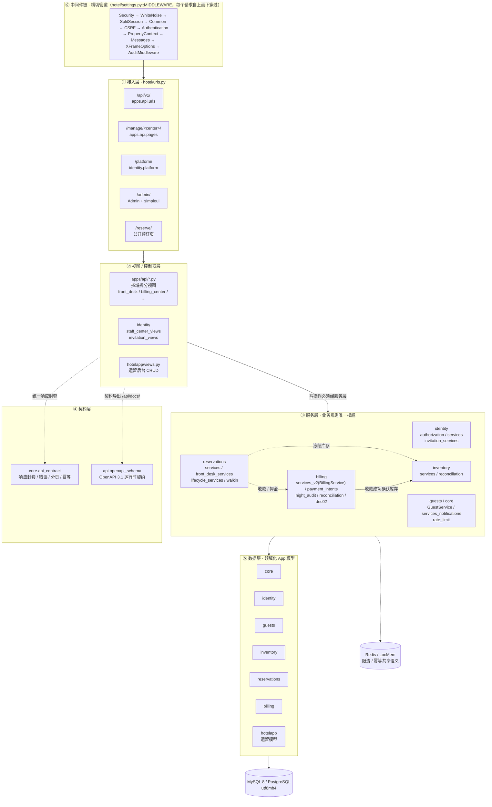
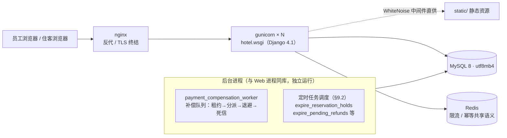
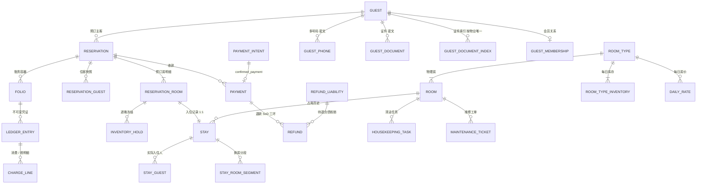
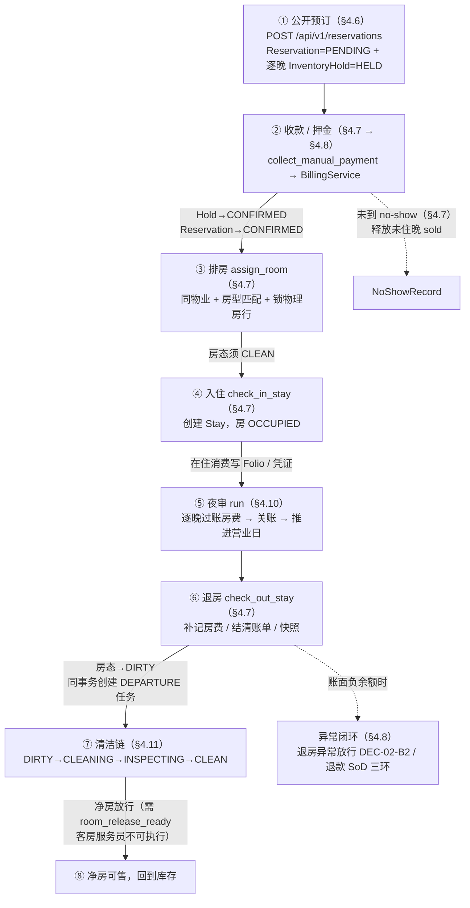
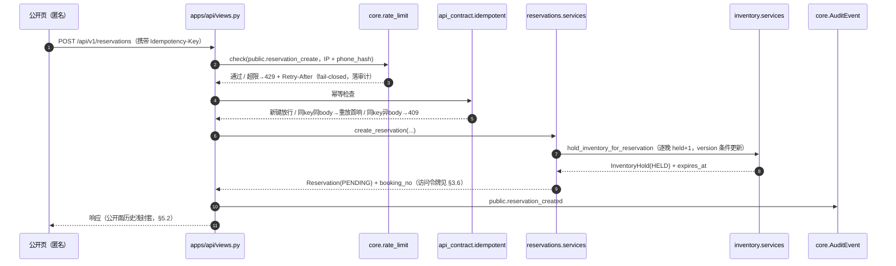
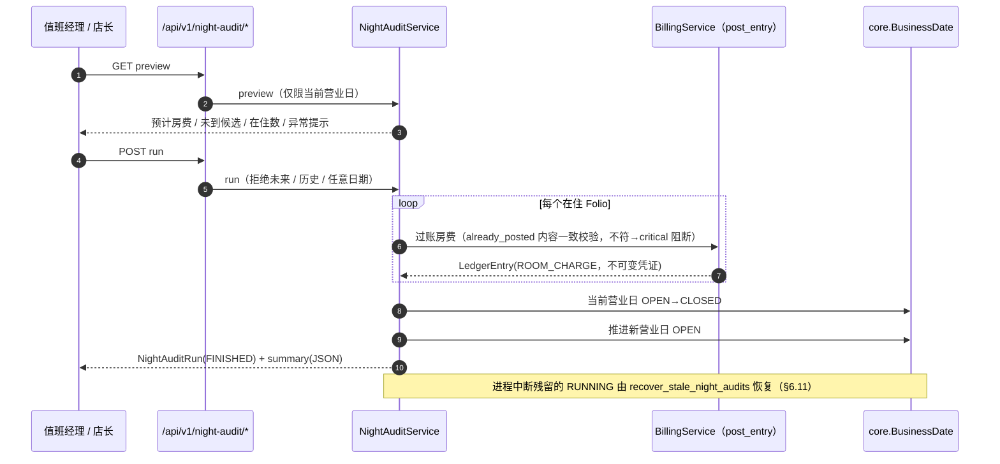
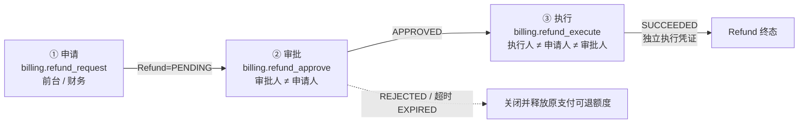
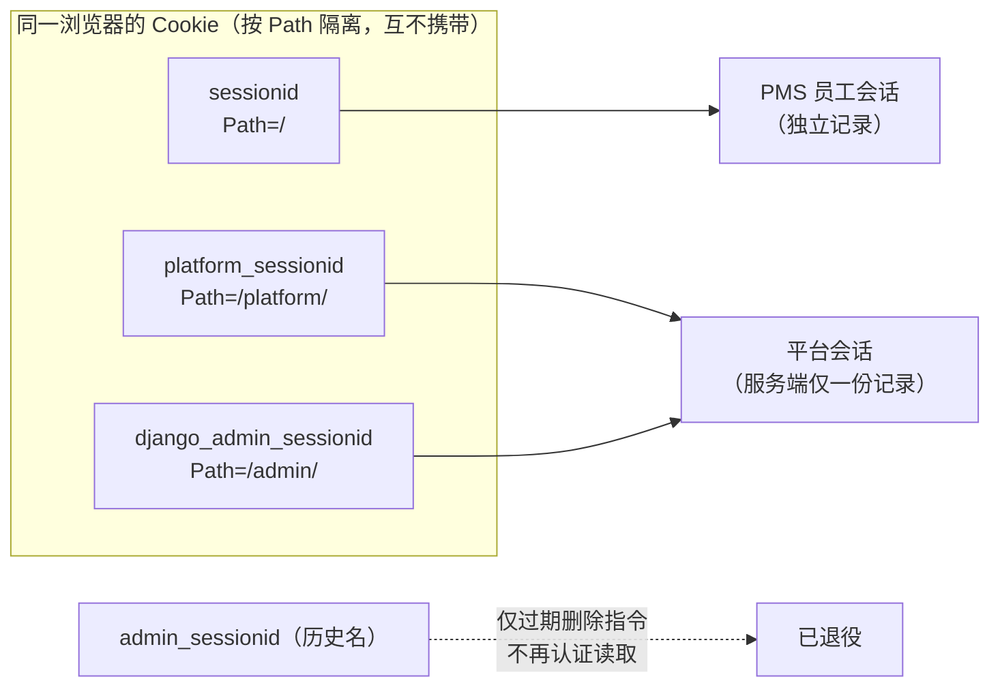
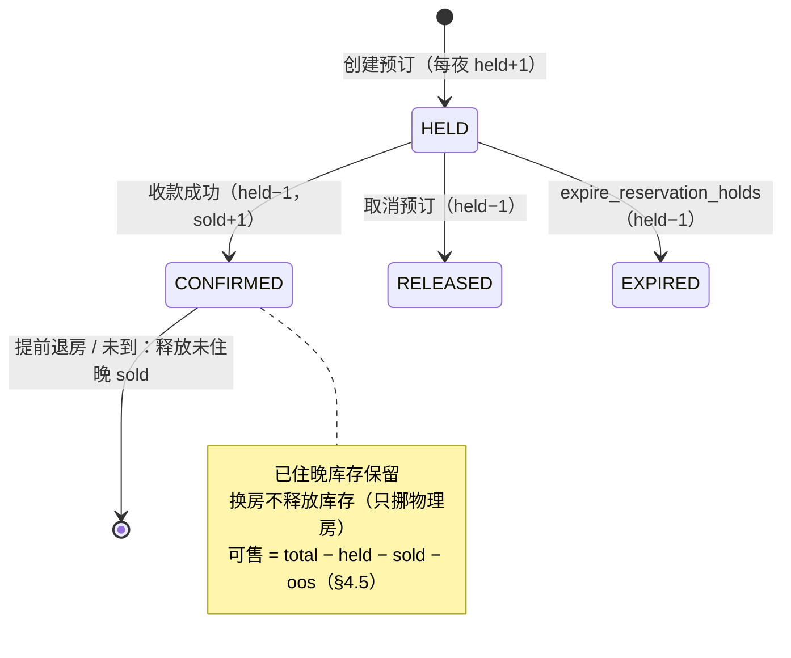

# PMS2 酒店管理系统 · 技术功能说明文档

| 项目 | 内容 |
|---|---|
| 文档名称 | PMS2 酒店管理系统技术功能说明文档 |
| 文档版本 | v1.1 |
| 编制日期 | 2026-11-12 |
| 代码基线 | `main` @ `57d2176`（白盒整改第六批 WB-119~126 之后） |
| 契约快照 | `docs/接口文档/openapi.json`（OpenAPI 3.1.0 / PMS2 API 2.1.0 / 113 paths / 115 operations） |
| 适用范围 | PMS2 当前版本（PMS2.0_当前版本） |
| 文档性质 | **代码事实说明**，不是验收结论；"代码存在" ≠ "用户验收通过" |

> **v1.1 修订（2026-11-12）**：重制 §2.1 总体架构图（Mermaid 化，补调用方向、横切中间件、存储位置）；新增 §0.4 内部代号速查、§2.6 领域依赖与调用规则、§2.7 部署拓扑、§3.0 跨域核心实体关系图、§4.0 端到端业务走查与预订创建时序、§4.10 夜审时序、§5.3 状态码速查、§6.2/§6.6/§6.7 示意图、§6.10 并发控制一览、§6.11 故障与恢复语义。

---

## 0. 文档说明

### 0.1 目的

本文档面向开发、测试、运维与验收人员，用**统一的结构化语言**说明 PMS2 系统的：

- 技术架构与代码组织方式；
- 数据模型与实体关系；
- 各业务功能域的职责、功能点、关键规则与状态流转；
- 对外接口的契约规范（响应封套、错误码、分页、幂等、鉴权、限流）；
- 支撑业务的关键技术机制（不可变事实、职责分离、营业日守卫、PII 加密等）；
- 权限矩阵、运维命令与测试证据。

### 0.2 阅读约定

| 约定 | 说明 |
|---|---|
| 「代码事实」 | 直接来源于源码，可按文中给出的文件路径/类名/方法名定位 |
| 「验收边界」 | 尚未被真实用户验收覆盖的部分，单独标注，不与代码事实混写 |
| 枚举值 | 数据库存英文码，中文 label 仅用于展示层（见 `apps/core/labels.py`） |
| 模型全名 | `app_label.ModelName`，如 `billing.LedgerEntry` |

### 0.3 术语表

| 术语 | 含义 |
|---|---|
| PMS | Property Management System，酒店物业管理系统 |
| Property（物业） | 酒店实体。当前为**单店运行**（`DEFAULT_PROPERTY_CODE`），多物业模型已预留 |
| BusinessDate（营业日） | 账务归属的自然日，与日历日解耦；夜审负责推进 |
| Folio（账单） | 一个预订/住客的账务容器，分 MASTER / GUEST / COMPANY / HOUSE / DEPOSIT |
| LedgerEntry（凭证） | 不可变财务事实，只能追加，不能修改或删除 |
| Hold / Sold | 库存的两种占用态：冻结（待支付）与已售（已确认占用） |
| SoD | Segregation of Duties，职责分离；同一笔业务的申请/审批/执行须为不同账号 |
| Break-glass | 关账日的紧急访问授权，需二次密码验证 + 事后复核 |
| PII | 个人身份信息；系统内手机号与证件号仅存密文 + 哈希 |
| SoD 三方分离 | 退款的申请人 / 审批人 / 执行人必须是三个不同账号 |

### 0.4 内部代号速查

正文与实施记录中高频出现的内部编号，统一含义如下（新读者先读此表）：

| 代号 | 含义 | 参考位置 |
|---|---|---|
| `WB-xxx` | 白盒整改条目编号，按批次推进（如第六批 WB-119~126）；旧入口 410/302 退役、守卫加固等均带此编号 | `docs/PMS2.0_当前版本/04_开发实施记录/` |
| `DEC-02` | 财务负余额闭环设计裁决：A1 账务调整、B2 退房异常放行 | `apps/billing/dec02.py`（§4.8） |
| `DEC-EMP-02` | 员工工号按部门原子编号裁决 | §3.3 `EmployeeNumberCounter` |
| `PAY-P0` | 支付中心专项（支付意图 / 渠道交易 / 补偿队列） | §4.9 |
| `FIN-P0` | 账务对账专项（Folio 对账运行与差异） | §3.7 `FolioReconciliationRun` |
| `Q7` | 生产启动门禁编号（`DJANGO_ENV=prod` 启动期 fail-fast 校验） | §1.2 注 |
| `G14` | 需独立签署的验收门禁编号 | §10.2 验收待办 |

---

## 1. 系统概述

### 1.1 业务定位

PMS2 是面向单体酒店/单体物业的酒店物业管理系统，覆盖从**官网公开预订**到**夜审关账**的完整链路：

```
公开预订 → 收款/押金 → 排房 → 入住 → 夜审过账房费 → 退房结清
→ 清洁维修 → 净房放行 → 退款申请/审批/执行
```

系统同时提供**平台管理面**（权限矩阵、超级管体检）与**员工自助面**（个人中心、改密、通知待办）。

### 1.2 技术栈

| 层次 | 选型 | 版本/说明 |
|---|---|---|
| 语言 | Python | 3.9+（CI 验证 3.9） |
| Web 框架 | Django | 4.1（LTS） |
| 目标数据库 | MySQL | 8.x（`utf8mb4`）；PostgreSQL 可选；SQLite 用于 CI/轻量测试 |
| ORM/迁移 | Django ORM + migrations | `DEFAULT_AUTO_FIELD = AutoField` |
| 后台 UI | django-simpleui | 2022.7.29（LTS 主题 `admin.lte.css`） |
| 静态资源 | WhiteNoise | 生产 WSGI 静态服务 |
| 缓存 | LocMem（开发）/ Redis（生产强制） | 登录限流与幂等共享语义 |
| 密码学 | `cryptography` | PII 对称加密；`django.utils.crypto` 做 HMAC |
| API 契约 | OpenAPI 3.1 | 静态快照 `docs/接口文档/openapi.json` + Swagger UI `/api/docs/` + ReDoc `/api/redoc/` |
| 部署 | WSGI（`hotel.wsgi`） | gunicorn/uwsgi + nginx 建议 |

> **生产启动门禁（Q7）**：`DJANGO_ENV=prod` 时 `_validate_production_settings()` 在启动阶段 fail-fast 校验 `DEBUG=False`、`DJANGO_SECRET_KEY ≥ 32 字符`、**独立** `DJANGO_PII_KEY ≥ 32 字符`、`ALLOWED_HOSTS` 禁用通配符、缓存必须为 Redis、`PAYMENT_WEBHOOK_SECRET` 必填。

### 1.3 模块注册表与生命周期状态

`apps/identity/registry.py::MODULE_REGISTRY_V2` 用三个常量描述模块生命周期：

| 状态 | 含义 |
|---|---|
| `MODULE_ACTIVE` | 在营：路由可达、权限码有真实执行点 |
| `MODULE_PLANNED` | 预留：待第三方对接/人员到位后启用（菜单隐藏，URL 仍可直达） |
| `MODULE_RETIRED` | 退役方向：入口已 410/冻结，只读面待收口 |

**11 个注册模块**：

| 模块 code | 名称 | 归属 App | 状态 | 路由前缀 |
|---|---|---|---|---|
| `accommodation` | 预订与入住 | reservations | ACTIVE | `/checkin` |
| `guests` | 客人 | guests | ACTIVE | `/manage/guests` |
| `rooms` | 房态与库存 | inventory | ACTIVE | `/manage/rooms` |
| `memberships` | 会员 | guests | ACTIVE | `/manage/memberships` |
| `staff` | 员工 | identity | ACTIVE | `/manage/staff` |
| `finance` | 财务 | billing | ACTIVE | `/manage/finance` |
| `night_audit` | 夜审 | core | ACTIVE | `/manage/night-audit` |
| `platform` | 权限管理（平台） | identity | ACTIVE | `/platform` |
| `fnb` | 餐饮 | hotelapp | PLANNED | — |
| `parking` | 停车 | hotelapp | PLANNED | — |
| `legacy` | 历史只读 | hotelapp | RETIRED | — |

> **RETIRED 的落地实例**：旧 `/no_show_one/` 直写入口已改 **410 Gone**（WB-044），统一走 `POST /api/v1/front-desk/reservation-rooms/{id}/no-show`；旧 `hotelapp` 写路由按 302 退役并迁往对应业务中心。

---

## 2. 总体架构

### 2.1 架构风格：模块化单体（Modular Monolith）

单一 Django 项目内的**领域化 Django App**，跨域调用只允许「服务层调用服务层」，不允许视图直连他域 ORM 查询业务规则。



**读图说明**：

- **实线** = 请求主链路（自上而下）；**虚线** = 横切/支撑关系与合法跨域服务调用示例。
- 中间件链**不是架构层**，而是横切管道：`PropertyContextMiddleware` 在此注入 `request.property`（§2.4），`AuditMiddleware` 在出口落审计。
- 「跨域调用只允许服务层 → 服务层」的完整规则与已知跨域调用清单见 **§2.6**。

### 2.2 代码目录

| 路径 | 职责 |
|---|---|
| `hotel/` | 项目配置：`settings.py` / `urls.py` / `wsgi.py` |
| `apps/core/` | 平台底座：物业、营业日、夜审运行、审计事件、幂等记录、状态流转、限流计数、通知 |
| `apps/identity/` | 身份域：员工档案、任职、授权、邀请、权限矩阵、平台门户 |
| `apps/guests/` | 住客域：住客档案、电话/证件（PII）、会员关系 |
| `apps/inventory/` | 库存域：房型、物理房、房价计划、每日房价、每日库存、清洁、维修、库存对账 |
| `apps/reservations/` | 预订域：预订主单/明细、Stay、住客快照、库存冻结、政策、Booking Token |
| `apps/billing/` | 账务域：账单、凭证、支付、退款、负债、班次、审批、支付意图、对账、DEC-02 |
| `apps/api/` | 接口层：URL 映射、按域视图、OpenAPI 契约与文档 UI |
| `hotelapp/` | 遗留域：旧酒店后台模型（员工/顾客/会员/客房/订单/餐饮/停车/财务流水/夜审记录）与 HTML 视图 |
| `templates/` | 前端模板：`pms/*_center.html`（各业务中心）、`platform/*`（平台面）、`public/booking.html`（官网预订） |
| `static/` | Bootstrap 3 / Meto / themify / flaticon 等前端静态资源 |
| `scripts/` | `e2e_full_chain.py`（全链路串测）、`pii_restore_drill.py`（PII 恢复演练） |
| `docs/` | 需求、架构、API、实施记录、验收证据（`docs/acceptance/evidence/`） |

### 2.3 领域模块职责矩阵

| 模块 | 数据模型数 | 服务入口 | 主要职责 |
|---|---|---|---|
| `core` | 11 | `services_notifications`、`rate_limit` | 物业、营业日、夜审运行、审计、幂等、状态流转、限流、站内通知 |
| `identity` | 5 | `authorization`、`services`、`invitation_services`、`permission_center` | 员工生命周期、任职授权、邀请激活、权限判定、矩阵管理 |
| `guests` | 6 | `GuestService`、`GuestMembershipService` | 住客档案、PII 加密与揭示、会员关系与等级历史 |
| `inventory` | 10 | `services`、`reconciliation` | 房型/物理房、房价、可售库存计算、清洁维修链、库存对账 |
| `reservations` | 13 | `services`、`front_desk_services`、`lifecycle_services`、`walkin` | 预订、Hold、履约（排房/入住/退房/换房/续住/未到）、押金、Walk-in |
| `billing` | 19 | `BillingService`、`ApprovalService`、`payment_intents`、`night_audit`、`reconciliation`、`dec02`、`liabilities` | 账单、凭证、收款、退款、负债、班次、冲销、支付意图、补偿队列、账务对账 |
| `api` | — | 12 个域视图模块 | REST 端点、契约、文档 UI |
| `hotelapp` | 11 | `views.py` + `state_machine.py` | 遗留后台 CRUD 与旧状态机 |

### 2.4 请求处理链路

**中间件顺序**（`hotel/settings.py`）：

1. `SecurityMiddleware` — 安全响应头
2. `WhiteNoiseMiddleware` — 生产静态资源
3. `SplitSessionMiddleware` — **按路径隔离的 Session Cookie**（见 §6.6）
4. `CommonMiddleware`
5. `CsrfViewMiddleware` — API 路径失败返回 JSON（`CSRF_FAILURE_VIEW`）
6. `AuthenticationMiddleware`
7. `PropertyContextMiddleware` — **注入 `request.property` / `request.staff_membership` / `request.staff_profile`**
8. `MessageMiddleware`
9. `XFrameOptionsMiddleware` — `X_FRAME_OPTIONS = DENY`
10. `AuditMiddleware`（`hotelapp/audit_middleware.py`）

**`PropertyContextMiddleware` 的三条分支**（`apps/identity/middleware.py`）：

| 情形 | 行为 |
|---|---|
| 平台路径（`/admin/`、`/platform/`、`/permissions/`） | 跳过任职解析，`request.property = None`，不产生审计噪声 |
| 匿名顾客 | 使用 `DEFAULT_PROPERTY_CODE` 对应的 ACTIVE 物业提供公开面 |
| 已认证员工 | 取 DEFAULT 物业的**有效任职**（员工在职 + 任职 ACTIVE + 物业 ACTIVE）；取不到则 `property=None` 并写 `security.property_context_denied` 审计，**禁止静默回退 DEFAULT** |

### 2.5 环境变量契约

| 变量 | 默认 | 说明 |
|---|---|---|
| `DJANGO_ENV` | `dev` | `dev` / `test` / `prod`；`test` 下测试期强制 `DEBUG=False` |
| `DJANGO_DEBUG` | 非 prod 为 True | 显式开关 |
| `DJANGO_SECRET_KEY` | dev 随机 | 生产必填且 ≥32 字符 |
| `DJANGO_PII_KEY` | 空（dev 回退 SECRET_KEY 派生） | **独立** PII 加密/HMAC 密钥，生产必填 ≥32 字符 |
| `DJANGO_ALLOWED_HOSTS` | `localhost,127.0.0.1` | 逗号分隔，生产禁通配符 |
| `DJANGO_CSRF_TRUSTED_ORIGINS` | 空 | 逗号分隔 |
| `DJANGO_DB_ENGINE` | `mysql` | `mysql` / `postgresql` / `sqlite` |
| `DJANGO_DB_NAME/USER/PASSWORD/HOST/PORT` | `hotel` / 空 / 空 / `localhost` / `3306` | 连接参数 |
| `DJANGO_TIME_ZONE` | `Asia/Shanghai` | 全局时区；物业可单独覆盖 |
| `DJANGO_CACHE_BACKEND` | `locmem` | 生产必须 `redis` + `DJANGO_REDIS_URL` |
| `PAYMENT_WEBHOOK_SECRET` | dev 随机 | Mock 回调 HMAC 签名密钥，生产必填 |
| `DEFAULT_PROPERTY_CODE` | `DEFAULT` | 单店运行的物业编码 |
| `DJANGO_INVITATION_TTL_HOURS` | `24` | 员工邀请 token 有效期 |
| `DJANGO_INVITATION_CANONICAL_HOST` | 空 | 邀请绝对 URL 的规范 Host（留空用请求 Host） |
| `DJANGO_SECURE_SSL_REDIRECT` / `DJANGO_SECURE_HSTS_SECONDS` / `DJANGO_TRUST_PROXY_SSL` | 关闭 | TLS 与 HSTS |
| `PLATFORM_PORTAL_COOKIE_NAME` / `DJANGO_ADMIN_SESSION_COOKIE_NAME` / `DJANGO_LEGACY_PLATFORM_COOKIE_NAME` | `platform_sessionid` / `django_admin_sessionid` / `admin_sessionid` | Session Cookie 网络隔离 |

### 2.6 领域依赖与调用规则

「服务层调用服务层」是**唯一的合法跨域路径**，具体约束：

| # | 规则 | 说明 |
|---|---|---|
| 1 | 视图 → 本域服务层 | 写操作必须经服务层；视图层不承载业务规则 |
| 2 | 服务层 → 他域服务层 | 唯一合法跨域路径（示例见下表） |
| 3 | 视图 ✗ 直连他域 ORM | 禁止绕过他域服务层查询业务规则 |
| 4 | 遗留 hotelapp 隔离 | 不新增写入口；旧写入口按 302/410 退役（§4.15）；经 `core.LegacyRecordLink` 建立映射，API 侧只读 |

**已知合法跨域调用示例**（按代码事实抽样）：

| 调用方（域） | 被调方（域） | 场景 |
|---|---|---|
| `reservations.services` | `inventory.services` | 预订创建时逐晚冻结库存（Hold） |
| `reservations.front_desk_services` | `billing.services_v2` | 前台收款 / 押金登记 |
| `billing.collect_payment` | `inventory.services` | 收款成功：Hold→CONFIRMED（held−1 / sold+1） |
| `reservations.front_desk_services` | `inventory`（房态 / 清洁） | 退房：房态→DIRTY，同事务创建 `DEPARTURE` 清洁任务 |
| `apps/api`（Guest 360） | guests / reservations / billing | `GET /guests/{id}/timeline` 跨域**只读**聚合（§4.4） |

> 新增跨域调用时，先在本节登记再实现；审计证据类跨域写入须落在 `@transaction.atomic` **之外**（§4.5 对账口径）。

### 2.7 部署拓扑（生产建议）



| 要点 | 说明 |
|---|---|
| 进程模型 | Web（gunicorn）与补偿 Worker 分离；限流计数与幂等记录**落表/Redis**，多进程共享（§5.5 / §5.7） |
| 静态资源 | 生产由 WhiteNoise 中间件直供（`MIDDLEWARE` 第 2 位），无需独立静态服务 |
| 启动门禁 | `DJANGO_ENV=prod` 触发 Q7 fail-fast 校验（DEBUG / 双密钥 / Redis / ALLOWED_HOSTS / Webhook 密钥，§1.2） |
| MySQL 触发器 | 追加型触发器需部署侧安装并周期校验：`install_mysql_append_only_guards` / `check_mysql_append_only_guards`（§6.1） |
| 开发态 | LocMem + SQLite 可跑功能测试；**并发语义必须 MySQL**（SQLite 下 `select_for_update` 为 no-op，§6.7） |

---

## 3. 数据模型

### 3.0 跨域核心实体关系（主干）

> 图中只画**跨域业务主干**的外键关系，完整字段见 §3.2~§3.8；所有业务表均带 `property` 外键（§3.1），图中统一省略。



**域归属图例**：`reservations`（Reservation / ReservationRoom / Stay / StayRoomSegment / ReservationGuest / StayGuest / InventoryHold）· `billing`（Folio / LedgerEntry / ChargeLine / Payment / Refund / RefundLiability / PaymentIntent）· `guests`（Guest / GuestPhone / GuestDocument / GuestDocumentIndex / GuestMembership）· `inventory`（RoomType / Room / RoomTypeInventory / DailyRate / HousekeepingTask / MaintenanceTicket）。

### 3.1 通用数据约定

| 约定 | 说明 |
|---|---|
| 多物业外键 | 所有业务表带 `property = FK(core.Property, on_delete=PROTECT)` |
| 业务删除保护 | 财务/审计类关联一律 `PROTECT`，避免误删 |
| 可空唯一键 | MySQL 8 不支持条件唯一约束（`models.W036`）。项目统一用**可空唯一键字段 + 模型 `save()` 维护 + 迁移回填**：`active_hold_key`、`open_property_key`、`active_membership_key`、`active_folio_key`、`primary_guest_key`、`primary_reservation_key`、`active_stay_key`、`execution_reference_key` |
| 乐观并发 | 库存 `RoomTypeInventory.version` 自增，配合条件更新 |
| 金额 | `Decimal(max_digits=12, decimal_places=2)`，币种 `CharField(max_length=3, default="CNY")` |
| 财务事实 | `ImmutableFinancialFactQuerySet` / `ImmutableAuditEventQuerySet` 禁止 `update` / `bulk_create` / `bulk_update` |
| 时间 | `USE_TZ = True`，存 UTC；展示与营业日按 `Property.timezone` 换算 |

### 3.2 core 域

| 模型 | 关键字段 | 说明 |
|---|---|---|
| `core.Property` | `code`(唯一) / `name` / `timezone` / `currency` / `status` | 物业；状态 `ACTIVE` 营业中 / `INACTIVE` 停用 |
| `core.AuditEvent` | `property` / `actor` / `action` / `entity_type` / `entity_id` / `before_json` / `after_json` / `reason` / `request_id` / `ip` / `user_agent` | 审计事件，**只追加**（MySQL 触发器 + 实例级 `save()` 守卫） |
| `core.LegacyRecordLink` | `source_system` / `source_model` / `source_pk` → `target_model`/`target_pk` / `mapping_status` | 遗留数据映射与人工核验 |
| `core.BusinessDate` | `business_date` / `open_property_key`(唯一可空) / `status` / `opened_at` / `closed_at` / `closed_by` / `reopened_at` / `reopened_by` / `reopen_reason` | 营业日；状态 `OPEN` / `CLOSED` / `REOPENED` |
| `core.NightAuditRun` | `business_date` / `status` / `started_at` / `finished_at` / `executed_by` / `summary`(JSON) / `error_message` | 单次夜审运行记录 |
| `core.BreakGlassRecord` | `business_date` / `action_code` / `requested_by` / `reason` / `password_verified_at` / `expires_at` / `status` / `used_at` / `reviewed_by` / `review_decision` | 紧急访问授权；状态 `GRANTED` → `USED` → `REVIEWED`，或 `EXPIRED` |
| `core.IdempotencyRecord` | `property` / `user` / `key` / `method` / `path` / `request_hash` / `response_status` / `response_body` / `status` / `expires_at` | 幂等记录，TTL 24h |
| `core.StatusTransition` | `entity_type` / `entity_id` / `from_status` / `to_status` / `actor` / `reason` / `request_id` | 业务状态变更时间线（区别于合规审计） |
| `core.RateLimitCounter` | `key_hash` / `action` / `count` / `window_start` | 限流计数（表存储，多进程可靠，不依赖缓存） |
| `core.Notification` | `property` / `recipient` 或 `role_group` / `category` / `severity` / `title` / `dedupe_key` / `resolved_at` | 站内通知与运营待办；**通知是提示不是业务状态权威**，生成/已读不落 AuditEvent；`dedupe_key` 保证运营待办实时派生时 upsert 去重 |
| `core.NotificationRead` | `notification` / `staff_profile` / `read_at` | 员工个人已读回执；岗位广播由不同员工各自独立记录（唯一约束 `notification + staff_profile`） |

### 3.3 identity 域

| 模型 | 关键字段 | 说明 |
|---|---|---|
| `identity.StaffProfile` | `user`(OneToOne) / `legacy_staff` / `full_name` / `phone` / `employment_status` / `must_change_password` / `last_password_change` | 员工档案；`employment_status`：`ACTIVE` 在职 / `INACTIVE` 停用 / `TERMINATED` 离职 |
| `identity.PropertyStaffMembership` | `staff_profile` / `property` / `employee_no` / `position_code` / `status` / `started_at` / `ended_at` / `active_membership_key` | 员工在物业的任职关系 |
| `identity.EmployeeNumberCounter` | `property` / `department_code` / `next_seq` | 工号原子编号（DEC-EMP-02） |
| `identity.StaffRoleAssignment` | `membership` / `group` / `starts_at` / `ends_at` / `granted_by` | 岗位授权（时间窗生效） |
| `identity.Invitation` | `staff_profile` / `membership` / `token_hash` / `status` / `expires_at` / `consumed_at` / `revoked_at` / `resend_count` / `last_sent_at` | 员工邀请（token 仅存哈希，一次性） |

### 3.4 guests 域

| 模型 | 关键字段 | 说明 |
|---|---|---|
| `guests.Guest` | `full_name` / `phone` / `phone_ciphertext` / `phone_hash` / `email` / `consent_version` | 住客主档；明文列保留但不再写入 |
| `guests.GuestPhone` | `guest` / `phone_ciphertext` / `phone_hash` / `phone_type` / `is_primary` / `primary_guest_key` / `shared_review_required` | 多号码；共享号码需复核 |
| `guests.GuestDocument` | `guest` / `doc_type` / `doc_no_ciphertext` / `doc_no_hash` / `issuing_country` / `expiry_date` / `verified_at` / `retention_until` | 证件；只存密文 + 哈希 |
| `guests.GuestDocumentIndex` | `property` / `guest` / `doc_no_hash` | **物业级证件唯一性仲裁**（`unique_together`） |
| `guests.GuestMembership` | `guest` / `member_no` / `level_code` / `active_guest_key` / `status` / `joined_at` / `expires_at` / `legacy_vip_id` | 会员关系 |
| `guests.MembershipLevelHistory` | `membership` / `from_level` / `to_level` / `reason` / `changed_by` | 等级变更历史 |

### 3.5 inventory 域

| 模型 | 关键字段 | 说明 |
|---|---|---|
| `inventory.RoomType` | `code` / `name` / `capacity` / `bed_type` / `amenities`(JSON) / `is_active` | 房型 |
| `inventory.Room` | `room_type` / `number` / `floor` / `occupancy_status` / `housekeeping_status` / `maintenance_status` / `is_active` | 物理房；占用 `VACANT`/`OCCUPIED`，清洁 `CLEAN`/`DIRTY`/`CLEANING`/`INSPECTING`，维修 `NORMAL`/`OUT_OF_ORDER`/`OUT_OF_SERVICE` |
| `inventory.RatePlan` | `code` / `name` / `valid_from` / `valid_to` / `cancellation_policy` / `deposit_policy` | 房价计划 |
| `inventory.DailyRate` | `rate_plan` / `room_type` / `stay_date` / `price` / `currency` / `closed` / `min_stay` / `max_stay` | 每日房价（可关房） |
| `inventory.RoomTypeInventory` | `room_type` / `stay_date` / `total_rooms` / `held` / `sold` / `out_of_service` / `stop_sell` / `version` | 每日房型库存；`available = total - held - sold - oos` |
| `inventory.HousekeepingTask` | `room` / `task_type` / `status` / `assigned_to` / `started_at` / `completed_at` / `inspected_by` / `inspected_at` / `checklist`(JSON) | 清洁任务；类型 `DEPARTURE`/`STAYOVER`/`DEEP_CLEAN`/`INSPECTION`/`TURNDOWN`；状态 `PENDING`→`IN_PROGRESS`→`DONE`→`INSPECTED`，退回 `REJECTED`，作废 `CANCELLED` |
| `inventory.MaintenanceTicket` | `room` / `from_date` / `to_date` / `reason` / `status` / `ticket_no`(唯一) / `reported_by` / `restored_by` | 维修工单；状态 `OPEN`/`IN_PROGRESS`/`RESTORED`/`CANCELLED` |
| `inventory.RoomInspection` | `task` / `room` / `inspector` / `result` / `checklist_result`(JSON) | 清洁检查记录；`PASS`/`FAIL` |
| `inventory.InventoryReconciliationRun` | `property` / `status` / `scan_time` / `scanned_dates` / `scanned_types` / `diff_count` | 库存对账运行 |
| `inventory.InventoryDiscrepancy` | `run` / `room_type` / `stay_date` / `current_total` / `recomputed_total` / `diff` / `held_count` / `sold_count` / `oos_count` / `status` / `requested_by` / `approved_by` / `executed_by` | 库存差异；状态 `OPEN`→`FIX_REQUESTED`→`FIX_APPROVED`→`FIXED`，或 `DISMISSED` |

### 3.6 reservations 域

| 模型 | 关键字段 | 说明 |
|---|---|---|
| `reservations.Reservation` | `booking_no` / `guest` / `source` / `status` / `check_in` / `check_out` / `room_count` / `adult_count` / `child_count` / `total_amount` / `deposit_amount` / `idempotency_key` / `request_fingerprint` / `expires_at` | 预订主单；状态 `PENDING`/`CONFIRMED`/`CANCELLED`/`EXPIRED`/`CHECKED_IN`/`CHECKED_OUT`/`NO_SHOW` |
| `reservations.ReservationRoom` | `reservation` / `room_type` / `rate_plan` / `assigned_room` / `check_in` / `check_out` / `nightly_rates`(JSON) / `amount` / `early_departure_snapshot`(JSON) / `inventory_released_from` | 预订房明细；`nightly_rates` 为**逐晚房价快照** |
| `reservations.Stay` | `reservation_room`(OneToOne) / `room` / `actual_check_in` / `actual_check_out` / `status` | 在住记录；状态 `IN_HOUSE`/`CHECKED_OUT`/`VOIDED` |
| `reservations.StayRoomSegment` | `stay` / `room` / `started_at` / `ended_at` / `active_stay_key` / `move_reason` / `moved_by` | 换房分段历史 |
| `reservations.NoShowRecord` | `reservation_room`(OneToOne) / `reason` / `processed_by` / `inventory_released_from` / `released_nights` | 未到处理记录 |
| `reservations.ReservationGuest` | `reservation` / `guest` / `role` / 姓名电话证件快照 / `primary_reservation_key` | 预订住客快照（主住客标记） |
| `reservations.StayGuest` | `stay` / `reservation_guest` / `guest` / 姓名证件快照 / `checked_in_at` / `checked_out_at` | 实际入住住客 |
| `reservations.InventoryHold` | `room_type` / `stay_date` / `reservation_room` / `quantity` / `status` / `active_hold_key` / `expires_at` / `released_at` | 库存冻结；状态 `HELD`/`CONFIRMED`/`RELEASED`/`EXPIRED` |
| `reservations.CancellationPolicy` | `rate_plan` / `free_cancel_until` / `penalty_type` / `penalty_value` / `no_show_penalty` | 取消政策 |
| `reservations.DepositPolicy` | `rate_plan` / `deposit_type` / `deposit_value` / `due_before` / `refundable` | 押金政策 |
| `reservations.EarlyDeparturePolicy` | `rate_plan` / `policy_type` / `policy_value` / `is_active` | 提前退房政策（NONE = 按合同全额结算） |
| `reservations.BookingAccessToken` | `reservation`(OneToOne) / `token_hash`(唯一) / `expires_at` / `revoked_at` | 公开预订访问令牌（明文仅返回一次） |
| `reservations.PendingBookingGate` | `property` / `gate_key` | 同手机号待支付预订的短时锁 |

### 3.7 billing 域

| 模型 | 关键字段 | 说明 |
|---|---|---|
| `billing.ApprovalRecord` | `action_code` / `entity_type` / `entity_id` / `requested_by` / `approved_by` / `status` / `payload_snapshot` / `idempotency_key` / `expires_at` | 通用审批单；状态 `PENDING`/`APPROVED`/`REJECTED`/`EXPIRED`/`CANCELLED` |
| `billing.Folio` | `reservation` / `folio_type` / `master_reservation_key` / `guest` / `status` / `currency` / `opened_at` / `closed_at` | 账单；状态 `OPEN`/`CLOSED`/`VOIDED`；类型 `MASTER`/`GUEST`/`COMPANY`/`HOUSE`/`DEPOSIT` |
| `billing.FolioTransfer` | `from_folio` / `to_folio` / `amount` / `reason` / `approved_by` | 账单间转账（需审批人） |
| `billing.LedgerEntry` | `folio` / `stay` / `entry_type` / `amount` / `currency` / `business_date` / `reference` / `posted_by` / `void_of` / `void_reason` / `approval_record` | **不可变凭证**；类型 `ROOM_CHARGE`/`DEPOSIT`/`PAYMENT`/`REFUND`/`ADJUSTMENT`/`REVERSAL`；红字通过 `void_of` 关联原凭证 |
| `billing.Payment` | `reservation` / `folio` / `cashier_shift` / `provider` / `provider_ref` / `method` / `amount` / `status` / `paid_at` | 收款；状态 `CREATED`/`PENDING`/`SUCCEEDED`/`FAILED`/`CANCELLED`/`REFUND_PENDING`/`PARTIALLY_REFUNDED`/`REFUNDED` |
| `billing.Refund` | `approval_record` / `payment` / `refund_liability` / `amount` / `idempotency_key` / `provider_ref`(唯一) / `status` / `requested_by` / `approved_by` / `executed_by` / `executed_at` / `execution_reference` / `execution_idempotency_key` / `execution_shift` | 退款；状态 `PENDING`/`APPROVED`/`SUCCEEDED`/`REJECTED`/`EXPIRED` |
| `billing.RefundLiability` | `reservation` / `folio`(OneToOne) / `source_payments`(M2M) / `amount` / `remaining_amount` / `status` / `settled_at` | 待退款负债；状态 `OPEN`/`PARTIALLY_SETTLED`/`SETTLED` |
| `billing.CashierShift` | `cashier` / `opened_at` / `closed_at` / `opening_cash` / `expected_cash` / `actual_cash` / `variance` / `variance_reason` / `status` / `open_shift_key` | 收银班次；状态 `OPEN`/`CLOSED`（关班即完成对账） |
| `billing.CashierShiftMovement` | `shift` / `direction`(`IN`/`OUT`) / `amount` / `reason` / `idempotency_key` / `created_by` | 班次现金补入/支出 |
| `billing.ChargeLine` / `billing.TaxLine` | `ledger_entry` / `charge_type` / `revenue_code` / `quantity` / `unit_price` / `amount` / `tax_*` | 消费明细与税行；`charge_type`：`ROOM`/`FOOD`/`LAUNDRY`/`EXTRA_BED`/`SERVICE`/`PENALTY`/`OTHER` |
| `billing.BillingAdjustment` | `folio` / `refund_liability` / `adjustment_type` / `amount` / `evidence_note` / `status` / `requested_by` / `approved_by` / `executed_by` / `ledger_entry` / `idempotency_key` | **DEC-02-A1** 账务调整；类型 `CHARGE_ADD`/`CHARGE_REVERSE`/`REFUND_INCREASE` |
| `billing.CheckoutExceptionRelease` | `reservation` / `folio` / `stay` / `amount` / `reason_code` / `reason_text` / `status` / `requested_by` / `approved_by` / `verified_by` / `refund_liability` / `active_folio_key` | **DEC-02-B2** 退房异常放行；状态 `REQUESTED`→`APPROVED`→`RELEASED`→`CONVERTED_LIABILITY` / `CLOSED_NO_REFUND` / `REJECTED` |
| `billing.PaymentIntent` | `intent_no`(唯一) / `idempotency_key`(唯一) / `amount` / `currency` / `purpose` / `provider_code` / `status` / `expires_at` / `max_expires_at` / `extension_count` / `confirmed_payment` | **PAY-P0** 支付意图；状态 `CREATED`/`PENDING`/`PROCESSING`/`SUCCEEDED`/`FAILED`/`EXPIRED`/`CANCELLED`/`UNKNOWN` |
| `billing.ProviderTransaction` | `intent` / `provider_code` / `provider_transaction_id` / `event_id` / `amount` / `currency` / `channel_status` / `signature_verified` / `provider_event_key` | 渠道交易（交易号 + 事件 ID 唯一约束 + 验签标志） |
| `billing.ProviderTransactionEvent` | 同上 | 渠道事件历史（只追加） |
| `billing.PaymentCompensationTask` | `task_type` / `aggregate_type` / `aggregate_id` / `idempotency_key`(唯一) / `status` / `attempt_count` / `max_attempts` / `next_attempt_at` / `lease_owner` / `lease_expires_at` | 补偿队列；状态 `PENDING`→`LEASED`→`SUCCEEDED`/`FAILED`/死信 |
| `billing.FolioReconciliationRun` | `property` / `scanned_at` / `scanned_folios` / `diff_count` / `checked_by` | **FIN-P0** 账务对账运行 |
| `billing.FolioReconciliationDiff` | `run` / `folio` / `diff_type` / `entity_type` / `entity_id` / `detail` | 对账差异；`diff_type` 8 类：`PAYMENT_NO_ENTRY` / `DEPOSIT_NO_ENTRY` / `REFUND_NO_ENTRY` / `ADJUSTMENT_NO_ENTRY` / `ENTRY_NO_PAYMENT`（反向：PAYMENT/DEPOSIT 凭证无法追溯到白名单状态内的 Payment，WB-092 反向扫描）/ `CHARGE_LINES_MISMATCH` / `BALANCE_MISMATCH` / `LIABILITY_NET_MISMATCH` |

### 3.8 hotelapp 遗留域

`Accommodation`（入住）、`Client`（顾客）、`Food`（菜品）、`Order`（点单）、`Park`（车位）、`FinanceRecord`（收支流水）、`NightAudit`（夜审记录）、`Folio`（账单流水）、`Room`（客房）、`Staff`（员工）、`Vip`（会员）。

字段为中文命名（`入住时间`、`房间状态`、`冲账人`），金额多为 `CharField`，与 PMS2 的 `Decimal` 口径不同。**通过 `core.LegacyRecordLink` 与新模型建立映射**；`apps/api/front_desk.py` 提供 `/api/v1/front-desk/legacy-reservations` 只读接口。

---

## 4. 功能域说明

### 4.0 端到端业务走查（纵向主链路）

§4.1~§4.15 按**域切片**描述各自职责；本节给一条**纵向走查**，把散在各域的环节串成一笔预订的完整生命周期。图中每个节点标注了详细说明所在小节：



其中**创建预订**是全链路里防护最密的一次写操作，完整时序如下（限流 → 幂等 → 冻结 → 审计，均为 §4.6 / §5.5 / §5.7 的代码事实）：



> 后续两条定时兜底：Hold 未支付由 `expire_reservation_holds` 过期释放（§9.2）；未到处理统一走新端点，旧入口 410（§4.15）。

### 4.1 身份与授权（identity）

**核心组件**

| 组件 | 位置 | 说明 |
|---|---|---|
| `AuthorizationService` | `apps/identity/authorization.py` | 唯一权限判定入口 |
| `EmployeeLifecycleService` | `apps/identity/services.py` | 员工生命周期写操作 |
| `EmployeeInvitationService` | `apps/identity/invitation_services.py` | 邀请创建/重发/撤销/消费 |
| `AuthorizationService.get_active_membership(user, property)` | — | 取当前用户在该物业的有效任职 |
| `AuthorizationService.has_permission(user, property, code, obj=None)` | — | 判定权限码；支持对象级判定 |
| `AuthorizationService.filter_queryset_for_property(qs, user, property)` | — | 按物业与权限裁剪 QuerySet |

**权限判定模型**：用户 → `StaffProfile` → `PropertyStaffMembership`（物业 + ACTIVE）→ `StaffRoleAssignment`（授权时间窗内有效）→ Django `Group` → `Permission`（codename）。

**权限码命名**：`<app>.<action>`，例如 `hotelapp.view_accommodation`、`billing.refund_approve`、`inventory.manage_rates`、`identity.staff_manage`、`core.audit_view`。

### 4.2 平台权限管理中心（platform + permission_center）

**页面与接口**

| 路由 | 说明 |
|---|---|
| `GET /platform/` | 平台门户首页（环境信息、模块状态、角色目录） |
| `GET /platform/system/` | 系统环境信息（`platform_superadmin_required` 门禁） |
| `GET /platform/permissions/` | 权限矩阵页 |
| `POST /platform/permissions/save/` | 矩阵保存（旧入口） |
| `GET /platform/api/permissions/<group_id>/` | 读取某组的权限集合（JSON） |
| `POST /platform/api/permissions/<group_id>/save/` | 保存权限变更 |
| `POST /platform/api/permissions/<group_id>/confirm-token/` | 签发高危变更确认 token |

**写操作三重保护**（`apps/identity/permission_center.py`）：

1. `content_version(codenames)` —— 计算当前权限集内容哈希，防并发覆盖；
2. `compute_diff(current, requested)` + `is_high_risk_diff(added, removed)` —— 高危差异需二次确认；
3. `issue_confirm_token()` / `validate_confirm_token()` —— 高危变更必须携带与 `group_id` + `user_pk` + 差异集绑定的确认 token。

**域内能力**：`active_module_codes()`、`allowed_codenames()`、`managed_universe_codenames()`、`special_codenames()`、`role_impact(group)`、`last_matrix_save(group)`。

### 4.3 员工生命周期与邀请（Employee Center）

**生命周期写操作**（`EmployeeLifecycleService`）：

| 操作 | 方法 | 说明 |
|---|---|---|
| 创建员工 | `create_employee` | 空工号时按部门代码（FO/HK/FIN/MG/ENG）走 DEC-EMP-02 原子编号 |
| 开账号 | `provision_account` | 创建 Django User + 强制改密标记 |
| 绑定既有账号 | `bind_existing_user` | 关联已有 User 到员工档案 |
| 授予角色 | `assign_role` | 创建 `StaffRoleAssignment`（可带起止时间） |
| 结束授权 | `end_assignment` | 终止在岗角色 |
| 变更在职状态 | `set_employment_status` | `ACTIVE` / `INACTIVE` / `TERMINATED` |
| 重置密码 | `reset_password` | 写 `last_password_change` |
| 发放邀请 | `provision_invitation_account` | 生成一次性邀请 token |
| 激活账号 | `activate_invitation_account` | 消费邀请并设密码 |

**邀请机制**：token 仅存 `token_hash`；明文 URL 由 `invite_accept_url()` 生成；TTL 默认 24h；支持重发（`resend_count`）与撤销；`expire_stale()` 批量过期。

**员工中心页面**：`/manage/staff/` 及动作路由 `actions/create|provision|assign_role|end_assignment|set_status|reset_password|invite|invite/resend|invite/revoke`。旧 `/staff_accounts/*` 写入口已 302 退役。

### 4.4 住客 360 与会员中心（guests）

**住客能力**

| 能力 | 说明 |
|---|---|
| 建档 | `GuestService.create_guest`（生成 phone_hash / phone_ciphertext） |
| 更新 | `GuestService.update_guest` |
| 多号码 | `GuestService.add_phone`，共享号码需复核（`shared_review_required`） |
| 证件登记 | `register_document()`；物业级唯一由 `GuestDocumentIndex` 仲裁 |
| 证件揭示 | `reveal_document(document, revealed_by, reason, request)` — 需 `hotelapp.guest_document_reveal`，原因必填，落审计 |
| 电话揭示 | `reveal_phone(...)` — 需 `hotelapp.guest_phone_reveal`，同上 |
| 360 时间线 | `GET /api/v1/guests/{id}/timeline` — 跨预订/入住/账单/会员聚合 |
| 账单摘要 | `GET /api/v1/guests/{id}/folios` |

**会员能力**（`GuestMembershipService`）：`create_membership` / `change_level`（写 `MembershipLevelHistory`）/ `suspend_membership` / `restore_membership`。

**PII 治理**：手机号与证件号**只存密文 + 哈希**；明文列保留但不再写入；`DJANGO_PII_KEY` 独立于 `SECRET_KEY`；揭示动作三层复核（装饰器 / 服务层 / API），每次落 `AuditEvent`。

### 4.5 房态、库存与房价（inventory）

**可售量计算**：`get_room_type_availability(property, room_type, check_in, check_out, rooms, rate_plan)` 逐晚计算
`available = total_rooms − held − sold − out_of_service`（并叠加 `stop_sell`）。

**库存三态转换**（`apps/inventory/services.py`）：

| 函数 | 语义 | 触发 |
|---|---|---|
| `hold_inventory_for_reservation` | 冻结（held+1），生成 `InventoryHold(HELD)` | 创建预订 |
| `confirm_inventory_for_reservation` | 冻结转已售（held−1 / sold+1），Hold→`CONFIRMED` | 收款成功 |
| `release_inventory_hold` | 释放冻结（held−1），Hold→`RELEASED` | 取消/过期 |
| `release_sold_inventory_for_room_line` | 释放已售库存（sold−1），记录 `inventory_released_from` | 提前退房 / 未到 |

**房价管理**：`adjust_daily_rate(property, rate_id, price, reason, ...)`；`DailyRate.closed` 支持关房；`min_stay`/`max_stay` 约束连住。

**清洁链状态机**（`change_housekeeping_status`）：

```
DIRTY → CLEANING → INSPECTING → CLEAN      （净房放行，需 room_release_ready）
                  ↓
                DIRTY（检查返工，联动任务 DONE → REJECTED）
```

未开工任务 → `CANCELLED`（联动）；退房自动创建 `DEPARTURE` 清洁任务并落 `housekeeping.task_created` 审计（WB-055）。

**维修链**（`change_maintenance_status`）：`NORMAL ↔ OUT_OF_ORDER（维修停用） / OUT_OF_SERVICE（停售）`；停用期间不计入可售。

**库存对账**（`apps/inventory/reconciliation.py`）：

```
scan_inventory_discrepancies → request_inventory_fix → approve_inventory_fix
→ execute_inventory_fix（重新对账）        另有 dismiss_discrepancy（无差异关闭）
```

- 扫描窗口按**物业时区**取日；
- `sold` 按**明细行计数**重算（多房预订不再按 distinct 预订低估）；
- 排除已未到的明细行；
- 判定口径：`held`/`sold` 不一致必报（曾因运算符优先级漏报）；`total_rooms` 按**容量语义**判超卖，不与占用和做相等比较；
- **自批拒绝**：申请人与审批人必须不同；
- 审计证据在 `@transaction.atomic` **之外**落库（`_MissingHoldDetails` 模式），避免随回滚丢失。

### 4.6 公开预订（Public Booking）

**入口**：`GET /reserve/`（页面，`Cache-Control: no-cache`）+ 4 个匿名 API。

| 能力 | 端点 | 关键约束 |
|---|---|---|
| 可查库存与价格 | `GET /api/v1/availability` | 入住日期 ≥ 酒店当地今天；最长 30 晚；房间数 1–10 |
| 创建预订 | `POST /api/v1/reservations` | 支持 `Idempotency-Key`；同 key 同 body 重放返回首次响应（200），同 key 不同 body → 409 |
| 查询预订 | `GET /api/v1/reservations/{booking_no}` | 凭 `X-Booking-Token` 头（**禁止**放 URL query）；姓名脱敏 |
| 取消预订 | `POST /api/v1/reservations/{booking_no}/cancel` | 凭 token；已取消重复取消幂等返回 |

**边界常量**（`apps/api/views.py`）：`MAX_ROOMS=10`、`MAX_GUESTS=10`、`MAX_NIGHTS=30`。

**防刷限流**（fail-closed，落 `RateLimitCounter` 表）：

| 动作 | 维度 | 额度 |
|---|---|---|
| `public.reservation_create` | IP + phone_hash | IP 10 次/10min；phone_hash 3 次/10min |
| `public.reservation_query` | IP | — |
| `public.reservation_cancel` | IP + booking_no | — |
| `public.payment_intent` | IP 10 次/5min；booking 5 次/5min | 限流**先于** token 校验，避免无效 token 绕过 |

超限统一返回 **429** + `Retry-After` 头 + `{"error": "...", "retry_after": N}`，并落 `public.rate_limited` 审计。

**审计动作**：`public.reservation_created`、`public.reservation_blocked`、`public.rate_limited`、`guest.booking_access_viewed`、`guest.booking_access_denied`、`guest.booking_cancelled`。

### 4.7 前台接待履约（front desk）

**排房 → 入住 → 退房** 主链路：

| 步骤 | 服务方法 | API | 关键规则 |
|---|---|---|---|
| 排房 | `assign_room` | `POST /front-desk/reservation-rooms/{id}/assign` | 房间属同物业且房型匹配；锁物理房行 |
| 入住 | `check_in_stay` | `POST /front-desk/reservation-rooms/{id}/check-in` | 房态须 CLEAN（未净房不可入住）；创建 `Stay` |
| 收款 | `collect_manual_payment` | `POST /front-desk/reservations/{booking_no}/payments` | 写 `Payment` + 凭证 + 确认库存 → `Reservation=CONFIRMED` |
| 押金 | `receive_manual_deposit` | `POST /front-desk/reservations/{booking_no}/deposits` | 按 `DepositPolicy` 校验（部分场景 30% 强制） |
| 退房 | `check_out_stay` | `POST /front-desk/stays/{id}/check-out` | 按 Stay 补记未入账房费；结清账单；房态→DIRTY；同事务创建清洁任务 |
| 续住 | `extend_stay` | `POST /front-desk/stays/{id}/extend` | 同事务逐晚过账房费凭证；锁物理房行（锁序与排房一致） |
| 换房 | `change_stay_room` | `POST /front-desk/stays/{id}/change-room` | 写 `StayRoomSegment` 分段历史 |
| 未到 | `mark_reservation_room_no_show` | `POST /front-desk/reservation-rooms/{id}/no-show` | 释放未住晚 sold 库存；写 `NoShowRecord` |
| Walk-in | `create_walk_in` | — | 占位号按幂等键确定性派生（uuid5）；房间查询物业隔离 |

**提前退房政策**（`calculate_early_departure`）：按 `EarlyDeparturePolicy` 计算；**无政策/NONE 时按合同金额全额结算**（同日退房也必须入账房费，与退房/负债基线一致）；结算时快照写入 `ReservationRoom.early_departure_snapshot`。

**缺逐晚房价快照时禁止自动结算**（WB-075）——与夜审 critical 同口径。

**错误分流约定**（重要）：

| 异常 | HTTP | 说明 |
|---|---|---|
| `BillingInputError`（ValueError 子类） | 400 | 入参格式/精度/方式/幂等键格式 |
| 普通 `ValueError` | 409 | 业务状态冲突（关账、超额、上限、班次、状态机） |
| `LifecycleValidationError` / `FrontDeskValidationError` | 400 | 视图层按子类优先捕获 |

### 4.8 财务账务（billing）

**唯一写入口**：`BillingService`（`apps/billing/services_v2.py`）。

| 方法 | 功能 | 关键约束 |
|---|---|---|
| `post_entry` | 写不可变凭证 | **拒写已关账营业日**；渠道资金事实豁免（`posted_by=None` 且 `entry_type=PAYMENT`） |
| `collect_payment` | 统一收款 | 写 `Payment` + `PAYMENT` 凭证 + 确认库存 |
| `record_deposit` | 押金登记 | 押金与房费分科目 |
| `request_refund` | 退款申请（SoD 第一环） | 需 `billing.refund_request`；金额 ≤ 可退余额 |
| `approve_refund` | 退款审批（SoD 第二环） | 需 `billing.refund_approve`；审批人 ≠ 申请人 |
| `execute_refund` | 退款执行（SoD 第三环） | 需 `billing.refund_execute`；执行人 ≠ 申请人 ≠ 审批人 |
| `reject_refund` | 驳回 | — |
| `expire_due_refunds` | 超时关闭 | 释放原支付可退额度 |
| `reverse_entry` | 红字冲销 | 必须关联已批准的 `ApprovalRecord`（`billing.reversal_approve`） |
| `open_shift` / `close_shift` | 收银开/关班 | 关班计算 `expected_cash` 与 `variance`；现金余额模型层非负校验 |
| `record_shift_movement` | 现金补入/支出 | 方向 `IN`/`OUT`；金额、原因、操作人、幂等键必留 |
| `cash_shift_breakdown` / `cash_shift_expected_cash` | 班次现金分解 | 支持 `lock_facts=True` 加锁 |
| `financial_summary` | 期间财务汇总 | 收入/支出/净额/收款/退款/凭证计数 |

**通用审批**：`ApprovalService.request_approval` / `approve` / `reject` / `invalidate`；`billing/approval_registry.py` 为四类动作注册实体校验器：退款、冲销、营业日重开、员工导出。

**DEC-02-A1 账务调整**（`apps/billing/dec02.py`）：

```
request_adjustment → approve_adjustment（值班经理）→ execute_adjustment
                                                 ↘ reject_adjustment
```

- 调整类型：`CHARGE_ADD`（费用补记）、`CHARGE_REVERSE`（费用冲销）、`REFUND_INCREASE`（新增应退事项）；
- 执行时生成**独立凭证**（`REFUND_INCREASE` 必须补独立调整凭证，不允许只有负债变更而无凭证）；
- 同事务按净额重建负债；
- 负债回增时清空 `settled_at`（审计保留原结清时间）。

**DEC-02-B2 退房异常放行**：

```
前台 exception-release-request → 值班经理 approve/reject → 已放行(RELEASED)
                                                              → 财务核查 settle
                                                                 ├─ CONVERTED_LIABILITY（受控转正式负债）
                                                                 └─ CLOSED_NO_REFUND（核查无需退款关闭）
```

- 申请金额必须 `> 0` 且 `≤ 当前负余额`（杜绝超额放行）；
- 审批审计绑定放行金额 + 审批时点余额快照；
- 放行消费不覆盖已批金额（受阻金额超过已批额维持阻断）；
- 财务转负债按核查时点实际负余额建账，超过已批额则拒绝；
- 每张账单同一时刻只允许一条活跃放行（`active_folio_key`）。

**退款负债**（`apps/billing/liabilities.py`）：`register_refund_liability` 登记待退款负债，关联源支付（M2M），按 `remaining_amount` 核销。

**收银班次**：`CashierShift` 状态仅 `OPEN` / `CLOSED`（`RECONCILED` 为不可达状态，已在 migration 0027 移除）。

### 4.9 支付中心（PAY-P0）

**支付意图**（`apps/billing/payment_intents.py`）：

| 函数 | 功能 | 规则 |
|---|---|---|
| `create_intent` | 创建意图 | 幂等指纹补齐 currency/purpose/provider_code；币种必须与 Folio/预订一致 |
| `extend_intent_window` | 延长支付窗口 | **服务端 `CHANNEL_WINDOW_CONFIG` 裁决**，客户端不可提交/修改窗口或延长上限 |
| `confirm_intent_success` | 确认成功 | 校验 `Payment` 完整归属（物业/预订/账单/金额/币种/状态/未被占用） |
| `record_provider_event` | 记录渠道事件 | 首次写入校验渠道/金额/币种/验签；事件重放幂等 |
| `expire_intent` | 过期 | 校验窗口确已到期 |
| `create_compensation_task` | 创建补偿任务 | 库存确认失败时同事务创建 `HOLD_COORDINATION` 任务 |

**渠道交易**：`ProviderTransaction`（交易号 + 事件 ID 唯一约束 + `signature_verified`）+ `ProviderTransactionEvent`（事件历史，只追加）。

**补偿队列**（`PaymentCompensationTask`）：

```
PENDING → LEASED → SUCCEEDED / FAILED
                ↘ 指数退避（next_attempt_at）→ 超过 max_attempts → 死信 → 人工 replay
```

- 租约抢占：`lease_compensation_task(task_id, lease_owner, lease_seconds)`；
- 完成时**强制校验租约所有权 + 有效期**（空值不再绕过）；
- 死信重放：`replay_dead_letter_task(task_id, operator, reason)`。

**Mock 支付**（`apps/billing/services.py`）：仅 `DJANGO_ENV ∈ {dev, test}` 且 `DEBUG` 时可用；HMAC 签名（`sign_mock_callback` / `verify_mock_callback`，密钥 `PAYMENT_WEBHOOK_SECRET`）；生产环境创建模拟支付 → 403，回调 → 404。

### 4.10 营业日与夜审（night audit）

**营业日模型**：`BusinessDate` 由 `OPEN` → `CLOSED`（夜审关账）→ `REOPENED`（审批重开）。

**夜审服务**（`apps/billing/night_audit.py::NightAuditService`）：

| 方法 | 说明 |
|---|---|
| `preview` | 预览：预计房费、未到候选、在住数、异常提示 |
| `run` | 执行夜审：按营业日过账房费 → 关账 → 推进营业日 |
| `request_reopen` | 申请重开营业日（双人审批第一环） |
| `approve_reopen` | 审批重开（第二环） |
| `request_break_glass` | 申请紧急访问（需二次密码验证） |
| `execute_break_glass` | 执行紧急访问（授权后放行） |
| `review_break_glass` | 事后复核（`CONFIRMED` / `REJECTED`） |

**夜审执行时序**（`preview` 与 `run` 的衔接及三步核心动作）：



**夜审守卫**（白盒整改第三批）：

- `post_entry` 拒写已关账营业日（渠道资金事实豁免）；
- 夜审**仅限当前营业日**，拒绝未来/历史/任意日期；
- `stay_count` 按过租窗口同口径统计；
- `already_posted` 从"是否已过账"升级为**内容一致校验**：folio/stay/金额/币种/营业日不符 → critical 阻断；
- `LedgerEntry` 实例级 `save()` 只追加守卫。

**失败恢复**：`recover_stale_night_audits`（管理命令）恢复超时残留的 `RUNNING` 记录。

### 4.11 清洁与维修（housekeeping）

**工作台端点**

| 端点 | 权限 | 说明 |
|---|---|---|
| `GET /api/v1/housekeeping/rooms` | `inventory.housekeeping_view` | 清洁/维修工作清单 |
| `GET /api/v1/housekeeping/summary` | `inventory.housekeeping_view` | 今日清洁统计 |
| `POST /api/v1/housekeeping/rooms/{id}/status` | `inventory.housekeeping_update`；放行另需 `hotelapp.room_release_ready` | 清洁状态流转 |
| `POST /api/v1/housekeeping/rooms/{id}/maintenance` | `inventory.maintenance_manage` | 维修状态登记 |

**净房放行双重校验**（服务层 + API 层）：**客房服务员不得执行净房放行**——净房放行仅值班经理/店长持有 `hotelapp.room_release_ready`。

**房态闭环**（WB-056）：净房放行（→CLEAN）联动任务 `DONE → INSPECTED`（记录检查人）；未开工任务 → `CANCELLED`；检查返工（INSPECTING→DIRTY）联动 `DONE → REJECTED`；各步落审计。

### 4.12 审计与合规（audit）

| 端点 | 说明 |
|---|---|
| `GET /api/v1/audit/events` | 审计事件分页检索（列表**不下发** before/after 载荷） |
| `GET /api/v1/audit/events/{id}` | 事件详情（含完整 before/after 快照） |
| `GET /api/v1/audit/summary` | 统计：近 7 天/30 天、Top 操作者、敏感动作 |
| `GET /api/v1/audit/actions` | 审计动作字典（去重清单 + 计数，供筛选下拉） |
| `GET /api/v1/audit-timeline` | 面向单笔业务的时间线（与合规审计并存同口径） |

**只读门禁**：`core.audit_view`（唯一入口权限，migration `core.0010` 已授予店长/值班经理）。

**不可变保障**：
- `ImmutableAuditEventQuerySet` 禁止 `update` / `bulk_create` / `bulk_update`；
- 实例级 `save()` 只追加守卫；
- MySQL 层通过 `install_mysql_append_only_guards` / `check_mysql_append_only_guards` 安装与校验**追加型触发器**（审计、凭证、现金流水三类事实表）。

### 4.13 报表分析（reports）

纯只读聚合，**不作为第二账本**。期间上限 92 天。

| 报表 | 端点 | 权限 |
|---|---|---|
| 入住率 | `GET /api/v1/reports/occupancy` | `hotelapp.view_accommodation` |
| ADR | `GET /api/v1/reports/adr` | `hotelapp.finance_access` |
| 收入 | `GET /api/v1/reports/revenue` | `hotelapp.finance_access` |
| 客源 | `GET /api/v1/reports/guests` | `hotelapp.view_accommodation` |
| 清洁效率 | `GET /api/v1/reports/housekeeping` | `hotelapp.view_accommodation` |

页面按权限隐藏无权报表卡片，API 仍逐请求复核。

### 4.14 通知与待办（notifications）

**门禁**：认证 + 当前物业有效任职（**不设专项权限码**，"所有员工都能收通知"）。

| 端点 | 说明 |
|---|---|
| `GET /api/v1/notifications` | 我的通知分页列表 |
| `GET /api/v1/notifications/unread-count` | 未读计数 |
| `POST /api/v1/notifications/{id}/read` | 标记单条已读 |
| `POST /api/v1/notifications/read-all` | 全部标记已读 |
| `POST /api/v1/notifications/refresh` | 触发当前物业运营待办实时重算 |

**待办类别**：待确认预订 / 今日抵离 / 待清洁放行 / 待审批 / 过期未到。实现位于 `apps/core/services_notifications.py::refresh_operational_todos`，按物业隔离重算。

**投递模型**：
- `recipient` 非空 → 定向发给某员工档案；
- `role_group` 非空（recipient 为空）→ 岗位广播，读取方按"当前有效任职"动态匹配（调岗/离职后旧广播待办自动不可见，无需迁移数据）；
- `dedupe_key` 非空的行由实时派生 upsert（`(property, dedupe_key)` 唯一），重复事件不重复生成；源业务解决后写 `resolved_at`，从待处理视图消失。

> **定位边界**：通知是**提示，不是业务状态权威**——生成与已读不落 `AuditEvent`，也不允许由通知反向推导业务状态。

### 4.15 遗留后台模块（hotelapp）

`hotelapp/views.py` 提供传统 HTML 后台 CRUD（员工、顾客、会员、客房、订单、餐饮、停车、财务流水、夜审记录），受登录 + 模块权限保护；旧状态机在 `hotelapp/state_machine.py`：

**订单状态机**

```
待确认 → 已确认 → 已入住 → 已退房 → 已冲账
   ↘      ↘          ↘
 已取消  未到
```

**房间状态机**

```
空闲 ⇄ 已预订 → 已入住 → 待清洁 → 清洁中 → 待检查 → 空闲
 ↘ 维修中 → 空闲
```

**退役与迁移**：旧写入口已按白盒整改退役或 302 —— `/no_show_one/` 改 **410 Gone**（统一走 `POST /api/v1/front-desk/reservation-rooms/{id}/no-show`）；`/staff_accounts/*` 写路由 302 → `/manage/staff/`；`/finance/` → `/manage/finance/`；`/permissions/` → `/platform/permissions/`。

---

## 5. 接口规范

### 5.1 契约总览

| 项 | 值 |
|---|---|
| 规范版本 | OpenAPI **3.1.0** |
| API 版本 | `2.1.0` |
| 路径数 | 113 paths / 115 operations（90 `verified` + 25 `partial`） |
| 运行时契约 | `apps/api/openapi_schema.py`（`openapi_json` 视图） |
| 提交快照 | `docs/接口文档/openapi.json` |
| 文档 UI | `/api/docs/`（Swagger UI）、`/api/redoc/`（ReDoc） |
| 同步命令 | `python manage.py export_openapi_schema` |

> **强约束**：修改 `apps/api/openapi_schema.py` 文案必须同步更新 `docs/接口文档/openapi.json`，否则测试 `test_committed_openapi_snapshot_matches_runtime_contract` 失败。

**契约状态标记**（`x-contract-status`）：

| 标记 | 含义 |
|---|---|
| `verified` | 字段经源码核实**且**有端点级 HTTP 测试覆盖 |
| `partial` | 字段经源码核实但端点级测试待补齐 |
| `planned` | 规划中未实现（当前不存在） |

### 5.2 响应封套

**成功**（`api_response`）：

```json
{
  "data": { "...": "..." },
  "meta": {
    "request_id": "a1b2c3d4e5f6a1b2",
    "source_system": "PMS2",
    "generated_at": "2026-11-12T22:31:39+08:00",
    "pagination": { "...": "..." }
  }
}
```

**错误**（`api_error_response`）：

```json
{
  "error": {
    "code": "BUSINESS_CONFLICT",
    "message": "...",
    "field_errors": { "...": "..." },
    "retryable": false
  },
  "meta": { "request_id": "...", "source_system": "PMS2", "generated_at": "..." }
}
```

> 公开预订/支付面为**历史浅封套**（直接返回对象 + `{"error": "..."}`），不套 `{data, meta}`；这是兼容口径，新增端点统一采用 `{data, meta}`。

### 5.3 错误码与状态码

`ApiError.STATUS_CODES` 定义的标准映射：

| code | HTTP | 语义 |
|---|---|---|
| `VALIDATION_ERROR` | 400 | 入参校验失败 |
| `AUTHENTICATION_REQUIRED` | 401 | 未认证 |
| `PERMISSION_DENIED` | 403 | 无权限 |
| `RESOURCE_NOT_FOUND` | 404 | 资源不存在 |
| `BUSINESS_CONFLICT` | 409 | 业务状态冲突 |
| `RATE_LIMITED` | 429 | 限流 |
| `INTERNAL_ERROR` | 500 | 未预期异常（不外泄堆栈） |

补充码：`IDEMPOTENCY_PROCESSING` → **425**（同键并发，5 分钟后允许重试）。

**HTTP 状态码 × 典型触发场景速查**（测试用例设计可直接对表取材）：

| HTTP | 典型触发点 |
|---|---|
| 400 | `VALIDATION_ERROR` 入参校验；`BillingInputError`（金额精度/方式/幂等键格式）；`LifecycleValidationError` / `FrontDeskValidationError` |
| 401 | `AUTHENTICATION_REQUIRED`（未认证 Session） |
| 403 | `PERMISSION_DENIED`；生产环境创建 Mock 支付；无 `hotelapp.room_release_ready` 执行净房放行 |
| 404 | `RESOURCE_NOT_FOUND`；生产环境 Mock 支付回调 |
| 409 | `BUSINESS_CONFLICT`：关账营业日写入、超额退款/放行、班次冲突、状态机冲突、幂等同 key 异 body |
| 410 | 旧 `/no_show_one/` 直写入口永久退役（WB-044，统一走 `POST /front-desk/reservation-rooms/{id}/no-show`） |
| 425 | `IDEMPOTENCY_PROCESSING`（同键并发，5 分钟后可重试） |
| 429 | 限流命中（`RateLimitCounter` 表计数；429 + `Retry-After` 头 + `retry_after` 字段） |
| 500 | `INTERNAL_ERROR`（不外泄堆栈） |
| 302 | 退役旧写入口的迁移跳转：`/staff_accounts/*`→`/manage/staff/`、`/finance/`→`/manage/finance/`、`/permissions/`→`/platform/permissions/` |

### 5.4 分页

统一由 `apps/core/api_contract.py::parse_page_args` / `paginate` / `ensure_stable_ordering` 实现：

| 参数 | 规则 |
|---|---|
| `page` | 默认 1，范围 `[1, 100000]`；非法 → 400 `VALIDATION_ERROR` |
| `page_size` | 默认 20，范围 `[1, 100]`；非法 → 400 |
| 排序 | 排序键未含主键时自动追加主键兜底（`ensure_stable_ordering`），保证跨页稳定 |
| meta | `pagination: {page, page_size, total, has_next, has_previous}` |

### 5.5 幂等

装饰器 `idempotent`（`apps/core/api_contract.py`）：

| 场景 | 行为 |
|---|---|
| 仅 POST/PUT/PATCH 生效 | GET 自动透传 |
| 无 `Idempotency-Key` 头 | 直接进入业务 |
| 同 key + 同 body + 已完成 | 返回首次响应（原状态码 + 原响应体） |
| 同 key + 不同 body | **409 BUSINESS_CONFLICT** |
| 同 key + 处理中（< 5 分钟） | **425 IDEMPOTENCY_PROCESSING**（`retryable=true`） |
| 同 key + 处理中超时（> 5 分钟） | 标记 FAILED，允许重试恢复 |
| 业务正常返回 4xx/5xx | 落终态 FAILED（避免永久 PROCESSING 掩盖真实冲突） |

TTL 24 小时，记录于 `core.IdempotencyRecord`。

### 5.6 鉴权模型

| 入口 | 凭据 |
|---|---|
| 管理端（`/manage/`、`/api/v1/` 受保护端点） | Django Session Cookie（`sessionid` @ `/`）+ `X-CSRFToken`（写操作） |
| 平台端（`/platform/`、`/admin/`） | 平台 Session（双 Path Cookie，见 §6.6） |
| 公开预订/支付（`/api/v1/availability`、`/api/v1/reservations`、`/api/v1/payments/*`） | 匿名 + Booking Access Token（`X-Booking-Token` 头） |

> **不存在 JSON 登录接口**：员工端统一 Django Session Cookie，登录入口为 `POST /login/`（HTML Form）。

### 5.7 限流

`apps/core/rate_limit.py`：`fingerprint(value)` 哈希化、`check(request, action, ...)` 计数、`retry_after_seconds(action)`、`cleanup_expired()`。计数落 `core.RateLimitCounter` 表（多进程可靠）。

### 5.8 敏感字段揭示

| 数据 | 权限码 | 要求 |
|---|---|---|
| 证件完整值 | `hotelapp.guest_document_reveal` | 原因必填 + 二次确认 + 落审计 |
| 电话完整值 | `hotelapp.guest_phone_reveal` | 同上 |

### 5.9 API 清单（按域）

| 域（OpenAPI tag） | 端点数 | 端点 |
|---|---|---|
| 公开预订 | 4 | availability / reservations POST / reservations GET / cancel |
| 支付 | 2 | payments/intents / payments/callback |
| 前台接待 | 24 | overview、arrivals、departures、in-house、reservations(2)、rooms、assignable、legacy-reservations(2)、folio-detail、available-rooms、assign、check-in、payments、check-out、extend、change-room、no-show、deposits、refunds、approve、reject、exception-release-request |
| 夜审与紧急访问 | 13 | preview、run、business-dates(3)、break-glass(3)、runs(2)、reopen-request、approve |
| 住客中心 | 6 | guests 列表/详情/创建/更新/timeline/folios |
| 敏感数据 | 2 | guests/{id}/documents/{id}/reveal、guests/{id}/phones/{id}/reveal |
| 房态库存 | 2 | rooms/status、room-types |
| 房价管理 | 2 | rate-calendar、daily-rates/{id}/adjust |
| 财务 | 27 | financial-summary、folios(2)、ledger、payments(2)、refunds(2)、refund-liabilities、adjustments(5)、exception-releases(4)、shifts(3)、movements、summary、reversals |
| 审批 | 4 | approvals 列表/request/approve/reject |
| 预订管理 | 2 | reservations-mgmt(2) |
| 审计 | 5 | audit-timeline、audit/events(2)、summary、actions |
| 员工中心 | 2 | staff(2) |
| 会员中心 | 5 | memberships(2)/create/level/status |
| 清洁与维修 | 4 | rooms、summary、status、maintenance |
| 报表分析 | 5 | occupancy、adr、revenue、guests、housekeeping |
| 通知与待办 | 5 | notifications、unread-count、read、read-all、refresh |
| 文档 | 1 | openapi.json |
| **合计** | **115** | — |

---

## 6. 关键技术机制

### 6.1 不可变财务事实

`ImmutableFinancialFactQuerySet`（`apps/billing/models.py`）与 `ImmutableAuditEventQuerySet`（`apps/core/models.py`）覆盖 `LedgerEntry`、`Payment`、`Refund`、`RefundLiability`、`CashierShift`、`CashierShiftMovement`、`BillingAdjustment`、`CheckoutExceptionRelease`、`PaymentIntent`、`ProviderTransaction`、`PaymentCompensationTask`、`ApprovalRecord`、`AuditEvent`。

- 禁止 `QuerySet.update` / `bulk_create` / `bulk_update`；
- 实例级 `save()` 只追加守卫；
- MySQL 部署侧追加触发器（`install_mysql_append_only_guards`）。

> 绕过方式仅限测试：`QuerySet(Model)` 显式构造。

### 6.2 职责分离（SoD）

| 业务 | 申请 | 审批 | 执行 |
|---|---|---|---|
| 退款 | 前台 / 财务（`billing.refund_request`） | 值班经理 / 店长（`billing.refund_approve`） | 财务（`billing.refund_execute`） |
| 红字冲销 | 财务（`billing.reverse_entry`） | 值班经理 / 店长（`billing.reversal_approve`） | 财务（执行） |
| 账务调整 | 财务（`billing.adjustment_request`） | 值班经理（`billing.adjustment_approve`） | 财务（`billing.adjustment_execute`） |
| 退房异常放行 | 前台 | 值班经理（申请人不得自批） | 财务核查结案 |
| 营业日重开 | 申请人 | 审批人 | — |
| 库存差异修复 | 申请人 | 审批人（自批拒绝） | 执行人 |
| 员工导出 | 申请人 | 审批人 | — |

三要素（`requested_by` / `approved_by` / `executed_by`）必须为**三个不同账号**。

以退款为例的三环流转（其余业务的环数与角色见上表）：



### 6.3 营业日关账守卫

- `post_entry` 在写入前检查目标 `business_date` 的 `BusinessDate.status`：CLOSED → 拒绝；
- 豁免：渠道资金事实（`posted_by=None` 且 `entry_type=PAYMENT`）——渠道到账是外部事实，不能被本地关账抹掉；
- 重开营业日须双人审批 + 留 `reopen_reason`；
- `BreakGlassRecord` 提供受控的紧急访问通道（二次密码验证 + 时效 + 事后复核）。

### 6.4 审计只追加

`AuditEvent` 记录：`action`、`entity_type`、`entity_id`、`before_json`、`after_json`、`reason`、`request_id`、`ip`、`user_agent`、`created_at`。全链路写操作（含敏感揭示、状态流转、权限变更、限流拦截）均落审计。

### 6.5 PII 加密与脱敏

| 项 | 方案 |
|---|---|
| 存储 | `phone_ciphertext` / `doc_no_ciphertext`（密文）+ `phone_hash` / `doc_no_hash`（HMAC 哈希，用于等值查询与唯一性仲裁） |
| 密钥 | `DJANGO_PII_KEY`（**独立于** `SECRET_KEY`），生产启动强制校验 |
| 唯一性 | 证件物业级唯一由 `GuestDocumentIndex(property, doc_no_hash)` 仲裁；号码主号唯一由 `primary_guest_key` 仲裁 |
| 揭示 | 三层复核 + 原因必填 + 审计留痕 |
| 恢复演练 | `scripts/pii_restore_drill.py` |

### 6.6 Session / Cookie 网络隔离

`apps/identity/session_middleware.py` 以**单一规格表**（`SessionCookieSpec`）派生全部 Cookie 行为：

| 身份域 | Cookie 名 | Path | 语义 |
|---|---|---|---|
| PMS | `sessionid` | `/` | Django 原生行为不变 |
| 平台门户 | `platform_sessionid` | `/platform/` | host-only |
| Django Admin | `django_admin_sessionid` | `/admin/` | host-only |
| 历史平台 | `admin_sessionid` | 5 个历史 Path 组合 | **仅发送过期删除指令，不再认证读取** |



关键不变量：平台两个 Cookie 是**同一 Session Key 的传输别名**（服务端只有一份会话记录）；平台响应不写/不删 PMS Cookie，PMS 响应不写/不删平台 Cookie；`/permissions/*` 兼容跳转路径不加载任何平台 Session。

### 6.7 库存 Hold/Sold 事务模型

预订创建时对每晚生成 `InventoryHold(HELD)` 并 `held += 1`；收款成功后转 `CONFIRMED`（`held -= 1, sold += 1`）；取消/过期释放 `held`；提前退房/未到释放未住晚 `sold`（记录 `inventory_released_from` 起始日，历史已住晚保留）。



**并发行锁序**：排房与续住均锁**物理房间行**（`select_for_update`），锁序一致以避免死锁。真实 MySQL 并发用例使用 `TransactionTestCase` + 多线程独立连接（SQLite 下 `select_for_update` 为 no-op，不可替代）。

### 6.8 补偿任务与租约

`PaymentCompensationTask` 提供租约抢占（`lease_owner` / `lease_expires_at`）、指数退避（`next_attempt_at`）、最大重试（`max_attempts`，超限转死信）、人工重放（`replay_dead_letter_task`）。完成时强制校验租约所有权与有效期。

Worker 入口：`python manage.py payment_compensation_worker`。

### 6.9 MySQL 条件唯一键替代方案

MySQL 8 不支持条件唯一约束（`models.W036`）。项目统一方案：

```
可空唯一键字段（unique=True, null=True）
  + 模型 save() 维护：仅当业务状态满足条件时写入键值，否则置 NULL
  + 迁移：AddField → RunPython 回填 → SeparateDatabaseAndState 移除部分索引
```

已应用到：`core/0006`、`billing/0006`、`billing/0028`、`guests/0006`、`reservations/0005`、`identity/0009`。

### 6.10 并发控制一览

系统内全部并发/互斥手段的集中索引（排查并发问题先查此表）：

| 机制 | 位置 | 防护的竞争场景 |
|---|---|---|
| `select_for_update` 物理房行 | 排房 / 续住（**锁序一致**防死锁，§6.7） | 同一物理房的并发排房与续住 |
| 乐观锁 `version` | `RoomTypeInventory.version` 条件更新（§3.1） | 逐晚库存 held/sold 计数并发增减 |
| 可空唯一键仲裁 | `active_hold_key` 等 8 个键（§3.1 / §6.9） | 同一实体的并发"激活"副本（如重复开班、重复主号） |
| 表计数限流 | `core.RateLimitCounter`（§5.7） | 公开接口防刷；落表而非缓存，多进程可靠 |
| 幂等短窗互斥 | `core.IdempotencyRecord` + **425**（§5.5） | 同 `Idempotency-Key` 并发重放 |
| 租约互斥 | `PaymentCompensationTask.lease_owner / lease_expires_at`（§6.8） | 多 Worker 抢占同一补偿任务；完成时强校验所有权与有效期 |
| 短时业务锁 | `reservations.PendingBookingGate`（§3.6） | 同手机号待支付预订并发重复下单 |
| 高危变更内容锁 | `content_version(codenames)` 哈希（§4.2） | 权限矩阵并发保存互相覆盖 |
| 双人 / 自批拒绝 | SoD 三环（§6.2）+ 库存对账自批拒绝（§4.5） | 单人操纵全流程、自己审批自己 |
| 并发验证方式 | `TransactionTestCase` + 多线程独立连接，`@skipUnless(mysql)`（§9.3） | SQLite 下 `select_for_update` 为 no-op，结果不可替代 |

### 6.11 故障与恢复语义

各机制自身的异常处置口径集中在一张表（此前散落在 §4.x / §5.x / §9.x）：

| 故障场景 | 检测方式 | 自动恢复 | 人工介入点 |
|---|---|---|---|
| 夜审 `RUNNING` 残留（进程中断） | 超时判定 | 管理命令 `recover_stale_night_audits`（§9.2 每日调度） | — |
| 幂等 `PROCESSING` 卡死 | 同键 > 5 分钟 | 标记 FAILED，允许重试恢复（§5.5） | — |
| 补偿任务反复失败 | `attempt_count` 递增 | 指数退避 → 超 `max_attempts` 转死信 | `replay_dead_letter_task(operator, reason)` 重放 |
| Hold 未支付滞留 | `expires_at` 到期 | `expire_reservation_holds` 释放 held（§9.2 每 10 分钟） | — |
| 退款审批超时 | 审批 `expires_at` 到期 | `expire_pending_refunds` 关闭并释放可退额度（§9.2 每小时） | — |
| 员工邀请过期滞留 | `expires_at` 到期 | `expire_invitations` 批量过期（§4.3） | — |
| 已关营业日需补账 | — | 无自动路径（`post_entry` 拒写，§6.3） | **双人审批重开** + `reopen_reason` 必留 |
| 紧急操作越权风险 | `BreakGlassRecord` 时效 | 授权过期 → `EXPIRED` | 二次密码验证 + 事后复核（§4.10） |
| PII 密钥丢失 / 库恢复 | 恢复演练 | — | `scripts/pii_restore_drill.py`（含 MySQL 变体）定期演练，证据留 `docs/acceptance/evidence/` |
| 追加型触发器被绕过 / 漂移 | `check_mysql_append_only_guards` | — | CI 周期校验（§9.3），漂移即失败 |

---

## 7. 权限矩阵

### 7.1 九角色目录（`apps/identity/registry.py::ROLE_REGISTRY`）

| 角色 | 状态 | 风险等级 | 授权项数 | 职责 |
|---|---|---|---|---|
| 前台 | ACTIVE | medium | 20 | 预订/入住/退房/客人档案/退款申请 |
| 值班经理 | ACTIVE | high | 31 | 夜审执行、净房放行、未到处理、退款与冲销审批、break-glass |
| 财务 | ACTIVE | high | 13 | 财务页、敏感导出申请、退款申请、冲账申请与执行 |
| 店长 | ACTIVE | high | 39 | 全模块管理 + `identity.staff_manage` + `inventory.manage_rates` |
| 客房服务员 | ACTIVE | low | 2 | 清洁链流转（**不含净房放行**） |
| 夜审员 | PLANNED | high | 0 | 预留空组（夜审由值班经理/店长兼岗） |
| 餐饮服务员 | PLANNED | low | 0 | 预留空组 |
| 餐饮主管 | PLANNED | medium | 0 | 预留空组 |
| 停车安保 | PLANNED | low | 0 | 预留空组 |

### 7.2 专项权限点（`SPECIAL_PERMISSIONS`）

| 权限码 | 模块 | 风险 | 需原因 | 需确认 | 说明 |
|---|---|---|---|---|---|
| `hotelapp.guest_document_reveal` | guests | high | ✔ | ✔ | 证件完整值揭示，三层复核 + 审计 |
| `hotelapp.guest_phone_reveal` | guests | high | ✔ | ✔ | 电话完整值揭示 |
| `billing.refund_request` | finance | medium | ✔ | ✘ | 退款申请（与审批权分离） |
| `billing.refund_approve` | finance | high | ✔ | ✘ | 退款审批 |
| `billing.refund_execute` | finance | high | ✔ | ✔ | 已批准退款的独立执行权 |
| `billing.reverse_entry` | finance | high | ✔ | ✔ | 红字冲销申请并执行 |
| `billing.reversal_approve` | finance | high | ✔ | ✘ | 红字冲销审批 |
| `billing.cashier_shift_manage` | finance | medium | ✘ | ✔ | 收银开班/关班 |
| `billing.cash_movement_manage` | finance | high | ✔ | ✔ | 班次现金补入/支出登记 |
| `hotelapp.room_release_ready` | rooms | high | ✘ | ✔ | **净房放行**（清洁与维修工作台执行点） |
| `inventory.housekeeping_view` | rooms | low | ✘ | ✘ | 清洁与维修工作台只读 |
| `inventory.housekeeping_update` | rooms | medium | ✘ | ✔ | 清洁链流转（不含净房放行） |
| `inventory.maintenance_manage` | rooms | high | ✔ | ✔ | 维修停用/停售/恢复登记 |
| `hotelapp.no_show_handle` | accommodation | medium | ✘ | ✔ | 未到处理并释放库存 |
| `hotelapp.finance_access` | finance | medium | ✘ | ✘ | 财务页入口/流水读 |
| `hotelapp.night_audit_execute` | night_audit | high | ✘ | ✔ | 营业日结：未到处理、房费过租、日结记录 |
| `hotelapp.business_date_reopen` | night_audit | high | ✔ | ✔ | 重开营业日申请/批准 + break-glass 申请/执行 |
| `core.breakglass_review` | night_audit | high | ✔ | ✘ | break-glass 事后复核（值班经理/店长） |
| `hotelapp.export_approve` | staff | high | ✔ | ✔ | 敏感导出审批 |
| `hotelapp.export_pii` | staff | high | ✔ | ✘ | 敏感数据导出申请（身份证/薪酬/联系方式） |
| `inventory.manage_rates` | rooms | medium | ✘ | ✘ | 每日房价调整（店长） |
| `identity.staff_manage` | staff | high | ✘ | ✘ | 员工与账号工作台全门禁（店长） |

> 专项权限共 **22 项**。另有**普通权限码**（非专项、走迁移直接授予）：`core.audit_view`（审计中心唯一读取门禁，`core.0010` 授予店长/值班经理）、`core.night_audit_view`（夜审中心读取，`core.0012` 授予）。

### 7.3 管理中心页面门禁（`apps/api/pages.py::MANAGEMENT_CENTERS`）

| 路径 | 中心 | 权限 |
|---|---|---|
| `/manage/staff/` | 员工中心 | `identity.staff_manage` |
| `/manage/guests/` | Guest 360 | `hotelapp.view_client` |
| `/manage/rooms/` | 房态与库存中心 | `hotelapp.view_room` |
| `/manage/memberships/` | 会员中心 | `hotelapp.view_vip` |
| `/manage/reservations/` | 预订与入住中心 | `hotelapp.view_accommodation` |
| `/manage/finance/` | 财务与账单中心 | `hotelapp.finance_access` |
| `/manage/night-audit/` | 营业日与夜审中心 | `core.night_audit_view` |
| `/manage/audit/` | 审计与合规中心 | `core.audit_view` |
| `/manage/housekeeping/` | 清洁与维修工作台 | `inventory.housekeeping_view` |
| `/manage/reports/` | 报表分析中心 | `view_accommodation` 或 `finance_access` |
| `/manage/notifications/` | 通知与待办中心 | 认证 + 有效任职（无专项权限码） |

---

## 8. 状态机汇总

| 对象 | 状态集 | 迁移入口 |
|---|---|---|
| `Reservation.Status` | PENDING / CONFIRMED / CANCELLED / EXPIRED / CHECKED_IN / CHECKED_OUT / NO_SHOW | `reservations.services`、`front_desk_services`、`lifecycle_services` |
| `Stay.Status` | IN_HOUSE / CHECKED_OUT / VOIDED | 入住 / 退房 |
| `InventoryHold.HoldStatus` | HELD / CONFIRMED / RELEASED / EXPIRED | `inventory.services` |
| `Room.OccupancyStatus` | VACANT / OCCUPIED | 入住/退房/换房 |
| `Room.HousekeepingStatus` | CLEAN / DIRTY / CLEANING / INSPECTING | `change_housekeeping_status` |
| `Room.MaintenanceStatus` | NORMAL / OUT_OF_ORDER / OUT_OF_SERVICE | `change_maintenance_status` |
| `HousekeepingTask.TaskStatus` | PENDING / IN_PROGRESS / DONE / INSPECTED / REJECTED / CANCELLED | 清洁链 + 房态联动 |
| `MaintenanceTicket.TicketStatus` | OPEN / IN_PROGRESS / RESTORED / CANCELLED | 维修登记 |
| `Folio.Status` | OPEN / CLOSED / VOIDED | 结账 / 作废 |
| `LedgerEntry.EntryType` | ROOM_CHARGE / DEPOSIT / PAYMENT / REFUND / ADJUSTMENT / REVERSAL | `BillingService.post_entry` |
| `Payment.Status` | CREATED / PENDING / SUCCEEDED / FAILED / CANCELLED / REFUND_PENDING / PARTIALLY_REFUNDED / REFUNDED | 支付中心 |
| `Refund.Status` | PENDING / APPROVED / SUCCEEDED / REJECTED / EXPIRED | 退款 SoD 三环 |
| `RefundLiability.Status` | OPEN / PARTIALLY_SETTLED / SETTLED | 负债核销 |
| `CashierShift.ShiftStatus` | OPEN / CLOSED | 开班 / 关班 |
| `BusinessDate.Status` | OPEN / CLOSED / REOPENED | 夜审 / 重开审批 |
| `BreakGlassRecord.Status` | GRANTED / USED / EXPIRED / REVIEWED | 紧急访问四步 |
| `ApprovalRecord.Status` | PENDING / APPROVED / REJECTED / EXPIRED / CANCELLED | `ApprovalService` |
| `BillingAdjustment.Status` | REQUESTED / APPROVED / REJECTED / EXECUTED | DEC-02-A1 四步 |
| `CheckoutExceptionRelease.Status` | REQUESTED / APPROVED / RELEASED / CONVERTED_LIABILITY / CLOSED_NO_REFUND / REJECTED | DEC-02-B2 五步 |
| `PaymentIntent.Status` | CREATED / PENDING / PROCESSING / SUCCEEDED / FAILED / EXPIRED / CANCELLED / UNKNOWN | 支付意图 |
| `PaymentCompensationTask.Status` | PENDING / LEASED / SUCCEEDED / FAILED（死信） | 补偿 Worker |
| `InventoryDiscrepancy.Status` | OPEN / FIX_REQUESTED / FIX_APPROVED / FIXED / DISMISSED | 库存对账四步 |
| 遗留订单 | 待确认 / 已确认 / 已入住 / 已退房 / 已冲账 / 已取消 / 未到 | `hotelapp.state_machine` |
| 遗留房间 | 空闲 / 已预订 / 已入住 / 待清洁 / 清洁中 / 待检查 / 维修中 | `hotelapp.state_machine` |

---

## 9. 运维与工具

### 9.1 管理命令

| 命令 | 所属 | 用途 |
|---|---|---|
| `export_openapi_schema` | api | 导出运行时 OpenAPI 契约到提交快照 |
| `expire_pending_refunds` | billing | 关闭审批超时的退款申请，释放可退额度 |
| `payment_compensation_worker` | billing | 补偿任务 Worker（租约领取 → 分派 → 完成 → 退避 → 死信重放） |
| `recover_stale_night_audits` | billing | 恢复超时残留的夜审 `RUNNING` 记录 |
| `run_billing_maintenance` | billing | 支付/账务维护调度入口 |
| `check_mysql_append_only_guards` | core | 校验 MySQL 追加型触发器 |
| `install_mysql_append_only_guards` | core | 安装 MySQL 追加型触发器（审计/凭证/现金流水） |
| `bind_staff_user` | identity | 绑定员工与登录账号 |
| `expire_invitations` | identity | 扫描并过期员工邀请 |
| `platform_superadmin_check` | identity | 平台超管三项不变量体检 |
| `sync_inventory_calendar` | inventory | 同步库存日历 |
| `expire_reservation_holds` | reservations | 过期并释放库存冻结 |
| `issue_booking_tokens` | hotelapp | 为存量预订补签 Booking Access Token |
| `release_expired_reservations` | hotelapp | 旧过期释放命令（已退役，转发到唯一权威入口） |
| `audit_employee_data` | hotelapp | 员工数据基线盘点（只读） |
| `classify_users` | hotelapp | 历史 User 盘点与七分类 |
| `reconcile_test_users` | hotelapp | 安全收敛测试环境的历史账号授权残留 |
| `seed_hotel_data` | hotelapp | 播种酒店基础数据 |
| `seed_role_test_accounts` | hotelapp | 创建九个业务角色的专用测试账号 |

### 9.2 建议的定时调度（生产）

| 频率 | 命令 |
|---|---|
| 每 5 分钟 | `payment_compensation_worker` |
| 每 10 分钟 | `expire_reservation_holds` |
| 每小时 | `expire_pending_refunds`、`expire_invitations` |
| 每日（营业日切换后） | `run_billing_maintenance`、`recover_stale_night_audits` |

### 9.3 测试与 CI

| 项 | 说明 |
|---|---|
| 框架 | Django `TestCase` / `TransactionTestCase` + `unittest` |
| 用例规模 | 近期回归记录 948 → 1020 项（SQLite 与 MySQL 8 双跑） |
| CI | GitHub Actions：SQLite 套件 + MySQL 8 套件（含 append-only 守卫安装/校验、迁移漂移检查） |
| 并发用例 | `TransactionTestCase` + 多线程独立连接，`@skipUnless(connection.vendor == "mysql")` |
| 契约快照校验 | `test_committed_openapi_snapshot_matches_runtime_contract` |
| 全链路脚本 | `scripts/e2e_full_chain.py`（**当前存在导入缺失、空断言、凭据硬编码、清库护栏不足问题，不可作为验收结论**） |
| 证据目录 | `docs/acceptance/evidence/`（保留失败轮次证据，不删除） |

**测试环境硬性要求**：

```powershell
# 必须以 test 环境运行，否则 reconcile_test_users 的安全门禁会拒绝执行
$env:DJANGO_ENV='test'
python manage.py test --noinput -v 2
```

> 后台 PowerShell 任务的 exit code 不可信（`2>&1 | Tee-Object` 会因 NativeCommandError 误报 exit 1）。**一律以日志内 `Ran N tests` / `OK` / `FAILED (...)` 为准。**

---

## 10. 已知边界与后续规划

### 10.1 当前边界（代码事实）

| 项 | 边界 |
|---|---|
| 多物业 | 模型与中间件已支持，**登录/切换链路尚未实现**；当前单店（DEFAULT）运行 |
| 真实支付渠道 | 仅 Mock（HMAC 签名本地回调），生产拒绝创建 |
| 餐饮 / 停车 | PLANNED 空组，仅遗留 `hotelapp` 表单 |
| 夜审员角色 | PLANNED 空组，夜审由值班经理/店长兼岗 |
| OpenAPI 契约 | 25 个端点标记 `partial`，端点级测试待补齐 |
| 遗留域 | `hotelapp` 仍为中文字段名 + CharField 金额，与 PMS2 Decimal 口径并存 |

### 10.2 验收待办

1. 九角色真实账号登录与全部权限边界本地验收；
2. 核心业务操作走查（预订→履约→夜审→退房→清洁→退款）；
3. 真实浏览器 E2E；
4. OpenAPI `partial` 接口逐项真实执行验证与关闭；
5. G14 独立签署；
6. `scripts/e2e_full_chain.py` 修复后在隔离 MySQL 库重跑。

### 10.3 后续规划

- **PMS3.0**（受 PMS2 最终验收门禁约束）：见 `docs/PMS3.0_后续规划/00_总体规划基线/PMS3.0全项目开发最终方案V2.3_2026-11-10.md`。

---

## 附录 A：核心文件导航

| 主题 | 文件 |
|---|---|
| 项目配置 | `hotel/settings.py`、`hotel/urls.py` |
| API 契约 | `apps/api/openapi_schema.py`、`apps/core/api_contract.py` |
| 公开预订接口 | `apps/api/views.py` |
| 授权判定 | `apps/identity/authorization.py`、`apps/identity/registry.py` |
| 员工生命周期 | `apps/identity/services.py`、`apps/identity/invitation_services.py` |
| 权限矩阵 | `apps/identity/permission_center.py`、`apps/identity/permission_admin.py` |
| 会话隔离 | `apps/identity/session_middleware.py` |
| 物业上下文 | `apps/identity/middleware.py` |
| 预订与履约 | `apps/reservations/services.py`、`front_desk_services.py`、`lifecycle_services.py`、`walkin.py` |
| 库存与房价 | `apps/inventory/services.py`、`reconciliation.py` |
| 账务 | `apps/billing/services_v2.py`（BillingService）、`services.py` |
| 支付 | `apps/billing/payment_intents.py` |
| 夜审 | `apps/billing/night_audit.py` |
| DEC-02 | `apps/billing/dec02.py`、`liabilities.py` |
| 对账 | `apps/billing/reconciliation.py`、`apps/inventory/reconciliation.py` |
| PII | `apps/guests/services.py` |
| 通知与限流 | `apps/core/services_notifications.py`、`apps/core/rate_limit.py` |
| 遗留后台 | `hotelapp/views.py`、`hotelapp/state_machine.py` |

## 附录 B：相关文档

- [文档索引](../../文档索引.md)
- [系统架构说明](../../共享规范/系统架构说明_2026-11-10.md)
- [PMS 业务流程与名词说明](../../共享规范/PMS业务流程与名词说明_2026-11-10.md)
- [角色权限验证指南](../../共享规范/角色权限验证指南_2026-11-10.md)
- [PMS2 接口文档与测试人员使用指南](../03_API接口与前后端规范/PMS2接口文档与测试人员使用指南_2026-11-10.md)
- [PMS2.0 最终开发完成与上线验收标准](../05_测试审计与缺陷整改/PMS2.0最终开发完成与上线验收标准_2026-11-10.md)
- [最新单元测试与白盒审查报告](../05_测试审计与缺陷整改/PMS2最新代码单元测试与白盒全链路审查报告_2026-11-09.md)
