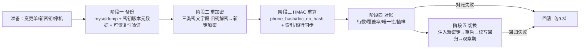

# PMS2 生产 PII 独立密钥备份重加密与切换手册

| 项目 | 内容 |
|---|---|
| 文档名称 | PMS2 生产 PII 独立密钥备份重加密与切换手册 |
| 文档版本 | v1.0 |
| 编制日期 | 2026-11-12 |
| 代码基线 | `main` @ `a0ec4fd`（含 WB-123 独立 PII 密钥启动校验、WB-103 手机号密文化、WB-102 证件占用索引、WB-124 MySQL 恢复演练） |
| 适用范围 | 生产环境（`DJANGO_ENV=prod`，MySQL 8）`DJANGO_PII_KEY` 独立 PII 密钥的备份、重加密、HMAC 重算、对账与切换 |
| 前置口径 | 《PMS2技术功能说明文档》§6.5 PII 加密与脱敏、§6.11 故障与恢复语义；《PMS2 MySQL财务与审计不可变事实部署说明》"PII 密钥切换"段落 |
| 文档性质 | **生产操作手册（runbook）**，不是验收结论；"手册存在" ≠ "切换已执行/已验收" |

---

## 1. 读者与执行边界声明

| 声明 | 内容 |
|---|---|
| 目标读者 | 生产运维 / DBA（执行人）、安全与合规（复核人）、业务负责人（批准人） |
| 执行边界 | 本手册仅供运维在生产环境受控执行。**AI 助手与开发人员不得直接操作生产数据库、生产密钥或生产服务进程**；开发人员的职责仅限于：评审本手册与轮换脚本、在隔离库（`test_hotel`）陪跑验证、对失败现场提供技术分析 |
| 变更管理 | 本手册执行前必须开立变更单（含窗口时间、回滚预案、签署栏，见附录 B）；无变更单不得执行 |
| 演练与生产的边界 | `scripts/pii_restore_drill.py`（SQLite）与 `scripts/pii_restore_drill_mysql.py`（MySQL，硬性限定 `test_hotel`）是 **WB-124 恢复演练**，只证明"备份→迁移→恢复→重放"链路与密钥恢复能力；**它们不执行重加密、不触碰生产库，也不能替代本手册的生产切换**。详见 §10 |
| 密钥纪律 | 全部凭据一律以环境变量注入（`$DJANGO_PII_KEY`、`$DJANGO_PII_KEY_OLD` 等）。任何真实密钥、口令**严禁**出现在命令行参数、日志、工单、IM、代码或本文档中。本文档自检口径见 §11 |
| 审计合规 | 轮换脚本的批量解密是**受控后台操作**，不走 `reveal_phone` / `reveal_document` 业务揭示权限路径；其授权依据是变更单 + 附录 B 签署栏留痕。任何经业务路径的人工抽样揭示必须填 `reason`（服务层 fail-closed）并落 `AuditEvent` |

---

## 2. 背景与代码事实（已核实）

### 2.1 PII 存储口径（对齐《技术功能说明文档》§6.5）

| 项 | 方案 |
|---|---|
| 存储 | 手机号/证件号只存密文（`phone_ciphertext` / `doc_no_ciphertext`，Fernet）+ HMAC 哈希（`phone_hash` / `doc_no_hash`，等值查询与唯一性仲裁用），不存明文 |
| 密钥 | `DJANGO_PII_KEY`（**独立于** `DJANGO_SECRET_KEY`），生产启动强制校验 ≥32 字符 |
| 唯一性 | 证件物业级唯一由 `GuestDocumentIndex(property, doc_no_hash)` 仲裁；号码主号唯一由 `primary_guest_key` 仲裁 |
| 揭示 | 独立权限 + 理由必填 + `AuditEvent` 留痕 |

### 2.2 密钥派生与加解密实现（源码：`apps/guests/services.py`）

| 函数 | 行为（已按 `a0ec4fd` 基线核实） |
|---|---|
| `_pii_key_bytes()` | 统一密钥派生入口：取 `settings.DJANGO_PII_KEY`，返回 `sha256(key).digest()`；**生产缺失时 fail-fast（禁止回退 SECRET_KEY，WB-123）**；开发/测试未配置时才回退 `sha256(SECRET_KEY)` |
| `_fernet()` | `Fernet(base64.urlsafe_b64encode(_pii_key_bytes()))` |
| `encrypt_phone(normalized)` / `decrypt_phone(ciphertext)` | Fernet 加解密标准化号码；密钥不匹配抛 `ValueError("电话密文解密失败：密钥不匹配或数据损坏")` |
| `encrypt_doc_no(doc_no)` / `decrypt_doc_no(ciphertext)` | 同构，证件号 |
| `phone_hash(normalized)` / `doc_no_hash(doc_no)` | `HMAC-SHA256(_pii_key_bytes(), value.strip()).hexdigest()`，不可逆 |
| `normalize_phone(raw)` | 去空格/横线/括号，仅保留数字与 `+` |
| `phone_plain(row)` / `guest_phone_plain(guest)` | 业务读取入口：解密 `phone_ciphertext` |
| `reveal_phone` / `reveal_document` | 揭示服务：独立权限 + `reason` 必填 + `AuditEvent` |

### 2.3 密钥注入与启动校验（源码：`hotel/settings.py`）

| 事实 | 说明 |
|---|---|
| 注入 | `DJANGO_PII_KEY = os.environ.get("DJANGO_PII_KEY", "").strip()`（第 33 行）——读取即 `strip()`，校验值与加密实际使用值一致 |
| 生产校验 | `_validate_production_settings(...)`（Q7 / WB-123）：`DJANGO_ENV=prod` 启动时校验 `DJANGO_PII_KEY` strip 后非空且 ≥32 字符，否则抛 `ImproperlyConfigured`，错误文案 `DJANGO_PII_KEY must be >=32 chars independent PII key` |
| dev 回退 | 仅非生产环境允许回退 `SECRET_KEY` 派生（服务层 `_pii_key_bytes` 第 3 分支）；**生产绝不允许** |

### 2.4 轮换涉及的表、字段与唯一性仲裁（源码：`apps/guests/models.py`、`apps/reservations/models.py`）

| 表 | 轮换涉及字段 | 说明 |
|---|---|---|
| `guests_guest` | `phone_ciphertext`、`phone_hash` | `phone` / `phone_normalized` 为历史列（迁移 0007 已清空，仅留列兼容 DDL），轮换后必须保持为空 |
| `guests_guestphone` | `phone_ciphertext`、`phone_hash` | 唯一约束 `uq_guestphone_guest_hash(guest, phone_hash)` |
| `guests_guestdocument` | `doc_no_ciphertext`、`doc_no_hash` | 唯一约束 `uq_guest_doc_hash(guest, doc_type, doc_no_hash)` |
| `guests_guestdocumentindex` | `doc_no_hash` | **物业级占用仲裁**：唯一约束 `uq_guestdocindex_property_hash(property, doc_no_hash)`，与 `GuestDocument.doc_no_hash` 同源，必须同步重算 |
| `reservations_pendingbookinggate` | `gate_key` | **并发锁行**：`gate_key` 与 `guest.phone_hash` 同源（HMAC），唯一约束 `uq_pbg_property_gate_key(property, gate_key)`，必须同步重算或清理 |
| `guests_guestphone.primary_guest_key` | **无需重算** | 取值为 `str(guest_id)`（主号码行），**不是**密钥派生值；轮换不改变它，只做存在性核对 |

> **关键结论**：密文与 HMAC 哈希派生自同一密钥，二者必须**同批、原子**地切换到新密钥——把"重加密"和"HMAC 重算"拆成两次独立扫描会制造"密文已换钥、哈希仍旧钥"的半状态窗口。因此 §6（阶段二）与 §7（阶段三）在实现上由同一脚本（附录 C）的同一批次事务完成，章节分开仅为了交代各自的验证点与仲裁字段注意事项。

---

## 3. 总体流程与停机窗口



### 3.1 停机窗口要求

轮换期间**必须停止全部写入方**，否则窗口内的并发写入会产生"旧钥密文/旧钥哈希"残留，对账必然失败：

1. 停止应用进程（WSGI/ASGI，`systemctl stop <pms2服务名>` 或容器缩容为 0）；
2. 停止 `payment_compensation_worker`（补偿任务 Worker）；
3. 停止计划任务：`expire_pending_refunds`、`expire_reservation_holds`、`recover_stale_night_audits` 等已部署的定时调度；
4. 确认夜审不会在窗口内触发（夜审跨窗口时择期）；
5. DBA 确认无活动业务连接：`SHOW PROCESSLIST` 中不应出现应用账号的业务会话。

### 3.2 执行顺序总览

| 步骤 | 动作 | 库状态 | 应用状态 | 生产 `DJANGO_PII_KEY` |
|---|---|---|---|---|
| 0 | 准备、新密钥下发、停机 | 在线 | 已停止 | 旧密钥（保持不变） |
| 1 | 阶段一：备份 + 可恢复性验证 | 在线 | 已停止 | 旧密钥 |
| 2/3 | 阶段二+三：轮换脚本 `verify-old` → `rotate --apply`（脚本进程内注入**新**密钥） | 被脚本写 | 已停止 | 旧密钥（应用侧未动） |
| 4 | 阶段四：`reconcile` + 抽样验证 | 已换钥 | 已停止 | 旧密钥 |
| 5 | 阶段五：更新密钥源 → 应用注入新密钥 → 重启 → 读写回归 | 已换钥 | 已启动 | **新密钥** |

> 注意：轮换脚本从 `settings.DJANGO_PII_KEY` 读取**新**密钥（进程环境注入），从 `DJANGO_PII_KEY_OLD` 读取旧密钥。**应用进程的密钥源在阶段五之前保持旧密钥不变**。

---

## 4. 新密钥生成与保管要求

### 4.1 生成要求

| 要求 | 内容 |
|---|---|
| 长度 | strip 后 ≥32 字符（启动校验硬性要求；建议 48 字节 base64） |
| 来源 | **密钥服务/秘密管理平台（KMS/Vault/密码保管库）生成并下发**；无密钥服务时由两名运维在受控终端现场生成、当面移交，全程不留复制粘贴痕迹 |
| 与 SECRET_KEY 隔离 | 不得与 `DJANGO_SECRET_KEY`、`PAYMENT_WEBHOOK_SECRET` 相同或派生自同一口令 |
| 字符集 | 建议 base64（无空格、无引号、无 shell 元字符）；settings 会 `strip()`，但**不要**以空白开头结尾 |
| 禁止事项 | **禁止写入代码、禁止提交 `.env`、禁止进日志/工单/IM/截图**；`.env` 仅限本地 dev 且必须处于 `.gitignore` 覆盖内 |
| 版本元数据 | 变更单记录：密钥版本号（如 `PII-KEY-v2`）、生成日期、启用时间、**指纹**（SHA-256 前 16 位 hex，见下），**不得记录密钥本体** |

指纹计算（在已注入新密钥的终端执行，输出仅 16 位 hex，可安全留痕）：

```bash
python -c "import os,hashlib; k=os.environ.get('DJANGO_PII_KEY','').strip(); print('PII-KEY fp:', hashlib.sha256(k.encode()).hexdigest()[:16] if k else 'EMPTY')"
```

```powershell
python -c "import os,hashlib; k=os.environ.get('DJANGO_PII_KEY','').strip(); print('PII-KEY fp:', hashlib.sha256(k.encode()).hexdigest()[:16] if k else 'EMPTY')"
```

生成命令（仅当无密钥服务时使用；输出直接写入受控移交介质，不回显到会话记录）：

```bash
openssl rand -base64 48
```

```powershell
$b = New-Object byte[] 48
[System.Security.Cryptography.RandomNumberGenerator]::Create().GetBytes($b)
[Convert]::ToBase64String($b)
```

### 4.2 旧密钥归档与保留期

| 阶段 | 要求 |
|---|---|
| 切换前 | 旧密钥从密钥服务导出至**离线归档**（加密介质 + 访问登记），供轮换脚本与回滚使用 |
| 观察期 | 切换后 **≥7 天**（覆盖至少一次夜审、一次备份恢复抽查、一次月结对账节点）旧密钥保持可取用状态，用于回滚反向重加密 |
| 归档期 | 观察期通过后转入密钥归档库，**归档保留 ≥90 天**（或按等保/个保法与甲方合同更长者执行） |
| 销毁 | 归档期满且无未决回滚需求，经**双人审批**后销毁并留痕（销毁时间、经办、复核） |

---

## 5. 阶段一：备份

目标：拿到"密钥轮换前"的完整可恢复备份（数据库 + 密钥版本元数据），并当场验证备份可用——**备份成功 ≠ 备份可用**（WB-124 演练口径）。

### 5.1 命令

推荐使用 `mysql_config_editor` 保存受控连接（口令交互输入，不落 argv、不落 shell 历史）：

bash：

```bash
# 1) 受控连接（一次性，--password 交互输入，不回显）
mysql_config_editor set --login-path=pms_rekey \
  --host="$DJANGO_DB_HOST" --port="$DJANGO_DB_PORT" --user="$PII_BACKUP_DB_USER" --password

# 2) 全库备份（与 WB-124 演练同参数：一致性快照 + 触发器 + 存储过程）
STAMP=$(date +%Y%m%d_%H%M%S)
BACKUP_FILE="${PII_BACKUP_DIR}/hotel_pre_pii_rekey_${STAMP}.sql"
mysqldump --login-path=pms_rekey --single-transaction --triggers --routines \
  --set-gtid-purged=OFF --default-character-set=utf8mb4 \
  --result-file="$BACKUP_FILE" "$DJANGO_DB_NAME"

# 3) 压缩归档 + 完整性校验
gzip "$BACKUP_FILE"
gzip -t "${BACKUP_FILE}.gz" && echo "gzip integrity OK"
```

PowerShell：

```powershell
mysql_config_editor set --login-path=pms_rekey `
  --host=$env:DJANGO_DB_HOST --port=$env:DJANGO_DB_PORT --user=$env:PII_BACKUP_DB_USER --password

$stamp = Get-Date -Format 'yyyyMMdd_HHmmss'
$dump  = "$env:PII_BACKUP_DIR\hotel_pre_pii_rekey_$stamp.sql"
mysqldump --login-path=pms_rekey --single-transaction --triggers --routines `
  --set-gtid-purged=OFF --default-character-set=utf8mb4 `
  --result-file="$dump" $env:DJANGO_DB_NAME
if ($LASTEXITCODE -ne 0) { throw "mysqldump failed: exit=$LASTEXITCODE" }
Compress-Archive -Path $dump -DestinationPath "$dump.zip"
Remove-Item $dump   # 仅留压缩件；如需留明文 dump 须放受控目录
```

### 5.2 备份验证（行数基线 + 关键表存在性）

bash：

```bash
# 源库行数基线（记入变更单，阶段四对账用）
mysql --login-path=pms_rekey "$DJANGO_DB_NAME" -N -e "
SELECT (SELECT COUNT(*) FROM guests_guest)                    AS guest_cnt,
       (SELECT COUNT(*) FROM guests_guestphone)               AS guestphone_cnt,
       (SELECT COUNT(*) FROM guests_guestdocument)            AS guestdocument_cnt,
       (SELECT COUNT(*) FROM guests_guestdocumentindex)       AS docindex_cnt,
       (SELECT COUNT(*) FROM reservations_pendingbookinggate) AS gate_cnt;"

# 备份文件包含关键表数据（各至少一条 INSERT）
for t in guests_guest guests_guestphone guests_guestdocument; do
  echo "== $t =="; grep -c "INSERT INTO \`$t\`" "$BACKUP_FILE"
done
```

PowerShell：

```powershell
mysql --login-path=pms_rekey $env:DJANGO_DB_NAME -N -e "
SELECT (SELECT COUNT(*) FROM guests_guest),
       (SELECT COUNT(*) FROM guests_guestphone),
       (SELECT COUNT(*) FROM guests_guestdocument),
       (SELECT COUNT(*) FROM guests_guestdocumentindex),
       (SELECT COUNT(*) FROM reservations_pendingbookinggate);"
Select-String -Path $dump -Pattern 'INSERT INTO ``guests_guest``' | Measure-Object | Select-Object Count
```

备份可恢复性验证（可选但强烈建议）：将备份恢复到隔离库 `test_hotel` 后核对行数，操作方式与 `scripts/pii_restore_drill_mysql.py` Phase 4/5 相同（该脚本已硬性限定目标库为 `test_hotel`，可整套运行作为备份可用性证据）。

### 5.3 失败判定与中止条件

| 现象 | 判定 | 动作 |
|---|---|---|
| `mysqldump` 退出码 ≠ 0 | 备份失败 | **中止**，不进入阶段二 |
| 备份文件 < 1KB 或缺任一关键表 INSERT | 备份不完整 | **中止** |
| `gzip -t` / `Compress-Archive` 校验失败 | 归档损坏 | **中止**，重新备份 |
| 行数基线无法取得 | 无法对账 | **中止** |
| 备份未含密钥版本元数据 | 回滚链路断裂 | **中止**——元数据（旧密钥指纹、版本号、归档位置）必须先记入变更单再继续 |

---

## 6. 阶段二：重加密

目标：三类密文字段（`guests_guest.phone_ciphertext`、`guests_guestphone.phone_ciphertext`、`guests_guestdocument.doc_no_ciphertext`）由"旧密钥 Fernet 密文"批量转换为"新密钥 Fernet 密文"。**实现载体是附录 C 轮换脚本的 `rotate` 子命令**（与阶段三的 HMAC 重算同批原子完成），脚本源自 WB-124 演练脚本的 `verify_backfill` / check 输出模式扩展。

> **脚本人库规则**：附录 C 脚本文本只是手册附件，**上线前必须先在隔离库试跑**（`DJANGO_ROTATION_SCOPE=test_hotel` + `DJANGO_DB_NAME=test_hotel`），经代码评审后才能放入 `scripts/` 并按生产口径执行；评审通过前不得以任何方式在生产执行。

### 6.1 执行环境（仅轮换脚本进程注入新密钥；应用保持旧密钥且已停止）

bash：

```bash
export DJANGO_ENV='prod'
export DJANGO_DB_ENGINE='mysql'
export DJANGO_DB_NAME='<生产库名>'
export DJANGO_DB_HOST='<生产库主机>'
export DJANGO_DB_PORT='3306'
export DJANGO_DB_USER='<应用运行账号>'          # 只需 guests_*/pendingbookinggate 的 SELECT/UPDATE，无需 DDL
export DJANGO_DB_PASSWORD='<由秘密管理平台注入，禁止字面量>'
export DJANGO_PII_KEY='<新密钥，由密钥服务下发>'
export DJANGO_PII_KEY_OLD='<旧密钥，从离线归档取用>'
export DJANGO_ROTATION_SCOPE='prod'
export PII_PROD_DB_NAME='<生产库名>'
export PII_ROTATION_CONFIRM='ROTATE-PII-PROD'

# 第 1 步：只读验证——旧密钥必须能解密全部存量密文（0 失败才允许写库）
python scripts/pii_key_rotation_prod.py verify-old 2>&1 | tee -a logs/pii_rekey_prod_round<N>.log
```

PowerShell：

```powershell
$env:DJANGO_ENV='prod'
$env:DJANGO_DB_ENGINE='mysql'
$env:DJANGO_DB_NAME='<生产库名>'
$env:DJANGO_DB_HOST='<生产库主机>'
$env:DJANGO_DB_PORT='3306'
$env:DJANGO_DB_USER='<应用运行账号>'
$env:DJANGO_DB_PASSWORD='<由秘密管理平台注入，禁止字面量>'
$env:DJANGO_PII_KEY='<新密钥，由密钥服务下发>'
$env:DJANGO_PII_KEY_OLD='<旧密钥，从离线归档取用>'
$env:DJANGO_ROTATION_SCOPE='prod'
$env:PII_PROD_DB_NAME='<生产库名>'
$env:PII_ROTATION_CONFIRM='ROTATE-PII-PROD'

python scripts\pii_key_rotation_prod.py verify-old 2>&1 | Tee-Object -Append logs\pii_rekey_prod_round<N>.log
```

切换前抽样清单（**只读**；清单只含掩码与加盐 HMAC 摘要，不含明文）：

```bash
python scripts/pii_key_rotation_prod.py sample-capture --out logs/pii_rekey_sample_manifest.json
```

```powershell
python scripts\pii_key_rotation_prod.py sample-capture --out logs\pii_rekey_sample_manifest.json
```

### 6.2 执行轮换（先 DRY-RUN，后 `--apply`）

bash：

```bash
# DRY-RUN：只统计将更新的行数，不写库
python scripts/pii_key_rotation_prod.py rotate 2>&1 | tee -a logs/pii_rekey_prod_round<N>.log

# 确认统计数与阶段一行数基线一致后，正式执行（分批事务，批大小 PII_ROTATION_BATCH，默认 500）
python scripts/pii_key_rotation_prod.py rotate --apply 2>&1 | tee -a logs/pii_rekey_prod_round<N>.log
```

PowerShell：

```powershell
python scripts\pii_key_rotation_prod.py rotate 2>&1 | Tee-Object -Append logs\pii_rekey_prod_round<N>.log
python scripts\pii_key_rotation_prod.py rotate --apply 2>&1 | Tee-Object -Append logs\pii_rekey_prod_round<N>.log
```

> `rotate`（DRY-RUN）与 `rotate --apply`（写库）两条命令在 bash 与 PowerShell 中除路径分隔符与管道落盘命令外完全一致。

### 6.3 验证方式

脚本输出与 WB-124 演练证据同格式（`[PASS]/[FAIL]` + `RESULT` 行），必须出现：

| 输出行 | 含义 |
|---|---|
| `[PASS] 旧密钥可解密 Guest/GuestPhone/GuestDocument 全部密文` | 阶段二前置验证通过 |
| `[PASS] 预检：GuestDocumentIndex 旧哈希均可解析` | 索引可与证件表同步 |
| `[WARN]/[PASS] 预检：PendingBookingGate 旧哈希均可解析` | 锁行可同步；孤儿锁行仅在停机窗口内允许删除 |
| `[PASS] Guest/GuestPhone/GuestDocument 重加密+重算完成 rows=<N>` | 三类密文全部换钥 |
| `[PASS] GuestDocumentIndex 同步完成` / `[PASS] PendingBookingGate 同步完成` | 仲裁字段与锁行同步 |
| `RESULT: PASS（重加密 + HMAC 重算完成；进入对账阶段）` | 阶段二/三整体通过，退出码 0 |

### 6.4 失败判定与中止条件

| 现象 | 判定 | 动作 |
|---|---|---|
| `verify-old` 出现任意 `解密失败=N>0` | 存量密文与旧密钥不匹配（拿错密钥版本或数据异常） | **中止**，未写库；核对密钥指纹后重试，仍失败则终止变更 |
| `rotate --apply` 中途 FAIL | 部分批次已提交（半状态） | **立即停手**，按 §9.3 执行**反向重加密回滚**（禁止直接重启应用） |
| 批处理耗时超出变更窗口 | 窗口不足 | 中止后续批次并回滚已写批次，择期重新开窗（禁止带病切换） |
| 脚本打印 `REFUSED` | 保护性拒绝（scope/确认串/库名不符或新旧密钥相同） | 属预期保护，纠正环境后重来；**不得绕过** |

---

## 7. 阶段三：HMAC 重算

目标：`phone_hash` / `doc_no_hash` 及全部**同源派生字段**切换为新密钥的 HMAC-SHA256。与阶段二在同一脚本批次内原子完成（理由见 §2.4 末注）。

### 7.1 重算范围与仲裁字段注意事项

| 字段 | 重算 | 注意事项 |
|---|---|---|
| `guests_guest.phone_hash` | 是 | 由解密出的标准化号码直接 HMAC，**不要**重新走 `normalize_phone`（避免口径漂移改变取值） |
| `guests_guestphone.phone_hash` | 是 | 与 Guest 主字段哈希必须保持一致（对账项 R5）；`uq_guestphone_guest_hash(guest, phone_hash)` 复合唯一在轮换前后语义不变（同一客人同一号码 → 同一明文 → 同一新哈希） |
| `guests_guestdocument.doc_no_hash` | 是 | `uq_guest_doc_hash(guest, doc_type, doc_no_hash)` 复合唯一语义不变 |
| `guests_guestdocumentindex.doc_no_hash` | **必须同步** | 物业级唯一仲裁（`uq_guestdocindex_property_hash`）。索引行只存哈希、不存密文，**无法自行解密**——必须以证件表旧哈希为映射源同步（脚本第 3 步）。若索引存在证件表中不存在的哈希，属数据异常，轮换中止 |
| `reservations_pendingbookinggate.gate_key` | **必须同步或清理** | 纯锁行、无业务状态，`get_or_create` 会按需重建。脚本第 4 步按 `(property_id, 旧phone_hash)→新hash` 映射同步；孤儿锁行（映射不到）默认保留并在对账中 WARN，仅在停机窗口内可设 `PII_ROTATION_ALLOW_ORPHAN_GATE_DELETE=1` 删除 |
| `guests_guestphone.primary_guest_key` | **否** | 值为 `str(guest_id)`，与密钥无关；轮换不得改动，仅做存在性核对（对账项 R6） |
| `AuditEvent` / `LedgerEntry` 等 | 否 | 不含 PII 密文或派生哈希（审计只落掩码 `_mask()` 值） |

### 7.2 验证方式与失败判定

验证并入 §6.3 的脚本输出与 §8 的对账（尤其 R2/R3/R4 三组唯一性 SQL）。失败判定同 §6.4。

---

## 8. 阶段四：对账

目标：在**切换应用密钥之前**确认轮换完整性。两类手段：脚本 `reconcile`（ORM 口径）与 SQL 直查（DBA 口径，可与脚本互为复核）。

### 8.1 脚本对账

bash：

```bash
python scripts/pii_key_rotation_prod.py reconcile \
  --expect-guest <阶段一guest_cnt> \
  --expect-guestphone <阶段一guestphone_cnt> \
  --expect-guestdocument <阶段一guestdocument_cnt> \
  --expect-guestdocumentindex <阶段一docindex_cnt> \
  2>&1 | tee -a logs/pii_rekey_prod_round<N>.log
```

PowerShell：

```powershell
python scripts\pii_key_rotation_prod.py reconcile `
  --expect-guest <阶段一guest_cnt> `
  --expect-guestphone <阶段一guestphone_cnt> `
  --expect-guestdocument <阶段一guestdocument_cnt> `
  --expect-guestdocumentindex <阶段一docindex_cnt> `
  2>&1 | Tee-Object -Append logs\pii_rekey_prod_round<N>.log
```

`reconcile` 检查项（`[PASS]` 必须全绿；`[WARN]` 须在变更单记录豁免理由）：

| 编号 | 检查项 | 期望 |
|---|---|---|
| R1a/R1b | `Guest` / `GuestPhone` 密文非空行数 = 哈希非空行数（密文行数=明文行数口径：轮换不增删行、覆盖率不降） | 相等 |
| R1c | `GuestDocument` 全部行 `doc_no_hash` 非空 | 缺失=0 |
| R2 | 四张表总行数与阶段一基线一致 | 相等（未提供期望值时脚本输出现值由人工比对） |
| R3 | `GuestDocumentIndex` 与 `GuestDocument` 按 `(property_id, doc_no_hash)` 一一对应 | 双向差集=0 |
| R4 | 三组唯一性：`(guest, phone_hash)` 重复组=0；`(property, doc_no_hash)` 索引重复组=0；同物业同证件哈希被多个客人占用组=0 | 全部为 0 |
| R5 | 主号码一致性：`GuestPhone(is_primary=True).phone_hash` 与 `Guest.phone_hash` 不一致行数 | 0（WARN，历史豁免须记录） |
| R6 | 有哈希的 `Guest` 均存在主号码行；`primary_guest_key` 未被轮换改动 | 0 / 抽查 |
| R7 | 历史明文列（`guests_guest.phone/phone_normalized`、`guests_guestphone.phone/phone_normalized`）保持为空 | 违规=0 |
| R8 | `PendingBookingGate` 锁行与新哈希对齐 | 孤儿=0（WARN） |

### 8.2 SQL 复核（DBA 直查，任选关键项）

```sql
-- R1 覆盖率：密文行数 = 哈希行数
SELECT
  (SELECT COUNT(*) FROM guests_guest WHERE phone_ciphertext IS NOT NULL AND phone_ciphertext <> '')       AS guest_ct,
  (SELECT COUNT(*) FROM guests_guest WHERE phone_hash IS NOT NULL AND phone_hash <> '')                   AS guest_hash,
  (SELECT COUNT(*) FROM guests_guestphone WHERE phone_ciphertext IS NOT NULL AND phone_ciphertext <> '')  AS gp_ct,
  (SELECT COUNT(*) FROM guests_guestphone WHERE phone_hash IS NOT NULL AND phone_hash <> '')              AS gp_hash;
-- 期望：guest_ct = guest_hash 且 gp_ct = gp_hash

-- R4 唯一性：三个仲裁维度均无重复
SELECT guest_id, phone_hash, COUNT(*) c FROM guests_guestphone
WHERE phone_hash IS NOT NULL GROUP BY guest_id, phone_hash HAVING c > 1;          -- 期望 0 行

SELECT property_id, doc_no_hash, COUNT(*) c FROM guests_guestdocumentindex
GROUP BY property_id, doc_no_hash HAVING c > 1;                                   -- 期望 0 行

SELECT gd.property_id, gd.doc_no_hash, COUNT(DISTINCT gd.guest_id) g
FROM guests_guestdocument gd GROUP BY gd.property_id, gd.doc_no_hash HAVING g > 1; -- 期望 0 行

-- R5 主号码一致性
SELECT COUNT(*) FROM guests_guestphone p JOIN guests_guest g ON g.id = p.guest_id
WHERE p.is_primary = 1 AND g.phone_hash IS NOT NULL AND g.phone_hash <> p.phone_hash;  -- 期望 0

-- R7 历史明文列保持为空
SELECT COUNT(*) FROM guests_guest
WHERE (phone IS NOT NULL AND phone <> '') OR (phone_normalized IS NOT NULL AND phone_normalized <> '');
-- 期望 0（guests_guestphone 同理）

-- R8 孤儿锁行
SELECT COUNT(*) FROM reservations_pendingbookinggate ggt
LEFT JOIN guests_guest gg ON gg.property_id = ggt.property_id AND gg.phone_hash = ggt.gate_key
WHERE gg.id IS NULL;   -- 期望 0（WARN）
```

### 8.3 抽样揭示验证

切换后执行（需新密钥已注入脚本进程环境）：

```bash
python scripts/pii_key_rotation_prod.py sample-verify --manifest logs/pii_rekey_sample_manifest.json
```

```powershell
python scripts\pii_key_rotation_prod.py sample-verify --manifest logs\pii_rekey_sample_manifest.json
```

判定（每条抽样行三个条件同时成立才算 PASS）：

1. 新密钥可解密且解密值的加盐 HMAC 摘要与清单一致（清单不含明文，只有掩码 + 摘要）；
2. 掩码形态与清单一致；
3. **旧密钥对同一密文解密必须失败**（证明轮换真实生效，而非"新旧同值"）。

清单文件 `pii_rekey_sample_manifest.json` 属敏感文件（掩码+加盐摘要仍可被定向暴力枚举），存放于受控目录，**验证完成后删除并留痕**。

### 8.4 失败判定与中止条件

| 现象 | 判定 | 动作 |
|---|---|---|
| 任一非 WARN 项 FAIL | 轮换不完整 | **禁止进入阶段五**；定位后修复并重跑 `reconcile`；无法修复则按 §9.3 回滚 |
| `sample-verify` 任一抽样 FAIL | 新密钥解密失败 / 旧密钥仍可解密 / 摘要不符 | 同上 |
| WARN 项无法给出豁免理由 | 数据口径存疑 | 按 FAIL 处理 |
| 对账期间出现新的应用连接写入 | 停机不彻底 | **中止**，恢复停机状态后重新对账（必要时报 §9.3 回滚） |

---

## 9. 阶段五：切换与回滚

### 9.1 切换步骤

1. **更新密钥源**（按实际部署形态其一）：
   - 服务器环境变量 / 服务管理器（systemd `EnvironmentFile`、Windows 服务凭据）：将 `DJANGO_PII_KEY` 值替换为新密钥；
   - 容器编排 secret / 配置中心：更新对应 secret 条目并滚动生效；
   - **禁止**把新密钥写入代码仓库或提交 `.env`。
2. **注入后指纹复核**（对比变更单记录的新密钥指纹）：

```bash
python -c "import os,hashlib; k=os.environ.get('DJANGO_PII_KEY','').strip(); print('PII-KEY fp:', hashlib.sha256(k.encode()).hexdigest()[:16] if k else 'EMPTY')"
```

3. **重启应用与 Worker**：

```bash
sudo systemctl restart <pms2服务名>
sudo systemctl start <pms2补偿worker服务名>   # 以实际服务单元名为准
```

```powershell
Restart-Service <PMS2 服务名>
Start-Service <PMS2 补偿 Worker 服务名>
```

4. **启动验证**：服务启动即过 Q7 生产校验（`DJANGO_PII_KEY` ≥32 字符）。检查：
   - 服务进程存活、无 `ImproperlyConfigured` 报错；
   - `logs/` 下无 `ValueError("...密文解密失败：密钥不匹配或数据损坏")`。
5. **读写冒烟回归**（在变更单指定口径下执行）：
   - 写：以 `GuestService.create_guest` 建一个烟囱测试档案（使用变更单指定的测试号码，不得使用真实客号）→ 检查 `guests_guest.phone_ciphertext` 非空且 `phone_hash` 非空；
   - 读：`guest_phone_plain(guest)` 返回与写入一致的标准化号码；
   - 揭示路径：以持有 `hotelapp.guest_phone_reveal` 权限的账号走 `reveal_phone`（`reason` 必填），确认返回明文且 `core_auditevent` 新增 `guest.phone_reveal` 事件；
   - 并发锁口径：新建一条官网未支付预订（或模拟路径），确认 `reservations_pendingbookinggate` 新行 `gate_key` 与对应 `guests_guest.phone_hash` 同值；
   - Admin 页面客人列表掩码显示正常、证件/电话揭示按钮行为正常。
6. **恢复调度**：恢复 §3.1 中停止的 Worker 与计划任务，确认首夜审正常。
7. **观察期**：≥7 天。期间日志无解密失败、抽样揭示正常、备份恢复演练（WB-124）通过一次；观察期结束旧密钥转入归档（§4.2）。

### 9.2 旧密钥处置

- 阶段五通过前：旧密钥仅供回滚链路使用（离线归档，双人取用）；
- 观察期（≥7 天）通过：旧密钥转入归档库，保留 ≥90 天；
- 销毁：归档期满、无未决回滚需求，双人审批后销毁并留痕。

### 9.3 回滚

**回滚触发条件**（满足其一即回滚）：

| 编号 | 触发条件 |
|---|---|
| RB-1 | `rotate --apply` 中途失败（半状态） |
| RB-2 | 阶段四对账或抽样验证 FAIL 且无法在窗口内修复 |
| RB-3 | 阶段五切换后应用启动失败，或日志出现解密失败（`InvalidToken`/`ValueError`） |
| RB-4 | 冒烟回归失败（写入的新数据读不出、揭示失败、锁行口径不一致） |
| RB-5 | 窗口超时未完成全部阶段 |

**回滚路径 A（首选）：反向重加密**（复用同一脚本，交换两个密钥变量；数据零丢失）：

```bash
# 目标态 = 旧密钥；当前数据态 = 新密钥 → 交换注入
export DJANGO_PII_KEY='<旧密钥>'
export DJANGO_PII_KEY_OLD='<新密钥>'
export DJANGO_ROTATION_SCOPE='prod'
export PII_PROD_DB_NAME='<生产库名>'
export PII_ROTATION_CONFIRM='ROTATE-PII-PROD'
python scripts/pii_key_rotation_prod.py rotate --apply
python scripts/pii_key_rotation_prod.py reconcile
```

完成后以**旧密钥**环境重启应用（应用密钥源从未改动的场景下直接按原配置启动即可）。

**回滚路径 B（兜底）：备份恢复**（路径 A 不可行时；整库恢复，**丢失窗口内全部写入**——窗口内应用已停止，正常情况下损失仅为轮换脚本自身的写入）：

```bash
# 以 DBA 权限执行（库名以变更单为准）
mysql --login-path=pms_rekey -e "DROP DATABASE <生产库名>; CREATE DATABASE <生产库名> CHARACTER SET utf8mb4 COLLATE utf8mb4_unicode_ci;"
gunzip -c "${PII_BACKUP_DIR}/hotel_pre_pii_rekey_<STAMP>.sql.gz" | mysql --login-path=pms_rekey <生产库名>
```

恢复后必须执行迁移状态核对与 WB-124 演练脚本同款的行数核对（guests/guestphone/guestdocument 各表行数 = 阶段一基线）。

**回滚后动作**：记录失败根因到变更单；本次轮换标记为"未通过"；修订手册/脚本后重新走全流程（含隔离库试跑）。

---

## 10. 演练与生产切换的边界（WB-124 引用）

| 维度 | 演练（`scripts/pii_restore_drill.py` / `pii_restore_drill_mysql.py`） | 生产切换（本手册） |
|---|---|---|
| 目标库 | SQLite 一次性隔离库 / MySQL `test_hotel`（脚本硬校验，`REFUSED` 退出码 2，绝不触碰 dev `hotel` 与生产库） | 生产库（双重确认：`PII_PROD_DB_NAME` 一致 + `PII_ROTATION_CONFIRM`） |
| 证明内容 | 备份→前向迁移→灾难恢复→重放迁移→二次核对；备份可用性与密钥恢复能力 | 旧钥解密→重加密→HMAC 重算→索引/锁行同步→对账→切换→回滚预案 |
| 写库行为 | 演练库内造数、迁移、DROP/恢复 | 真实业务数据重加密（分批事务） |
| 密钥操作 | 不换钥（验证当前密钥解密/HMAC） | 新旧双钥轮换 |
| 证据 | `docs/acceptance/evidence/pii-restore-drill-mysql-wb-round32.log`（`[PASS]/[FAIL]` + `RESULT: PASS` 格式） | 本手册 §11 证据归档 |
| 替代性 | **SQLite 演练不替代 MySQL 演练；演练不替代生产切换**（《不可变事实部署说明》§PII 密钥切换口径） | 生产切换前必须有通过的演练证据；切换本身必须独立执行与验收 |

---

## 11. 证据归档

全部阶段命令输出按演练证据同格式留档：`[PASS]/[FAIL]` 行 + `RESULT: PASS/FAILED` 结论行。

1. 执行时以 `tee -a logs/pii_rekey_prod_round<N>.log`（PowerShell `Tee-Object -Append`）落盘；
2. 完成并**脱敏复核**（确认无密钥、无口令、无明文 PII、无明文手机号/证件号片段）后，复制为
   `docs/acceptance/evidence/pii-rekey-prod-round<N>-<YYYYMMDD>.log`；
3. 同批归档：变更单编号、新旧密钥**指纹**（16 位 hex）、阶段一行数基线、`reconcile` 全文、`sample-verify` 全文、冒烟回归结果与截图说明；
4. 本文档执行一轮后，在文末追加"执行记录补充"小节（风格同《PMS2 MySQL财务与审计不可变事实部署说明》的状态补充节），仅记录时间、轮次、指纹与结论，不记录密钥值。

---

## 12. 验收清单（签署前逐项勾选）

- [ ] 变更单已批准，窗口、回滚预案、签署栏齐备（附录 B）。
- [ ] 新密钥 ≥32 字符、来自密钥服务、与 `DJANGO_SECRET_KEY` 不同，指纹已记录，未出现在任何代码/日志/工单。
- [ ] 旧密钥已离线归档并可取用，指纹一致。
- [ ] 停机清单执行完毕（应用、补偿 Worker、定时任务、夜审、无活动业务连接）。
- [ ] 阶段一备份完成且可恢复性验证通过，行数基线已记录。
- [ ] 轮换脚本已在隔离库（`test_hotel`）试跑通过后才用于生产。
- [ ] `verify-old` 通过（旧密钥解密失败=0）。
- [ ] `rotate --apply` 输出全部 `[PASS]`，`RESULT: PASS`，退出码 0。
- [ ] `reconcile` 全部非 WARN 项 PASS，行数与阶段一基线一致；WARN 项豁免理由已记录。
- [ ] SQL 复核（§8.2）与脚本结论一致。
- [ ] `sample-verify` 通过（新密钥可解密、摘要一致、旧密钥解密失败）。
- [ ] 阶段五切换后应用启动无 `ImproperlyConfigured`、日志无解密失败。
- [ ] 读写冒烟回归（写/读/揭示+审计/锁行口径/Admin 掩码）全部通过。
- [ ] 调度与 Worker 已恢复，首个夜审正常。
- [ ] 证据文件已脱敏并归档至 `docs/acceptance/evidence/`。
- [ ] 观察期 ≥7 天通过后，旧密钥转入归档（≥90 天保留），销毁计划已登记。

---

## 附录 A：风险清单

| 编号 | 风险 | 影响 | 缓解 |
|---|---|---|---|
| A1 | 备份不可恢复 | 回滚链路断裂，事故不可逆 | 备份后当场验证（行数基线 + 关键表 INSERT + 恢复到 `test_hotel` 抽查） |
| A2 | 轮换半途失败留下半状态 | 密文/哈希/索引混钥，业务不可用 | 写库前全量 `verify-old` 预检；分批事务；失败即中止；回滚路径 A 反向重加密 |
| A3 | 停机不彻底（应用/Worker/定时任务残留写入） | 窗口内新写入仍是旧钥 → 对账失败、混钥残留 | §3.1 停机清单 + `SHOW PROCESSLIST` 确认 + 对账前复查连接 |
| A4 | 密钥泄漏（argv/日志/工单/代码/.env 提交） | 全量 PII 暴露 | 全程环境变量注入；`mysql_config_editor` login-path；留痕只用指纹；文档与日志 grep 自查（§11） |
| A5 | 新旧密钥混淆 / 同值 | 轮换空转或全量解密失败 | 脚本指纹打印 + `REFUSED：新密钥与旧密钥相同` 保护 + manifest 指纹校验 |
| A6 | 仲裁字段漂移（`GuestDocumentIndex`、`PendingBookingGate.gate_key` 不同步） | 证件重复登记、并发上限口径失效 | 脚本第 3/4 步同批同步 + R3/R4/R8 对账项 |
| A7 | `primary_guest_key` 被误改 | 主号唯一约束破坏 | 明确该字段与密钥无关（§7.1），轮换只核对不写 |
| A8 | SQLite 演练被误当生产验证 | 假信心上线 | §10 边界声明；MySQL 演练证据为上线前置条件 |
| A9 | 批量解密的审计合规争议 | 合规追责 | 变更单 + 双人签署留痕（§1）；业务揭示一律走 `reveal_*` 权限路径 |
| A10 | 抽样清单（掩码+加盐摘要）被定向枚举 | 有限的 PII 推断风险 | 受控目录存放、验证完成后删除留痕；盐为每次生成 32 字节随机值 |
| A11 | 观察期不足即销毁旧密钥 | 后发现的问题无法回滚 | §4.2 保留期硬性要求 + 双人销毁审批 |
| A12 | dev/测试回退口径误用到生产 | 生产静默回退 SECRET_KEY，独立密钥失效 | 生产启动 Q7 校验 fail-fast（WB-123）；切换后指纹复核 |
| A13 | `normalize_phone` 重算导致口径漂移 | 哈希与既有查询口径不一致 | 轮换不重新标准化，直接对解密明文 HMAC（§7.1） |

---

## 附录 B：签署栏

> 本栏随变更单归档；未签署完成前，手册任何阶段不得执行。

| 角色 | 姓名/账号 | 签署 | 日期 |
|---|---|---|---|
| 执行人（运维/DBA） | | | |
| 复核人（安全/合规） | | | |
| 批准人（业务负责人） | | | |
| 密钥服务经办（如适用） | | | |

---

## 附录 C：生产 PII 密钥轮换脚本全文（`scripts/pii_key_rotation_prod.py`）

> **状态：手册附件，尚未入库。上线前必须：1) 在隔离库（`DJANGO_ROTATION_SCOPE=test_hotel` + `DJANGO_DB_NAME=test_hotel`）试跑通过；2) 经代码评审后才能放入 `scripts/`；3) 与 `apps/guests/services.py::_pii_key_bytes` 派生口径交叉验证。** 脚本输出格式与 WB-124 演练证据一致（`[PASS]/[FAIL]` + `RESULT` 行），任何 FAIL 非零退出。全部凭据经环境变量注入，脚本不落任何字面量凭据。

```python
# -*- coding: utf-8 -*-
"""生产 PII 独立密钥轮换脚本（手册附录 C，上线前须在隔离库试跑）。

与 scripts/pii_restore_drill_mysql.py（WB-124 演练）的边界：
  * 演练脚本证明"备份→迁移→恢复→重放"链路，目标库硬性限定 test_hotel；
  * 本脚本执行真实的"旧密钥解密 → 新密钥重加密 + HMAC 重算"，可在隔离库
    试跑，也可在受控停机窗口对生产库执行（双重显式确认）。

环境要求（全部经环境变量注入，禁止任何字面量凭据）：
  DJANGO_ENV / DJANGO_DB_*        Django 运行环境（同其他 manage.py 调用）
  DJANGO_PII_KEY                  新密钥（本进程注入；应用进程保持旧密钥且已停止）
  DJANGO_PII_KEY_OLD              旧密钥（仅本进程读取；禁止写日志）
  DJANGO_ROTATION_SCOPE           test_hotel | prod（不设则拒绝执行）
  PII_PROD_DB_NAME                scope=prod 时必须与 DJANGO_DB_NAME 一致
  PII_ROTATION_CONFIRM            scope=prod 时必须为字符串 ROTATE-PII-PROD
  PII_ROTATION_BATCH              批大小（默认 500）
  PII_ROTATION_SAMPLE             抽样数（默认 9，三类表各约 1/3）
  PII_ROTATION_ALLOW_ORPHAN_GATE_DELETE=1
                                  允许删除孤儿锁行（仅限停机窗口）

子命令：
  verify-old      只读：验证旧密钥可解密全部存量密文
  sample-capture  只读：生成抽样清单（不含明文，仅掩码 + 加盐 HMAC 摘要）
  rotate          重加密 + HMAC 重算 + 索引/锁行同步（默认 DRY-RUN，--apply 才写库）
  reconcile       对账：行数/覆盖率/唯一性/主号一致性/孤儿锁行
  sample-verify   切换后抽样验证：新密钥可解密、旧密钥必须失效、摘要一致
"""
import base64
import hashlib
import hmac
import json
import os
import sys

sys.path.insert(0, os.path.dirname(os.path.dirname(os.path.abspath(__file__))))
os.environ.setdefault("DJANGO_SETTINGS_MODULE", "hotel.settings")

import django  # noqa: E402

django.setup()

from django.conf import settings  # noqa: E402
from django.db import transaction  # noqa: E402
from django.db.models import Count, F, Q  # noqa: E402
from cryptography.fernet import Fernet, InvalidToken  # noqa: E402

from apps.guests.models import (  # noqa: E402
    Guest, GuestDocument, GuestDocumentIndex, GuestPhone)
from apps.reservations.models import PendingBookingGate  # noqa: E402

FAILURES = []
WARNS = []

CONFIRM_PROD = "ROTATE-PII-PROD"
OLD_KEY = os.environ.get("DJANGO_PII_KEY_OLD", "").strip()
NEW_KEY = (getattr(settings, "DJANGO_PII_KEY", "") or "").strip()
BATCH = int(os.environ.get("PII_ROTATION_BATCH", "500"))
SAMPLE = int(os.environ.get("PII_ROTATION_SAMPLE", "9"))

SOURCES = (
    (Guest, "phone_ciphertext"),
    (GuestPhone, "phone_ciphertext"),
    (GuestDocument, "doc_no_ciphertext"),
)


def check(label, ok, detail="", fatal=True):
    mark = "PASS" if ok else ("WARN" if not fatal else "FAIL")
    print(f"[{mark}] {label}" + (f" | {detail}" if detail else ""), flush=True)
    if not ok:
        (WARNS if not fatal else FAILURES).append(f"{label}: {detail}")


def fingerprint(key):
    """密钥指纹：SHA-256 前 16 位 hex（可安全留痕，不含密钥本体）。"""
    return hashlib.sha256(str(key).encode("utf-8")).hexdigest()[:16]


def key_bytes(key):
    """与 apps/guests/services.py::_pii_key_bytes 同口径（WB-123）。"""
    return hashlib.sha256(str(key).encode("utf-8")).digest()


def fernet_for(key):
    return Fernet(base64.urlsafe_b64encode(key_bytes(key)))


def hmac_for(key, value):
    """与 apps/guests/services.py::phone_hash / doc_no_hash 同口径。"""
    return hmac.new(key_bytes(key), (value or "").strip().encode("utf-8"),
                    hashlib.sha256).hexdigest()


def mask(value):
    """与 apps/guests/services.py::_mask 同口径（短值全打码）。"""
    v = (value or "").strip()
    if not v:
        return ""
    if len(v) < 6:
        return "*" * len(v)
    return v[:2] + "*" * (len(v) - 4) + v[-2:]


def phone_rows(model):
    """有密文的行（密文与哈希同空同非空，verify-old 阶段校验该不变式）。"""
    qs = model.objects.filter(
        Q(phone_ciphertext__isnull=False) & ~Q(phone_ciphertext=""))
    if model is GuestPhone:
        qs = qs.select_related("guest")   # 同步锁行映射需要 guest.property_id
    return qs.order_by("pk")


def doc_rows():
    return GuestDocument.objects.exclude(doc_no_ciphertext="").order_by("pk")


def rows_for(model):
    if model is GuestDocument:
        return doc_rows()
    return phone_rows(model)


def ct_field_for(model):
    return "doc_no_ciphertext" if model is GuestDocument else "phone_ciphertext"


def _chunks(qs, size):
    last_pk = 0
    while True:
        rows = list(qs.filter(pk__gt=last_pk).order_by("pk")[:size])
        if not rows:
            return
        yield rows
        last_pk = rows[-1].pk


def _guard():
    scope = os.environ.get("DJANGO_ROTATION_SCOPE", "")
    db = settings.DATABASES["default"]["NAME"]
    if scope == "test_hotel":
        if db != "test_hotel":
            print(f"REFUSED：隔离库试跑要求 DJANGO_DB_NAME=test_hotel（当前 {db!r}）")
            sys.exit(2)
    elif scope == "prod":
        prod_db = os.environ.get("PII_PROD_DB_NAME", "")
        if not prod_db or db != prod_db:
            print("REFUSED：scope=prod 要求 DJANGO_DB_NAME 与 PII_PROD_DB_NAME 一致")
            sys.exit(2)
        if os.environ.get("PII_ROTATION_CONFIRM", "") != CONFIRM_PROD:
            print(f"REFUSED：生产执行必须显式设置 PII_ROTATION_CONFIRM={CONFIRM_PROD}")
            sys.exit(2)
    else:
        print("REFUSED：必须设置 DJANGO_ROTATION_SCOPE=test_hotel 或 prod")
        sys.exit(2)
    if not NEW_KEY or len(NEW_KEY) < 32:
        print("REFUSED：新密钥 DJANGO_PII_KEY 未注入或 strip 后长度不足 32 字符")
        sys.exit(2)
    if not OLD_KEY or len(OLD_KEY) < 32:
        print("REFUSED：旧密钥 DJANGO_PII_KEY_OLD 未注入或 strip 后长度不足 32 字符")
        sys.exit(2)
    if NEW_KEY == OLD_KEY:
        print("REFUSED：新密钥与旧密钥相同")
        sys.exit(2)
    print(f"密钥指纹（SHA-256 前 16 位，不含密钥本体）："
          f"old={fingerprint(OLD_KEY)} new={fingerprint(NEW_KEY)}")


def _decrypt_old(old_f, ciphertext):
    """旧密钥解密；失败抛 InvalidToken/ValueError/UnicodeEncodeError。"""
    return old_f.decrypt((ciphertext or "").encode("ascii")).decode("utf-8").strip()


def cmd_verify_old():
    _guard()
    old_f = fernet_for(OLD_KEY)
    # 不变式：密文非空 ⟺ 哈希非空（轮换前必须成立）
    for model in (Guest, GuestPhone):
        bad = model.objects.filter(
            Q(phone_ciphertext__isnull=False) & ~Q(phone_ciphertext="")
            & (Q(phone_hash__isnull=True) | Q(phone_hash=""))
        ).count() + model.objects.filter(
            (Q(phone_ciphertext__isnull=True) | Q(phone_ciphertext=""))
            & Q(phone_hash__isnull=False) & ~Q(phone_hash="")
        ).count()
        check(f"数据不变式：{model.__name__} 密文与哈希同空同非空", bad == 0,
              f"违规={bad}")
    for model, field in SOURCES:
        bad = total = 0
        for rows in _chunks(rows_for(model), BATCH):
            for row in rows:
                total += 1
                try:
                    _decrypt_old(old_f, getattr(row, field))
                except (InvalidToken, ValueError, UnicodeEncodeError):
                    bad += 1
        check(f"旧密钥可解密 {model.__name__} 全部密文", bad == 0,
              f"total={total} 解密失败={bad}")
    if FAILURES:
        print("RESULT: FAILED（旧密钥解密验证未通过，禁止进入重加密）")
        sys.exit(1)
    print("RESULT: PASS（旧密钥解密验证通过）")


def cmd_sample_capture(out_path):
    _guard()
    old_f = fernet_for(OLD_KEY)
    salt = os.urandom(32)   # 每次生成独立盐：清单摘要不可与密钥混淆
    per = max(1, SAMPLE // 3)
    samples = []
    for model, field in SOURCES:
        qs = rows_for(model)
        picked = list(qs.order_by("pk")[:per]) + list(qs.order_by("-pk")[:per])
        seen = set()
        for row in picked:
            if row.pk in seen:
                continue
            seen.add(row.pk)
            try:
                plain = _decrypt_old(old_f, getattr(row, field))
            except (InvalidToken, ValueError, UnicodeEncodeError):
                check(f"抽样解密 {model.__name__}#{row.pk}", False, "旧密钥解密失败")
                continue
            samples.append({
                "model": model.__name__, "pk": row.pk,
                "masked": mask(plain),
                "digest": hmac.new(salt, plain.encode("utf-8"),
                                   hashlib.sha256).hexdigest(),
            })
    manifest = {"old_fingerprint": fingerprint(OLD_KEY), "salt": salt.hex(),
                "samples": samples}
    os.makedirs(os.path.dirname(out_path) or ".", exist_ok=True)
    with open(out_path, "w", encoding="utf-8") as fh:
        json.dump(manifest, fh, ensure_ascii=False, indent=2)
    check("抽样清单生成（不含明文）", True,
          f"file={out_path} samples={len(samples)}")
    print("注意：清单属敏感文件（掩码+加盐摘要），验证完成后必须删除并留痕。")
    if FAILURES:
        print(f"RESULT: FAILED（{len(FAILURES)} 项未通过）")
        sys.exit(1)
    print("RESULT: PASS（抽样清单已生成）")


def cmd_rotate(apply):
    _guard()
    old_f = fernet_for(OLD_KEY)
    new_f = fernet_for(NEW_KEY)

    def enc(plain):
        return new_f.encrypt(plain.encode("utf-8")).decode("ascii")

    def hsh(plain):
        return hmac_for(NEW_KEY, plain)

    # ---- 第 0 步：写库前全量验证（防止半途失败留下半状态）----
    for model, field in SOURCES:
        bad = 0
        for rows in _chunks(rows_for(model), BATCH):
            for row in rows:
                try:
                    _decrypt_old(old_f, getattr(row, field))
                except (InvalidToken, ValueError, UnicodeEncodeError):
                    bad += 1
        check(f"写库前全量验证：{model.__name__} 旧密钥可解密", bad == 0,
              f"失败={bad}")
    # ---- 预检：索引与锁行的旧哈希均可由本轮映射解析 ----
    doc_old = set(GuestDocument.objects.exclude(doc_no_ciphertext="")
                  .values_list("doc_no_hash", flat=True))
    idx_missing = GuestDocumentIndex.objects.exclude(
        doc_no_hash__in=doc_old).count()
    check("预检：GuestDocumentIndex 旧哈希均可解析", idx_missing == 0,
          f"未匹配={idx_missing}")
    phone_old = set(Guest.objects.filter(phone_hash__isnull=False)
                    .exclude(phone_hash="").values_list("phone_hash", flat=True))
    phone_old |= set(GuestPhone.objects.filter(phone_hash__isnull=False)
                     .exclude(phone_hash="").values_list("phone_hash", flat=True))
    gate_missing = PendingBookingGate.objects.exclude(
        gate_key__in=phone_old).count()
    check("预检：PendingBookingGate 旧哈希均可解析", gate_missing == 0,
          f"未匹配={gate_missing}", fatal=False)   # 锁行可按需重建，仅 WARN
    if FAILURES:
        print("RESULT: FAILED（预检未通过，已中止，未写库）")
        sys.exit(1)

    if not apply:
        counts = [rows_for(model).count() for model, _f in SOURCES]
        check("DRY-RUN 统计（未写库）", True,
              f"Guest={counts[0]} GuestPhone={counts[1]} "
              f"GuestDocument={counts[2]}（索引与锁行将按映射同步）")
        print("RESULT: PASS（DRY-RUN 通过；确认后加 --apply 执行写库）")
        return

    updated = {"Guest": 0, "GuestPhone": 0, "GuestDocument": 0,
               "GuestDocumentIndex": 0, "PendingBookingGate": 0}
    doc_hash_map = {}     # 旧 doc_no_hash -> 新 doc_no_hash
    phone_hash_map = {}   # (property_id, 旧 phone_hash) -> 新 phone_hash

    # ---- 第 1 步：Guest / GuestPhone 重加密 + 重算 phone_hash ----
    for model in (Guest, GuestPhone):
        name = model.__name__
        done = 0
        for rows in _chunks(phone_rows(model), BATCH):
            with transaction.atomic():
                for row in rows:
                    plain = _decrypt_old(old_f, row.phone_ciphertext)
                    old_hash = row.phone_hash
                    if not plain:
                        # 理论不可能（密文非空 ⟹ 号码非空）；防御性处理
                        row.phone_ciphertext = ""
                        row.phone_hash = None
                    else:
                        new_hash = hsh(plain)
                        if old_hash:
                            prop_id = (row.property_id if name == "Guest"
                                       else row.guest.property_id)
                            phone_hash_map[(prop_id, old_hash)] = new_hash
                        row.phone_ciphertext = enc(plain)
                        row.phone_hash = new_hash
                    row.save(update_fields=["phone_ciphertext", "phone_hash",
                                            "updated_at"])
            done += len(rows)
            print(f"  ... {name} 已处理 {done} 行", flush=True)
        updated[name] = done
        check(f"{name} 重加密+重算完成", True, f"rows={done}")

    # ---- 第 2 步：GuestDocument 重加密 + 重算 doc_no_hash ----
    done = 0
    for rows in _chunks(doc_rows(), BATCH):
        with transaction.atomic():
            for row in rows:
                plain = _decrypt_old(old_f, row.doc_no_ciphertext)
                new_hash = hsh(plain)
                if row.doc_no_hash:
                    doc_hash_map[row.doc_no_hash] = new_hash
                row.doc_no_ciphertext = enc(plain)
                row.doc_no_hash = new_hash
                row.save(update_fields=["doc_no_ciphertext", "doc_no_hash",
                                        "updated_at"])
        done += len(rows)
        print(f"  ... GuestDocument 已处理 {done} 行", flush=True)
    updated["GuestDocument"] = done
    check("GuestDocument 重加密+重算完成", True, f"rows={done}")

    # ---- 第 3 步：GuestDocumentIndex 同步（物业级唯一仲裁，WB-102）----
    done = 0
    for rows in _chunks(GuestDocumentIndex.objects.order_by("pk"), BATCH):
        with transaction.atomic():
            for row in rows:
                new_hash = doc_hash_map.get(row.doc_no_hash)
                if new_hash is None:
                    # 预检已拦截；此处为兜底（如并发写入），立即中止
                    raise RuntimeError(
                        f"GuestDocumentIndex#{row.pk} 旧哈希无法解析，中止轮换")
                row.doc_no_hash = new_hash
                row.save(update_fields=["doc_no_hash", "updated_at"])
                done += 1
    updated["GuestDocumentIndex"] = done
    check("GuestDocumentIndex 同步完成", True, f"rows={done}")

    # ---- 第 4 步：PendingBookingGate 同步（gate_key 与 phone_hash 同源）----
    done = orphans = 0
    allow_delete = (os.environ.get("PII_ROTATION_ALLOW_ORPHAN_GATE_DELETE") == "1")
    for rows in _chunks(PendingBookingGate.objects.order_by("pk"), BATCH):
        with transaction.atomic():
            for row in rows:
                new_key = phone_hash_map.get((row.property_id, row.gate_key))
                if new_key is None:
                    orphans += 1
                    if allow_delete:   # 纯锁行无业务状态，仅限停机窗口
                        row.delete()
                    continue
                row.gate_key = new_key
                row.save(update_fields=["gate_key"])
                done += 1
    updated["PendingBookingGate"] = done
    check("PendingBookingGate 同步完成", True,
          f"rows={done} orphans={orphans} deleted={'1' if allow_delete else '0'}")

    print("--- 轮换汇总 ---")
    for key, val in updated.items():
        print(f"  {key}: {val}")
    if FAILURES:
        print(f"RESULT: FAILED（{len(FAILURES)} 项未通过）")
        sys.exit(1)
    print("RESULT: PASS（重加密 + HMAC 重算完成；进入对账阶段）")


def cmd_reconcile(expect):
    _guard()
    # R1 覆盖率：密文行数 = 哈希行数
    g_ct, g_hash = (Guest.objects.filter(
        Q(phone_ciphertext__isnull=False) & ~Q(phone_ciphertext="")).count(),
        Guest.objects.filter(Q(phone_hash__isnull=False)
                             & ~Q(phone_hash="")).count())
    check("R1a Guest 密文行数=哈希行数", g_ct == g_hash,
          f"ct={g_ct} hash={g_hash}")
    gp_ct, gp_hash = (GuestPhone.objects.filter(
        Q(phone_ciphertext__isnull=False) & ~Q(phone_ciphertext="")).count(),
        GuestPhone.objects.filter(Q(phone_hash__isnull=False)
                                  & ~Q(phone_hash="")).count())
    check("R1b GuestPhone 密文行数=哈希行数", gp_ct == gp_hash,
          f"ct={gp_ct} hash={gp_hash}")
    d_nohash = GuestDocument.objects.filter(
        Q(doc_no_hash__isnull=True) | Q(doc_no_hash="")).count()
    check("R1c GuestDocument 哈希覆盖完整", d_nohash == 0, f"缺失={d_nohash}")
    # R2 总行数与阶段一基线一致
    totals = {"guest": Guest.objects.count(),
              "guestphone": GuestPhone.objects.count(),
              "guestdocument": GuestDocument.objects.count(),
              "guestdocumentindex": GuestDocumentIndex.objects.count()}
    for key in ("guest", "guestphone", "guestdocument", "guestdocumentindex"):
        if key in expect:
            check(f"R2 {key} 总行数与轮换前一致",
                  totals[key] == int(expect[key]),
                  f"now={totals[key]} expect={expect[key]}")
        else:
            print(f"[INFO] {key} 总行数={totals[key]}"
                  "（未提供期望值，请与阶段一记录人工核对）")
    # R3 索引与证件一一对应
    doc_pairs = set(GuestDocument.objects.select_related("guest").values_list(
        "guest__property_id", "doc_no_hash"))
    idx_pairs = set(GuestDocumentIndex.objects.values_list(
        "property_id", "doc_no_hash"))
    check("R3 GuestDocumentIndex 与 GuestDocument 一一对应",
          doc_pairs == idx_pairs,
          f"docs={len(doc_pairs)} index={len(idx_pairs)} "
          f"仅在doc={len(doc_pairs - idx_pairs)} "
          f"仅在index={len(idx_pairs - doc_pairs)}")
    # R4 唯一性
    dup1 = GuestPhone.objects.filter(phone_hash__isnull=False).values(
        "guest_id", "phone_hash").annotate(c=Count("id")).filter(
        c__gt=1).count()
    check("R4a 同一客人同一 phone_hash 无重复", dup1 == 0, f"dup_groups={dup1}")
    dup2 = GuestDocumentIndex.objects.values(
        "property_id", "doc_no_hash").annotate(c=Count("id")).filter(
        c__gt=1).count()
    check("R4b (property, doc_no_hash) 索引无重复", dup2 == 0,
          f"dup_groups={dup2}")
    dup3 = GuestDocument.objects.values(
        "guest__property_id", "doc_no_hash").annotate(
        g=Count("guest", distinct=True)).filter(g__gt=1).count()
    check("R4c 同物业同证件哈希未被多个客人占用", dup3 == 0,
          f"dup_groups={dup3}")
    # R5 主号码一致性（WARN：历史数据豁免须记录变更单）
    mismatch = GuestPhone.objects.filter(
        is_primary=True,
        guest__phone_hash__isnull=False).exclude(
        phone_hash=F("guest__phone_hash")).count()
    check("R5 主号码 phone_hash 与 Guest 主字段一致", mismatch == 0,
          f"mismatch={mismatch}", fatal=False)
    no_primary = Guest.objects.filter(Q(phone_hash__isnull=False)
                                      & ~Q(phone_hash="")).exclude(
        phones__is_primary=True).count()
    check("R6 有哈希的 Guest 均存在主号码行", no_primary == 0,
          f"count={no_primary}", fatal=False)
    # R7 历史明文列保持为空
    plain_left = 0
    for model in (Guest, GuestPhone):
        for col in ("phone", "phone_normalized"):
            plain_left += model.objects.filter(
                Q(**{f"{col}__isnull": False})
                & ~Q(**{f"{col}": ""})).count()
    check("R7 历史明文列保持为空", plain_left == 0, f"违规={plain_left}")
    # R8 孤儿锁行（WARN）
    pair_set = set(Guest.objects.filter(phone_hash__isnull=False)
                   .exclude(phone_hash="").values_list(
                       "property_id", "phone_hash"))
    pair_set |= set(GuestPhone.objects.select_related("guest").filter(
        phone_hash__isnull=False).exclude(phone_hash="").values_list(
        "guest__property_id", "phone_hash"))
    gates = list(PendingBookingGate.objects.values_list(
        "property_id", "gate_key"))
    orphans = sum(1 for pair in gates if pair not in pair_set)
    check("R8 PendingBookingGate 锁行与新哈希对齐", orphans == 0,
          f"orphan={orphans}", fatal=False)
    if FAILURES:
        print(f"RESULT: FAILED（{len(FAILURES)} 项未通过，禁止切换）")
        sys.exit(1)
    print(f"RESULT: PASS（对账通过；WARN={len(WARNS)} 项须记录豁免）")


def cmd_sample_verify(manifest_path):
    _guard()
    with open(manifest_path, "r", encoding="utf-8") as fh:
        manifest = json.load(fh)
    check("清单密钥指纹与本次旧密钥一致",
          manifest.get("old_fingerprint") == fingerprint(OLD_KEY),
          str(manifest.get("old_fingerprint", "")))
    old_f = fernet_for(OLD_KEY)
    new_f = fernet_for(NEW_KEY)
    salt = bytes.fromhex(manifest["salt"])
    model_map = {model.__name__: (model, field) for model, field in SOURCES}
    bad = 0
    for item in manifest["samples"]:
        model, field = model_map[item["model"]]
        row = model.objects.get(pk=item["pk"])
        ciphertext = getattr(row, field)
        plain = None
        try:
            plain = new_f.decrypt(ciphertext.encode("ascii")).decode("utf-8").strip()
        except (InvalidToken, ValueError, UnicodeEncodeError):
            plain = None
        old_still = True
        try:
            old_f.decrypt(ciphertext.encode("ascii"))
        except (InvalidToken, ValueError, UnicodeEncodeError):
            old_still = False
        digest_ok = (plain is not None and hmac.new(
            salt, plain.encode("utf-8"), hashlib.sha256).hexdigest()
            == item["digest"])
        masked_ok = plain is not None and mask(plain) == item["masked"]
        check(f"抽样验证 {item['model']}#{item['pk']} "
              f"新钥可解密+摘要一致+掩码一致+旧钥失效",
              digest_ok and masked_ok and not old_still,
              f"masked={item['masked']}")
        if not (digest_ok and masked_ok and not old_still):
            bad += 1
    if bad:
        print(f"RESULT: FAILED（{bad} 条抽样未通过，禁止完成切换）")
        sys.exit(1)
    print("RESULT: PASS（抽样验证通过：新密钥生效且旧密钥失效）")


def main():
    argv = sys.argv[1:]
    cmd = argv[0] if argv else ""
    if cmd == "verify-old":
        cmd_verify_old()
    elif cmd == "sample-capture":
        out = (argv[argv.index("--out") + 1] if "--out" in argv
               else os.path.join("logs", "pii_rekey_sample_manifest.json"))
        cmd_sample_capture(out)
    elif cmd == "rotate":
        cmd_rotate("--apply" in argv)
    elif cmd == "reconcile":
        expect = {}
        for key in ("guest", "guestphone", "guestdocument", "guestdocumentindex"):
            flag = f"--expect-{key}"
            if flag in argv:
                expect[key] = argv[argv.index(flag) + 1]
        cmd_reconcile(expect)
    elif cmd == "sample-verify":
        path = (argv[argv.index("--manifest") + 1] if "--manifest" in argv
                else os.path.join("logs", "pii_rekey_sample_manifest.json"))
        cmd_sample_verify(path)
    else:
        print(__doc__)
        sys.exit(2)


if __name__ == "__main__":
    main()
```

---

## 附录 D：参考与引用

| 引用 | 位置 |
|---|---|
| PII 存储与治理口径 | `docs/PMS2.0_当前版本/02_技术架构与数据模型/PMS2技术功能说明文档_2026-11-12.md` §6.5、§6.11 |
| 部署文档风格与"PII 密钥切换"口径 | `docs/PMS2.0_当前版本/05_测试审计与缺陷整改/PMS2 MySQL财务与审计不可变事实部署说明_2026-11-10.md` |
| 加密/HMAC/揭示实现 | `apps/guests/services.py`（`_pii_key_bytes` / `_fernet` / `encrypt_phone` / `decrypt_phone` / `phone_hash` / `encrypt_doc_no` / `decrypt_doc_no` / `doc_no_hash` / `reveal_phone` / `reveal_document`） |
| 密钥注入与生产启动校验 | `hotel/settings.py`（`DJANGO_PII_KEY` strip 注入、`_validate_production_settings` Q7/WB-123） |
| 数据模型与唯一约束 | `apps/guests/models.py`（`uq_guestphone_guest_hash`、`uq_guest_doc_hash`、`uq_guestdocindex_property_hash`、`primary_guest_key`）、`apps/reservations/models.py`（`PendingBookingGate.uq_pbg_property_gate_key`） |
| 恢复演练脚本（WB-124） | `scripts/pii_restore_drill.py`（SQLite）、`scripts/pii_restore_drill_mysql.py`（MySQL，硬性限定 `test_hotel`） |
| 演练证据格式 | `docs/acceptance/evidence/pii-restore-drill-mysql-wb-round32.log` |
| 存量回填口径（同源内联实现） | `apps/guests/migrations/0007_phone_pii_ciphertext_and_document_index.py` |
