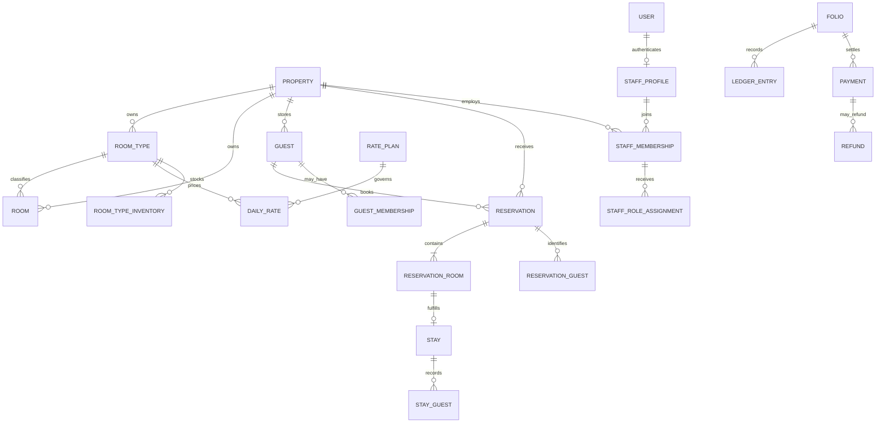

# PMS 2.0 统一业务模型与数据库治理实施方案

> 文档类型：综合实施方案 / 开发执行基线  
> 仓库：`wulei0214/django-hotel2`  
> 审查分支：`main`  
> 审查基线：`f5fea858b43bd3f664ae6a16dbe714f3f8ca4457`  
> 编制日期：2026-11-03  
> 状态：待项目负责人确认后作为实施任务拆分依据  
> 适用范围：统一侧边栏和业务工作台、五大 PMS2 中心、员工登录与顾客直订页面、新旧业务迁移、数据库字段和表治理。

---

## 0. 文档定位、优先级与执行原则

### 0.1 本文档的定位

本文档是在现有架构、代码和既有评审结论之上重新整理的**统一实施方案**。它整合并落实以下既有文件，不重新发明已经评审过的权限规则、审批规则、财务规则或业务模型：

1. `docs/PMS后台管理体系专项评审_第12节决策审核结论.md`
2. `docs/五大模块重构需求设计方案.md`
3. `docs/PMS2第一阶段平台底座开发记录.md`
4. `docs/PMS2第二阶段预订与库存闭环开发记录.md`
5. `docs/系统架构说明.md`
6. `docs/敏感字段权限边界设计.md` 及已正式确认的敏感字段决策

本文档负责把上述决策落到统一菜单、唯一数据权威、数据表和字段治理、页面/API/Service 的实施顺序与验收标准上。

### 0.2 决策优先级

出现描述冲突时，按以下顺序处理：

1. 已正式确认的业务决策基线、权限矩阵、审批规则、财务与审计规则；
2. 《后台管理体系专项评审：第12节决策审核结论》；
3. 已评审的《五大模块重构需求设计方案》及 PMS2 Phase 基线；
4. 本文档中对前述规则的整合与执行安排；
5. 当前代码实现。

当前代码如果与已确认决策不一致，应修复代码，不得把现存实现自动视为新的业务规则。`docs/敏感字段权限边界设计.md` 标注为“待确认稿”的字段边界，仍以负责人已经正式批准的决定为准；不得由开发人员自行选择方案 A/B。

### 0.3 三项最高级硬约束

**约束 A：PMS2 是唯一业务写权威。** 新业务事实只允许通过 PMS2 领域服务写入 PMS2 权威模型。旧 `hotelapp` 页面、视图和模型不得继续成为第二套业务写入口。迁移阶段可保留受控的历史读取和映射工具，但不得长期双写、双主档或让员工在新旧两套页面中任选一套操作。

**约束 B：旧系统只允许作为有期限的迁移对象。** PMS2 已覆盖某个业务域后，旧页面必须按专项评审的门禁执行“冻结旧写入 → 迁移/核验 → 受控只读或归档 → 下线路由和菜单 → 删除废弃代码/表字段”。不允许以“兼容”为由永久保留相同业务的两套菜单和两套 CRUD。

**约束 C：数据库清理必须以证据为依据。** 不以字段名称看起来重复、代码搜索不到、某张表暂时没有页面为理由直接删表删字段。必须结合数据库实况、外键、迁移历史、数据量、代码/API/后台/任务引用、业务审计与保留要求判定，并通过备份恢复、数据迁移对账和回归测试。

### 0.4 不改变的架构边界

- Django 4.1、模块化单体、B/S、Django Template + 原生 JavaScript、Django View + JsonResponse API v1。
- MySQL 为默认数据库，配置保留 PostgreSQL/SQLite 支持；SQLite 测试不能代替 MySQL/PostgreSQL 并发与事务验收。
- 不引入独立 Next.js、DRF、微服务、Redis、Celery 或消息队列，除非另有正式评审。
- 当前单店优先，通过 `Property` 和 `property_id` 保留物业数据隔离，不在业务代码中写死单店假设。
- 真实支付、OTA、公安旅业接口、POS、停车、电子发票等未接入项目，不做假按钮、假数据或模拟生产支付。

---

## 1. 当前项目代码基线与新旧页面判定

### 1.1 当前技术结构

| 层级 | 现有实现 | 执行约束 |
|---|---|---|
| 项目入口 | `hotel/` | 统一路由、设置、物业上下文和认证入口 |
| PMS2 领域 | `apps/core`、`identity`、`guests`、`inventory`、`reservations`、`billing` | 权威业务模型和领域服务所在位置 |
| API | `apps/api`，前缀 `/api/v1/` | 页面只消费 API；权限与业务规则必须由服务端执行 |
| 页面 | `templates/` + `static/` | 延续 Django Template + 原生 JS，不另建前端工程 |
| 历史兼容层 | `hotelapp/` | 只承担尚未迁移的数据/历史代码处理；按专项评审退役 |
| 平台后台 | Django Admin + SimpleUI | 收缩为平台配置、受控主数据和只读审计，不作为员工日常业务写入口 |

### 1.2 按真实模型和服务判定新旧，不按菜单名称判定

**PMS2 新业务入口/代码：**

| 当前页面或入口 | 当前模型/服务 | 处理意见 |
|---|---|---|
| `/manage/staff/` | `StaffProfile`、`PropertyStaffMembership`、`StaffRoleAssignment`、`EmployeeLifecycleService`、`/api/v1/staff` | 新员工中心入口；补全页面交互并吸收账号管理功能 |
| `/staff_accounts/` 及其详情/操作 URL | 新 `identity` 模型和 `EmployeeLifecycleService` | 虽然 URL 名称不属于 `/manage/`，但它是新身份域代码；功能迁入员工中心后，旧入口不再独立展示/维护 |
| `/manage/guests/` | `Guest`、`GuestPhone`、`GuestDocument`、`/api/v1/guests` | 新 Guest 360 入口；增强关联预订、Stay、Folio 的详情读取 |
| `/manage/rooms/` | `RoomType`、`Room`、`DailyRate`、`RoomTypeInventory`、`/api/v1/rooms/status`、`rate-calendar` | 新房态与库存中心；完善房态卡片、日历和受控操作 |
| `/manage/memberships/` | `GuestMembership`、`MembershipLevelHistory`、`/api/v1/memberships` | 新会员关系入口；会员数据归属于 Guest，不单建第二份人档 |
| `/manage/reservations/` | `Reservation`、`ReservationRoom`、`Stay`、`Folio`，`/api/v1/front-desk/*` | 新预订与入住中心；与前台工作台合并为一个业务工作区 |
| `/checkin/` | 当前前台工作台及 `/api/v1/front-desk/` 查询/写 API、`front_desk_services.py`、`lifecycle_services.py` | PMS2 履约操作主入口；统一到“预订与入住中心”，不另造第二套入住工作流 |
| `/reserve/` | `templates/public/booking.html`、`/api/v1/availability`、`reservations`、`billing` | 顾客端官网直订入口，独立于员工后台，但使用同一 PMS2 房价、库存、Guest、Reservation 数据 |
| `/permissions/` | `apps/identity/permission_admin.py` 与当前权限目录 | 独立系统安全中心；按既有权限决策逐步迁移到 PMS2 权限目录，不能并入员工中心 |

**旧 `hotelapp` 页面/数据入口：**

| 旧页面/路由 | 旧模型 | 最终处理 |
|---|---|---|
| `/index/`、`insert/`、`update_staff/` 等 | `hotelapp.Staff` | 员工主档迁移/映射到 `StaffProfile`；旧薪酬/工龄数据按批准的敏感字段规则处理；新入口覆盖后冻结旧写入 |
| `/show_client/` 及 CRUD | `hotelapp.Client` | 历史顾客数据候选映射到 `Guest`；核验后保留映射关系，旧页面退役 |
| `/show_vip/` 及 CRUD | `hotelapp.Vip` | 历史会员候选映射到 `GuestMembership`；不能仅凭姓名/手机号自动合并；旧页面退役 |
| `/show_room/` 及 CRUD | `hotelapp.Room` | 房间和房型核验迁移至 `RoomType`/`Room`；旧单字段房态模型退役 |
| `/show_accomodation/` 及 CRUD | `hotelapp.Accommodation` | 历史订单核验迁移至 `Reservation`/`ReservationRoom`/`Stay`；不能无依据补造价格快照、支付或入住事实 |
| `/checkin/legacy/` 和旧入住写路由 | 旧 `Accommodation`、旧 `Room`、旧 `Folio` 等 | 新履约链路覆盖后冻结；历史记录只读归档，再下线 |
| `/finance/`、`finance_add/` | `FinanceRecord` | 财务新权威只认 PMS2 `Folio`/`Payment`/`LedgerEntry` 和 `BillingService`；历史流水对账归档 |
| `/nightaudit/`、旧夜审写入口 | `hotelapp.NightAudit` | 新 `BusinessDate`/`NightAuditRun`/`NightAuditService` 覆盖后冻结旧写入口，旧记录只读归档 |
| `/booking/` | 历史顾客预订页面 | 顾客新预约统一使用 `/reserve/`；完成切换后 `/booking/` 关闭或明确跳转到新顾客预订入口，不再维护第二套预订页 |
| `/admin/` 下旧业务模型编辑 | `hotelapp` 业务表 | 按专项评审改为只读/移除菜单；禁止成为新页面之外的业务写入口 |

补充说明：`hotelapp.Order` 是历史餐饮订单，不是客房预订订单。餐饮/停车长期范围以已批准的第12节决策为准，不得把餐饮订单错误并入 `Reservation`，也不得为了减少表数量把不相关业务表硬合并。

### 1.2.1 五个中心的当前代码成熟度

当前五个 `/manage/.../` 页面都由 `apps/api/pages.py` 的 `MANAGEMENT_CENTERS` 配置并使用 `templates/pms/management_center.html` 共用模板，主要实现真实 API 列表、关键字搜索和分页，房态中心另有房价/库存次级列表。它们尚未成为五套完整的业务工作台。

| 中心 | 已存在的代码基础 | 当前需要补齐的内容 |
|---|---|---|
| 员工中心 | 员工身份模型、`EmployeeLifecycleService`、`/api/v1/staff` 列表/详情、`/staff_accounts/` 现有生命周期操作 | 将操作合并进新员工中心页面；统一详情、岗位/账号历史和审计展示；不重复实现生命周期服务 |
| Guest 360 | Guest 模型、联系方式/证件服务、Guest 列表/详情/创建/更新 API | 汇总预订明细、StayGuest、账单、会员与时间线；补详情抽屉/标签页和字段权限交互 |
| 房态与库存 | Room/RoomType/RatePlan/DailyRate/RoomTypeInventory、房态列表与 rate calendar API | 房态卡片、清洁任务、检查、维修工单、价格库存日历和受控写操作 |
| 会员中心 | GuestMembership、MembershipLevelHistory、列表/详情/创建/等级变更 API | 与 Guest 360 共用详情和主档；完整会员操作反馈、历史映射审核；不得凭空出现积分/权益字段 |
| 预订与入住 | Reservation/ReservationRoom/Stay/Folio、前台查询/详情/排房/入住/收款/退房 API 和服务 | 把预订筛选、任务视图、详情抽屉与 `/checkin/` 操作整合；完善多房和住客关联信息 |

开发验收必须同时检查页面、API、领域服务、权限、审计、测试和数据，不得以“模型存在”或“API 返回 200”单独宣称功能完成。

### 1.3 新旧并存的允许范围与禁止范围

允许的过渡行为仅包括：

- 使用 `LegacyRecordLink` 记录旧主键与 PMS2 目标主键的映射状态；
- 通过受控迁移脚本读取旧数据并写入 PMS2 服务/模型；
- 在迁移审查界面暂时查看未完成映射的历史数据；
- 对无法还原的历史订单、历史账务保留归档查询。

禁止：

- 两套页面都能新增或修改同一业务对象；
- 同一名员工/顾客/房间/订单在两个系统各维护一份活动主档；
- PMS2 页面回写旧 `hotelapp` 表以维持旧页面显示；
- 旧入口静默重定向到新写接口，制造“看似旧页面、实际写新系统”的语义混乱；
- 未完成数据核验就物理删除旧表或旧记录。

**最终用户体验必须只有一套正式业务入口和一个权威数据来源。** 临时迁移工具不应进入日常侧边栏，也不应被当成第二套运营系统。

---

## 2. 统一业务信息架构与侧边栏

### 2.1 侧边栏目标结构

所有菜单都按业务任务组织，而不是按旧数据库表名罗列。建议正式结构如下：

```text
酒店 PMS
├─ 运营工作台
│  └─ 今日运营概览
├─ 前台运营
│  ├─ 预订与入住中心
│  ├─ 今日抵店 / 待排房
│  ├─ 当前在住
│  └─ 今日离店
├─ 客人关系
│  ├─ Guest 360 客人中心
│  └─ 会员中心（客人中心的会员视图/快捷入口）
├─ 客房运营
│  ├─ 房态总览
│  ├─ 房间与房型
│  ├─ 清洁与检查
│  └─ 房价与库存
├─ 员工组织
│  └─ 员工中心（含账号、物业任职、岗位授权状态）
├─ 财务与日结
│  ├─ 财务管理
│  └─ 夜审
└─ 系统管理（按权限显示）
   ├─ 权限管理
   ├─ 系统配置
   └─ 审计与迁移核验（仅管理/运维授权）
```

### 2.2 菜单收拢规则

| 当前侧边栏重复项 | 目标处理 |
|---|---|
| “PMS2 员工中心” + “员工与账号管理” + “员工管理” | 合并为唯一“员工中心”；员工档案、账号、物业任职和授权状态使用同一详情工作区 |
| “PMS2 Guest 360” + “顾客管理” | 合并为唯一“Guest 360 客人中心” |
| “PMS2 房态与库存中心” + “客房管理” | 合并为唯一“客房运营中心”，内部有房态、房型、客房、清洁、价格库存视图 |
| “PMS2 会员中心” + “会员信息管理” | 合并为同一个会员业务视图；可保留快捷入口，但必须复用同一个页面、API 和 `GuestMembership` |
| “PMS2 预订与入住中心” + “入住管理” + “客房订单管理” | 合并为唯一“预订与入住中心”；通过任务筛选切换待确认、抵店、排房、在住、离店、历史订单 |
| “权限管理” | 独立保留在系统管理，不合并进员工中心 |
| “财务管理”“夜审” | 继续独立作为职能域，但数据源统一为 PMS2 Billing / Night Audit |

### 2.3 跨模块导航必须围绕业务对象

每个对象都应有唯一主档/主单详情入口，其他页面只提供上下文跳转：

- Guest 详情可打开该客人的会员、预订、入住、账单和历史服务；
- Reservation 详情可打开 Guest、ReservationRoom、Stay、Room、Folio；
- Room 详情可打开当前 Stay、关联预订、清洁任务和维修工单；
- Membership 详情必须返回关联 Guest 的会员 Tab，不创建第二份客人主档；
- Staff 详情显示账号与授权状态，但编辑角色目录/权限矩阵跳转到权限管理；
- Folio/Payment/LedgerEntry 从订单和客人详情进入，具体写操作仍由 BillingService 与审批规则控制。

### 2.4 全局界面框架

统一采用：左侧导航 + 顶部酒店/物业上下文 + 页面主工作区 + 右侧详情抽屉。

顶部栏包括：当前物业、营业日期、全局搜索、当前用户/岗位、会话和退出入口。全局搜索支持客人姓名/可授权电话、预订编号、会员号、房号、员工工号，返回结果需要标出对象类型和来源，敏感字段按权限遮罩。

视觉规范：浅灰/暖白工作区、深色文字、单一品牌强调色、状态色只表达业务状态；表格弱分隔线、固定表头、明确键盘焦点；减少大面积渐变、装饰性卡片和多个同级高亮按钮。桌面、笔记本和平板均需支持。

---

## 3. 五大业务中心详细设计

### 3.1 员工中心

**定位：员工生命周期工作台，不是权限矩阵管理台。**

页面结构：

1. 指标：在职、暂停、离职、未开通账号、无有效任职/岗位授权；指标必须按当前物业统计。
2. 列表：姓名、物业工号、岗位、任职状态、账号状态、生效角色、最后登录；默认不显示薪酬等敏感信息。
3. 筛选：姓名/工号/手机号、物业、任职状态、岗位、账号状态。
4. 详情 Tab：基本档案、物业任职、账号安全、岗位授权历史、旧员工资料映射、人事变更审计。
5. 操作：新增员工、仅建档、开通账号、调岗、暂停、恢复、离职、重置密码、查看授权历史。

数据/服务约束：

- `StaffProfile` 是员工自然人主档；`PropertyStaffMembership` 是员工在具体物业的任职；`StaffRoleAssignment` 是该任职对应的岗位授权记录。
- `auth.User` 只负责认证身份。业务角色不直接存放在全局 `User.groups`；`Group` 是岗位权限模板，由 `AuthorizationService` 结合物业、任职有效期、员工状态和角色分配计算访问权。
- 所有员工、账号、任职、角色授权、密码重置、暂停/离职操作必须调用 `EmployeeLifecycleService`；不得从 view/template/Admin 直接写模型或调用 `User.groups.add()`。
- 员工中心允许展示当前岗位与授权来源，但不提供权限点勾选矩阵；角色权限矩阵、权限白名单、敏感动作审批放在独立权限中心。
- 不允许自我提权；授权历史采用结束时间留痕，不物理删除；离职/暂停按既定策略处理账号、任职和角色回收。
- 旧 `hotelapp.Staff` 的月薪、工龄及旧职务不能自动覆盖 PMS2 岗位身份。薪酬迁移和可见范围严格遵循已批准的敏感字段决策。

### 3.2 Guest 360 客人中心

**定位：住客唯一主档和关联服务总览。**

页面结构：

- 列表：客人姓名、脱敏联系方式、会员状态/等级、当前入住、最近入住、下次抵店、未结账单提示（须具备账务查看权限）。
- 过滤：全部、当前在住、即将抵店、历史客人、会员、存在未结账单；历史记录按 PMS2/LEGACY 来源筛选只用于迁移审核，不作为两个正式客人系统。
- 详情 Tab：概览、预订、入住历史、账单与支付、会员、联系方式/证件与隐私、操作审计。
- 常用动作：登记客人、发起预订、打开当前订单、打开会员信息、按权限揭示敏感信息。

数据约束：

- `Guest` 是客人/住客主档；联系方式由 `GuestPhone` 管理；证件由 `GuestDocument` 加密存储并使用哈希查重。
- `Reservation.guest` 表示预订联系人/主预订客人，不等于全部实际入住人；一单多住客通过 `ReservationGuest` 表达，入住事实通过 `StayGuest` 记录。快照字段是历史事实，不可被视为无用重复字段。
- Guest 详情聚合 `Reservation`、`ReservationRoom`、`Stay`、`Folio`、`Payment`、`LedgerEntry`、`GuestMembership`；只聚合读取，不把订单/账单字段复制存进 Guest。
- 默认联系方式脱敏；完整电话/证件揭示必须检查对应字段权限并记录 `AuditEvent`；导出权限严于页面查看权限。
- 旧 `Client` 不因姓名相同、手机号相同就自动合并；使用 `LegacyRecordLink` 和人工核验，冲突进入待处理队列。

### 3.3 房态与库存中心

**定位：房间履约状态和未来销售库存的统一工作台。**

页面四个主视图：

1. 房态总览：按楼层/房型展示房卡；显示占用、清洁、维修三种状态。
2. 房间资料：房号、楼层、房型、启用状态、设备设施、关联历史。
3. 清洁与检查：任务状态、分派人员、开始/完成时间、检查人、检查结果；使用已有 `HousekeepingTask`、`RoomInspection`。
4. 房价与库存：按日期/房型/RatePlan 展示 `DailyRate` 和 `RoomTypeInventory`，允许有权限人员通过专门服务调整。

页面交互：日期、楼层、房型、清洁状态、维修状态筛选；点击房卡打开详情抽屉，查看当前 Stay、下一条有效预订、清洁任务和维修工单。

关键规则：

- 物理客房 `Room` 的占用、清洁、维修为三个相互独立状态；不得回退成一个字符串状态字段。
- 当前物理房间“可入住净房”不等于未来某日期的“可预订库存”。未来可售量由逐日库存和价格计划计算。
- 房型 `RoomType`、物理房间 `Room`、价格计划 `RatePlan`、每日价格 `DailyRate`、逐日库存 `RoomTypeInventory` 分工明确。
- 清洁和维修状态变化由对应业务服务更新，不允许直接在表格中随意改状态；若现有 `RoomStatusService` 尚未完整建立，作为 P1 服务补齐。
- `HousekeepingTask`、`RoomInspection`、`MaintenanceTicket` 已存在模型，不代表所有任务操作已交付；逐个核实 API、Service、权限、审计和页面动作，禁止用空按钮假装完成。

### 3.4 会员中心

**定位：Guest 之上的会员关系子域。**

会员列表：会员编号、关联客人、会员等级、状态、加入日期、有效期、来源/历史映射状态。

会员详情直接打开 Guest 360 的会员 Tab，显示会员关系、等级历史、变更原因、操作人和时间。会员数据不能复制出一套可独立编辑的姓名/手机号主档。

当前可复用：`GuestMembership`、`MembershipLevelHistory`、`GuestMembershipService` 的建档和等级变更能力。

当前边界：没有经过正式业务规则评审和数据库模型支持前，不开发积分余额、积分账本、积分过期、优惠券、自动升降级、会员权益包、积分商城或会员价。旧 `Vip` 的普通/高级等级只作为历史映射来源；不得把旧等级直接当作新等级权益规则。

### 3.5 预订与入住中心

**定位：酒店日常履约主工作台，整合预订、排房、入住、住中、收款和退房。**

页面任务视图：全部预订、待支付/待确认、已确认、今日抵店、待排房、今日入住、当前在住、今日离店、已退房、取消/过期、未到店。

订单主列表显示预订编号、客人、预订来源、状态、入住/离店、房间数、排房状态、金额和账单余额（按权限）。详情抽屉显示：客人、逐间 ReservationRoom、价格快照、房间分配、Stay、Folio、Payment 和事件时间线。

写操作必须复用现有服务：

- 创建预订/取消：`apps.reservations.services`；
- 库存冻结、确认、释放：`apps.inventory.services`；
- 排房、入住、退房：`apps.reservations.front_desk_services`；
- 续住、换房、No-Show、押金、退款申请/审批：`apps.reservations.lifecycle_services`；
- 收款、押金、退款、账单记账、红字冲销、收银班次：`apps.billing.services_v2.BillingService` 和 `ApprovalService`；
- 夜审：`apps.billing.night_audit.NightAuditService`。

如当前某个 API 仍直接写 `Payment`、`LedgerEntry`、库存计数或状态字段，必须迁入上述唯一领域服务，并补审计与幂等；不得由前端传入的金额、房价或状态作为最终权威。

多房预订必须逐条显示 `ReservationRoom`。主单、房间明细、实际入住 `Stay` 是不同业务事实，不允许简化成“一个订单=一个房间=一个入住”。


### 3.6 五大中心页面级详细设计（正式 UI / 交互基线）

> 本节是五大页面的实际页面设计要求，不是功能概述。开发必须按每个中心独立的业务布局实现，不得继续把五个中心统一渲染成只有表格、搜索和分页的 `management_center.html` 通用只读清单。可以复用全局布局、表格、筛选器、详情抽屉、状态徽章、时间线等基础组件，但每个中心的内容结构、数据 DTO、动作和交互必须按本节分别定义。
>
> 设计基调沿用对话评审已经确认的方向：现代商用 PMS 工作台，高信息密度、低视觉噪声；浅灰/暖白工作区、深色文字、单一品牌强调色；状态色仅表达业务含义；桌面端以列表/看板 + 右侧详情抽屉为主，窄屏改为独立详情页或覆盖式抽屉。

#### 3.6.1 员工中心（唯一员工业务入口）

**页面目标：** 管理员工从建档、物业任职、账号开通、岗位授权到暂停/恢复/离职的完整生命周期。账号和任职是员工中心内的子功能，不再是另一个侧边栏入口；权限中心仍独立管理角色权限模板、权限点矩阵和安全策略。

**页面总体布局：**

```text
┌ 员工中心 / 员工档案                     [新增员工] [导出*] ┐
│ 在职 24 │ 暂停 2 │ 未开通账号 3 │ 无有效岗位 1              │
├───────────────────────────────────────────────────────────┤
│ 搜索姓名/工号/手机号  任职状态▼ 岗位▼ 账号状态▼  [筛选]    │
├───────────────────────────────────────────────────────────┤
│ 姓名/工号 | 岗位 | 任职状态 | 登录账号 | 账号状态 | 角色 | › │
│ …                                                         │
└───────────────────────────────────────────────────────────┘
点击一行 / 查看 → 右侧员工详情抽屉
```

**列表字段与规则：**

| 列 | 显示内容 | 规则 |
|---|---|---|
| 员工 | 姓名、头像首字母/默认图标 | 姓名来自 `StaffProfile.full_name` |
| 工号 | 当前物业工号 | 来自 `PropertyStaffMembership.employee_no`，不能把旧 `Staff.员工id` 当作新工号 |
| 岗位 | 岗位代码对应的中文名称 | 来自当前任职；岗位目录使用既定 `BUSINESS_ROLE_NAMES` |
| 任职状态 | 在职/暂停/已结束 | 同时考虑员工档案状态、物业任职状态和有效日期 |
| 登录账号 | 用户名或“未开通” | 来自关联 `auth.User` |
| 账号状态 | 正常/已停用/未开通 | 不能只看页面状态，服务端认证状态为准 |
| 生效角色 | 当前有效角色标签 | 只读展示授权结果，不提供权限点编辑 |
| 最近登录 | 时间或“从未登录” | 来自 `User.last_login` |
| 操作 | 查看；允许的生命周期操作 | 根据 `allowed_actions` 和权限显示，服务端再次校验 |

**筛选与排序：** 姓名、工号、手机号（按授权决定匹配/显示）、任职状态、岗位、账号是否开通、账号是否启用、生效角色；支持按姓名、工号、创建时间和最近登录排序。所有统计和搜索必须限定当前物业。

**详情抽屉：**

- 顶部身份条：姓名、物业工号、任职状态、账号状态、当前有效岗位。
- Tab「员工资料」：姓名、联系电话（遵守字段权限）、创建时间、历史档案映射状态。
- Tab「物业任职」：物业、工号、岗位代码、任职开始/结束日期、任职状态、历史任职记录。
- Tab「账号安全」：用户名、启停状态、最后登录、是否强制改密、最近密码变更时间；不显示密码或密码哈希。
- Tab「岗位授权历史」：角色、授权开始/结束时间、授权人、结束原因；只读历史。
- Tab「旧员工资料」：旧 `Staff` 映射 ID、映射状态；月薪/工龄等旧字段只在批准的敏感权限下显示，并显式标为历史资料，不当作 PMS2 员工身份字段。
- Tab「操作审计」：入职、开账号、任职变更、授权、暂停、恢复、离职、重置密码等事件。

**新增员工向导：**

1. 人员资料：姓名、联系电话等必要字段；姓名/手机号校验由后端负责。
2. 物业任职：物业、店内工号、岗位、任职日期。不可从前端传入并信任任意 `property_id`。
3. 账号与初始授权：允许只建档不开账号；如开账号则设置一次性初始凭证并强制首次改密；初始角色必须来自允许的岗位目录。

**允许的动作：** 建档、开通/关联账号、调整当前物业任职、岗位授权/结束授权、暂停、恢复、离职、重置密码、导出（须有独立导出权限）。所有动作调用 `EmployeeLifecycleService`；角色授权历史不物理删除，不能自我提权。权限中心负责修改“角色拥有什么权限”，员工中心只负责“员工当前被授予哪个已定义岗位”。

**不可出现的 UI：** 在员工详情里提供“勾选查看/新增/修改/删除权限”的矩阵；员工自己给自己加角色；未经批准的薪酬编辑；把旧 `/index/` 的月薪、工龄和旧职务当成当前员工主档。

**当前开发缺口：** `/api/v1/staff` 当前有列表/详情读 API；生命周期写操作分散在 `/staff_accounts/` 视图 URL。需将新员工中心的写 API 接口化并调用现有 `EmployeeLifecycleService`，随后让旧 `/staff_accounts/` 页面退出日常入口，不能重写一套 Service。

#### 3.6.2 Guest 360 客人中心（客人唯一主档）

**页面目标：** 员工从一个客人档案中查看其全部预订、实际入住、会员关系和账务摘要；不是把顾客、会员、订单分别复制成多个档案。

**列表页面：**

```text
┌ Guest 360 / 客人中心             [登记客人] [为客人创建预订] ┐
│ 全部  当前在住  即将抵店  历史客人  会员  有未结账单          │
│ 搜索姓名/电话/预订号/会员号  最近入住▼  会员等级▼  来源▼      │
├────────────────────────────────────────────────────────────┤
│ 客人 | 联系方式 | 会员 | 当前入住 | 最近入住 | 下次抵店 | ›  │
│ …                                                          │
└────────────────────────────────────────────────────────────┘
```

**列表列定义：**

| 列 | 显示内容 | 数据来源/约束 |
|---|---|---|
| 客人 | 姓名 | `Guest.full_name` |
| 联系方式 | 默认脱敏电话 | `GuestPhone` 主电话；完整值需字段权限 |
| 会员 | 非会员/会员等级/会员编号摘要 | 当前物业有效 `GuestMembership`；没有会员关系不能凭旧 `Vip` 自动推断 |
| 当前入住 | 在住/未入住 | 查询当前有效 `Stay`，不能只看预订主单状态 |
| 最近入住 | 最近一次实际入住时间/离店时间 | 来自历史 `Stay` |
| 下次抵店 | 下一条未来有效预订入住日 | 来自 `Reservation` / `ReservationRoom` |
| 未结账单 | 有/无及余额摘要 | 仅有账务查看权限时返回；余额从 Folio/Ledger 聚合 |

**筛选：** 全部客人、当前在住、即将抵店、历史客人、会员、存在未结账单；支持姓名、授权电话、预订编号、会员编号检索。LEGACY 映射状态仅用于具备迁移/审计权限的核验视图，不能让一线员工进入另一套旧顾客 CRUD。

**客人详情抽屉/详情页：**

- 顶部客人卡：姓名、脱敏电话、邮箱、会员标识、当前入住状态；右侧主操作为“创建预订”，其它动作收在更多菜单。
- Tab「概览」：当前在住、下一次抵店、最近入住、关联会员、未结余额摘要（账务权限控制）。
- Tab「预订」：按未来/当前/历史/取消/未到分类；每行显示订单号、来源、状态、日期、间数、房型、房间分配和订单金额；点击进入唯一 Reservation 详情。
- Tab「入住历史」：实际 Stay、入住/离店时间、房号、入住人；支持从 Stay 打开房间详情。
- Tab「账单与支付」：Folio、LedgerEntry 摘要、Payment/Refund 状态；凭证只读展示，收款/退款等操作按财务权限与审批流程执行。
- Tab「会员」：会员编号、等级、状态、加入/有效日期、等级历史；点击打开同一个会员详情视图，不创建第二份客人档案。
- Tab「联系方式与证件」：电话列表、主电话、共享电话待核验标志、证件类型和脱敏号、同意版本；揭示完整电话/证件必须独立授权并写审计。
- Tab「服务与操作记录」：资料变更、建单、入住、换房、收款、退房等可追溯事件。

**业务动作：** 登记客人、编辑允许维护的联系方式/基本资料、添加电话、创建预订、查看会员、打开预订/Stay/Folio；合并客人如尚无成熟的合并服务和冲突审核 UI，不应在此提供“合并”按钮。

**关键业务语义：** `Reservation.guest` 是预订联系人/主客人，不等于所有实际入住人。多住客必须展示 `ReservationGuest` / `StayGuest`，不可以把所有同住人都强行并入 `Guest` 主档，也不能用 Guest 当前资料覆盖入住时的历史快照。

**当前开发缺口：** `guest_detail` 已返回基础档案、证件/电话摘要和部分预订，但需要扩展 StayGuest、Folio/Payment/账务摘要和跨页面跳转；列表 DTO 要避免对每个 Guest 单独查询引发 N+1。新增/编辑使用 `GuestService`，证件揭示使用现有证件服务及独立审计。

#### 3.6.3 房态与库存中心（客房运营工作台）

**页面目标：** 以物理房间为日常运营视角，以房型日期库存为销售视角，提供统一入口但保持两套事实的边界。

**页面默认：房态看板。**

```text
┌ 客房运营 / 房态总览                 [房态日历] [房价与库存] ┐
│ 日期：今天▼ 楼层▼ 房型▼ 占用▼ 清洁▼ 维修▼ [刷新]          │
│ 可入住净房 18 | 在住 32 | 待清洁 4 | 清洁中 2 | 待检查 1 | 维修 1│
├──────────────────────────────────────────────────────────┤
│ 1F  [101 净房] [102 在住] [103 脏房] [105 待检查]            │
│ 2F  [201 清洁中] [202 净房] [203 维修停用]                  │
│ 3F  [301 净房] [302 在住] [303 停售]                        │
└──────────────────────────────────────────────────────────┘
点击房卡 → 右侧房间详情；点击“房价与库存” → 日期库存日历
```

**顶部指标：** 可入住净房、在住、脏房、清洁中、待检查、维修停用。指标必须按当前物业和指定业务日期计算；“当前可入住净房”不能当作未来某日可售房量。

**房态房卡：** 卡片主视觉是房号；副行显示房型/楼层；状态标签分别表达占用、清洁、维修三个维度。颜色只能作为辅助，状态文字必须同时展示。点击房卡打开详情，不直接将卡片变成随意修改状态的控件。

**房间详情抽屉：**

- 基础信息：房号、楼层、房型、启用状态、容量/床型/设施。
- 三维房态：占用状态、清洁状态、维修状态，分别展示更新时间和操作人（有审计数据时）。
- 当前入住：当前 Stay、客人摘要、实际入住时间；隐私字段按 Guest 权限处理。
- 关联预订：当前房间未来时间段内的有效 ReservationRoom，不得仅凭房间即时状态判断日期冲突。
- 清洁任务：当前任务、指派人员、状态、开始/完成/检查时间和检查结果。
- 维修工单：工单号、报修原因、停用区间、恢复状态与记录。
- 历史记录：房态变化、清洁检查、维修操作。

**子视图：**

1. 「房态总览」：按楼层或房型分组的房卡视图；支持日期和状态筛选。
2. 「房间资料」：房号、房型、楼层、启用状态、设施等资料列表；新增/编辑只使用房间服务。
3. 「清洁与检查」：任务队列，按待清洁/清洁中/待检查/已完成过滤；展示任务编号、房号、楼层、任务类型、负责人、时限/更新时间；检查通过后再按服务规则恢复净房。
4. 「维修管理」：维修工单列表，显示房号、故障原因、起止日期、工单状态、报修人和恢复人；维修状态不可由普通房态下拉框直接覆盖。
5. 「房价与库存」：按日期区间（默认未来 14 天，可调整）和房型筛选，行=房型/RatePlan，列=日期；每格同时显示房价、可售数量、关房/停售提示。详情可查看 `total_rooms`、`held`、`sold`、`out_of_service`、`available_count` 和 `version`。

**房态与库存关键规则：**

- `Room` 的 occupancy / housekeeping / maintenance 三维状态相互独立。
- 当前房卡上显示“可入住净房”只说明当前物理房间满足 `is_sellable_now` 条件。
- 顾客未来预订读取 `RoomTypeInventory` 每日库存和 `DailyRate`，不能由“净房数”直接推算；任何一晚缺价格、停售或库存不足均不可售。
- 调价只能修改未来生效的价格记录；历史 `ReservationRoom.nightly_rates` 成交快照不受影响。
- `held` / `sold` 等计数与 `InventoryHold` 明细必须通过对账逻辑维护，不能在前端直接编辑计数。

**当前开发缺口：** 房态列表、房型、房价库存读取 API 已有；`HousekeepingTask` / `RoomInspection` / `MaintenanceTicket` 模型已存在，但任务状态变更、检查流转、维修开始/恢复等 API/Service/UI 需逐项核查，缺少的服务先补齐，再接页面动作。不得仅因为模型存在就宣称清洁和维修流程已经完成。

#### 3.6.4 会员中心（Guest 会员关系工作区）

**页面目标：** 管理 Guest 上的会员关系和等级历史；它是 Guest 360 的业务子域，可作为侧边栏快捷入口，但数据和详情必须回到同一 Guest。

**列表页面：**

```text
┌ 会员中心                              [登记会员关系] ┐
│ 全部会员  有效  暂停/失效  待核验历史会员              │
│ 搜索会员号/客人姓名/授权联系方式  等级▼ 状态▼ 来源▼   │
├─────────────────────────────────────────────────────┤
│ 会员编号 | 客人 | 等级 | 状态 | 加入日期 | 有效期 | › │
│ …                                                   │
└─────────────────────────────────────────────────────┘
```

**列表列定义：** 会员编号、客人姓名（点击打开 Guest 360）、脱敏/授权联系方式、等级、状态、加入日期、有效期、来源/历史映射状态。统计只计入有效映射到 PMS2 `GuestMembership` 的真实会员关系；未核验的旧 `Vip` 记录单独进入迁移核验工具，不计入正式会员数。

**会员详情：**

- 会员关系摘要：会员编号、Guest 主档链接、当前等级、状态、加入和有效日期、来源。
- 等级历史：原等级、新等级、变更原因、操作人、生效时间；历史只追加，不覆盖。
- 客人概况：Guest 姓名、脱敏电话、最近入住和预订摘要；“查看完整档案”返回 Guest 360。
- 历史来源：旧 Vip ID、映射方法、复核人和状态，仅对有迁移权限的人可见。

**允许的动作：** 创建会员关系、按现有服务变更等级、查看历史、按正式模型和批准规则执行状态操作；等级变更必须填写原因，服务端写 `MembershipLevelHistory` 和 `AuditEvent`。

**本期不可出现：** 积分余额、积分累计、积分消费、等级自动升级、优惠券、会员权益包、会员价、积分商城等未有正式规则和模型的功能。不要用静态数字或虚拟等级包装成已交付能力。

**与 Guest 360 的关系：** Guest 360 的会员 Tab 与本中心的会员详情必须调用同一 API/DTO/详情组件；不能各写一份姓名、手机号或等级维护逻辑。会员列表筛选和详情可以是独立路由，但主档始终是 Guest。

**当前开发缺口：** 会员列表/详情/创建/等级变更 API 和 `GuestMembershipService` 已存在；页面仍是只读通用表格，需增加详情抽屉和创建/等级变更交互；任何状态变更先确认模型/Service 支持，不得临时直接 `membership.status = ...`。

#### 3.6.5 预订与入住中心（唯一前台履约工作台）

**页面目标：** 把预订主单、逐间房明细、排房、实际入住、住中服务、账单、收款与退房放在一个工作区；整合 `/manage/reservations/` 与 `/checkin/`，不平行维护两套前台系统。

**页面顶部：**

```text
┌ 前台运营 / 预订与入住中心         [新建预订*] [散客直入*] ┐
│ 待确认 6 │ 今日抵店 12 │ 待排房 4 │ 当前在住 28 │ 今日离店 8│
├─────────────────────────────────────────────────────────┤
│ 全部 | 待确认 | 今日抵店 | 待排房 | 已入住 | 今日离店 | 历史 │
│ 搜索预订号/客人/电话/房号  来源▼ 日期▼ 状态▼ [查询]       │
├─────────────────────────────────────────────────────────┤
│ 预订号 | 客人 | 来源 | 状态 | 入住-离店 | 房数 | 房间 | 余额│
│ …                                                       │
└─────────────────────────────────────────────────────────┘
点击预订 → 右侧预订履约详情抽屉
```

**任务视图：** 全部预订、待支付/待确认、已确认、今日抵店、待排房、今日入住、当前在住、今日离店、已退房、取消/过期、未到店。日期过滤必须用物业时区和业务日期，不可用服务器 UTC 日期直接替代。

**订单列表字段：** 预订编号、客人、预订来源（官网/前台/其他已支持来源）、订单状态、入住/离店日期、晚数、房间数、已排房数、已入住数、订单金额/币种、账单余额摘要、最近更新时间。手机号默认脱敏；账单金额按权限显示。

**预订详情抽屉布局：**

- 顶栏：预订编号、状态、来源、创建时间；主要操作按 `allowed_actions` 返回，其他动作放入更多菜单。
- 客人卡：主预订联系人、脱敏电话、会员标记、“打开 Guest 360”。实际入住人另在住客明细中展示。
- 住宿摘要：入住/离店日期、晚数、成人/儿童数、间数、币种、总额。
- 房间明细区：每一条 `ReservationRoom` 独立卡片，显示房型、RatePlan、每晚价格快照、单间小计、分配房号、当前 Stay 状态；支持逐间部分排房/部分入住/部分退房。
- 入住人区：`ReservationGuest` 与 `StayGuest`；显示登记快照和实际入住核验状态，敏感证件按字段权限遮罩。
- 账单区：主/分账单 Folio、房费/消费摘要、已收款、退款/押金、当前余额；跳转完整 Folio 详情。LedgerEntry 为只读凭证。
- 事件时间线：预订创建、确认、库存 Hold、排房、入住、换房、续住、收款、退款、No-Show、退房和审批。

**状态驱动的操作：**

| 当前业务情况 | 允许展示的主要动作（最终由 API 返回并二次校验） |
|---|---|
| 待支付/待确认 | 查看、按订单规则取消/确认；不能伪装成已收款 |
| 已确认且未排房 | 排房、查看可分配房间 |
| 已排房且已到入住日 | 办理入住、查看住客信息 |
| 部分房间已入住 | 对未处理的明细继续排房/入住；已入住明细显示独立操作状态 |
| 当前在住 | 续住、换房、登记实际收款/押金、申请退款（按既定审批）、查看账单、退房 |
| 部分退房 | 对仍在住明细继续处理；主单不可提前标记全部退房 |
| 全部退房 | 历史查看、打印/导出（按权限） |
| 取消/过期/未到店 | 只显示当前状态允许的历史/受控操作，不能显示普通入住按钮 |

**排房交互：** 从待排房明细打开选择房间弹窗/抽屉，候选房间必须由服务端根据物业、房型、入住区间、当前三维房态、未来预订冲突计算；用户确认后调用排房 API。不能只按“房间当前空闲”决定未来多晚可分配。

**办理入住：** 选择具体 `ReservationRoom`，核对预订住客和实际入住人，确认已分配合规房间且 Folio 已建立；调用 `front_desk_services.check_in_stay`。成功后刷新预订、Stay、Room 和 Guest 360 中的关联摘要。

**收款与退房：** 只显示真实支付/线下收款登记及审批允许的动作。线下收款必须由员工确认实际已收款后登记；当前 Mock 只能在 dev/test 使用。退房必须遵循 Folio 余额与当前财务决策，不允许浏览器自行把余额改为零或绕过 BillingService。

**多房订单规则：** Reservation 是主单；ReservationRoom 是每间房明细；Stay 是实际入住。一单多房可分批排房、入住和退房；只有按业务规则完成全部明细后，主单才进入最终退房状态。

**与其它中心联动：**

- 客人姓名点击 Guest 360；
- 房号点击房态中心房间详情；
- 会员标识点击 Guest 的会员 Tab；
- Folio 余额点击账单详情；
- 入住完成后刷新房态/Guest 360；
- 退房后房间进入清洁流程，库存与房态分别更新；
- 官网 `/reserve/` 创建的订单应直接出现在此中心，不复制导入。

**当前开发缺口：** 现有 `/api/v1/front-desk/` 已有预订列表/详情、抵店/离店/在住、排房、入住、续住、换房、No-Show、押金、收款、退款申请/审批和退房等接口；需逐个核对写服务和审计是否真正统一，前台 `/checkin/` 与 `/manage/reservations/` 页面需合并为一套 UI。不要另写订单状态机。

#### 3.6.6 五个中心共用的页面交互规范

| 交互 | 统一要求 |
|---|---|
| 列表加载 | 显示骨架/加载提示；失败显示可重试错误，不显示伪造空数据 |
| 筛选 | 筛选状态可见；支持重置；过滤条件与分页联动，条件变化回到第 1 页 |
| 分页 | 服务端分页；默认每页 20 条，最大值按 API 契约；显示总数和当前页 |
| 详情 | 优先右侧抽屉保留列表上下文；窄屏切成整页详情；请求失败区分 401/403/404/409/500 |
| 保存 | 表单字段级校验；提交按钮进入 loading/disabled；防止重复提交；成功后刷新当前 DTO |
| 确认 | 离职、取消预订、退房、退款、冲销等不可逆/高风险动作需要二次确认并填写原因（按已批准政策） |
| 状态 | 状态 code 与中文 label 分离；状态色不作为唯一信息；不能由前端推算状态机是否合法 |
| 权限 | 菜单/按钮按权限展示仅是 UX；API/Service 每次请求重新授权 |
| 审计 | 高风险动作要显示操作结果和审计事件编号/时间（有权限时） |
| 空状态 | 区分“确实没有数据”“筛选无结果”“没有查看权限”“接口失败” |
| 导出 | 独立授权，字段白名单、物业范围过滤、敏感字段脱敏/审计；不能默认导出表中所有列 |
| URL | 使用 Django `reverse()`/命名路由生成；列表到详情要么真实 HTML 路由，要么 API + 抽屉，不允许拼接不存在的 `/manage/<center>/<id>/` |

#### 3.6.7 五大中心的开发完成判定

每个中心都必须提交独立验收记录，至少列出：

1. 页面路由和命名路由；
2. 列表/详情 API 与 DTO；
3. 写操作 API 与唯一 Service；
4. 字段权限和岗位动作矩阵；
5. 物业范围过滤和跨物业拒绝测试；
6. 审计事件与幂等要求；
7. 页面加载、空状态、筛选、分页、详情、保存、失败反馈；
8. 与其它业务中心的对象跳转；
9. 新旧入口冻结状态与数据迁移状态；
10. 自动化测试结果及真实运行截图。

只有 UI、API、Service、权限、审计、数据一致性和测试全部通过，才可以将对应中心标记为“完成”。

---

## 4. 登录入口与顾客直订页面

### 4.1 员工登录页

当前 `/login/` 使用 `templates/login.html` 与 `static/css/login_page.css`。CSS 当前黄色菱形大背景、蓝色倾斜图标和黄色按钮，与企业级 PMS 工作台不协调，应按现有认证后端重做表现层，不创建第二套认证系统。

目标设计：

- 左侧：酒店品牌/系统品牌、低干扰的酒店空间图或品牌底色；右侧：简洁、专业的登录表单；窄屏改成单栏。
- 保留 Django Session、当前物业任职检查、账号状态检查、首登强制改密及既定安全策略。
- 不显示员工注册入口；员工账号必须由员工中心的 `EmployeeLifecycleService` 开通。
- 顾客预订入口放在独立顾客官网，不把顾客注册、顾客预约和员工登录混在一个身份入口。
- 用户名/密码使用正确 `autocomplete`；提供密码显示、加载态、明确错误反馈、键盘焦点和无障碍 label。
- `next` 跳转必须使用安全 host/scheme 校验，不能只判断字符串是否以 `/` 开头；增加认证频率限制和失败审计时遵守既定安全策略。

### 4.2 顾客预约页

保留 `/reserve/`，它是面向住客的官网直订体验，不是员工后台功能。不得移除该页面，也不应把它放在员工侧边栏作为业务管理模块。

当前页面基础：`apps/api/pages.py` 渲染 `templates/public/booking.html`；使用 `/api/v1/availability` 查询房型和逐晚价格，`POST /api/v1/reservations` 创建预订，通过预订编号和联系电话查询/取消；Mock 支付只在开发/测试环境显示。

改版原则：

- 顾客无需员工账号即可查看可售房型和价格；如未来引入顾客账号，必须另有顾客身份与隐私设计，不复用员工 `StaffProfile`。
- 页面分为日期/人数查询、房型比较、入住人信息、预订摘要/提交、订单确认/查询；清楚展示逐晚价格、政策、税费/费用口径（只有后端已有规则才展示）。
- 移动端优先，表单字段少而明确；明确无房、价格变化、预订冲突、网络错误和提交成功状态。
- 前端不得决定可售库存、最终价格、支付成功或订单状态；一切以 PMS2 API 响应为准。
- `/booking/` 是旧页面；完成 `/reserve/` 的视觉/功能和验收后，停止旧页面维护并按专项评审退役。
- 生产环境不显示“模拟支付成功”，不得把 Mock 回调描述为真实支付。

---

## 5. 统一业务模型与关联数据基线

### 5.1 核心关系



### 5.2 权威数据归属

| 业务事实 | 唯一权威 | 禁止形成的重复权威 |
|---|---|---|
| 酒店/物业 | `core.Property` | 配置文件、旧表或模板中的重复物业信息 |
| 员工自然人 | `identity.StaffProfile` | `hotelapp.Staff` 作为另一份可写员工主档 |
| 员工物业任职 | `PropertyStaffMembership` | 旧职务文本、全局用户组作为任职事实 |
| 岗位授权历史 | `StaffRoleAssignment` + `AuthorizationService` | 页面临时拼接的角色、直接改 `User.groups` |
| 客人主档 | `guests.Guest` | `hotelapp.Client` 或 `hotelapp.Vip` 作为另一份客人主档 |
| 客人联系方式 | `GuestPhone`；Guest 上的主联系电话字段作为当前主联系方式投影/兼容字段，须由服务保持一致 | 多个页面各自保存电话、按同手机号自动合并不同客人 |
| 会员关系 | `GuestMembership` | `hotelapp.Vip` 或单独会员姓名/电话表 |
| 房型/物理房间 | `RoomType` / `Room` | 旧 Room 文本房型和单字段房态作为活动数据 |
| 未来每日售卖价 | `RatePlan` / `DailyRate` | 直接用旧 Room 门市价充当所有日期价格 |
| 未来每日库存 | `RoomTypeInventory`（并结合预订/库存冻结事实） | 用今天的净房数代替未来库存 |
| 预订合同 | `Reservation` | `hotelapp.Accommodation` 继续新建订单 |
| 每间房的销售明细 | `ReservationRoom` | 主单字段代替逐间房价格和房型明细 |
| 实际入住 | `Stay`；入住人关联 `StayGuest` | 仅靠预订状态推断实际入住事实 |
| 账单/账本/支付/退款 | `Folio`、`LedgerEntry`、`Payment`、`Refund` | 旧 `FinanceRecord` 或旧 `Folio` 作为新账务事实 |
| 营业日/夜审 | `BusinessDate`、`NightAuditRun`、`NightAuditService` | 旧 `NightAudit` 继续生成新报表依据 |
| 审计 | `AuditEvent`、必要的 `StatusTransition` | 普通文本日志或 Django Admin Log 代替业务审计 |
| 旧记录映射 | `LegacyRecordLink` | 无来源说明的手工复制/自动猜测关联 |

### 5.3 不可随意删除的“看起来重复”字段/记录

以下数据存在快照、缓存、审计或并发保护语义，不能只因字段内容和其他字段相似就删除：

- `Reservation.total_amount`、`room_count` 与 ReservationRoom 汇总：如果作为查询快照/主单汇总，需要确定唯一维护策略和一致性校验，不可在未分析 API/订单合同规则前删除。
- `ReservationRoom.nightly_rates` 和 `amount`：成交价格快照，防止后续调价篡改历史订单。
- `ReservationGuest`、`StayGuest` 的姓名/电话/证件快照：区分预订登记时和实际入住时的人员事实；不能仅凭 `Guest` 当前资料替代历史快照。
- `Guest.phone`、`phone_normalized` 与 `GuestPhone`：主联系方式投影与联系方式历史/多号码管理可能同时存在；需明确由 `GuestService` 维护的唯一写入口，再决定是否保留/合并。
- `RoomTypeInventory.held` 与 `InventoryHold`：库存汇总计数与逐笔冻结记录的关系需做对账；在并发与服务调用核实前不得删除其一。
- `LedgerEntry` 与 `Payment`：一个是账务凭证，一个是支付渠道/收款状态记录，不是重复表。
- `Stay` 与 `ReservationRoom`：预订销售明细与实际入住履约事实不同。
- `LegacyRecordLink`、`AuditEvent`、`StatusTransition`、`IdempotencyRecord`、`ApprovalRecord`、`BreakGlassRecord`：安全、审计、审批、幂等和追溯数据，不能作为“暂时没页面用”的冗余表删除。

---

## 6. 数据库表与字段治理方案

### 6.1 数据治理目标

数据库最终应满足：

1. 每张表有明确业务归属、唯一写服务、主键策略、生命周期和保留策略；
2. 每个字段有准确名称、业务含义、数据类型、是否可空、默认值、约束、敏感级别、来源和读写服务；
3. 同一业务事实不被两个字段/表以不同规则重复维护；
4. 日期使用日期/时间字段，金额使用 `Decimal`，状态使用稳定枚举/代码，避免历史 `CharField` 承载金额和日期；
5. 关键外键、唯一约束、检查约束、索引和物业隔离在数据库层兜底；
6. 历史和财务记录满足审计与法定保留要求；
7. 清理后的 schema 与 Django migrations、模型代码、测试和运维文档一致。

### 6.2 表级清理分类

所有表必须先归入以下一类，不能直接按“是否当前菜单展示”决定：

| 分类 | 含义 | 允许操作 |
|---|---|---|
| A. PMS2 权威业务表 | 当前活动业务唯一数据来源 | 保留；优化字段、约束、索引必须走评审和迁移 |
| B. PMS2 审计/幂等/审批/运行表 | 保障安全、并发、账务、夜审和可追溯 | 原则保留；按数据保留策略归档，不随意删除 |
| C. 业务扩展模型 | 模型已建立但页面/Service 尚未完全交付 | 核查既定范围和后续闭环；未有明确范围调整前不能因暂时未使用而删表 |
| D. 历史迁移源表 | `hotelapp` 旧业务表 | 先冻结写入、迁移核验、归档和验收；达到退役门禁后再删除或永久归档 |
| E. 框架/系统表 | Django `auth_*`、`django_content_type`、`django_session`、`django_migrations`、`django_admin_log`、M2M 中间表等 | 除非有框架级迁移和专项验证，禁止清理；不能因为业务页面不展示就删除 |
| F. 证实废弃对象 | 无运行引用、无数据/外键/审计/保留价值、无迁移依赖且经负责人批准 | 单独迁移删除，必须有可恢复备份和回滚/恢复预案 |

### 6.3 字段级盘点清单

每个字段必须进入统一数据字典，至少包含：

| 元数据 | 说明 |
|---|---|
| App / Model / DB Table | Django App、模型名和真实数据库表名 |
| Field / DB Column | Python 字段名和实际列名（含 `db_column`） |
| Business Meaning | 业务含义，不允许只写“备注/状态/数据” |
| Data Type | Python/Django 类型与数据库真实 SQL 类型 |
| Null / Blank / Default | 是否可空、表单可空、默认值；三者不能混为一谈 |
| PK / FK / Unique / Check | 主键、外键、唯一、检查约束 |
| Index | 普通/联合/部分/唯一索引及查询用途 |
| Sensitivity | 普通、个人信息、敏感个人信息、财务、认证安全等等级 |
| Authority | 该字段的权威来源和维护 Service |
| Readers / Writers | 读页面/API/报表与唯一写入口 |
| Retention | 保存期限、归档和删除条件 |
| Migration Status | 新建、迁移中、已映射、废弃待删除、已归档 |

字段字典必须从 `models.py`、所有 migration 和真实数据库 `information_schema`/`sqlite_master` 联合生成；不能只凭模型代码认定线上数据库列已经一致。

### 6.4 当前 PMS2 核心模型字段目录（基于 main 源码）

以下字段清单是源码基线。实施 P0 时必须补齐每个字段的 SQL 类型、长度、null/default、约束和真实数据库列名，产出机器可读 CSV/Markdown 数据字典；若现场数据库与源码不同，以核验记录为准，不擅自覆盖。

#### A. `apps.core`

| 模型 | 当前字段及业务含义 |
|---|---|
| `Property` | `code` 物业编码；`name` 酒店名称；`timezone` 物业时区；`currency` 本位币；`address` 地址；`status` 物业状态；`created_at`/`updated_at` 创建和更新时间 |
| `AuditEvent` | `property` 所属物业；`actor` 操作人；`action` 动作代码；`entity_type`/`entity_id` 对象类型和对象 ID；`before_json`/`after_json` 变更前后快照；`reason` 原因；`request_id` 请求链路 ID；`ip` 来源 IP；`user_agent` 客户端标识；`created_at` 时间 |
| `LegacyRecordLink` | `property` 物业；`source_system` 来源系统；`source_model` 来源模型；`source_pk` 来源主键；`target_model`/`target_pk` 目标模型和主键；`mapping_status` 映射状态；`match_method` 匹配方式；`reviewed_by`/`reviewed_at` 核验人和时间；`review_note` 核验备注；`created_at`/`updated_at` 创建和更新时间 |
| `BusinessDate` | `property` 物业；`business_date` 营业日期；`open_property_key` 当前开启唯一键；`status` 营业日状态；`opened_at`/`closed_at` 开关账时间；`closed_by` 关账人；`reopened_at`/`reopened_by` 重开时间和人员；`reopen_reason` 重开原因 |
| `BreakGlassRecord` | `property` 物业；`business_date` 业务日期；`action_code` 紧急动作；`requested_by` 申请人；`reason` 紧急原因；`password_verified_at` 二次验证时间；`expires_at` 授权过期；`status` 状态；`used_at` 执行时间；`reviewed_by`/`reviewed_at` 复核人员和时间；`review_decision`/`review_reason` 复核结论和原因；`created_at` 申请时间 |
| `NightAuditRun` | `business_date` 营业日；`status` 执行状态；`started_at`/`finished_at` 起止时间；`executed_by` 执行人；`summary` 结果摘要；`error_message` 失败信息 |
| `IdempotencyRecord` | `property` 物业；`user` 请求用户；`key` 幂等键；`method` HTTP 方法；`path` 请求路径；`request_hash` 请求体哈希；`response_status` 首次响应状态；`response_body` 首次响应结果；`status` 记录状态；`expires_at` 过期时间；`created_at` 创建时间 |
| `StatusTransition` | `entity_type`/`entity_id` 对象类型和 ID；`from_status`/`to_status` 状态变化；`actor` 操作人；`reason` 原因；`request_id` 请求链路 ID；`created_at` 时间 |

#### B. `apps.identity`

| 模型 | 当前字段及业务含义 |
|---|---|
| `StaffProfile` | `user` 登录账号关联；`legacy_staff` 历史员工映射；`full_name` 姓名；`phone` 联系电话；`employment_status` 员工生命周期状态；`must_change_password` 首登/重置后强制改密；`last_password_change` 最近改密时间；`created_at`/`updated_at` 时间戳 |
| `PropertyStaffMembership` | `staff_profile` 员工档案；`property` 任职物业；`employee_no` 物业内工号；`position_code` 岗位代码；`status` 任职状态；`started_at`/`ended_at` 任职起止日期；`created_at`/`updated_at` 时间戳 |
| `StaffRoleAssignment` | `membership` 任职关系；`group` 岗位权限模板；`starts_at`/`ends_at` 授权生效和结束时间；`granted_by` 授权人；`created_at` 记录时间 |

#### C. `apps.guests`

| 模型 | 当前字段及业务含义 |
|---|---|
| `Guest` | `property` 物业；`full_name` 客人姓名；`phone` 当前主电话投影；`phone_normalized` 标准化主电话；`email` 邮箱；`notes` 备注；`consent_version` 隐私同意版本；`created_at`/`updated_at` 时间戳 |
| `GuestPhone` | `guest` 客人；`phone` 原始电话；`phone_normalized` 标准化号码；`phone_type` 电话类型；`is_primary` 是否主号码；`primary_guest_key` 主号码唯一性辅助键；`shared_review_required` 共享号码待核验标志；`source` 来源；`verified_at` 验证时间；`created_at`/`updated_at` 时间戳 |
| `GuestDocument` | `guest` 客人；`doc_type` 证件类型；`doc_no_ciphertext` 证件密文；`doc_no_hash` 查重哈希；`issuing_country` 签发国家/地区；`expiry_date` 有效期；`verified_at`/`verified_by` 核验时间和核验人；`retention_until` 保留截止日；`is_primary` 主证件标志；`created_at`/`updated_at` 时间戳 |
| `GuestMembership` | `property` 物业；`guest` 会员所属客人；`member_no` 会员编号；`level_code` 当前等级代码；`active_guest_key` 当前有效会员唯一性辅助键；`status` 会员状态；`joined_at`/`expires_at` 加入和有效期；`source` 来源；`legacy_vip_id` 旧会员映射标识；`created_at`/`updated_at` 时间戳 |
| `MembershipLevelHistory` | `membership` 会员关系；`from_level`/`to_level` 原等级和新等级；`reason` 变更原因；`changed_by` 操作人；`created_at` 生效记录时间 |

#### D. `apps.inventory`

| 模型 | 当前字段及业务含义 |
|---|---|
| `RoomType` | `property` 物业；`code` 房型编码；`name` 名称；`capacity` 可住人数；`bed_type` 床型；`amenities` 设施 JSON；`is_active` 启用状态；`created_at`/`updated_at` 时间戳 |
| `Room` | `property` 物业；`room_type` 房型；`number` 房号；`floor` 楼层；`occupancy_status` 占用状态；`housekeeping_status` 清洁状态；`maintenance_status` 维修状态；`is_active` 启用状态；`created_at`/`updated_at` 时间戳 |
| `RatePlan` | `property` 物业；`code` 价格计划编码；`name` 计划名称；`valid_from`/`valid_to` 生效区间；`cancellation_policy` 取消政策文本/关联策略待核验；`deposit_policy` 押金政策文本/关联策略待核验；`is_active` 启用状态；`created_at`/`updated_at` 时间戳 |
| `DailyRate` | `property` 物业；`rate_plan` 价格计划；`room_type` 房型；`stay_date` 住宿日期；`price` 每晚价格；`currency` 币种；`closed` 是否关房；`min_stay`/`max_stay` 连住限制；`created_at`/`updated_at` 时间戳 |
| `RoomTypeInventory` | `property` 物业；`room_type` 房型；`stay_date` 住宿日；`total_rooms` 总房量；`held` 冻结数；`sold` 已售数；`out_of_service` 停用数；`stop_sell` 是否停售；`version` 并发版本；`updated_at` 更新时间 |
| `HousekeepingTask` | `property` 物业；`room` 客房；`task_type` 任务类型；`status` 任务状态；`assigned_to` 执行人员；`started_at`/`completed_at` 开始/完成时间；`inspected_by`/`inspected_at` 检查人和时间；`checklist` 检查项 JSON；`notes` 备注；`created_at`/`updated_at` 时间戳 |
| `MaintenanceTicket` | `property` 物业；`room` 客房；`from_date`/`to_date` 停用区间；`reason` 报修原因；`status` 工单状态；`ticket_no` 工单号；`reported_by` 报修人；`restored_by`/`restored_at` 恢复人和时间；`notes` 备注；`created_at` 创建时间 |
| `RoomInspection` | `task` 清洁任务；`room` 客房；`inspector` 检查人；`result` 检查结果；`checklist_result` 检查项结果 JSON；`notes` 问题说明；`created_at` 检查时间 |

#### E. `apps.reservations`

| 模型 | 当前字段及业务含义 |
|---|---|
| `Reservation` | `property` 物业；`booking_no` 预订编号；`guest` 预订联系人/主客人；`source` 来源；`status` 主单状态；`check_in`/`check_out` 住宿日期；`room_count` 房间数；`adult_count`/`child_count` 人数；`total_amount` 订单金额汇总；`deposit_amount` 押金摘要；`currency` 币种；`idempotency_key` 幂等键；`request_fingerprint` 请求指纹；`expires_at` 订单过期时间；`created_at`/`updated_at` 时间戳 |
| `ReservationRoom` | `property` 物业；`reservation` 主单；`room_type` 销售房型；`rate_plan` 价格计划；`assigned_room` 实际排定房间；`check_in`/`check_out` 逐间住宿区间；`nightly_rates` 每晚价格快照；`amount` 单间小计；`created_at` 时间戳 |
| `Stay` | `property` 物业；`reservation_room` 对应预订房间明细；`room` 实际入住房间；`actual_check_in`/`actual_check_out` 实际入住/退房时间；`status` 实际入住状态；`created_at`/`updated_at` 时间戳 |
| `StayRoomSegment` | `property` 物业；`stay` 实际入住；`room` 房间；`started_at`/`ended_at` 房间占用区间；`active_stay_key` 当前有效房段唯一键；`move_reason` 换房原因；`moved_by` 操作人；`created_at` 创建时间 |
| `NoShowRecord` | `property` 物业；`reservation_room` 未到店的房间明细；`reason` 处理原因；`processed_by`/`processed_at` 操作人和时间；`inventory_released_from` 释放库存起始日；`released_nights` 释放晚数 |
| `ReservationGuest` | `reservation` 预订主单；`guest` 关联 Guest（可空/待核验按实际模型定义）；`role` 住客/预订联系人角色；`full_name`/`phone` 姓名和电话快照；`doc_type`/`doc_no_ciphertext`/`doc_no_hash` 证件类型、密文和哈希；`birth_date` 出生日期；`nationality` 国籍/地区；`is_primary` 主住客标志；`primary_reservation_key` 唯一性辅助键；`created_at`/`updated_at` 时间戳 |
| `StayGuest` | `stay` 实际入住；`reservation_guest` 预订住客关联；`guest` Guest 关联；`full_name`/`phone` 入住现场快照；`doc_type`/`doc_no_ciphertext`/`doc_no_hash` 证件信息；`checked_in_at`/`checked_out_at` 时间；`is_primary` 主住客标志；`note` 备注；`created_at` 时间戳 |
| `InventoryHold` | `property` 物业；`room_type` 房型；`stay_date` 住宿日；`reservation_room` 预订房明细；`quantity` 冻结数量；`status` Hold 状态；`active_hold_key` 活动冻结唯一键；`expires_at` 过期时间；`created_at`/`released_at` 创建和释放时间 |
| `CancellationPolicy` | `rate_plan` 价格计划；`free_cancel_until` 免费取消截止规则；`penalty_type` 罚金类型；`penalty_value` 罚金金额/比例；`no_show_penalty` 未到店罚金；`currency` 币种；`version` 策略版本；`created_at` 时间戳 |
| `DepositPolicy` | `rate_plan` 价格计划；`deposit_type` 押金类型；`deposit_value` 押金数值；`due_before` 缴纳时点规则；`refundable` 是否可退；`created_at` 时间戳 |

#### F. `apps.billing`

| 模型 | 当前字段及业务含义 |
|---|---|
| `ApprovalRecord` | `property` 物业；`action_code` 待审批动作；`entity_type`/`entity_id` 目标对象；`requested_by`/`approved_by` 申请和审批人员；`status` 状态；`reason` 原因；`payload_snapshot` 审批时参数快照；`idempotency_key` 幂等键；`approved_at`/`expires_at` 审批时间和失效时间；`created_at` 时间戳 |
| `Folio` | `property` 物业；`reservation` 预订；`folio_type` 账单类型；`master_reservation_key` 主账单辅助键；`guest` 账单客人；`status` 状态；`currency` 币种；`opened_at`/`closed_at` 开立和关闭时间 |
| `FolioTransfer` | `from_folio`/`to_folio` 转出/转入账单；`amount` 金额；`reason` 原因；`approved_by` 审批人；`created_at` 时间 |
| `LedgerEntry` | `property` 物业；`folio` 账单；`stay` 实际入住；`entry_type` 凭证类型；`amount` 带符号金额；`currency` 币种；`business_date` 营业日；`reference` 关联编号；`description` 摘要；`posted_by` 入账人；`void_of` 原凭证；`void_reason` 冲销原因；`created_at` 入账时间 |
| `Payment` | `property` 物业；`reservation` 预订；`folio` 账单；`provider` 支付提供方；`provider_ref` 提供方交易号；`method` 支付方式；`amount` 金额；`currency` 币种；`status` 支付状态；`paid_at` 支付完成时间；`created_at`/`updated_at` 时间戳 |
| `Refund` | `property` 物业；`approval_record` 审批记录；`payment` 原支付；`amount` 退款金额；`currency` 币种；`reason` 原因；`idempotency_key` 幂等键；`provider_ref` 退款登记编号；`status` 退款状态；`requested_by`/`approved_by` 申请和审批人；`created_at`/`processed_at` 申请和处理时间 |
| `CashierShift` | `property` 物业；`cashier` 收银员；`opened_at`/`closed_at` 开关班时间；`opening_cash` 期初现金；`expected_cash` 应有现金；`actual_cash` 实有现金；`variance` 差异；`variance_reason` 差异说明；`status` 班次状态；`open_shift_key` 活动班次唯一键；`created_at` 创建时间 |
| `ChargeLine` | `ledger_entry` 账本凭证；`charge_type` 消费类型；`revenue_code` 收入科目；`description` 摘要；`quantity` 数量；`unit_price` 单价；`amount` 金额；`tax_amount` 税额；`tax_rate` 税率；`is_tax_inclusive` 是否含税；`department` 部门；`created_at` 时间戳 |
| `TaxLine` | `charge_line` 消费明细；`tax_code` 税种代码；`tax_rate` 税率；`tax_amount` 税额；`created_at` 时间戳 |

#### G. `hotelapp` 历史模型字段（迁移源，不作为新业务权威）

| 旧模型 | 旧字段及含义 | PMS2 目标/处置 |
|---|---|---|
| `Staff` / `staff` | `员工id` 工号；`姓名`；`启用`；`职务`；`月薪`；`工龄` | 人员映射 `StaffProfile`，任职/岗位映射 `PropertyStaffMembership`/`StaffRoleAssignment`；薪酬与工龄按已批准敏感规则迁移或作为受控历史资料 |
| `Client` / `client` | `顾客id`；`姓名`；`身份证号` | 候选映射 `Guest` 与 `GuestDocument`；证件必须加密/哈希并遵守字段权限；不可自动合并 |
| `Vip` / `vip` | `会员编号`；`姓名`；`会员等级`；`联系方式` | 经人工核验后映射 `GuestMembership`；旧联系方式不能直接作为新会员主档 |
| `Room` / `room` | `房间号`；`客房类型`；`价格`；`负责人编号`；`房间状态` | 映射 `RoomType`/`Room`/`DailyRate`/`RoomTypeInventory`；旧价格须确定生效日和价格计划，旧负责人字段不能冒充新清洁任务派工 |
| `Accommodation` / `accommodation` | `顾客id`；`客房编号`；`入住时间`；`id`；`状态`；`联系电话`；`收款金额`；`押金`；`退房时间`；`冲账人`；`冲账时间` | 逐条评估是否能还原 `Reservation`/`ReservationRoom`/`Stay`/`Folio`；不能还原的作为 LEGACY 历史订单保存，不补造支付流水 |
| `FinanceRecord` / `finance_record` | `id`；`类型`；`金额`；`事由`；`关联订单`；`日期`；`经手人` | 对账后归档；不得将历史汇总直接伪造成 `Payment` 或新的账本凭证 |
| `Folio` / `folio` | `id`；`order`；`类型`；`金额`；`事由`；`日期`；`经手人` | 历史账单流水归档或经财务核验映射；新账务以 PMS2 `Folio`/`LedgerEntry` 为准 |
| `NightAudit` / `night_audit` | `id`；`营业日期`；`在住单数`；`过租总额`；`未到处理数`；`操作人`；`执行时间` | 映射为历史夜审结果；新营业日和夜审由 `BusinessDate`/`NightAuditRun` 执行 |
| `Food` / `food` | `菜品编号`；`菜名`；`价格`；`厨师id` | 餐饮范围按既有正式决策；不是客房 Reservation 数据 |
| `Order` / `order` | `顾客编号`；`菜品编号`；`服务员编号`；`桌号`；`id`；`状态`；`冲账人`；`冲账时间` | 历史餐饮订单，不得错误迁移为客房订单 |
| `Park` / `park` | `车位编号`；`当前状态`；`车辆牌号` | 停车范围按既有正式决策；不得混入客房/会员主档 |

### 6.5 当前需要重点治理的字段语义

| 问题 | 当前风险 | 处理要求 |
|---|---|---|
| 历史日期/金额为 `CharField` | 排序、范围查询、财务汇总和格式校验脆弱 | 迁移至真实 `DateField`/`DateTimeField`/`DecimalField`；无效值进隔离清单，禁止静默转 0 或任意日期 |
| 旧员工职务与新岗位代码混用 | 旧“职务”不是 PMS2 授权角色 | 保留映射表，人工确认新岗位；禁止按字符串直接把旧职务转成权限组 |
| 旧单字段房态 | 占用/清洁/维修状态互相覆盖 | 按明确映射表迁移到三维状态；未知/矛盾状态人工核验 |
| 旧客房价格是门市整数价 | 缺失币种、计划和生效区间 | 确认生效日、币种和 RatePlan 后再迁移 DailyRate |
| `Guest.phone` 与 `GuestPhone` | 主电话摘要和联系方式记录可能不同步 | 明确 GuestService 为唯一写入口，增加一致性检查和修复命令；确认后才决定是否收敛字段 |
| `RoomTypeInventory` 计数与 `InventoryHold` 明细 | 冻结、已售、停用的计数可能重复或不一致 | 明确详细记录与汇总字段关系；提供对账命令和并发测试，不能先删任一字段 |
| 订单金额/数量汇总 | 主单汇总和逐间明细需要保持一致 | 定义主单字段为权威快照或由明细重算；在订单状态和历史账单规则评审后实施一致性约束 |
| `RatePlan` 政策文本与 `CancellationPolicy`/`DepositPolicy` | 政策可能存在文本和结构化模型两套表达 | 核查实际 Service/API 使用；确定唯一结构化权威和页面展示格式；迁移完成后再决定旧文本字段去留 |
| 一些模型存在但 UI 未完全交付 | 被误判为无用表 | 按既定 Phase/业务范围检查是否是预留闭环；只有正式缩减范围才评估删除 |

### 6.6 表/字段“无用”判定标准

任一表或字段只有同时满足以下条件，才可列入删除候选：

1. 全部应用代码、模板、JS、API、Admin、管理命令、定时任务和报表均无有效读取/写入；
2. 数据库中没有有价值的数据，或数据已按批准规则迁移并校验；
3. 没有外键、唯一约束、触发器、视图、存储过程、索引或外部集成依赖；
4. 不承担审计、幂等、快照、历史合同、账务凭证、审批、隐私或监管保留职责；
5. Django migration graph 和历史部署版本不依赖该对象；
6. 有替代数据源且结果经过业务对账；
7. 完成备份与恢复演练，并得到负责人批准。

代码搜索无引用、当前行数为 0 或“没有页面显示”都不能单独作为删除依据。

---

## 7. 数据库重构和迁移实施方法

### 7.1 P0：建立真实数据库基线（先做，不改表）

必须在本地开发库、测试库和目标部署库分别执行，并记录差异：

- 数据库产品/版本、字符集、排序规则、时区、引擎；
- 全部 schema/table/column 的 SQL 类型、长度、nullable、default、主键、外键、唯一键、检查约束、索引；
- 每表记录数、表大小、字段空值率、异常值、重复业务键、孤儿外键；
- Django migrations 的已应用/未应用状态与 `migrate --plan`；
- 真实表结构与当前 migration/model 是否一致；
- 旧页面、API、Admin、命令、报表及外部接口的字段引用清单。

同时专项核查仓库已跟踪的历史 SQL/备份文件及 Git 历史：确认是否含真实业务数据、敏感字段或凭据；若有，按第12节决策隔离并私有化存储，清理公开历史中的敏感数据并轮换相关凭据。只在当前工作树删除文件，不能证明 Git 历史中的数据已经得到处置。

建议产物：

```text
docs/database/
  schema_inventory_<date>.md
  field_dictionary_<date>.csv
  table_dependency_graph_<date>.json
  data_quality_report_<date>.md
  legacy_mapping_plan_<date>.md
```

### 7.2 P0：备份与恢复门禁

任何数据迁移/删列/删表前：

1. 对数据库做完整备份；包含 schema、数据、序列/自增值、必要权限和字符集信息；
2. 对文件存储、上传证件密文等外部数据单独备份；
3. 备份必须在隔离环境完成恢复演练；仅“备份命令成功”不等于备份可用；
4. 对 SQL 导出、日志和测试样本脱敏；禁止把真实顾客证件、账号口令、支付密钥提交到仓库；
5. 生产变更安排维护窗口和回滚负责人；保留变更前 schema 快照。

### 7.3 P1：数据质量清理

针对旧字段和新模型分别执行：

- 主键重复、业务唯一键重复、空值和格式不合法；
- 日期字段不合法、入住日晚于离店日、金额无法解析、金额精度超限；
- 外键缺失、跨物业关联、房型不存在、Guest/Member 断链；
- 订单主单与明细数量/金额不一致；
- 每日库存 held/sold/out_of_service 与 Reservation/InventoryHold 关系不一致；
- Folio、Payment、Refund、LedgerEntry 关联缺失或金额不平；
- 旧状态与 PMS2 新状态无法映射。

每类异常形成“自动修复 / 人工确认 / 仅归档 / 拒绝迁移”处理结果。不得通过默认值掩盖历史坏数据。

### 7.4 P2：先扩展、回填、验证，再收缩（Expand → Migrate → Contract）

采用可分批恢复的迁移顺序：

1. **Expand：** 新增必要字段/约束/索引或新模型；不立即删除旧列。
2. **Backfill：** 写一次性可重复执行的迁移命令；幂等、可断点续跑；按批次更新并记录成功/失败数量。
3. **Verify：** 比较源/目标记录数、业务键、金额、日期、状态、关联关系；抽样人工核验。
4. **Cutover：** 页面、API 和 Service 改为只读/写 PMS2 权威；先冻结旧写路由，再切换唯一正式入口；不双写。
5. **Archive：** 对不能完整映射的旧事实形成只读归档和校验和；保留原主键、来源、迁移状态。
6. **Contract：** 在退役门禁满足后，独立迁移删除旧列/旧表/旧 URL/旧模板/旧权限项。

不要在同一个不可逆迁移中同时做大批数据转换、页面切换和删除旧表。

### 7.5 Migration 工程规范

- 不修改已发布的旧 migration 文件；新增 migration 追加变更。
- 不删除 `migrations/` 历史文件，不用 `--fake` 掩盖 schema 差异。
- 每个 RunPython/SQL migration 尽可能可逆；不可逆操作必须先归档并在 migration 文档声明。
- 对 MySQL DDL 可能隐式提交、长锁、索引重建的操作提前评估；必要时使用在线迁移方案或停机窗口。
- migration 必须在真实目标数据库引擎跑过；SQLite 结果不能代替 MySQL/PostgreSQL。
- `makemigrations --check --dry-run` 必须通过，且数据库版本与 migration graph 一致。
- 生产数据库 schema 变更必须有前后对比报告和恢复验证结果。

### 7.6 数据库约束与健壮性要求

所有核心业务表需要核实：

- 外键 `on_delete` 策略符合业务事实；历史账单/订单/审计优先 `PROTECT`，不可级联删除关键凭证；
- 物业级唯一键必须包含 `property_id`，防止跨店冲突；
- 业务必要的 `NOT NULL`、`CHECK`、日期顺序、金额非负/精度、状态枚举约束；
- 幂等键有合适唯一约束和请求指纹；
- 关键查询的联合索引覆盖物业、状态、日期、外键等过滤条件；
- 需要并发保护的库存/财务操作使用事务、行锁/乐观锁、幂等和重试策略；
- 账本记录不可直接更新/删除，退款/冲销追加新凭证并记录原因；
- PII 加密密钥独立于普通应用密钥配置，并提供轮换与恢复方案。

---

## 8. API、领域服务与审计统一

### 8.1 API 契约

五大中心和相关运营模块统一使用 `/api/v1/`，成功响应统一 `{data, meta}`，错误统一 `{error, meta}`。列表分页、金额十进制字符串、时区 ISO 时间、日期 `YYYY-MM-DD`、状态 code + 中文 label、来源标识和 `allowed_actions` 按既有五模块方案执行。

任何 API 都不得相信前端传入的 `property_id` 作为权限依据；物业从服务端当前员工任职上下文取得。所有写接口必须执行认证、物业范围、动作权限、CSRF、参数校验、幂等和审计。

### 8.2 单一 Service 写入口矩阵

| 领域 | 唯一写入口/服务 | 视图层职责 |
|---|---|---|
| 员工/账号/任职/岗位 | `EmployeeLifecycleService` | 参数、权限、响应；不直接写身份表 |
| Guest/电话/证件 | `GuestService`、证件服务 | 物业/权限校验、脱敏 DTO；证件揭示单独审计 |
| 会员关系 | `GuestMembershipService` | 参数和动作权限；不直接改等级字段 |
| 房型/房态/清洁/维修 | 现有 Inventory/Housekeeping/Maintenance Service；缺失部分先补服务 | 不直接改 `Room` 状态、库存计数 |
| 价格/日库存 | `apps.inventory.services` 及受控价格/库存服务 | 不把浏览器报价当作真实价格 |
| 预订 | `apps.reservations.services` | 创建/取消请求、幂等和权限边界 |
| 排房/入住/退房 | `front_desk_services` | 操作权限、参数和结果反馈 |
| 续住/换房/No-Show/押金/退款生命周期 | `lifecycle_services` + `ApprovalService` | 不能绕过审批和状态机 |
| 收款/记账/退款/冲销/班次 | `BillingService` + `ApprovalService` | 不直接 create/update Payment/LedgerEntry/Refund |
| 夜审 | `NightAuditService` | 预览/执行/申请重开/Break-glass 的权限边界 |
| 业务审计 | `AuditEvent.record` 等统一审计服务 | 视图只传入 actor/request/reason，不散写日志替代审计 |

代码审查要特别核对 `front_desk_services.py`、`lifecycle_services.py` 和 `billing/services_v2.py` 的写入口是否真正收口。当前已有 BillingService/ApprovalService，不代表每个旧视图和服务都已经全部迁入；以调用图、测试和数据库写路径审计为准。

### 8.3 审计内容

关键写动作必须写 `AuditEvent`，必要时写 `StatusTransition`：员工入离职/岗位、顾客敏感信息揭示、会员等级变更、房态/清洁/维修变化、价格库存变更、预订创建取消、排房入住退房、续住换房、押金收款退款、账单冲销、夜审和紧急操作。

审计不得记录密码、完整证件号码、支付凭证秘密等敏感值；审计保存对象 ID、动作、原因、操作者、物业、request_id、时间和必要脱敏快照。

---

## 9. 旧模块冻结、迁移和退役计划

严格执行《后台管理体系专项评审》第5节门禁：

### G0：冻结旧写入

条件：对应 PMS2 业务已经有可操作的新页面/API/Service，关键路径验收通过。

动作：旧菜单隐藏；旧写路由返回明确的 410/403 和新入口提示；旧 Admin 写权限关闭；停止旧表业务新增/修改。不要在 PMS2 未覆盖流程前先关闭唯一可用入口。

### G1：历史只读

动作：为迁移和查询保留受限只读访问，不在日常菜单中暴露第二套业务页面；标记 `LEGACY` 来源和映射状态；指标不与 PMS2 混算。

### G2：归档

动作：导出历史数据和必要附件，生成行数/校验和/时间范围/来源主键清单；进行恢复演练；财务和业务负责人确认账务与历史记录完整。

### G3：删除

动作：在独立 migration/提交中移除旧路由、模板、视图、权限项和确认无依赖的旧表/字段。删除前必须满足全仓引用扫描、无外键依赖、数据归档、至少一个完整业务周期只读观察、业务签字和回滚方案。

### 永久保留对象

- Django migrations 历史；
- `AuditEvent`、`LedgerEntry`、`Payment`、`Refund`、`Folio` 等账务和审计凭证；
- `LegacyRecordLink` 迁移映射记录；
- 无法完全还原的必要历史订单/账务归档；
- 业务安全所需的审批、幂等、夜审和紧急授权记录。

---

## 10. 实施阶段与任务排序

### Phase 0：代码/数据基线和安全护栏

1. 固定审查 SHA，检查分支是否变化；
2. 导出 schema/字段/表依赖清单，读取目标数据库实况；
3. 核查迁移状态、真实数据和 SQL 文件安全问题；
4. 生成旧业务页/路由/API/Admin/Service 使用矩阵；
5. 确定每个领域唯一写服务、唯一数据权威和需补齐的 Service；
6. 备份数据库并恢复演练。

交付：数据库数据字典、表关系图、数据质量报告、新旧页面清单、写入口清单、备份/恢复报告。

### Phase 1：统一路由和侧边栏

1. 将 `/staff_accounts/` 的身份管理功能迁入员工中心；
2. 收拢员工、顾客、会员、房间、旧客房订单/入住的重复菜单；
3. 侧边栏只展示目标业务工作区；
4. 统一详情抽屉/详情路由规则，修复所有“查看”404；
5. 旧菜单从正式导航移除的前置条件是新页面完成对应流程覆盖；
6. `/permissions/`、财务、夜审独立保留但逐步切换到新权限/新账本数据。

交付：新信息架构、权限控制菜单、URL reverse 清单、全量页面 200/403/404 检查报告。

### Phase 2：五大中心业务工作台

顺序建议：

1. 员工中心：完整详情、生命周期操作、旧员工映射；
2. Guest 360：完整关联预订、Stay、会员、账单和敏感信息权限；
3. 房态与库存中心：房态看板、清洁检查、维修、价格与库存日历；
4. 会员中心：会员列表、详情、等级历史，保持 Guest 唯一主档；
5. 预订与入住中心：整合 `/checkin/` 和 reservation 查询、排房、入住、住中、账务和退房。

交付：每个页面自己的业务布局、列表/筛选/详情/动作、API DTO、Service 调用、权限和审计测试；不再把五个页面全部套入一个只能读表格的通用模板。

### Phase 3：登录和顾客直订体验

- 员工登录页视觉重做与认证安全修复；
- `/reserve/` 视觉和移动端体验完善；
- 顾客端只使用 PMS2 availability/reservation/payment API；
- 旧 `/booking/` 停止维护并按退役门禁关闭。

### Phase 4：数据库迁移与字段清理

按业务域推进，建议次序：

1. 员工 `Staff` → `StaffProfile`/Membership/Assignment；
2. 顾客 `Client`/`Vip` → `Guest`/GuestPhone/GuestDocument/GuestMembership；
3. 房间/房型/价格/库存 `Room` → PMS2 inventory models；
4. 订单/入住 `Accommodation` → Reservation/ReservationRoom/Stay/Guest snapshots；
5. 财务/账单/夜审旧记录 → PMS2 Billing/Night Audit 或历史归档。

迁移脚本可重复执行，有错误隔离和核验报告；不自动猜测身份，不造假支付，不补造没有来源的入住时间和成交价。

### Phase 5：冻结旧业务入口和旧对象退役

- 完成 G0-G3；
- 旧 CRUD 页面、路由和旧权限项按批准列表下线；
- 删除表/字段使用独立数据库 migration，不与页面大改混为一个不可逆提交；
- 全量检查 Django Admin 不存在旧业务写入口。

### Phase 6：完整回归与发布

- 本地/CI/目标数据库引擎测试；
- 物业隔离、RBAC、PII、库存并发、预订幂等、账务不可变、退款审批、夜审安全回归；
- 桌面/窄屏截图；
- README、ARCHITECTURE、UI_GUIDE、DEVELOPMENT_GUIDE、CHANGELOG 和本方案同步。

---

## 11. 验收标准（Definition of Done）

### 11.1 菜单与页面

- 员工、账号、旧员工管理不再有平行入口；只有一个员工中心。
- 顾客管理只有 Guest 360；会员是 Guest 关系视图，不产生第二份人档。
- 客房管理只有 PMS2 房态与库存工作台。
- 预订与入住只有一个工作区；旧 `/checkin/legacy/` 和旧客房订单写入口退役。
- 权限管理与员工中心职责分离。
- 所有可点击的“查看”均打开真实详情 API/页面，不跳未注册 URL；403/404/500 有不同提示。
- `/reserve/` 是顾客唯一正式预订页面；`/booking/` 已停维/退役。

### 11.2 数据和字段

- 100% 活动业务数据有明确 PMS2 权威模型和唯一写 Service。
- 100% 当前字段进入数据字典，含类型、空值、默认、约束、索引、敏感级别、写入口和保留规则。
- 所有旧数据都有映射状态或归档状态；不允许“无来源”混入 PMS2 指标。
- 旧写入在切换后为 0；新旧数据不双写、不双算。
- 删除字段/表有代码引用、数据库依赖、数据价值、审计保留和迁移历史证据。
- 每个删除操作有可验证的备份、恢复和业务对账记录。

### 11.3 业务链路

- 员工建档/账号/任职/授权/停职/离职全走 `EmployeeLifecycleService`。
- Guest、电话、证件和会员变更全走对应服务。
- 日期库存和价格由 PMS2 Inventory 服务决定；并发预订不超卖。
- 预订合同、逐间明细、实际入住分离；多房订单部分入住/退房正确。
- 所有收款/退款/冲销由 BillingService/审批服务执行；账本不可直接改删。
- 夜审以 BusinessDate/NightAuditService 为权威。
- 所有跨模块跳转使用真实 FK/业务标识，不复制第二份数据。

### 11.4 安全和质量

- 服务端逐请求校验身份、当前物业、岗位权限和动作权限；前端隐藏菜单不是安全措施。
- 敏感字段遵守已批准边界；查看/导出分离授权；揭示和导出有审计。
- 不允许员工自我提权；关键审批有操作者和复核记录。
- 没有 `GET` 删除、退款、冲账等状态写操作；写操作使用 POST/PATCH/DELETE 并进行 CSRF/幂等校验。
- `python manage.py check`、`makemigrations --check --dry-run`、`python manage.py test` 通过；数据库目标引擎执行 migrations 和关键并发测试。
- 所有更新后的文档与实际代码、真实截图一致。

---

## 12. 开发禁令与风险控制

1. 不允许为赶页面视觉进度而复制一张 Guest/Staff/Room/Reservation 表。
2. 不允许绕过现有 Service 在 view、template、Admin 或命令中直接改核心业务状态。
3. 不允许把“有模型”当成“功能已完成”；每项功能必须核对 UI、API、Service、权限、审计、测试和数据迁移。
4. 不允许无审批增删敏感权限点或财务行为。
5. 不允许未经字段字典审查就增加重复字段，或删掉带有快照/幂等/并发/审计语义的字段。
6. 不允许为减少表数量而把不相关的员工、客人、会员、订单、账务或房态实体硬合并。
7. 不允许直接在主库执行未审查的 `DROP TABLE`/`DROP COLUMN`；删除必须通过版本化 migration 和发布门禁。
8. 不允许把测试环境 Mock 支付入口暴露到生产。
9. 不允许把真实数据库数据、SQL dump、证件明文、口令或密钥提交到公开仓库。
10. 不允许在未完成迁移和财务对账前删除历史账单、支付、退款、审计或夜审数据。

---

## 13. 需要形成的实施交付物

| 交付物 | 位置建议 | 说明 |
|---|---|---|
| 本统一实施方案 | `docs/PMS2统一业务模型与数据库治理实施方案.md` | 本文档；受既有正式评审约束 |
| 数据库 schema 清单 | `docs/database/schema_inventory_<date>.md` | 真实 DB 表/列/类型/索引/约束 |
| 完整字段数据字典 | `docs/database/field_dictionary_<date>.csv` | 所有字段的业务含义、敏感级别和权威服务 |
| 表关系/依赖图 | `docs/database/table_dependency_graph_<date>.json` | 外键、代码/接口引用和删除依赖 |
| 数据质量报告 | `docs/database/data_quality_report_<date>.md` | 重复、孤儿、异常值、金额/日期校验 |
| 旧数据映射方案 | `docs/database/legacy_mapping_plan_<date>.md` | 来源、目标、映射策略和人工复核规则 |
| 页面/API/Service 矩阵 | `docs/development/PMS2_PAGE_API_SERVICE_MATRIX.md` | 每个功能是否真实交付 |
| 数据库迁移记录 | `docs/database/migrations/` | 每次 schema/数据迁移和回滚说明 |
| UI 真实截图 | `docs/screenshots/` | 从运行代码实际截取，标注版本日期 |

---

## 14. 代码核对索引

以下文件是本方案制定时核对的主要代码入口；实施时应重新核对实际提交 SHA：

- 根路由：`hotel/urls.py`
- 侧边栏：`templates/_sidebar.html`
- 员工生命周期：`apps/identity/models.py`、`apps/identity/services.py`、`apps/identity/authorization.py`
- 顾客和会员：`apps/guests/models.py`、`apps/guests/services.py`
- 房型、客房、价格和库存：`apps/inventory/models.py`、`apps/inventory/services.py`
- 预订和入住：`apps/reservations/models.py`、`apps/reservations/services.py`、`apps/reservations/front_desk_services.py`、`apps/reservations/lifecycle_services.py`
- 账务与审批：`apps/billing/models.py`、`apps/billing/services.py`、`apps/billing/services_v2.py`、`apps/billing/night_audit.py`
- API 路由与管理中心：`apps/api/urls.py`、`apps/api/pages.py`、`apps/api/guest_center.py`、`apps/api/staff_center.py`、`apps/api/front_desk.py`
- 旧业务模型和页面：`hotelapp/models.py`、`hotelapp/views.py`、`templates/`
- 当前 UI 说明：`docs/UI_GUIDE.md`

---

## 15. 最终结论

本次重构不是在旧系统旁边再增加五个新表格，而是完成一次**以 PMS2 为唯一业务权威的统一业务工作台和数据库治理**：

- 侧边栏按酒店运营业务重组，重复菜单收拢为唯一业务入口；
- 五大中心围绕 Guest、Membership、Reservation、Stay、Room、Inventory、Folio、Payment 和 Staff 身份权限模型相互关联；
- 员工中心不再复制权限管理；会员不再复制顾客主档；预订与入住不再形成两套履约系统；
- 员工登录与顾客直订是两个不同访问场景，但都使用同一 PMS2 后端数据和业务服务；
- 数据库先建立完整字段字典和依赖清单，再按“迁移、验证、切换、归档、删除”的顺序收敛旧表和冗余字段；
- 所有历史数据、审计和账务凭证在满足保留和对账要求前不得删除。

**最终目标：一个 PMS2 业务系统、一套权威业务模型、一组唯一领域服务、一份清晰的数据字典、一套经过验证的数据库结构，以及一套员工日常实际使用的业务导航。**


---

## 2026-11-12 当前模型与迁移实现核对

当前代码基线 57d2176b2dec821dd5c82ec71743603a42f44474。已确认当前存在：Guest/GuestPhone 手机号密文与 HMAC 字段；Guest PII 迁移 0007；ProviderTransactionEvent 事件历史及 billing 迁移 0030；PropertyStaffMembership 可空有效任职唯一键；EmployeeNumberCounter 工号计数器；ReservationRoom 逐晚房价与提前离店政策快照。

仍需注意：
1. dev 库 hotel 上线前需备份、核对迁移状态并应用 guests.0007、billing.0030；迁移后核对 Guest/GuestPhone 密文/HMAC 覆盖、ProviderTransactionEvent 回填数量、唯一约束和外键关系。
2. GuestDocument 仅确认存在 retention_until，未发现完整 LegalHold/RetentionPolicy/自动清理审批执行闭环。
3. DepositPolicy 模型存在，但当前 BillingService.record_deposit 固定按整单 30% 计算，未按模型配置值动态读取并保存完整订单政策快照。
4. ENTRY_NO_PAYMENT 反向扫描缺失；账务对账仍需金额、币种、凭证类型、精确引用和 ChargeLine 覆盖。
5. PII 密钥换钥必须执行备份、旧钥验证、受控重加密、HMAC 重算、对账和切换，不允许直接覆盖 DJANGO_PII_KEY。

结构变更的最终验收必须在目标 MySQL 环境核验迁移、唯一约束、索引、事务和数据行数；SQLite CI 不替代 MySQL 部署验证。
