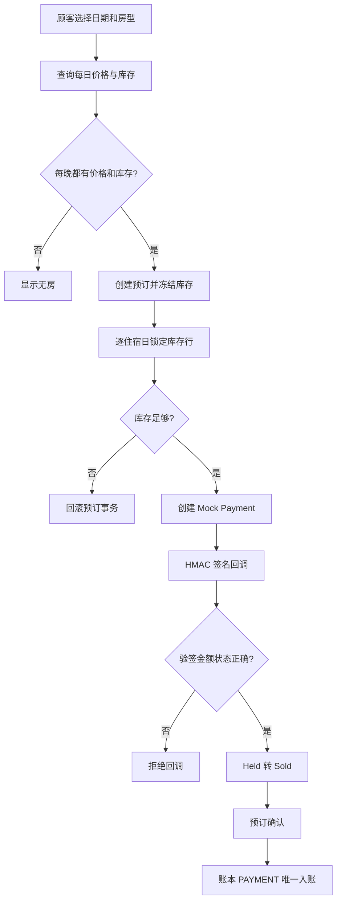

# PMS 2.0 — Phase 2 预订与库存闭环开发记录

- 分支：pms2/phase2-reservations-inventory
- 上游：pms2/phase1-platform-foundation
- 范围：住客档案、房型/房间/房价、按日库存、预订/Stay、Folio/账本、Mock 支付与 API v1。
- 版本边界：本轮属于 PMS 2.0 的核心业务闭环；3.0 仅处理已有功能的完善、Bug、安全/性能/兼容问题和回归，不增加业务功能。

## 新增领域模型

### 住客

- Guest：以物业 + 规范化手机号做唯一去重；本阶段不要求在顾客官网采集身份证号。
- 证件加密、脱敏、留存和公安旅业系统适配另按合规专项实施。

### 房型、房间、房价与库存

- RoomType：房型主数据。
- Room：物理房间；占用、清洁、维修三态独立。
- RatePlan：房价计划和有效期。
- DailyRate：房型/房价计划/住宿日期的每日价格来源。
- RoomTypeInventory：房型 × 住宿日的总房量、Hold、Sold、停用量和停售开关。

库存口径：available = total_rooms - held - sold - out_of_service。入住日期包含，离店日期不包含。库存按每个住宿日晚分别检查和锁定。价格必须覆盖区间内每一晚，成交价格快照写入 ReservationRoom.nightly_rates。

初始化库存日历：

    python manage.py sync_inventory_calendar --property-code DEFAULT --room-type-code KING --start-date 2026-11-01 --end-date 2026-12-31

该命令按启用的物理房间主数据同步总量与停用量，不会覆盖已有 Hold/Sold。每日房价需在 Admin 中按 RatePlan + RoomType + 日期维护。

### 预订、入住和账务

- Reservation：交易合同主单，记录预订意图、日期区间、房间数、金额、幂等键和 15 分钟 Hold 截止时间。
- ReservationRoom：一间房一条明细，记录成交价快照，支持一单多房。
- Stay：实际履约记录；实际入住/退房时间与预订日期分开。
- Folio：每张预订账单一个账务容器。
- LedgerEntry：金额带方向、业务日期、唯一 reference 的账本凭证；禁止实例/QuerySet 物理删除和直接更新，纠错使用红字反向凭证。
- Payment：支付流水，与预订和 Folio 关联，provider_ref 唯一。

Folio 余额口径：房费/消费为正，押金/收款/退款抵减为负；正数余额代表客人仍需支付。

## 最小预订与 Mock 支付链路

## API v1

本分支使用 Django 原生 View + JsonResponse 实现契约，暂不在同一变更中升级 Django 主版本或引入 DRF。后续将框架升级作为单独任务。

| 方法 | 路径 | 用途 |
|---|---|---|
| GET | /api/v1/availability?check_in=...&check_out=...&rooms=1 | 查询每晚房态与价格 |
| POST | /api/v1/reservations | 创建预订，必须带 Idempotency-Key |
| GET | /api/v1/reservations/{booking_no}?phone=... | 预订号 + 联系电话查询 |
| POST | /api/v1/reservations/{booking_no}/cancel | 取消待支付预订并释放 Hold |
| POST | /api/v1/payments/intents | 创建本地模拟支付单 |
| POST | /api/v1/payments/callback | HMAC 验签与幂等模拟回调 |
| GET | /api/v1/openapi.json | 当前接口说明 |

创建预订示例：

    curl -X POST http://127.0.0.1:8000/api/v1/reservations \
      -H "Content-Type: application/json" \
      -H "Idempotency-Key: booking-demo-001" \
      -d '{"full_name":"张三","phone":"13800000000","room_type_id":1,"rate_plan_id":1,"check_in":"2026-11-01","check_out":"2026-11-03","rooms":1,"adults":2,"children":0}'

**Mock 只用于本地/CI 验证状态流转，不是真实收单、扣款、退款或银行清算。** 模拟回调必须满足 DEBUG=True 且 DJANGO_ENV=dev/test；生产环境返回 404。生产支付必须接正式服务商适配器。

## 超时和取消

- 默认 Hold 15 分钟；支付失败时暂不立即释放，等待支付期限到期，避免迟到回调与重新售卖之间发生竞态。
- 手动释放过期 Hold：python manage.py expire_reservation_holds
- 本阶段允许顾客自助取消尚未支付的预订。
- 已确认预订不开放自助取消；需先定义取消规则、退款政策和账务冲销，再开放此路径。
- 后续可通过 Celery Beat/系统调度器运行超时命令，本阶段不强制安装 Celery。

## 验收用例

- 跨两晚价格正确汇总；离店日不作为住宿夜计价。
- 任一晚库存不足，整个事务回滚，不遗留部分 Hold 或半张订单。
- 同一 Idempotency-Key + 相同 payload 返回同一预订；同一 Key + 不同 payload 返回冲突。
- 两次成功回调只有一个 PAYMENT 账本凭证，Held 只转 Sold 一次。
- 金额不匹配或 HMAC 错误，不得确认预订或写账本。
- 15 分钟超时释放全部住宿日 Hold。
- 同一手机号在同一物业复用 Guest 档案。
- 同一预订编号必须配合匹配联系电话才能查询/取消。

## 当前边界与后续阶段

本阶段完成可测试的预订库存与 Mock 支付最小闭环，不代表 PMS 2.0 全部完成。下一阶段将现有前台入住/换房/续住/退房接到 Reservation/Stay/Folio/Ledger 服务，并补夜审营业日、客房清洁、财务日结和报表。真实支付、公安旅业、OTA/Channel Manager、电子发票、POS、停车系统均保持适配器边界，暂不接入。

所有数据写入必须经过领域服务；旧 Django 模板页面暂时并存，完成回归测试后再逐页替换，不在一个提交里同时推翻旧页面。
