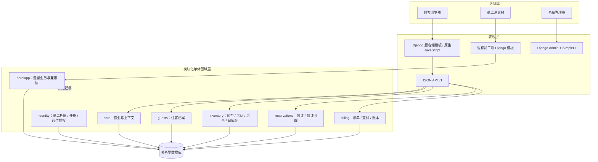
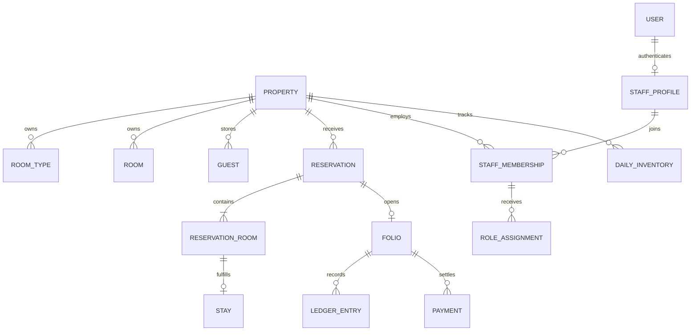

# PMS 2.0 技术架构说明

> 文档状态：随当前仓库代码更新  
> 当前交付：PMS2 已具备 11 个运营中心主要代码能力；SQLite/MySQL 8 CI 各 1178 项通过（SQLite skip 19）；真实浏览器、九角色本地实账号和最终独立验收仍待完成  
> **定位声明（2026-11-14）**：本文定位为架构概念层（§1~§5）；代码事实细节唯一承载为《PMS2技术功能说明文档_2026-11-12.md》，当前状态以《PMS当前状态总览》为准（DUP-08）。本文既有追加校准节保留为历史，不再续写。
> 版本策略：PMS 2.0 完成既定业务范围；3.0 只做已有功能完善、Bug 修复、性能/安全/兼容优化和回归，不新增业务功能。

> **2026-11-04 代码核对补充（main @ 610fe3c28bfc43058b69b2d4054c8adbefee70a1）**：当前已有 PMS2 `/checkin/` 前台工作台及 `/api/v1/front-desk/` 相关接口；员工 `/manage/staff/` 主要为读取工作台，生命周期写操作仍在 `/staff_accounts/`；当前按 DEFAULT 单物业上下文运行，不支持物业登录切换。`/reserve/` 是新顾客直订入口，旧 `/booking/` 仍需冻结和退役。身份邀请、联系方式验证和住客 OTP 尚未实现。本文下文若与此补充冲突，以代码核对补充及对应 SHA 的实现事实为准；正式业务规则仍以已批准决策文件为准。

## 1. 项目定位

本项目采用**单体酒店优先、预留多物业扩展**的酒店管理系统（PMS）。当前仍处于从历史 Django CRUD 原型向业务域模块化单体迁移的阶段。新业务不再以“单表增删改查”为中心，而围绕酒店物业、员工身份、房型/房间、日期库存、预订、实际入住、账单和账本建立边界。

当前实现与规划边界必须区分：

- 已实现：物业上下文、员工身份与任职关系、基础岗位授权模型、住客档案、房型/物理房间/每日房价/按日库存、预订与预订明细、支付模拟、账单与不可变账本、API v1、顾客端 `/reserve/`。
- 仍在旧系统/迁移中：员工生命周期写操作仍有 `/staff_accounts/` 路径；部分财务/夜审旧页面和原有业务模型仍保留。旧页面暂时保留，不代表已全部迁移到新领域模型。
- 已有基础：`/checkin/` 前台工作台及 `/api/v1/front-desk/` 部分入住履约 API 使用 PMS2 服务；客房清洁、夜审、财务报表仍需逐项核对页面/API/Service/测试覆盖，不能仅凭模型存在宣称完整交付。
- 不在当前范围：真实支付渠道、OTA、公安旅业系统、POS、停车系统、电子发票/数电票等第三方对接。

## 2. 总体架构

采用**模块化单体（Modular Monolith）+ Django B/S + API-First**，不是微服务。

### 架构原则

1. **模块化单体**：各业务域按 Django App 分包，使用领域服务封装事务和业务规则；当前部署仍是一个 Django 项目、一个应用进程体系和一个关系型数据库。
2. **API-First**：新顾客端页面只负责交互和展示，库存、金额、幂等、订单状态和支付结果由后端 API/领域服务决定。
3. **服务端渲染优先**：现阶段顾客端使用 Django Template + 原生 JavaScript，减少 Next.js 独立部署、跨域、双工程维护和认证复杂度。
4. **数据库约束兜底**：关键唯一性、金额范围、日期区间和关联完整性尽可能落在数据库约束；并发库存更新放在事务内锁定库存行。
5. **账务凭证不可篡改**：LedgerEntry 禁止常规更新/删除；纠错应新增红字冲销凭证并保留原因和原始凭证关联。
6. **渐进迁移**：新旧页面并存，按业务闭环逐步切换，不在一个阶段一次性推翻旧页面。

## 3. 技术栈

| 层次 | 当前采用 | 说明 |
|---|---|---|
| 后端框架 | Django 4.1 | 当前仓库锁定版本；框架升级应独立评估，不与业务重构混做 |
| 语言 | Python | Django 应用与领域服务 |
| 页面 | Django Template + 原生 JavaScript | 顾客端新页面；旧员工端页面暂时并存 |
| API | Django View + JsonResponse | 当前 API v1；尚未引入 Django REST Framework |
| 管理后台 | Django Admin + django-simpleui | 配置和基础数据管理 |
| 认证 | Django User / Session / Group / Permission | 新员工域将 User 与员工档案分离 |
| 数据库 | MySQL 默认；可配置 PostgreSQL / SQLite | 生产建议 MySQL 或 PostgreSQL；SQLite 主要用于测试/轻量本地验证 |
| 缓存 | Django LocMemCache | 当前默认本地内存缓存；多进程/多实例生产部署应评估 Redis |
| 自动化测试 | Django TestCase / CI 工作流 | 以仓库实际测试与 GitHub Actions 结果为准 |
| 静态资源 | Django staticfiles | 当前无独立前端构建链 |

依赖以 `requirements.txt` 为准。不要仅凭本说明升级 Django、数据库驱动或 UI 组件版本。

## 4. Django App / 领域边界

| App | 职责 | 关键实体/内容 |
|---|---|---|
| `apps.core` | 酒店物业主数据和请求物业上下文 | Property |
| `apps.identity` | 员工自然人、物业任职、岗位授权 | StaffProfile、PropertyStaffMembership、StaffRoleAssignment |
| `apps.guests` | 顾客/住客档案 | Guest |
| `apps.inventory` | 房型、物理房间、价格计划、每日价格、日库存 | RoomType、Room、RatePlan、DailyRate、RoomTypeInventory |
| `apps.reservations` | 预订合同、每间房明细、实际履约模型 | Reservation、ReservationRoom、Stay |
| `apps.billing` | 账单、支付流水、不可变账本 | Folio、Payment、LedgerEntry |
| `apps.api` | API 路由、参数校验、序列化响应、OpenAPI JSON | `/api/v1/*` |
| `hotelapp` | 历史系统与尚未迁移的页面/模型 | 旧员工、顾客、入住、餐饮、停车等 |

依赖方向建议：表现层 → API/应用服务 → 领域模块 → ORM/数据库。跨模块写操作应调用对方服务，不应在模板或视图中散落库存扣减、账务写入等规则。

## 5. 单体酒店与连锁扩展

当前按单体酒店落地，但核心业务表通过 `property_id` 关联 `Property`，为连锁扩展保留数据隔离基础。

现阶段只配置一个默认物业（`DEFAULT_PROPERTY_CODE`），不代表已经实现集团总部、跨店调拨、集团会员、跨店账务、集团报表或连锁 OTA 管理。未来增加集团组织/品牌/区域等实体时，应先明确集团级与门店级数据权限，不要把所有表简单加一个集团字段了事。

## 6. 细节层与当前状态入口（2026-11-14 收缩说明）

按权威关系矩阵（DUP-08），本文保留概念层（§1~§5），细节层唯一承载如下，本文不再重复维护：

| 原 章节 | 现唯一承载 |
|---|---|
| §6 员工 User 与 Staff 关系 / RBAC | 《02_技术架构与数据模型/PMS2技术功能说明文档_2026-11-12.md》§4.1 + 身份方案2.0/平台身份权限方案 |
| §7 核心业务数据模型 | 《PMS2技术功能说明文档》§3/§4 |
| §8 核心流程 | 《共享规范/PMS业务流程与名词说明_2026-11-10.md》+ 《PMS2技术功能说明文档》 |
| §9 API 与顾客端 | 《PMS2技术功能说明文档》§5 + 《03_.../PMS2接口文档与测试人员使用指南_2026-11-10.md》 |
| §10 第三方系统集成边界 | 《PMS2技术功能说明文档》 |
| §11 环境与配置 | 《PMS2技术功能说明文档》§2.5 |
| §12 当前已知限制 | 《PMS当前状态总览》§4 + 《docs全量一致性校准报告_2026-11-12.md》§4 |
| 2026-11-05/09/12 追加校准节 | 内容已被校准报告与状态总览覆盖，历史见 Git |
