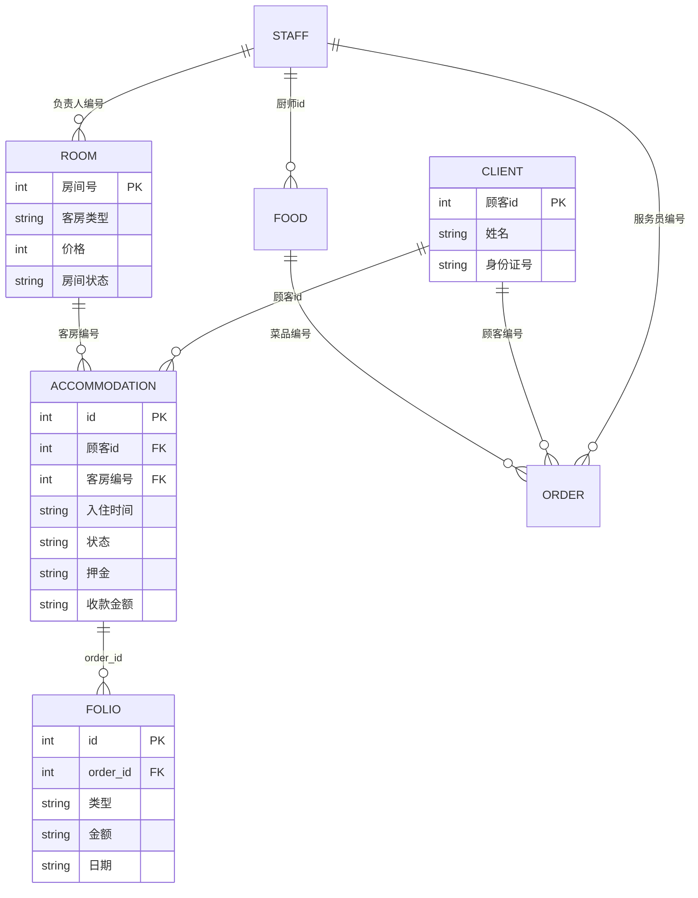
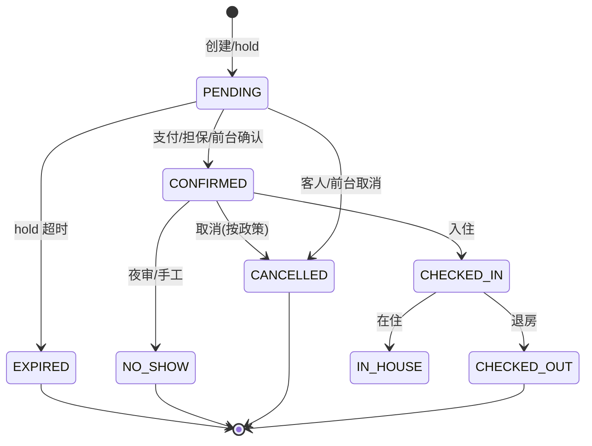
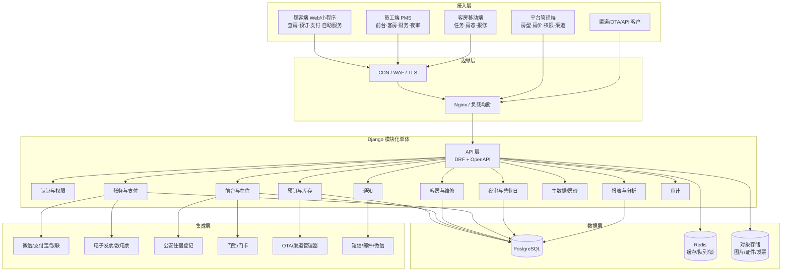
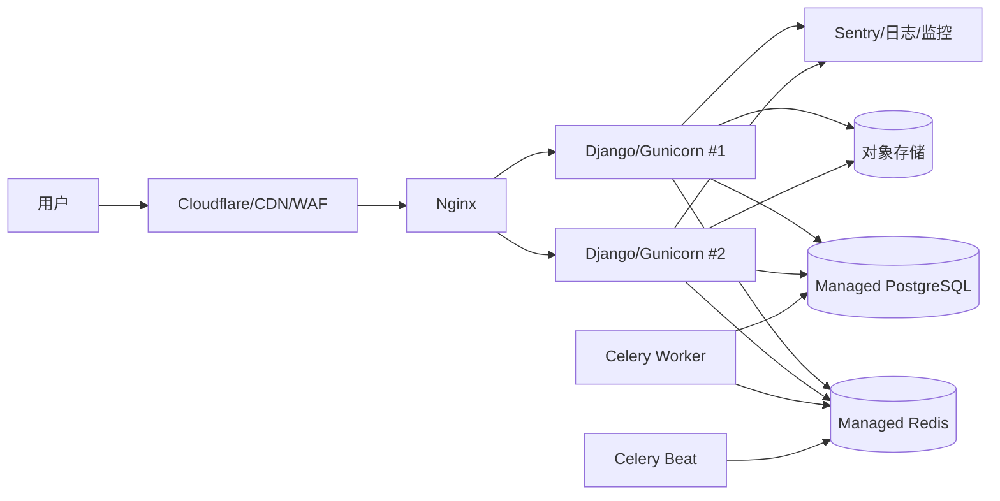
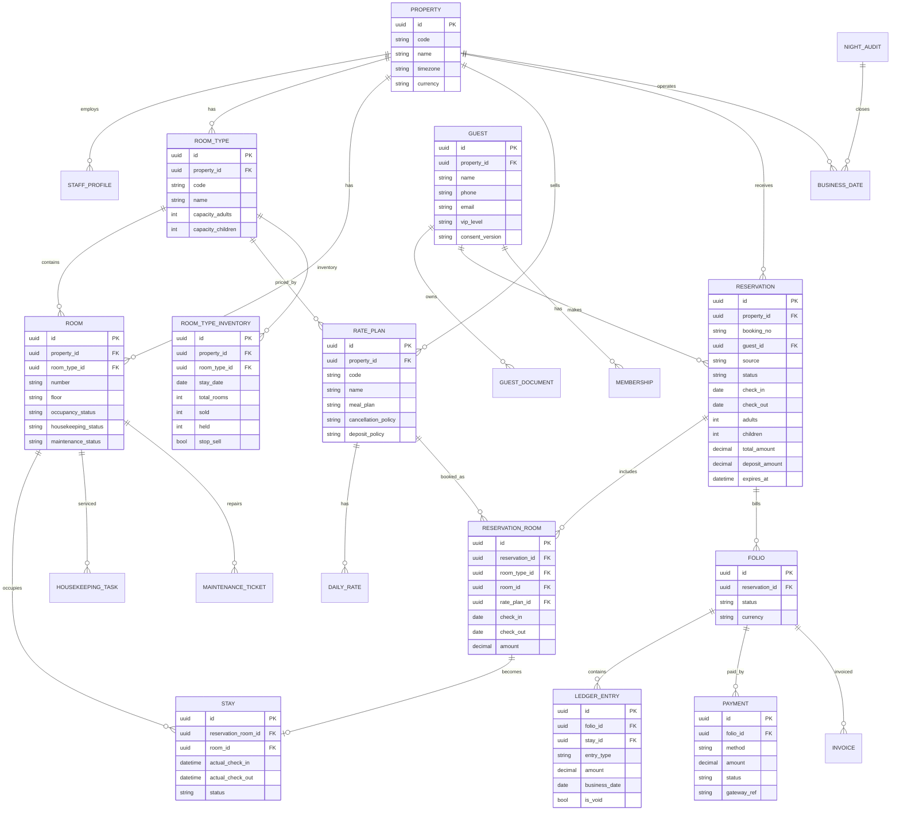
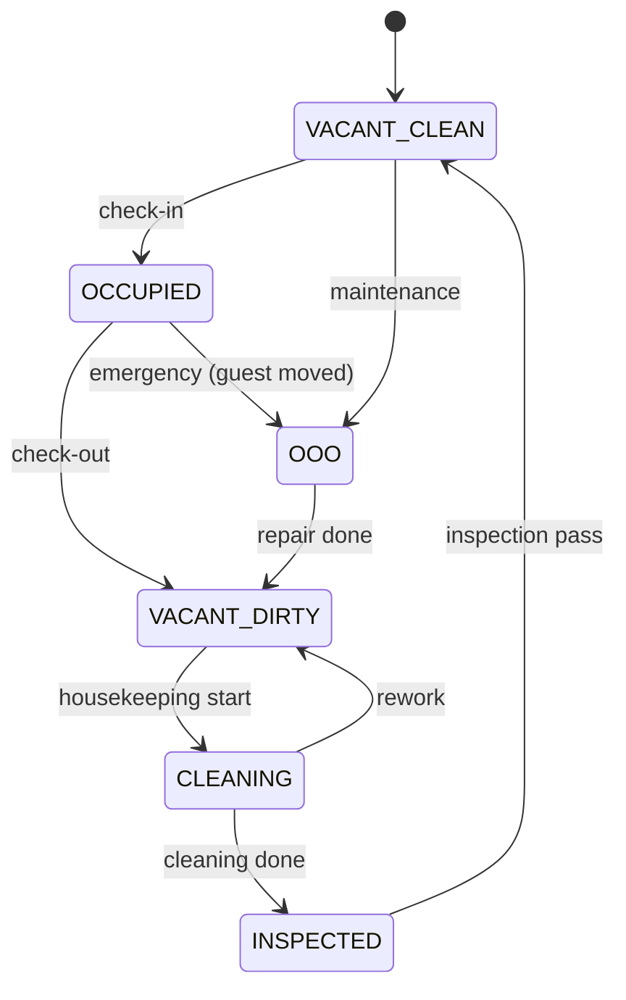
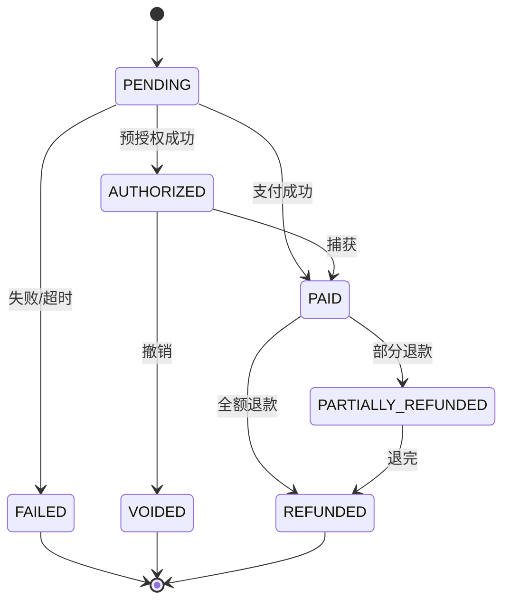
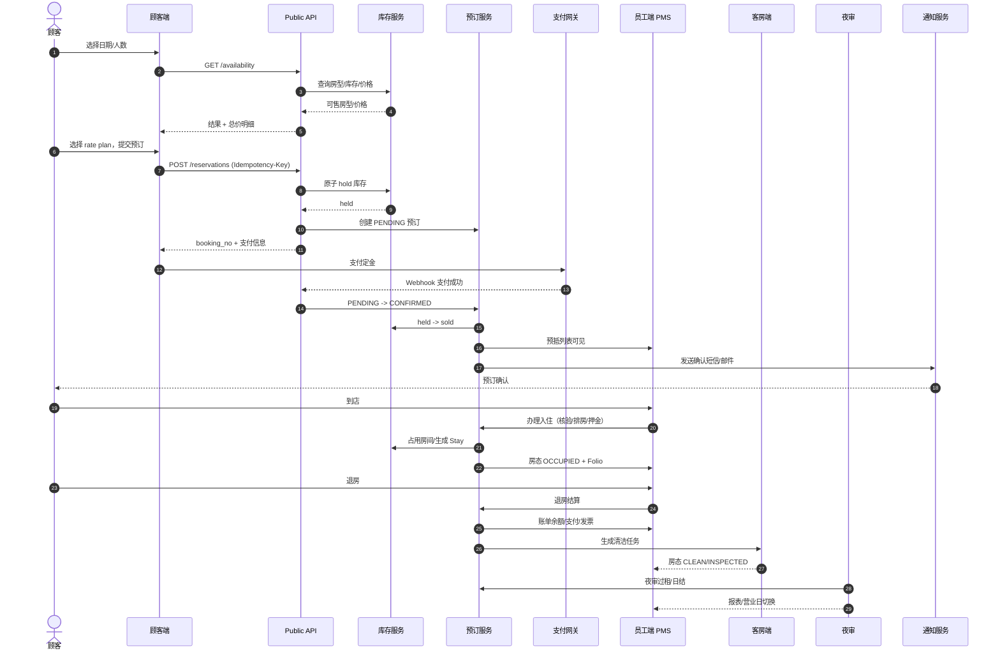

# 酒店管理系统（django-hotel）技术架构与项目需求说明书

| 项目 | 内容 |
|---|---|
| 文档版本 | v1.0（规划稿，待评审） |
| 编制日期 | 2026-10-30 |
| 适用项目 | `F:\Desktop\django-hotel` |
| 文档性质 | 现状审计 + 产品需求 + 技术架构 + 实施路线图 |
| 目标读者 | 项目负责人、产品经理、开发、测试、运维、酒店业务方 |
| 当前结论 | 项目是可运行的教学/原型系统，但还不是可正式运营的酒店 PMS；建议按“模块化单体 + API-first + 顾客端/员工端分离”的路线重构 |

> **阅读建议**：第 0～1 章回答“现在有什么、问题在哪”；第 2～4 章回答“应该做什么、不做什么”；第 5～6 章回答“技术上怎么实现、前台和后台怎么串”；第 7～9 章回答“先做什么、怎么做、如何验收”。

---

## 0. 执行摘要

### 0.1 一句话判断

当前项目已经具备“酒店业务演示”的骨架：有登录与角色、有 8 个 CRUD 模块、有预订→入住→退房→财务→夜审的流程、有状态机和事件机制；但它的核心模型仍然是**以“单表增删改查”为中心**，而不是**以“预订、库存、在住、账务”四条主线为中心**。因此它更像一个“酒店业务课程设计”，距离“可日常运营的单体酒店 PMS”还有明显差距。

### 0.2 五个关键结论

1. **最缺的不是页面，而是领域模型。** 当前没有“房型库存”“日期区间”“价格计划”“客人档案”“账单凭证”“支付流水”“夜审营业日”等可支撑真实运营的模型。
2. **当前预订不是“预订引擎”。** 只选了入住日期，没有离店日期；不校验日期区间的可售库存；甚至可能把已入住房间分配给新预订。
3. **当前账务是“两套账”。** `FinanceRecord` 与 `Folio` 各记一套，夜审只写前者，退房写两套，冲账/反结账又会删除流水，导致报表与账单不一致。
4. **“前台”和“后台”不应做成两套业务逻辑。** 正确做法是：一套领域服务 + 一个数据库事实源；顾客端、员工端、管理端只是三个入口。顾客端不能直接改库存，员工端不能绕过账务规则。
5. **餐厅、停车场、员工薪资不是核心 PMS。** 它们要么降级为“可选附加模块”，要么通过 POS/停车系统集成；继续以玩具级 CRUD 形式保留，会稀释核心产品的完成度。

### 0.3 建议的目标形态

- **架构**：Django 5.2 LTS + Django REST Framework 的**模块化单体**，不是微服务。
- **数据**：PostgreSQL 16+（首选）或 MySQL 8.0+；金额用 `Decimal`，日期用 `DateField`，主键用自增/UUID。
- **入口**：
  - 顾客端（官网/预订引擎）：实时查房、下单、支付定金、确认、取消/修改；
  - 员工端（PMS）：预订日历、前台接待、房态、客房、账单、夜审、报表；
  - 管理端：房型/房价/权限/渠道/系统配置，仅超管使用。
- **连接**：所有入口统一调用领域服务/API，PMS 数据库是唯一事实源；渠道管理器、支付、发票、公安登记、门锁通过适配器集成。
- **路线**：先修数据与账务底座（2～3 周），再做预订引擎（3～4 周），再做前台/客房/夜审（4～5 周），最后做报表与集成（3～4 周）。2 名开发 + 兼职测试约 16～22 周；3 名开发约 12～16 周。
- **取舍**：核心自建；渠道直连、电子发票、公安上传、支付、门锁优先采购/对接成熟服务；餐厅/停车场按实际业务决定是否保留。

### 0.4 需要业务方优先确认的 8 个决策（完整 12 项见第 9 章）

1. 单店还是连锁？当前按**单体酒店**设计，但数据模型预留 `property_id`。
2. 餐厅、停车场是否真实经营？是否已有 POS/停车系统？
3. 顾客端是继续用 Django 模板，还是独立 Next.js 官网？
4. 支付走微信/支付宝/银联的哪家服务商？是否需要预授权？
5. 是否必须对接公安旅馆业治安管理信息系统？目标城市/接口由谁提供？
6. 是否需要对接携程/美团/飞猪/抖音等 OTA？优先级如何？
7. 是否需要电子发票/数电票？开票服务商是谁？
8. 团队规模、预算、上线时间、是否允许停机迁移？

---

## 1. 项目现状梳理

### 1.1 项目定位与业务边界

当前项目是一个基于 Django 的 B/S 酒店业务管理系统，覆盖：

- 员工、顾客、餐厅菜品、餐饮订单、停车场、会员、客房、客房订单 8 个基础模块；
- 顾客自助预订、排房确认、入住、退房、冲账、反结账、夜审、财务流水；
- 四类业务角色（前台、值班经理、财务、店长）+ 超管；
- 字段校验、唯一性查重、操作提示、审计日志、简单数据仪表盘。

它试图覆盖“酒店前台 + 后台管理”的完整闭环，但实际边界仍然是：

- **有 CRUD，没有资源计划**：房型、房价、库存、日期区间没有建模；
- **有流程，没有账务规则**：账单、支付、押金、退款、发票没有形成可对账的凭证体系；
- **有角色，没有岗位职责**：权限按模型分组，未体现前台/客房/财务/夜审的岗位边界；
- **有页面，没有产品层级**：顾客端、员工端、平台管理端混在同一个 Django 项目里。

### 1.2 技术栈与运行方式

| 层次 | 当前实现 | 评价 |
|---|---|---|
| 语言/框架 | Python 3.9 + Django 4.1 | 4.1 已不在官方支持周期，Python 3.9 也已 EOL，建议升级 |
| 数据库 | MySQL，库名 `hotel`，`CONN_MAX_AGE=60` | 可用；但表结构来自旧版 `hotel.sql`，金额/日期大量用字符串 |
| 缓存 | `LocMemCache` | 单进程有效，多实例不一致；生产应换 Redis |
| 会话/认证 | Django `User` + `Group` + `is_staff` | 有 RBAC 雏形；Staff 与 User 未关联 |
| 前端 | Django 模板 + jQuery + ECharts + Bootstrap 旧资源 | 可运行；模板重复、无组件化、无构建链 |
| 后台 | Django Admin + simpleui | 适合超管配置；不适合作为日常业务后台 |
| 异步 | 无 | 通知、渠道同步、报表、夜审重试都缺基础设施 |
| 日志 | `logs/audit.log`、`logs/request.log` | 文件日志，不可查询、无 before/after |
| 测试 | `hotelapp/tests.py` 为空 | 没有任何自动化测试 |
| 部署 | `runserver` | 无生产 WSGI、无 Nginx、无容器、无 CI |
| 依赖 | `Django==4.1`、`PyMySQL==1.0.2`、`django-simpleui==2022.7.29` | 依赖过少，缺少生产/测试/安全依赖 |

验证结果（2026-10-30，当前工作区）：

```text
python manage.py check                         -> System check identified no issues
python manage.py makemigrations --check        -> No changes detected
```

这说明项目当前“能启动、模型与迁移一致”，但不代表业务正确或可运营。

### 1.3 代码结构

```text
django-hotel/
├─ hotel/                        项目配置
│  ├─ settings.py                数据库/缓存/日志/模板/登录地址
│  ├─ urls.py                    全部路由（约 45 条）
│  └─ wsgi.py
├─ hotelapp/
│  ├─ models.py                  11 个模型（8 业务 + 财务/夜审/账单）
│  ├─ views.py                   约 1600 行，全部视图与业务逻辑
│  ├─ state_machine.py           订单/房态状态机
│  ├─ events.py                  同步发布/订阅
│  ├─ handlers.py                退房/确认/取消/未到的事件订阅
│  ├─ audit_middleware.py        写操作文件日志
│  ├─ admin.py                   Django Admin 注册
│  ├─ migrations/                0001～0009
│  └─ tests.py                   空
├─ templates/                    17 个页面模板（含 403、登录、注册、侧边栏）
├─ static/                       CSS/JS/图片/字体/Sass 缓存
├─ docs/                         截图与本文件
├─ hotel.sql                     旧版数据库导出（MySQL 5.6）
├─ deploy_notes.md               性能/安全说明与升级路线
├─ requirements.txt
└─ manage.py
```

### 1.4 现有功能地图

| 模块 | 主要路由 | 模板 | 模型 | 现状 |
|---|---|---|---|---|
| 登录/注册/退出 | `/login/` `/register/` `/logout/` | `login.html` `register.html` | `User` | 可登录；注册即前台且 `is_staff=True`，风险高 |
| 主界面/仪表盘 | `/home/` `/` | `home.html` | 多模型聚合 | 有统计卡片、ECharts、预警；查询在 Python 内存中完成 |
| 顾客自助预订 | `/booking/` | `booking.html` | `Client` `Accommodation` `Room` | 仅选入住日期；无离店日期/库存/支付；可把在住房间分配给新预订 |
| 入住管理 | `/checkin/` | `checkin.html` | `Accommodation` `Room` `Folio` | 有排房、入住、退房、换房、续住、快捷离店、冲账、反结账 |
| 财务管理 | `/finance/` `/finance_add/` | `finance.html` | `FinanceRecord` | 有收支流水、按日汇总、入住率/RevPAR 估算；与 Folio 双账 |
| 夜审 | `/nightaudit/` `/nightaudit_run/` | `nightaudit.html` | `NightAudit` `Accommodation` `FinanceRecord` | 有过租、No-Show、日结；无幂等、可重复执行、无事务 |
| 员工管理 | `/index/` `/insert/` `/update_staff/` `/delete_staff/` `/search_staff/` | `index.html` | `Staff` | 纯 CRUD；与登录账号无关；含薪资/工龄等 HR 字段 |
| 顾客管理 | `/show_client/` ... | `html1.html` | `Client` | 仅姓名+身份证；无手机号/客史/证件类型 |
| 餐厅菜品 | `/show_food/` ... | `html4.html` | `Food` | 纯 CRUD；菜名唯一 |
| 餐饮订单 | `/show_order/` ... | `order.html` | `Order` | 一单一菜；无数量/总价/支付/桌台状态 |
| 会员管理 | `/show_vip/` ... | `vip.html` | `Vip` | 独立 CRUD；与顾客/订单无关联 |
| 停车场 | `/show_park/` ... | `park.html` | `Park` | 仅车位+车牌；无进出场/计费/与住客关联 |
| 客房管理 | `/show_room/` ... | `room.html` | `Room` | 纯 CRUD + 房态按钮；房型是字符串，无房型主数据 |
| 客房订单 | `/show_accomodation/` ... | `accomodation.html` | `Accommodation` | 可手工建单；与预订/入住流程部分重叠 |
| 后台管理 | `/admin/` | simpleui | 全部模型 | 超管可用；业务角色也可能进入，边界不清 |

### 1.5 数据模型现状

当前 11 个模型：

| 模型 | 作用 | 主键/关键字段 | 主要问题 |
|---|---|---|---|
| `Staff` | 员工信息 | `员工id` AutoField；姓名/职务/月薪/工龄 | 与 `User` 无关联；薪资/工龄不属于 PMS 核心 |
| `Client` | 顾客 | `顾客id` AutoField；姓名/身份证号 | 无手机号/客史/证件类型；每次预订新建一条 |
| `Vip` | 会员 | `会员编号` AutoField；姓名/等级/联系方式 | 与 `Client` 无关联；手机号唯一但无会员权益模型 |
| `Room` | 房间 | `房间号` Integer PK；类型/价格/负责人/状态 | 房型是字符串；价格挂在房间；单一状态混合占用/清洁/维修 |
| `Food` | 菜品 | `菜品编号` Integer PK；菜名/价格/厨师 | 价格字符串；与餐饮订单强绑定 |
| `Order` | 餐饮订单 | `id` Integer PK；顾客/菜品/服务员/桌号/状态 | 一单一菜；无数量/金额/支付；`id` 手工输入 |
| `Park` | 车位 | `车位编号` Integer PK；状态/车牌 | 与住客/订单无关；无时间/费用 |
| `Accommodation` | 客房订单/住宿 | `id` Integer PK；顾客/房间/入住时间/状态/金额/押金 | 无离店日期；日期/金额字符串；`id` 手工分配；预订与在住未拆分 |
| `FinanceRecord` | 财务流水 | 自增 id；类型/金额/事由/关联订单/日期/经手人 | 金额/日期字符串；关联订单无类型；与 Folio 重复 |
| `Folio` | 账单流水 | 自增 id；订单 FK/类型/金额/事由/日期/经手人 | 只覆盖部分场景；夜审不写；冲账/反结账会删除 |
| `NightAudit` | 夜审记录 | 自增 id；营业日期/在住数/过租总额/操作人 | 营业日期无唯一约束；可重复执行 |

当前 ERD（简化）：



### 1.6 角色与权限现状

| 角色 | 账号 | 现有权限 | 问题 |
|---|---|---|---|
| 前台 | `front` | 顾客/会员/餐饮订单/客房订单/车位增改查；菜品/客房只读 | 不能删除；但可改房价？实际房价属于客房修改，前台只读 |
| 值班经理 | `manager` | 前台全部 + 客房改价 + 订单删除（冲账） | 角色名硬编码在视图/模板中 |
| 财务 | `finance` | 全部业务只读 + 财务录入 | 财务报表与 Folio 不一致 |
| 店长 | `owner` | 全部模块增改查 | 无物理删除 |
| 超管 | `admin` | 全部 | 可进 Django Admin |

实现方式：

- 迁移 `0005_role_groups.py` 创建角色组和演示账号；
- 视图用 `@staff_required` + `@permission_required('hotelapp.xxx')`；
- 模板用 `perms.hotelapp.xxx` 控制按钮/菜单；
- 部分视图用 `_has_role(request.user, "值班经理")` 做二次判断。

问题：

- 角色名是字符串硬编码，改角色名即失效；
- `User.groups.all.0` 取第一个组，多角色用户菜单可能错误；
- `Staff` 与 `User` 两张皮，员工入职/离职不会同步账号；
- 公开注册直接成为前台，等于把内部系统入口开放给互联网；
- Django Admin 与业务后台的权限边界没有产品化。

### 1.7 现有业务闭环


这条链路在演示时能走通，但存在关键断点：

1. **预订没有离店日期**：无法计算住几晚、总价、库存占用区间。
2. **预订不占库存**：同一房型可以被无限预订；房间分配是“先到先得 + 兜底任意房间”。
3. **入住会覆盖预订日期**：`checkin_in` 把 `入住时间` 改成今天，原预订日期丢失。
4. **夜审与账单脱节**：夜审只写 `FinanceRecord`，不写 `Folio`；退房只按前台输入的金额收款，不按账单余额结算。
5. **冲账/反结账破坏审计**：反结账直接删除 `FinanceRecord` 和 `Folio` 收款记录，无法追溯。
6. **房态是单一字段**：`空闲/已预订/已入住/待清洁/清洁中/待检查/维修中` 混在一起，导致“已入住但待清洁”“维修但已预订”等组合无法表达。

### 1.8 工程质量评估

**做得好的地方：**

- `views.py` 文件头有结构约定，`show_/insert_/update_/delete_/search_` 模式统一；
- 有 `_first_error`、`_error_context`、`_search` 白名单等输入校验思路；
- 有 `state_machine.py`，把订单/房态流转集中定义；
- 有 `events.py`/`handlers.py`，尝试把前台操作与后台联动解耦；
- 有 RBAC、审计日志、部署说明、README 和截图，文档意识较好；
- 当前 `manage.py check` 与迁移检查通过。

**主要工程债务：**

| 类别 | 问题 | 影响 |
|---|---|---|
| 架构 | 所有逻辑堆在 1600 行 `views.py` | 难测试、难复用、难拆分 API |
| 数据 | 金额/日期用 `CharField`；手工主键；`DO_NOTHING` 外键 | 数据错误、并发冲突、孤儿记录 |
| 账务 | `FinanceRecord` 与 `Folio` 双账；删除流水 | 报表不可信、审计不可追溯 |
| 安全 | 硬编码密钥、`DEBUG=True`、GET 写操作、公开注册 | 生产不可用，存在 CSRF/越权/数据泄露风险 |
| 前端 | 17 个独立 HTML，重复布局和 JS | 维护成本高，交互不一致 |
| 测试 | 0 个测试 | 任何重构都没有安全网 |
| 运维 | 无环境分离、无 CI/CD、无监控、无备份演练 | 无法稳定上线 |
| 性能 | 仪表盘 Python 循环全表；无分页/索引 | 数据量上来后明显变慢 |
| 合规 | 身份证/手机号明文；无同意/保留策略 | 违反《个人信息保护法》风险 |

### 1.9 关键缺陷清单（按优先级）

> 行号截至 2026-10-30 当前工作区；修复时请以最新代码为准。

#### P0：上线前必须修复

| ID | 问题 | 证据 | 影响 | 建议 |
|---|---|---|---|---|
| P0-01 | 住宿订单主键手工分配，`max(id)+1` 并发冲突 | `models.py:18`；`views.py:986-988`、`1321-1323` | 并发下单/散客入住可能 500 | 改 `AutoField`/UUID，数据库生成 |
| P0-02 | 没有离店日期，无法表达住宿区间 | `models.py:17`；`booking.html` 仅入住日期 | 无法算晚数、总价、库存 | 增加 `check_in/check_out`，`ReservationRoom` 按夜拆分 |
| P0-03 | 预订不做日期区间库存校验，可能分配在住房间 | `views.py:1305`、`1318-1319` | 超售、重复售卖、到店无房 | 建 `RoomTypeInventory`，按日原子占用 |
| P0-04 | 夜审可重复执行，重复过租 | `views.py:1594-1625`；`models.py:118-134` 无营业日唯一约束 | 收入和应收虚增 | `NightAudit(property, business_date)` 唯一 + 幂等任务 |
| P0-05 | `FinanceRecord` 与 `Folio` 双账，夜审只写前者 | `models.py:99-157`；`views.py:1452-1455`、`1611-1614` | 账单余额与财务报表不一致 | 合并为统一 `LedgerEntry`，报表从账务派生 |
| P0-06 | 退房金额由前台任意输入，押金不自动抵扣 | `views.py:1441-1447` | 收错钱、无法退款、无法对账 | 按 Folio 余额结算，支持押金抵扣/退款 |
| P0-07 | 删除/冲账使用 GET，且无 CSRF | `views.py:186`、`271`、`358`、`445`、`529`、`615`、`713`、`805` | 链接预取、爬虫、CSRF 可触发写操作 | 全部改 POST/DELETE + CSRF + 二次确认 |
| P0-08 | 反结账直接删除财务/账单流水 | `views.py:1484-1485` | 审计链断裂，无法追责 | 用红字反向凭证，禁止物理删除 |
| P0-09 | 财务冲账按“关联订单”字符串排除，餐饮/客房 ID 会串 | `views.py:1496-1497` | 误排除无关流水，报表错误 | 关联订单加 `source_type` + FK/唯一业务号 |
| P0-10 | 公开注册即前台且 `is_staff=True` | `views.py:1120-1153` | 互联网用户可进入内部系统 | 关闭公开注册/改为邀请制+审批 |
| P0-11 | 硬编码 `SECRET_KEY`、`DEBUG=True`、数据库明文密码 | `settings.py:23-28`、`85-95` | 生产密钥泄露、调试页泄露 | `.env` + 环境分离 + 密钥管理 |
| P0-12 | 房态单字段混合占用/清洁/维修 | `models.py:166`；`state_machine.py:18-26` | 无法表达组合状态，房态图失真 | 拆 `occupancy_status` / `housekeeping_status` / `maintenance_status` |
| P0-13 | 每次预订新建 `Client`，无手机号唯一/客史 | `views.py:1320`；`models.py:35-44` | 客人重复、无法识别回头客 | 以手机号/证件号做 Guest 去重与合并 |
| P0-14 | 入住时把 `入住时间` 覆盖为今天 | `views.py:1421` | 丢失原预订日期，影响夜审/价格 | 分离 `reserved_arrival` 与 `actual_check_in` |
| P0-15 | 取消预订无事务/行锁；确认排房条件可绕过 | `views.py:1352-1367`；`1383` | 并发下重复释放/占用房间 | 统一 `select_for_update` + 状态机 + 事务 |
| P0-16 | 身份证/手机号明文存储，无同意与保留策略 | `models.py:38`、`195` | 违反 PIPL/治安管理要求 | 字段加密/脱敏、访问审计、同意记录 |
| P0-17 | 没有自动化测试 | `hotelapp/tests.py` | 重构无安全网 | 先补关键流程测试，再重构 |
| P0-18 | 没有 API/契约，前后端只能靠模板耦合 | `hotel/urls.py` | 顾客端/移动端/渠道无法复用 | 建 `/api/v1` + OpenAPI |
| P0-19 | 审计只有文件日志，无 before/after | `audit_middleware.py` | 无法回答“谁改了什么” | 建 `AuditLog` 表，记录实体/旧值/新值 |
| P0-20 | `check_unique` 缓存 60 秒且创建后不失效 | `views.py:115-120` | 可能提示“可用”但实际已存在 | 写操作后主动失效或缩短 TTL |

#### P1：MVP 必须补齐

| ID | 问题 | 影响 | 建议 |
|---|---|---|---|
| P1-01 | 无房型主数据/房价计划/季节价 | 无法差异化定价、无法做套餐 | `RoomType`、`RatePlan`、`DailyRate` |
| P1-02 | 无客房任务/查房/维修工单 | 客房部无法协同 | `HousekeepingTask`、`MaintenanceTicket` |
| P1-03 | 无支付网关/退款/对账 | 只能手工记账 | 微信/支付宝/银联 + 支付流水 |
| P1-04 | 无发票/数电票 | 无法满足客人开票 | 对接发票服务商，Folio 快照开票 |
| P1-05 | 无预订确认/短信/邮件/微信通知 | 客人不知道是否成功 | 通知适配器 + 模板 |
| P1-06 | 无渠道管理器/OTA 直连 | 多渠道手工改房态，易超售 | 先接 1～2 个渠道或采购 channel manager |
| P1-07 | 无散客/团队/协议单位/旅行社 | 无法承接团队和协议客户 | `GroupBlock`、`Company`、`TravelAgent` |
| P1-08 | 无夜审营业日/收银班次 | 无法日结、无法交班 | `BusinessDate`、`CashierShift` |
| P1-09 | 无 ADR/RevPAR/来源/客源等标准报表 | 老板无法决策 | 报表层 + 物化视图 |
| P1-10 | 无身份证读卡/公安上传 | 前台手工录入，合规风险 | 适配器 + 人工复核 |
| P1-11 | 无多语言/多币种 | 无法接待外宾 | i18n + currency |
| P1-12 | 无分页/索引/异步导出 | 数据量上来后变慢 | 分页、索引、Celery |
| P1-13 | 无 CI/CD/监控/备份演练 | 上线后故障不可控 | GitHub Actions + Sentry + 备份脚本 |
| P1-14 | 无软删除/数据归档 | 主数据删除后历史断链 | `is_active` + 归档策略 |
| P1-15 | 无现金/押金/退款权限分离 | 财务舞弊风险 | 收银班次 + 审批 + 审计 |

### 1.10 哪些功能是“累赘”，哪些应该降级

这里的“累赘”不是建议立刻删除，而是**不应继续占用核心产品资源**。建议按以下方式处理：

| 功能 | 当前问题 | 建议 | 理由 |
|---|---|---|---|
| 员工薪资/工龄（`Staff`） | 与登录账号无关，薪资/工龄不是 PMS 日常运营必需 | **降级**：只保留 `StaffProfile`（姓名/工号/手机/岗位/状态/关联 User）；薪资/工龄移到 HR 系统或删除 | PMS 的核心是排班/权限/操作审计，不是发工资 |
| 餐厅菜品/餐饮订单（`Food`/`Order`） | 一单一菜、无数量/总价/支付/桌台状态，无法真实运营 | **二选一**：① 酒店有餐厅 → 接 POS，账单挂房账；② 无餐厅 → 从核心移除，作为可选插件 | 玩具级餐饮模块会误导“已支持餐饮” |
| 停车场（`Park`） | 只有车位+车牌，无进出场/计费/住客关联 | **降级/外购**：免费停车可只保留“车位备注”；收费停车接停车系统 | 停车计费是独立硬件/系统领域 |
| 会员（`Vip`） | 与顾客、订单、积分、权益无关联 | **合并**：并入 `Guest` + `Membership`，不要单独 CRUD | 会员是客人档案的一部分 |
| `FinanceRecord` | 与 `Folio` 双账 | **合并**：统一账务凭证，财务报表从凭证派生 | 两套账必然对不上 |
| Django Admin 作为业务后台 | 业务角色也能进，容易绕过业务规则 | **保留但限权**：仅超管/系统配置使用；日常业务走 PMS | Admin 是数据库管理工具，不是业务产品 |
| 旧模板 `html1.html`/`html4.html`、`accomodation` 拼写 | 模板重复、命名不一致 | **重构**：统一 `base.html` + 组件；路由改 REST 风格 | 降低维护成本 |
| `hotel.sql` | 旧版 MySQL 5.6 导出，与迁移不一致 | **移除/改为 seed**：只保留 migrations + 演示数据 fixture | 防止误导入旧结构 |
| `check_unique` 独立接口 | 缓存可能过期，前端每个字段都要写 JS | **保留但产品化**：统一表单校验/异步查重组件，或直接依赖后端唯一约束 | 不是核心功能，但体验需要 |
| 静态目录 `_sass-cache`、旧 Bootstrap/jQuery 资源 | 构建产物/旧依赖混在源码 | **清理**：现代构建链或至少移除缓存目录 | 仓库整洁、减少安全面 |

---

## 2. 竞品与行业基准

### 2.1 对标产品

| 类型 | 代表产品 | 公开资料中的核心能力 | 对本项目的启示 |
|---|---|---|---|
| 国际 enterprise PMS | Oracle OPERA Cloud | 预订、入住/退房、客房分配、房价管理、开单、移动化、云部署、集成生态 | 核心是“一个客人/一个订单/一个账单”的单一记录 |
| 国际 cloud all-in-one | Mews、Cloudbeds、RoomRaccoon | PMS + booking engine + payments + channel manager + housekeeping + reporting | 单体酒店更适合一体化套件，减少集成 |
| 中国云 PMS | 罗盘云 PMS、云居客 PMS | 客房预订、前台接待、客房管家、财务审计、数据报表、多店连锁、房态图、餐饮 | 中国酒店需要房态图、夜审、公安登记、OTA 直连 |
| 中国渠道管理 | 订单来了 | 30+ OTA 直连，价格/房态/库存/订单实时同步，一个后台 | 渠道同步是独立能力，建议采购而非自研全部 OTA |
| 国际 booking engine | Mews Booking Engine、Cloudbeds Booking Engine | 实时房态/价格、移动优先、支付、rate plan/package、加购、多语言/多币种、分析 | 顾客端不是“展示页”，而是实时库存与支付系统 |

### 2.2 行业核心能力清单

综合 Oracle、RoomMaster、Hotel Tech Report 等公开资料，现代 PMS 的核心能力可以归纳为 12 项：

| # | 能力 | 说明 | 当前项目 |
|---|---|---|---|
| 1 | 预订与库存 | 创建/修改/取消预订，实时库存，防超售 | 部分：有订单，无库存/日期区间 |
| 2 | 前台运营 | 入住、退房、换房、散客、早到/晚到 | 部分：有基础流程 |
| 3 | 客人档案/CRM | 联系方式、证件、偏好、住史、会员 | 很弱：仅姓名+证件 |
| 4 | 房价与房型 | 房型、房价计划、季节价、限制条件 | 很弱：房价挂在房间 |
| 5 | 账单/Folio | 房费、杂费、拆分、转账、发票 | 部分：有 Folio，但与财务双账 |
| 6 | 支付 | 押金、预授权、收款、退款、对账 | 很弱：只记录金额 |
| 7 | 客房/维修 | 脏房/干净/查房/维修/停用 | 部分：只有状态按钮 |
| 8 | 夜审 | 过租、No-Show、对账、营业日切换 | 部分：可执行但可重复 |
| 9 | 渠道管理 | OTA/GDS 房价房态同步 | 无 |
| 10 | 收益管理 | 动态定价、预测、限制 | 无 |
| 11 | 报表 | 入住率、ADR、RevPAR、来源、现金流 | 部分：仪表盘+简单汇总 |
| 12 | 集成 | POS、门锁、身份证、公安、发票、支付 | 无 |

### 2.3 预订引擎基准

Mews 的公开清单强调 12 项：移动优先、品牌定制、加载速度、低摩擦流程、实时 PMS/房价/库存、转化优化、加购、多语言/多币种、安全支付、促销/价格计划/套餐、分析、实施与支持。RateGain 进一步强调实时库存、渠道管理、支付、移动端、分析。Cloudbeds 的文档说明其支持 rate plan/package、押金、MinLOS、支付处理。

对本项目的要求：

- **实时**：房价/库存来自 PMS，不能在前端写死；
- **可解释**：总价拆分明细（房费、税费、服务费、加购、折扣）；
- **可取消**：取消政策、押金政策、No-Show 政策在预订前展示；
- **可支付**：至少支持定金/全额支付，支付失败可重试；
- **可确认**：下单后立即得到预订号，并收到短信/邮件/微信通知；
- **可自助**：客人可凭预订号+手机号查询、取消、修改；
- **可防刷**：限流、验证码、幂等键、库存 hold 过期释放。

### 2.4 中国市场的特殊要求

| 要求 | 公开依据 | 产品含义 |
|---|---|---|
| 住宿实名登记 | 《旅馆业治安管理办法》第六条：旅馆接待旅客住宿必须登记，查验身份证件，如实登记 | 入住必须采集/核验证件，不能只填姓名 |
| 登记信息上传 | 上海 2025 年《旅馆业单位住宿登记规定》第三条：登记后 2 小时内上传旅馆业治安管理信息系统；境外人员 24 小时内报送 | 需要公安系统适配器/人工复核，不能假设 API 一定开放 |
| 未成年人保护 | 上海规定第八条：接待未成年人需询问监护人联系方式、同住关系并记录 | 入住流程增加未成年人登记/提醒 |
| 个人信息保护 | 《个人信息保护法》：合法、正当、必要、诚信；最小范围；敏感个人信息需特定目的、充分必要性、严格保护 | 身份证/手机号加密、脱敏、访问审计、同意记录、保留期限 |
| 电子发票/数电票 | 国内酒店普遍需要开票 | Folio 结算后开票，保存发票快照 |
| 移动支付 | 微信/支付宝/银联 | 支付适配器，不存卡号 |
| OTA 渠道 | 携程/美团/飞猪/抖音/小红书等 | 渠道管理器或直连适配器，统一库存 |

> 合规提示：公安上传、支付、发票、门锁等接口通常需要企业资质、商户号、设备/服务商配合。本文只做架构预留，不承诺这些接口可以“纯软件”直接接通。

### 2.5 对本项目的启示

1. **PMS 是事实源，booking engine 是渠道。** 顾客端不能自己维护库存，否则一定超售。
2. **先做“可运营的最小闭环”，再做“功能大而全”。** 对单体酒店，预订、前台、账单、夜审、房态、报表是刚需；动态定价、AI、机器人是后话。
3. **能买则买。** 渠道直连、电子发票、公安上传、支付、门锁，优先接成熟服务；自研只做与酒店运营差异化相关的部分。
4. **中国场景不能照搬国外。** 实名登记、公安上传、发票、OTA、微信生态是必选项。
5. **产品价值是“少出错、少漏单、账对得上”，不是页面多。** 当前最需要补的是库存与账务的确定性。

---

## 3. 产品定位、范围与版本策略

### 3.1 产品定位

**假设（待确认）**：面向 30～120 间客房的单体酒店/精品酒店，1 个 property，1～3 个餐饮/停车等附加经营点，前台 2～4 人，客房 5～15 人，财务 1～2 人，店长 1 人。

**产品目标：**

1. 让顾客可以在官网/微信/手机端实时查房、下单、支付定金、收到确认；
2. 让前台在一个界面完成排房、入住、换房、续住、退房、收款；
3. 让客房部实时看到脏房/干净/查房/维修任务；
4. 让财务每天能对平账、夜审能日结、老板能看到入住率/ADR/RevPAR；
5. 让所有渠道（官网、前台、OTA）共享同一库存，避免超售。

**非目标（本阶段不做）：**

- 完整 HR/薪酬/排班系统；
- 完整餐饮 ERP/供应链；
- 完整总账/合并报表（只做酒店经营账）；
- 连锁 CRS/多物业集中管控（架构预留，不做 UI）；
- 自研 OTA 平台/支付牌照/公安系统；
- AI 动态定价、机器人、能耗管理（V2 以后）。

### 3.2 用户与场景

| 角色 | 典型场景 | 关键诉求 |
|---|---|---|
| 顾客 | 手机查房、比价、下单、支付、取消、查询 | 快、准、透明、可取消、有确认 |
| 前台接待 | 排房、入住、换房、续住、退房、收款 | 一屏完成、少录、防错、有提示 |
| 客房服务员/主管 | 接任务、改房态、报维修、查房 | 手机可用、状态清楚、少走路 |
| 值班经理 | 授权冲账、反结账、处理投诉、夜审 | 有权限、有留痕、可追溯 |
| 财务/收银 | 对账、收款、退款、开票、交班 | 账实一致、凭证完整、可导出 |
| 店长/老板 | 看经营数据、房价策略、异常预警 | 实时、准确、移动端可看 |
| 系统管理员 | 用户/角色/房型/房价/渠道/参数 | 安全、可配置、可审计 |
| 渠道/OTA | 推送订单、同步房态/价格 | 稳定、幂等、可对账 |

### 3.3 版本策略

| 版本 | 目标 | 范围 | 不包含 |
|---|---|---|---|
| **MVP（必须）** | 单店可运营 | 房型/房间/房价、日期区间库存、官网预订、定金支付、预订管理、前台入住/退房、Folio、支付记录、房态/客房任务、夜审、基础报表、RBAC、审计、测试 | 渠道直连、发票、公安、门锁、会员积分、动态定价 |
| **V1（增强）** | 提升效率与合规 | 渠道管理器、电子发票、身份证读卡/公安上传、会员/协议单位、团队预订、收银班次、更多报表、多语言 | 多物业、AI 定价 |
| **V2（规模化）** | 多店/收益管理 | 多 property、中央预订、动态定价、忠诚度、移动客房 App、BI、开放 API | 自研 OTA/支付 |

### 3.4 功能取舍：保留 / 补齐 / 降级 / 移除 / 外购

| 功能 | 决策 | 说明 |
|---|---|---|
| 登录/RBAC | **保留并重构** | 改为岗位权限 + 属性权限；Staff 与 User 关联；MFA |
| 顾客管理 | **补齐** | 升级为 Guest 档案：手机号、证件、偏好、住史、会员、 consent |
| 客房管理 | **补齐** | 拆 RoomType/Room；房态拆占用/清洁/维修 |
| 客房订单 | **重构** | 拆 Reservation/ReservationRoom/Stay；支持日期区间 |
| 入住管理 | **保留并重构** | 保留流程，改为服务层 + API + 事务 |
| 财务/夜审 | **重构** | 统一 Ledger；夜审幂等；营业日；收银班次 |
| 会员 | **合并** | 并入 Guest + Membership，不做独立 CRUD |
| 员工 | **降级** | 保留岗位/账号/状态；薪资/工龄移出 |
| 餐厅 | **可选/外购** | 有餐厅接 POS；无餐厅移除 |
| 停车场 | **可选/外购** | 免费停车做备注；收费接停车系统 |
| Django Admin | **保留限权** | 仅超管/配置；日常业务走 PMS |
| 旧模板/旧 SQL | **清理** | 统一 base 模板；migrations + seed |
| 渠道管理 | **外购/适配** | 订单来了/住哲/罗盘等，或 OTA 官方 API |
| 支付 | **外购/适配** | 微信/支付宝/银联服务商 |
| 发票 | **外购/适配** | 百望/航信/数电票服务商 |
| 公安上传 | **外购/适配** | 当地指定系统/设备商 |
| 门锁 | **外购/适配** | 门锁厂商 SDK |

---

## 4. 需求说明

### 4.1 角色与权限矩阵

权限缩写：C=创建，R=查看，U=修改，D=删除/作废，A=审批/授权，—=无权限。

| 模块/动作 | 顾客 | 前台 | 客房主管 | 值班经理 | 财务 | 店长 | 超管 |
|---|---|---|---|---|---|---|---|
| 官网查房/下单 | C/R | — | — | — | — | — | — |
| 预订创建/修改/取消 | 自己的 | C/R/U | — | C/R/U/A | R | R | C/R/U/D |
| 排房/入住/换房/续住 | — | C/R/U | R | C/R/U/A | R | R | C/R/U |
| 退房/收款 | — | C/R | — | C/R/A | C/R/A | R | C/R |
| 冲账/反结账 | — | — | — | A | R | R | A |
| 房价/房型配置 | — | R | — | R | R | C/R/U | C/R/U/D |
| 房态/客房任务 | — | R/U | C/R/U | C/R/U/A | R | R | C/R/U |
| 维修工单 | — | C/R | C/R/U | C/R/U/A | R | R | C/R/U/D |
| Folio/账单 | 自己的 | C/R/U | — | C/R/U/A | C/R/U/A | R | C/R/U |
| 支付/退款 | 自己的 | C/R | — | C/R/A | C/R/A | R | C/R |
| 发票 | 自己的 | C/R | — | R | C/R | R | C/R |
| 夜审 | — | — | — | A | R | R | A |
| 报表 | — | 有限 | 有限 | R | R | R | R |
| 用户/角色 | — | — | — | — | — | R | C/R/U/D |
| 系统配置 | — | — | — | — | — | R | C/R/U/D |
| 审计日志 | — | — | — | R | R | R | R |

补充规则：

- **职责分离**：前台可收款但不能改房价/冲账；值班经理可授权冲账但不能删除审计；财务可对账但不能改业务单；店长看全局但不日常操作。
- **金额权限**：折扣/免单/退款超过阈值需值班经理/店长审批。
- **数据范围**：员工只能看自己 property 的数据；连锁时按 property 授权。
- **敏感操作**：冲账、反结账、退款、改房价、删除主数据、导出客人信息，必须记录 `AuditLog` 并可查询。

### 4.2 顾客端（Guest Web / Booking Engine）需求

| ID | 优先级 | 需求 | 验收标准 |
|---|---|---|---|
| FR-GW-001 | P0 | 首页展示酒店品牌、房型、服务、位置、联系方式 | 移动端/桌面端自适应；LCP < 2.5s |
| FR-GW-002 | P0 | 日期区间搜索：入住/离店、成人/儿童、房间数 | 离店 > 入住；日期不可早于今天；最多 30 晚 |
| FR-GW-003 | P0 | 实时查房：按日期区间返回可售房型、最低价、剩余房量 | 数据来自 PMS；缓存 TTL ≤ 60s；无房时给出替代日期 |
| FR-GW-004 | P0 | 房型详情：面积、床型、可住人数、设施、图片、政策 | 内容来自 CMS/后台；图片懒加载 |
| FR-GW-005 | P0 | 价格计划：含早/不含早、可取消/不可取消、连住优惠 | 每个 plan 展示总价、取消政策、押金政策 |
| FR-GW-006 | P0 | 总价明细：房费×晚数、税费、服务费、加购、折扣 | 明细可展开；与支付金额一致 |
| FR-GW-007 | P0 | 加购：早餐、加床、接送、延迟退房、停车 | 加购库存/价格可配置；计入总价 |
| FR-GW-008 | P0 | 预订表单：姓名、手机、证件（可选）、到店时间、特殊需求 | 手机号校验；支持保存常用信息（登录后） |
| FR-GW-009 | P0 | 支付定金/全额；支付失败可重试 | 支付回调幂等；失败不占库存超过 hold 时长 |
| FR-GW-010 | P0 | 下单幂等：同一会话重复提交不重复建单 | `Idempotency-Key`；返回同一 booking_no |
| FR-GW-011 | P0 | 库存 hold：下单后保留 15 分钟，超时释放 | 定时任务释放；释放后库存可售 |
| FR-GW-012 | P0 | 确认通知：短信/邮件/微信模板消息 | 5 分钟内送达；含预订号、日期、房型、金额、取消链接 |
| FR-GW-013 | P0 | 预订查询：预订号+手机号 | 可查看状态、账单、取消政策 |
| FR-GW-014 | P0 | 自助取消/修改：在政策允许范围内 | 取消后释放库存；退款按政策；记录原因 |
| FR-GW-015 | P0 | 取消/No-Show/押金政策展示与勾选同意 | 下单前必须勾选；留存版本号/时间 |
| FR-GW-016 | P1 | 多语言（中/英）、多币种 | 语言/币种切换；金额按汇率展示，结算币种明确 |
| FR-GW-017 | P1 | 会员登录/积分/优惠券 | 登录后可见会员价、积分、优惠券 |
| FR-GW-018 | P1 | 地图/交通/周边/FAQ/评价 | 内容可后台维护 |
| FR-GW-019 | P1 | SEO：结构化数据、sitemap、 canonical、OG | 搜索引擎可收录房型/价格页面 |
| FR-GW-020 | P1 | 防刷：限流、验证码、异常下单拦截 | 同 IP/手机号频控；可疑订单转人工 |
| FR-GW-021 | P2 | 在线选房/升级/延住 | 依赖房态图与库存 |
| FR-GW-022 | P2 | 企业协议价/促销码 | 协议客户登录后可见 |

### 4.3 员工端 PMS 需求

#### 4.3.1 工作台/仪表盘

| ID | 优先级 | 需求 | 验收标准 |
|---|---|---|---|
| FR-PMS-001 | P0 | 今日概览：预抵/预离/在住/空房/脏房/维修房 | 数字与房态图一致；5 秒内刷新 |
| FR-PMS-002 | P0 | 经营指标：入住率、ADR、RevPAR、当日收入 | 口径可解释；与夜审报表一致 |
| FR-PMS-003 | P0 | 预警：超售、未排房、未到、押金不足、维修超时、待查房 | 可点击跳转处理 |
| FR-PMS-004 | P1 | 来源/渠道/客源结构 | 按日/周/月筛选 |
| FR-PMS-005 | P1 | 待办：客房任务、审批、退款、发票 | 按角色展示 |

#### 4.3.2 预订与库存

| ID | 优先级 | 需求 | 验收标准 |
|---|---|---|---|
| FR-RSV-001 | P0 | 预订日历/房态图（Tape Chart）：按房型×日期展示占用 | 拖拽改期/换房；冲突实时提示 |
| FR-RSV-002 | P0 | 创建/修改/取消预订；支持电话/前台/官网/OTA 来源 | 状态机校验；修改生成历史记录 |
| FR-RSV-003 | P0 | 日期区间库存：按房型×日期维护总量/已售/保留/停售 | 原子扣减；不可超卖 |
| FR-RSV-004 | P0 | 排房：按房型/楼层/偏好/可用性推荐房间 | 不可排入维修/在住/冲突房间 |
| FR-RSV-005 | P0 | 房价计划：含早/不含早、可取消/不可取消、连住/提前订 | 价格快照写入订单，后续改价不影响已确认订单 |
| FR-RSV-006 | P0 | 押金/担保：信用卡/微信/支付宝/挂账 | 押金状态可追踪；取消按政策退款 |
| FR-RSV-007 | P0 | 候补/超售控制：超售上限、候补名单 | 超售需审批；到店无房有安置流程 |
| FR-RSV-008 | P1 | 团队/会议/协议单位：房块、主账、分账 | 团队释放规则；主/分 Folio |
| FR-RSV-009 | P1 | 渠道订单：OTA 订单自动落单、取消同步 | `channel_ref` 唯一；幂等 |
| FR-RSV-010 | P1 | 预订备注/特殊需求/到店时间 | 前台可见；可打印 |
| FR-RSV-011 | P2 | 等待名单/自动排房 | 有房时通知 |

#### 4.3.3 前台接待

| ID | 优先级 | 需求 | 验收标准 |
|---|---|---|---|
| FR-FD-001 | P0 | 预抵列表：今日/未来 3 天/未排房/VIP | 可筛选、排序、批量操作 |
| FR-FD-002 | P0 | 入住：核验客人/证件、分配房间、收押金、发卡/钥匙 | 未排房可现场排；证件必填可配置 |
| FR-FD-003 | P0 | 在住：换房、续住、加床、留言、报维修、挂账 | 换房更新房态与账单；续住按夜计价 |
| FR-FD-004 | P0 | 退房：账单核对、押金抵扣、收款、退款、发票 | 余额为 0 才能关账；差异需审批 |
| FR-FD-005 | P0 | 散客 Walk-in：无预订直接入住 | 自动建 Guest/Reservation/Stay；收押金 |
| FR-FD-006 | P0 | 早到/晚到/延迟退房/提前离店 | 按政策计费；修改日期同步库存 |
| FR-FD-007 | P0 | 房态图：颜色区分空净/空脏/在住/维修/预订 | 点击房间可操作；实时刷新 |
| FR-FD-008 | P0 | 留言/叫醒/行李/保险箱等前台服务 | 可记录、可完成、可交接 |
| FR-FD-009 | P1 | 身份证读卡/OCR/公安上传 | 读取成功率高；失败可手工录入；上传状态可查 |
| FR-FD-010 | P1 | 团体入住/批量排房/批量制卡 | 支持团队名单导入 |
| FR-FD-011 | P1 | 收银班次：开班/交班/现金盘点 | 差异记录；经理审批 |

#### 4.3.4 客人档案与会员

| ID | 优先级 | 需求 | 验收标准 |
|---|---|---|---|
| FR-GST-001 | P0 | Guest 档案：姓名、手机、邮箱、性别、生日、国籍、语言、地址 | 手机号/证件去重；可合并重复档案 |
| FR-GST-002 | P0 | 证件：类型、号码、签发地、有效期、照片/扫描件 | 加密存储；脱敏展示；访问审计 |
| FR-GST-003 | P0 | 住史：历次预订/入住/账单/偏好/投诉 | 一客一档；可快速复住 |
| FR-GST-004 | P0 | 偏好/标签/黑名单/备注 | 前台入住时提示 |
| FR-GST-005 | P1 | 会员：等级、积分、权益、优惠券 | 积分规则可配置；与订单关联 |
| FR-GST-006 | P1 | 协议单位/旅行社/联系人 | 挂账、协议价、主账 |
| FR-GST-007 | P1 | 隐私同意/营销同意/数据删除请求 | 记录版本/时间；可导出/删除 |
| FR-GST-008 | P2 | 客史分析/复购/流失预警 | 报表 |

#### 4.3.5 客房与维修

| ID | 优先级 | 需求 | 验收标准 |
|---|---|---|---|
| FR-HK-001 | P0 | 房态：空净/空脏/清洁中/待查/在住/维修/停用 | 与前台房态图实时一致 |
| FR-HK-002 | P0 | 客房任务：退房清洁、续住清洁、深度清洁、查房 | 自动生成/手工派发；可拍照/备注 |
| FR-HK-003 | P0 | 任务状态：待接/进行中/完成/查房通过/返工 | 手机端可操作；超时提醒 |
| FR-HK-004 | P0 | 维修工单：报修、派单、维修中、完成、停用 | OOO/OOS 区分；影响可售库存 |
| FR-HK-005 | P1 | 布草/易耗品/迷你吧盘点 | 低库存提醒 |
| FR-HK-006 | P1 | 客房员工业绩/房间数统计 | 按人/按日 |
| FR-HK-007 | P2 | 移动端离线操作 | 弱网可用，恢复后同步 |

#### 4.3.6 账单、支付与发票

| ID | 优先级 | 需求 | 验收标准 |
|---|---|---|---|
| FR-BIL-001 | P0 | Folio：房费、餐饮、停车、加床、赔偿、杂费 | 每笔有类型/金额/日期/经手人/营业日 |
| FR-BIL-002 | P0 | 押金：收取、抵扣、退还、部分退还 | 押金余额可追踪；退款有凭证 |
| FR-BIL-003 | P0 | 支付：现金/微信/支付宝/银行卡/挂账 | 支付流水与 Folio 关联；回调幂等 |
| FR-BIL-004 | P0 | 退款：原路退回/现金/挂账调整 | 需审批；红字凭证；不可删除原流水 |
| FR-BIL-005 | P0 | 拆分 Folio：公司/个人/团队分账 | 主账/分账路由规则 |
| FR-BIL-006 | P0 | 结账：余额为 0 才能关账；差异挂账 | 关账后不可改；更正走冲账 |
| FR-BIL-007 | P0 | 发票：抬头/税号/邮箱/手机/开票项目 | 发票金额 ≤ 可开票金额；红冲可追溯 |
| FR-BIL-008 | P1 | 夜审对账：现金/支付/挂账/押金 | 日结差异报表 |
| FR-BIL-009 | P1 | 收银交班：现金盘点/差异/签字 | 班次报表 |
| FR-BIL-010 | P2 | 多币种/汇率 | 结算币种与展示币种分离 |

#### 4.3.7 夜审

| ID | 优先级 | 需求 | 验收标准 |
|---|---|---|---|
| FR-NA-001 | P0 | 营业日：每个 property 一个当前营业日 | 未夜审不能进入下一日 |
| FR-NA-002 | P0 | No-Show：过期未到订单标记未到并释放库存 | 可按政策收费；可撤销 |
| FR-NA-003 | P0 | 过租：为在住订单按夜生成房费 | 每单每晚唯一；重复执行不重复入账 |
| FR-NA-004 | P0 | 对账：房费/餐饮/支付/押金/挂账 | 差异清单；必须处理或挂账 |
| FR-NA-005 | P0 | 日结报表：收入、入住率、ADR、RevPAR、来源 | 与 Folio/支付一致 |
| FR-NA-006 | P0 | 营业日切换：事务内完成；失败回滚 | 幂等；可重试 |
| FR-NA-007 | P1 | 夜审日志/操作人/耗时 | 可审计 |
| FR-NA-008 | P1 | 自动夜审（定时） | 失败告警；人工可重跑 |

#### 4.3.8 财务与报表

| ID | 优先级 | 需求 | 验收标准 |
|---|---|---|---|
| FR-FIN-001 | P0 | 日收入报表：房费/餐饮/其他/税费/支付方式 | 与夜审一致 |
| FR-FIN-002 | P0 | 应收账款：挂账、账期、催收 | 按公司/团队 |
| FR-FIN-003 | P0 | 现金流：收款、退款、押金 | 按班次/日期 |
| FR-FIN-004 | P0 | 经营指标：入住率、ADR、RevPAR、TRevPAR | 口径文档化 |
| FR-FIN-005 | P1 | 来源分析：官网/OTA/前台/协议 | 订单来源必填 |
| FR-FIN-006 | P1 | 预订进度（Pace）/取消/No-Show | 按日/周 |
| FR-FIN-007 | P1 | 客源国/省市/年龄/性别 | 脱敏聚合 |
| FR-FIN-008 | P1 | 导出 Excel/PDF/CSV | 异步导出；权限控制 |
| FR-FIN-009 | P2 | BI/数据仓库 | 只读副本 |

#### 4.3.9 主数据与配置

| ID | 优先级 | 需求 | 验收标准 |
|---|---|---|---|
| FR-MD-001 | P0 | Property：名称、地址、电话、税号、时区、币种、政策 | 单店也要有 property 记录 |
| FR-MD-002 | P0 | RoomType：代码、名称、面积、床型、人数、设施、图片 | 可排序/上下架 |
| FR-MD-003 | P0 | Room：房号、房型、楼层、朝向、连通房、状态 | 房号唯一；可批量导入 |
| FR-MD-004 | P0 | RatePlan：代码、名称、含早、取消政策、押金政策、有效期 | 与房价/库存关联 |
| FR-MD-005 | P0 | DailyRate：按日期设置价格/停售/最小连住/提前预订 | 批量改价；日历视图 |
| FR-MD-006 | P0 | 渠道：官网/前台/OTA/协议 | 来源统计 |
| FR-MD-007 | P1 | 套餐/加购/促销码 | 价格计算可解释 |
| FR-MD-008 | P1 | 通知模板：短信/邮件/微信 | 变量替换；预览 |
| FR-MD-009 | P1 | 支付/发票/公安/门锁配置 | 密钥加密；连通性测试 |
| FR-MD-010 | P2 | 多物业/多语言/多币种 | 架构预留 |

#### 4.3.10 系统与审计

| ID | 优先级 | 需求 | 验收标准 |
|---|---|---|---|
| FR-SYS-001 | P0 | 用户/角色/权限：按岗位+property | 最小权限；可审计 |
| FR-SYS-002 | P0 | 登录安全：密码策略、失败锁定、MFA（管理/财务） | 符合安全基线 |
| FR-SYS-003 | P0 | 审计日志：登录、查询敏感数据、写操作、导出 | 可检索；保留 ≥ 180 天 |
| FR-SYS-004 | P0 | 数据备份/恢复 | 每日全量+binlog；每季度演练 |
| FR-SYS-005 | P1 | 系统监控/告警 | 错误率/延迟/队列/磁盘 |
| FR-SYS-006 | P1 | 数据导入/导出/归档 | 客人数据可导出/删除 |
| FR-SYS-007 | P2 | 开放 API/Webhook | 供渠道/门锁/BI 使用 |

### 4.4 关键业务规则

#### 4.4.1 库存与超售

1. 库存按 `property + room_type + date` 维护，日期为“住宿夜”，区间为 `[check_in, check_out)`。
2. `可售 = 总房量 - 已售 - 保留(hold) - 停售 - 维修停用 + 超售上限`。
3. 下单先创建 `PENDING` 预订并 `hold` 库存，`expires_at` 默认 15 分钟；支付成功转 `CONFIRMED`，hold 转 sold；超时释放。
4. 所有渠道（官网/前台/OTA）必须走同一库存服务；禁止前端或渠道直接写 `sold`。
5. 超售必须显式配置上限并审批；到店无房要有“安置流程”（升级/换店/赔偿）。
6. 维修房 `OOO` 不计入可售；`OOS` 可保留但不可排房，需区分。

#### 4.4.2 预订状态机



规则：

- `CHECKED_OUT` 后不可回到 `CHECKED_IN`；更正走“重开账单/冲账”权限流程。
- `CANCELLED`/`NO_SHOW` 可收违约金/首晚房费，按政策生成 Folio 费用。
- 状态变更必须记录操作人、时间、原因、旧状态/新状态。

#### 4.4.3 房态模型

不要把“占用”和“清洁”塞进一个字段。建议三个维度：

| 维度 | 取值 | 说明 |
|---|---|---|
| 占用 | `VACANT` / `OCCUPIED` | 是否有在住客人 |
| 清洁 | `CLEAN` / `DIRTY` / `CLEANING` / `INSPECTED` | 客房部状态 |
| 维修 | `NORMAL` / `OOO` / `OOS` | 停用/停售 |
| 预订 | 由 `ReservationRoom` 推导 | 不放在房间状态里 |

可售判断：`VACANT + INSPECTED/CLEAN + NORMAL + 无冲突预订`。

#### 4.4.4 账务规则

1. **统一账本**：所有费用、押金、支付、退款、冲账都是 `LedgerEntry`；金额带符号或按 type 区分，禁止直接改单笔金额。
2. **不可删除**：已入账凭证只能红字冲销；`void` 记录原凭证、原因、操作人、时间。
3. **押金**：收取时记为“押金负债”；结账时抵扣房费；剩余退还；不得直接改押金金额。
4. **支付**：支付流水与 Folio 关联；支付回调幂等；退款与原支付关联。
5. **夜审**：每单每晚房费唯一键 `(stay_id, business_date, type=ROOM)`；夜审日结唯一键 `(property_id, business_date)`。
6. **营业日**：所有凭证带 `business_date`；夜审切换营业日；报表按营业日，不按自然日。
7. **对账**：日结时 `收款 + 押金抵扣 = 房费 + 杂费 + 税费 - 退款`；差异必须挂账/审批。
8. **发票**：按 Folio 可开票金额开票；红冲要关联原发票；发票金额不得超过已收款。

#### 4.4.5 入住/退房规则

- 入住：预订 `CONFIRMED` → 核验客人/证件 → 排房 → 收押金 → `CHECKED_IN` → 房态 `OCCUPIED`。
- 早到：按政策收早到费或等待；晚到：保留房间到政策时间。
- 换房：旧房 `DIRTY`，新房 `OCCUPIED`；账单不换，房费按实际房型/日期重算或补差。
- 续住：按夜生成房费；库存不足时拒绝或换房。
- 退房：账单余额为 0 → `CHECKED_OUT` → 房态 `DIRTY` → 生成客房任务。
- 快速离店：免查房，但仍需账单核对/支付；不能跳过账务。
- 反结账：仅值班经理，且房间未被新客人入住、未过夜审；用红字凭证，不删除原账。

#### 4.4.6 取消/No-Show/押金政策

| 场景 | 规则 |
|---|---|
| 免费取消期内 | 全额退定金；释放库存 |
| 超过免费取消期 | 收首晚/一定比例；释放库存 |
| 不可取消价 | 不退款；仍释放库存 |
| No-Show | 按政策收首晚/全额；释放库存；标记客人 |
| 提前离店 | 按政策收剩余晚数或免收；需审批 |
| 延迟退房 | 按小时/半天/全天计费 |
| 押金不足 | 前台提醒补收；未补收需审批 |

### 4.5 非功能需求

| 类别 | 要求 | 目标 |
|---|---|---|
| 性能 | 查房 API P95 | < 300ms（缓存命中）；< 800ms（回源） |
| 性能 | 下单提交 P95 | < 1s（不含支付网关） |
| 性能 | 页面 LCP | < 2.5s（4G） |
| 容量 | 单店日订单 | 1,000+；峰值 50 并发 |
| 可用性 | 生产可用性 | 99.9%（年停机 < 8.8h） |
| 恢复 | RPO/RTO | RPO ≤ 15min；RTO ≤ 2h |
| 安全 | 标准 | OWASP ASVS L2；密码哈希；MFA；最小权限 |
| 安全 | 传输/存储 | TLS 1.2+；敏感字段加密；备份加密 |
| 合规 | 个人信息 | PIPL：最小必要、同意、可删除、访问审计 |
| 合规 | 住宿登记 | 实名登记；公安上传适配；未成年人记录 |
| 合规 | 支付 | PCI DSS 由服务商承担；不存卡号/CVV |
| 可访问性 | WCAG | 2.1 AA（顾客端优先） |
| 国际化 | 语言/时区/币种 | 中/英；Asia/Shanghai；CNY（预留多币种） |
| 兼容性 | 浏览器 | Chrome/Edge/Safari/Firefox 最近 2 版；移动端 |
| 可观测 | 日志/指标/追踪 | 结构化日志；请求 ID；错误告警 |
| 可维护 | 测试覆盖率 | 核心领域 ≥ 80%；关键流程 E2E |
| 可运维 | 部署 | 一键部署/回滚；迁移可重入 |

### 4.6 数据与合规需求

1. **数据分类**：公开（房型/价格）、内部（房价策略/报表）、敏感（身份证/手机号/支付信息）、高敏（证件照片/发票）。
2. **最小收集**：预订只收集完成住宿必需的信息；营销同意单独勾选。
3. **加密**：身份证号/手机号/证件照片加密存储；日志脱敏；前端只显示后四位。
4. **访问控制**：只有前台/财务/经理按职责查看；每次查看敏感字段写审计。
5. **保留期限**：订单/账单按税务/行业要求保留；证件照片按公安要求；营销数据到期删除/匿名化。
6. **数据主体权利**：查询、更正、删除、撤回同意；提供流程和时限。
7. **跨境**：默认数据境内存储；如需境外传输，单独评估。
8. **备份**：加密备份；恢复演练；备份访问审计。

### 4.7 验收场景（UAT）

| # | 场景 | 预期 |
|---|---|---|
| 1 | 官网查 10/30-11/02，房型 A 有 2 间 | 显示可售 2 间、总价 3 晚、取消政策 |
| 2 | 两人同时下单最后 1 间 | 只有 1 单成功，另 1 单提示无房；无超售 |
| 3 | 下单后 15 分钟未支付 | hold 释放，库存恢复 |
| 4 | 支付成功但回调延迟 | 订单状态最终一致；不重复收款 |
| 5 | 前台排房到维修房 | 系统拒绝并提示 |
| 6 | 入住时证件重复 | 提示已有客人，可合并/复用档案 |
| 7 | 换房 | 旧房变脏房，新房在住，账单不丢 |
| 8 | 续住 1 晚 | 生成 1 晚房费；库存扣减；账单更新 |
| 9 | 退房押金 500，房费 380 | 抵扣 380，退 120；账单余额 0 |
| 10 | 退房金额与账单不符 | 拒绝关账或走差异审批 |
| 11 | 夜审重复点击 | 只入账一次；第二次提示已日结 |
| 12 | 夜审中途失败 | 事务回滚，可重试；不产生半日结 |
| 13 | 冲账 | 生成红字凭证；原账保留；报表排除 |
| 14 | 反结账后房间已入住 | 拒绝；提示走财务调整 |
| 15 | 前台删除客人 | 无权限；只能停用/匿名化 |
| 16 | 财务导出客人手机号 | 脱敏/审批/审计 |
| 17 | 公开注册 | 默认关闭；邀请/审批后才能登录 |
| 18 | OTA 重复推送同一订单 | 幂等，不重复建单 |
| 19 | 渠道取消 | 库存释放；PMS 状态同步 |
| 20 | 断电/重启 | 数据不丢；未完成支付/hold 可恢复 |

---
## 5. 技术架构

### 5.1 架构原则

1. **单一事实源（Single Source of Truth）**：库存、预订、客人、账单、房态只在一个地方写；顾客端/渠道端只能通过 API 读写。
2. **API-first**：先定义契约，再实现页面；顾客端、员工端、移动端、渠道、BI 共用同一套领域 API。
3. **模块化单体**：按领域拆 app/模块，但部署为一个 Django 服务；不引入微服务的网络复杂度。
4. **事务边界清晰**：下单、入住、退房、夜审、支付回调必须在数据库事务内完成；跨服务用 outbox/事件最终一致。
5. **幂等与可重试**：支付回调、OTA 订单、夜审、通知、导出都必须可重试且不重复。
6. **不可变账务**：已入账凭证只冲销不删除；审计日志 append-only。
7. **默认安全**：最小权限、默认拒绝、敏感字段加密、所有写操作审计。
8. **能买则买**：支付、发票、公安、门锁、OTA 直连优先接成熟服务，自研聚焦酒店运营。

### 5.2 架构方案对比与决策

| 方案 | 优点 | 缺点 | 适用 |
|---|---|---|---|
| A. 继续当前 Django SSR 单体 | 改动小、上线快 | 前后端耦合、难支持顾客端/移动端/渠道、测试难 | 仅作为过渡 |
| B. **模块化单体 + API-first（推荐）** | 一个部署、事务简单、可逐步拆分、支持多端 | 需要自律的模块边界 | 单店/中小连锁 |
| C. 微服务 | 独立伸缩/团队自治 | 分布式事务、运维复杂、成本高 | 大型连锁/多团队 |
| D. 直接买 SaaS PMS | 最快、功能全 | 数据/定制/集成受限、长期成本 | 无研发团队 |

**决策：采用 B。** 在当前 Django 项目内重构为模块化单体，保留 Django 的认证/ORM/Admin 优势，新增 DRF API 层；顾客端可以先沿用 Django 模板，也可以独立为 Next.js；员工端先用 Django 模板 + HTMX/Alpine，复杂房态图用局部前端组件。

### 5.3 逻辑架构



### 5.4 部署架构

**小规模（推荐起步）：**



- 2 个应用实例 + 1 个 worker + 1 个 beat；数据库/Redis 用云托管；
- Nginx 负责 TLS、静态文件、反向代理、限流；
- 静态资源走 CDN；上传文件走对象存储私有桶 + 签名 URL；
- 生产不使用 `runserver`；Linux 用 Gunicorn，Windows 用 Waitress；
- 开发/测试/生产三套环境，配置用 `.env`/密钥管理，不提交仓库。

**规模化后（V2）：** 读写分离、报表只读副本、按 property 分库/分表、Kubernetes/容器编排、独立报表服务。不要在 MVP 阶段做。

### 5.5 技术选型

| 层次 | 推荐 | 理由 |
|---|---|---|
| 语言 | Python 3.12/3.13 | 3.9 已 EOL；3.12 生态成熟 |
| Web 框架 | Django 5.2 LTS | 长期支持；ORM/Admin/Auth 成熟 |
| API | Django REST Framework + drf-spectacular | 生态成熟；OpenAPI 3.1；权限/序列化完善 |
| 数据库 | PostgreSQL 16+（首选）/ MySQL 8.0+ | 事务、约束、JSONB、日期范围排他约束；MySQL 8 也可 |
| 缓存/队列 | Redis 7 | 缓存、会话、分布式锁、Celery broker |
| 异步 | Celery 5 + Celery Beat | 通知、渠道同步、报表、hold 释放、夜审重试 |
| 员工端 | Django 模板 + HTMX + Alpine.js | 低复杂度；房态图可局部用 Vue 3 |
| 顾客端 | 方案 A：Django 模板 + 轻量 JS；方案 B：Next.js 15 | 先 A 快速上线；需要 SEO/营销/多语言时转 B |
| 样式 | Tailwind CSS 或设计 token + 原生 CSS | 统一设计系统；避免继续堆旧 Bootstrap |
| 图表 | ECharts（保留）或 Chart.js | 现有 ECharts 可复用 |
| 任务/报表 | Celery + pandas/openpyxl（按需） | 导出/汇总；大数据用只读副本 |
| 错误监控 | Sentry | 前后端错误聚合 |
| 指标/追踪 | Prometheus + Grafana + OpenTelemetry | 请求延迟、错误率、队列、DB |
| 日志 | 结构化 JSON + 集中日志 | 可检索、带 request_id |
| 测试 | pytest + pytest-django + factory_boy + Playwright | 单测/集成/E2E |
| 代码质量 | ruff + black + mypy + pre-commit | 统一风格、类型检查 |
| CI/CD | GitHub Actions/GitLab CI | 测试、构建、迁移检查、镜像 |
| 容器 | Docker + Docker Compose | 环境一致；小规模足够 |
| 反向代理 | Nginx | TLS、静态、限流、代理 |
| 密钥 | `.env` + 云密钥管理/Vault | 不硬编码 |
| 对象存储 | S3/阿里云 OSS/腾讯云 COS | 图片、证件、发票、导出 |

> 数据库选择说明：如果团队/运维坚持 MySQL，架构不变；但“同一房间日期不重叠”这类约束在 PostgreSQL 可用 `EXCLUDE USING gist` 原生保证，MySQL 需要用事务+唯一键/应用锁模拟。推荐 PostgreSQL 是为了减少超售类 bug。

### 5.6 代码组织（目标）

```text
hotel/
├─ config/
│  ├─ settings/
│  │  ├─ base.py
│  │  ├─ dev.py
│  │  ├─ test.py
│  │  └─ prod.py
│  ├─ urls.py
│  ├─ celery.py
│  └─ asgi.py / wsgi.py
├─ apps/
│  ├─ core/                 # Property、UserProfile、Role、AuditLog、BusinessDate
│  ├─ guests/               # Guest、GuestDocument、Membership
│  ├─ inventory/            # RoomType、Room、RatePlan、DailyRate、Inventory
│  ├─ reservations/         # Reservation、ReservationRoom、GroupBlock、Channel
│  ├─ frontdesk/            # Stay、CheckIn、CheckOut、RoomMove、WalkIn
│  ├─ housekeeping/         # HousekeepingTask、MaintenanceTicket、RoomStatus
│  ├─ billing/              # Folio、LedgerEntry、Payment、Invoice、CashierShift
│  ├─ nightaudit/           # NightAudit、BusinessDate、日结
│  ├─ reporting/            # 报表查询/导出（只读）
│  ├─ notifications/        # 短信/邮件/微信模板与发送
│  ├─ integrations/         # payment/invoice/psb/lock/ota adapters
│  └─ api/                  # public/staff/admin 路由与序列化
├─ templates/               # 员工端/顾客端模板（如采用 Django 模板）
├─ static/
├─ tests/                   # 单测/集成/E2E
├─ fixtures/                # 演示数据/测试数据
├─ docs/                    # 本文档、ADR、API、runbook
├─ docker-compose.yml
├─ Dockerfile
├─ pyproject.toml
├─ manage.py
└─ .env.example
```

模块内部建议分层：

```text
apps/reservations/
├─ models.py          # 持久化
├─ selectors.py       # 只读查询（列表/详情/报表）
├─ services.py        # 写操作/事务/领域规则
├─ api.py             # DRF ViewSet/Serializer
├─ tasks.py           # Celery 任务
├─ events.py          # 领域事件
└─ tests/
```

**规则：**

- View/API 不直接写多个模型；写操作调用 `services.py`；
- 报表/列表查询放 `selectors.py`，避免 N+1；
- 跨模块通过 service 接口或事件，不直接改对方表；
- 金额、日期、状态转换集中在 domain/service，模板/前端不计算关键金额。

### 5.7 目标领域模型（ERD）



### 5.8 核心数据表设计

> 以下是“关键字段/约束”级别，不是完整 DDL。实际实现用 Django migration 生成，并补充数据库级约束。

#### 5.8.1 组织与权限

| 表 | 关键字段 | 约束/说明 |
|---|---|---|
| `property` | id, code, name, timezone, currency, address, tax_no, status | `code` 唯一；单店也建一条 |
| `staff_profile` | id, user_id, property_id, employee_no, name, phone, position, status | `user_id` 1:1；`employee_no` 店内唯一；离职即停用账号 |
| `role`/`permission` | 可用 Django Group/Permission，或自定义 | 建议“岗位角色 + 功能权限 + 数据范围” |
| `audit_log` | id, property_id, actor_id, action, entity, entity_id, before, after, ip, user_agent, request_id, created_at | append-only；before/after 用 JSONB |
| `business_date` | id, property_id, current_date, status, last_closed_at | `(property_id)` 唯一；夜审切换 |

#### 5.8.2 客人

| 表 | 关键字段 | 约束/说明 |
|---|---|---|
| `guest` | id, property_id, name, phone, email, gender, birthday, nationality, language, address, vip_level, notes, consent_version, consent_at | `(property_id, phone)` 唯一（手机号规范化）；姓名可重复 |
| `guest_document` | id, guest_id, type, number_encrypted, number_hash, issuing_country, expiry, photo_url, verified_at | `number_hash` 唯一索引用于查重；号码加密；照片私有存储 |
| `membership` | id, guest_id, level, points, joined_at, tier_expiry | 与 Guest 1:1 或 1:N（按品牌） |
| `guest_merge_log` | id, source_guest_id, target_guest_id, merged_by, merged_at | 合并可追溯 |

#### 5.8.3 房型、房间、房价、库存

| 表 | 关键字段 | 约束/说明 |
|---|---|---|
| `room_type` | id, property_id, code, name, description, capacity_adults, capacity_children, bed_type, size, amenities, images, sort, is_active | `(property_id, code)` 唯一 |
| `room` | id, property_id, room_type_id, number, floor, building, features, occupancy_status, housekeeping_status, maintenance_status, is_active | `(property_id, number)` 唯一；三状态分离 |
| `rate_plan` | id, property_id, code, name, meal_plan, cancellation_policy, deposit_policy, min_stay, max_stay, advance_days, valid_from, valid_to, is_active | `(property_id, code)` 唯一 |
| `daily_rate` | id, rate_plan_id, stay_date, price, currency, closed, min_stay, max_stay, cta, ctd | `(rate_plan_id, stay_date)` 唯一；`Decimal(12,2)` |
| `room_type_inventory` | id, property_id, room_type_id, stay_date, total_rooms, sold, held, stop_sell, overbooking_limit, version | `(property_id, room_type_id, stay_date)` 唯一；`CHECK` 非负 |

关键 DDL 示例：

```sql
CREATE TABLE room_type_inventory (
    id              BIGSERIAL PRIMARY KEY,
    property_id     UUID NOT NULL,
    room_type_id    UUID NOT NULL,
    stay_date       DATE NOT NULL,
    total_rooms     INT NOT NULL,
    sold            INT NOT NULL DEFAULT 0,
    held            INT NOT NULL DEFAULT 0,
    stop_sell       BOOLEAN NOT NULL DEFAULT FALSE,
    overbooking_limit INT NOT NULL DEFAULT 0,
    version         INT NOT NULL DEFAULT 0,
    UNIQUE (property_id, room_type_id, stay_date),
    CHECK (total_rooms >= 0 AND sold >= 0 AND held >= 0),
    CHECK (sold + held <= total_rooms + overbooking_limit)
);
```

#### 5.8.4 预订与在住

| 表 | 关键字段 | 约束/说明 |
|---|---|---|
| `reservation` | id, property_id, booking_no, guest_id, source, status, check_in, check_out, adults, children, rooms, rate_plan_id, total_amount, deposit_amount, currency, special_requests, cancellation_policy_snapshot, expires_at, channel_ref, created_by, created_at | `booking_no` 唯一；`(channel, channel_ref)` 唯一；`check_out > check_in` |
| `reservation_room` | id, reservation_id, room_type_id, room_id, rate_plan_id, check_in, check_out, adults, children, nightly_rates(JSONB), amount, status | 一间房一条；价格快照 |
| `stay` | id, reservation_room_id, room_id, actual_check_in, actual_check_out, status, key_no | 入住后生成；与 reservation_room 1:1 |
| `group_block` | id, property_id, name, company_id, check_in, check_out, room_type_id, rooms, rate_plan_id, status | 团队房块 |
| `company` | id, property_id, name, tax_no, contact, credit_limit, payment_terms | 协议单位/挂账 |
| `channel` | id, code, name, type, config | 官网/前台/OTA/协议 |
| `channel_mapping` | id, channel_id, room_type_id, rate_plan_id, external_id | 渠道映射 |

> 物理排房冲突建议用数据库约束兜底。PostgreSQL 示例（把“已确认/在住”的排房记录放入 `room_assignment`，用日期范围排他）：

```sql
CREATE EXTENSION IF NOT EXISTS btree_gist;

ALTER TABLE room_assignment
ADD CONSTRAINT room_assignment_no_overlap
EXCLUDE USING gist (
    room_id WITH =,
    daterange(check_in, check_out, '[)') WITH &&
)
WHERE (status IN ('CONFIRMED', 'CHECKED_IN'));
```

#### 5.8.5 账务、支付、发票

| 表 | 关键字段 | 约束/说明 |
|---|---|---|
| `folio` | id, property_id, reservation_id, guest_id, status, currency, opened_at, closed_at | 一个预订可多 Folio（主账/分账） |
| `ledger_entry` | id, folio_id, stay_id, entry_type, description, quantity, unit_price, amount, tax_amount, currency, business_date, source, posted_by, is_void, void_of_id, void_reason, created_at | 金额 `Decimal(12,2)`；已入账不可改；`void` 用红字 |
| `payment` | id, folio_id, method, amount, currency, status, gateway, gateway_ref, paid_at, refund_of_id, cashier_shift_id | `gateway_ref` 唯一；回调幂等 |
| `invoice` | id, folio_id, number, type, title, tax_no, amount, status, issued_at, pdf_url, red_of_id | 发票金额 ≤ 可开票金额 |
| `cashier_shift` | id, property_id, user_id, opened_at, closed_at, opening_float, closing_float, difference, status | 交班对账 |
| `night_audit` | id, property_id, business_date, status, started_at, closed_at, operator_id, stats(JSONB) | `(property_id, business_date)` 唯一 |

关键 DDL 示例：

```sql
CREATE TABLE ledger_entry (
    id              BIGSERIAL PRIMARY KEY,
    folio_id        UUID NOT NULL REFERENCES folio(id),
    stay_id         UUID NULL,
    entry_type      VARCHAR(32) NOT NULL,
    description     VARCHAR(255) NOT NULL,
    quantity        NUMERIC(10,2) NOT NULL DEFAULT 1,
    unit_price      NUMERIC(12,2) NOT NULL DEFAULT 0,
    amount          NUMERIC(12,2) NOT NULL,
    tax_amount      NUMERIC(12,2) NOT NULL DEFAULT 0,
    currency        CHAR(3) NOT NULL DEFAULT 'CNY',
    business_date   DATE NOT NULL,
    source          VARCHAR(32) NOT NULL,
    posted_by_id    BIGINT NULL,
    is_void         BOOLEAN NOT NULL DEFAULT FALSE,
    void_of_id      BIGINT NULL REFERENCES ledger_entry(id),
    void_reason     VARCHAR(255) NULL,
    created_at      TIMESTAMPTZ NOT NULL DEFAULT now()
);

CREATE UNIQUE INDEX uq_room_charge_per_night
ON ledger_entry (stay_id, business_date)
WHERE entry_type = 'ROOM' AND is_void = FALSE;
```

#### 5.8.6 客房与维修

| 表 | 关键字段 | 约束/说明 |
|---|---|---|
| `housekeeping_task` | id, property_id, room_id, task_type, priority, status, assignee_id, due_at, notes, photos, inspected_by, completed_at | 退房自动生成；可派发/返工 |
| `maintenance_ticket` | id, property_id, room_id, issue, priority, status, reported_by, assigned_to, ooo_from, ooo_to, resolved_at | OOO 影响可售；OOS 不影响 |
| `room_status_log` | id, room_id, dimension, old_value, new_value, actor_id, reason, created_at | 房态变更历史 |

#### 5.8.7 集成与事件

| 表 | 关键字段 | 约束/说明 |
|---|---|---|
| `outbox_event` | id, aggregate_type, aggregate_id, event_type, payload, status, retry_count, created_at, processed_at | 事务内写 outbox，worker 投递 |
| `notification` | id, channel, recipient, template, payload, status, provider_ref, sent_at, error | 短信/邮件/微信 |
| `integration_config` | id, property_id, type, provider, config_encrypted, status | 支付/发票/公安/门锁/OTA |
| `channel_order` | id, channel_id, external_id, raw_payload, reservation_id, status | OTA 原始报文，幂等 |

### 5.9 可用性与定价引擎

#### 5.9.1 查房流程

```text
输入：property, check_in, check_out, adults, children, rooms, promo_code
1. 校验日期：check_out > check_in；check_in >= today；nights <= 30
2. 查 room_type + rate_plan 有效期/可售
3. 对每个住宿夜 [check_in, check_out)：
   available = total_rooms - sold - held - stop_sell + overbooking_limit
   若 available < rooms，则该房型不可售
4. 计算价格：
   nightly_total = sum(daily_rate.price for each night)
   fees = 税费/服务费（按配置）
   addons = 加购
   discount = 促销/会员/协议
   total = nightly_total + fees + addons - discount
5. 返回房型、rate plan、总价明细、取消政策、剩余房量
6. 缓存结果 30-60 秒；key 含日期/人数/促销码
```

#### 5.9.2 下单与库存占用

```text
POST /api/v1/public/reservations
Idempotency-Key: <uuid>

BEGIN;
1. 校验幂等键；若已存在，返回原订单
2. 校验客人信息/同意版本
3. 对每个住宿夜，原子占用 held：
   UPDATE room_type_inventory
      SET held = held + :rooms, version = version + 1
    WHERE property_id = :p
      AND room_type_id = :rt
      AND stay_date = :d
      AND stop_sell = FALSE
      AND total_rooms + overbooking_limit - sold - held >= :rooms;
   若受影响行数 != 1 -> ROLLBACK，返回 NO_AVAILABILITY
4. 创建 reservation(status=PENDING, expires_at=now+15min)
5. 创建 reservation_room，写入 nightly_rates 快照
6. 写 outbox_event(reservation.created)
COMMIT;
返回 booking_no + payment_intent
```

支付成功回调：

```text
BEGIN;
1. 校验签名/金额/币种/订单号
2. 若 payment.gateway_ref 已处理 -> 直接返回 200（幂等）
3. 更新 payment=SUCCEEDED
4. reservation: PENDING -> CONFIRMED
5. inventory: held -= rooms; sold += rooms
6. 写 ledger_entry(DEPOSIT/PAYMENT)
7. 写 outbox_event(reservation.confirmed)
COMMIT;
发送确认通知
```

取消/超时：

```text
BEGIN;
1. 校验状态/政策
2. reservation -> CANCELLED/EXPIRED
3. inventory: 若 PENDING -> held -= rooms；若 CONFIRMED -> sold -= rooms
4. 按政策生成违约金 ledger_entry
5. 退款（如有）
6. 写 outbox_event(reservation.cancelled)
COMMIT;
```

#### 5.9.3 并发与防超售

- 所有库存更新用单条条件 `UPDATE` 或 `SELECT ... FOR UPDATE`；
- 每个住宿夜一行，避免“整段日期锁”；
- 失败快速回滚，不部分占用；
- 渠道订单用 `(channel_id, external_id)` 唯一键幂等；
- 超售上限默认 0，需值班经理/店长配置；
- 监控“可售为负”的异常并告警；
- 压测场景：最后 1 间房 50 并发下单，只能成功 1 单。

#### 5.9.4 价格快照与改价

- 预订确认时把每晚价格写入 `reservation_room.nightly_rates`，后续改价不影响已确认订单；
- 修改预订日期/房型时重新计价，生成价格变更记录；
- 房价/税费/服务费规则变更要有生效时间，不回溯已发生业务；
- 所有金额用 `Decimal`，禁止 `float` 累加；展示与结算币种分离。

### 5.10 账务与夜审设计

#### 5.10.1 统一账本

**原则：** 一个 Folio 下多条 LedgerEntry；费用为正，收款/押金为负；余额 = `sum(amount)`。示例：

| 时间 | 类型 | 金额 | 说明 | 余额 |
|---|---|---|---|---|
| 入住 | DEPOSIT | -500.00 | 收押金 | -500.00 |
| 夜审 | ROOM | +380.00 | 首晚房费 | -120.00 |
| 消费 | F&B | +88.00 | 餐厅挂账 | -32.00 |
| 退房 | PAYMENT | -32.00 | 补收 | 0.00 |
| 退房 | DEPOSIT_APPLY | +500.00 | 押金抵扣 | 0.00 |
| 退房 | REFUND | +120.00 | 退押金 | 0.00 |

> 具体符号/类型可按会计习惯调整，但必须在系统内统一，并有文档和测试。关键是：**不要一套账记收入、一套账记应收。**

#### 5.10.2 夜审步骤

```text
1. 获取锁：lock:night_audit:{property_id}:{business_date}
2. 校验 business_date.status = OPEN；若已 CLOSED，直接返回（幂等）
3. No-Show：过期未到预订 -> NO_SHOW；释放库存；按政策收费
4. 过租：对每个在住 Stay，若该 business_date 无 ROOM 凭证：
   生成 ROOM 费用（房费+税），唯一索引兜底
5. 对账：按支付方式汇总收款/退款/押金；与 Folio 汇总比对
6. 生成日结快照：入住率/ADR/RevPAR/收入/来源/异常
7. 写 night_audit(status=CLOSED, stats)
8. business_date.current_date += 1；状态 OPEN
9. 提交事务；发送报表/告警
```

要点：

- 整个夜审在**一个事务**内；失败全部回滚；
- `night_audit(property_id, business_date)` 唯一；重复执行直接返回已关闭结果；
- `ledger_entry` 的 `(stay_id, business_date, type=ROOM)` 唯一索引兜底；
- 夜审不能在 Web 请求里长时间阻塞；可改为 Celery 任务 + 进度查询；
- 夜审前必须处理未排房、押金不足、支付未对平等异常；
- 营业日切换后，新业务记到新营业日；补录历史账要指定 business_date 并审批。

#### 5.10.3 冲账/反结账

- 冲账：生成一条负数/反向 `ledger_entry`，关联原凭证 `void_of_id`；原凭证 `is_void=True` 但不删除；
- 反结账：仅值班经理；校验房间未被新客人入住、未过夜审；生成反向凭证并重开 Folio；不删除原收款；
- 所有冲账/反结账写 `audit_log`，包含原因、金额、操作人、审批人；
- 报表默认排除 `is_void=True` 和其反向凭证，保留审计视图。

### 5.11 状态机（房态/支付）

#### 房态



> 实现上不要把 `VACANT_CLEAN` 等作为单一字段；用 `occupancy_status + housekeeping_status + maintenance_status` 组合，状态图用于校验组合是否合法。

#### 支付



规则：

- 支付状态以网关回调为准，前端轮询只做展示；
- 回调必须验签、校验金额/币种/订单号、幂等；
- 退款必须关联原支付；部分退款累计不得超过原金额；
- 预授权过期自动撤销；捕获金额不得超过授权金额。

### 5.12 API 设计

#### 5.12.1 约定

| 项 | 约定 |
|---|---|
| Base URL | `/api/v1` |
| 格式 | JSON；字段 `snake_case`；时间 ISO 8601；金额字符串/Decimal |
| 认证 | 员工端：Session（同站）或 Bearer JWT；顾客端：匿名 + 预订查询令牌；渠道：API Key + HMAC |
| 权限 | 每个 endpoint 声明权限；对象级校验 property/owner |
| 版本 | URL 版本 `/v1`；破坏性变更升版本 |
| 分页 | `?page=1&page_size=20`；返回 `data/meta` |
| 过滤/排序 | 白名单字段；`?status=&date_from=&date_to=&ordering=` |
| 错误 | `{"error":{"code","message","details","request_id"}}` |
| 幂等 | POST 支持 `Idempotency-Key`；保留 24h |
| 并发 | 更新支持 `If-Match`/`version`；冲突返回 409 |
| 限流 | 公共查房 60/min/IP；下单 5/min/手机号；员工 300/min/用户 |
| 文档 | OpenAPI 3.1，`/api/schema/`、`/api/docs/` |

#### 5.12.2 公共 API（顾客端）

| 方法 | 路径 | 说明 |
|---|---|---|
| GET | `/public/properties/{code}` | 酒店信息/政策/联系方式 |
| GET | `/public/availability` | 查房：`check_in,check_out,adults,children,rooms,promo_code` |
| GET | `/public/room-types/{id}` | 房型详情/图片/设施 |
| GET | `/public/rate-plans` | 价格计划/套餐 |
| POST | `/public/reservations` | 创建预订（hold） |
| GET | `/public/reservations/{booking_no}` | 查询（需手机号校验） |
| POST | `/public/reservations/{booking_no}/cancel` | 取消 |
| POST | `/public/reservations/{booking_no}/modify` | 修改日期/房型 |
| POST | `/public/reservations/{booking_no}/payment-intent` | 创建支付 |
| POST | `/public/reservations/{booking_no}/confirm` | 支付后确认（或由 webhook） |
| POST | `/webhooks/payment/{provider}` | 支付回调（验签） |
| POST | `/webhooks/channel/{provider}` | 渠道订单/取消回调 |

**查房响应示例：**

```json
{
  "data": {
    "currency": "CNY",
    "check_in": "2026-11-01",
    "check_out": "2026-11-03",
    "nights": 2,
    "room_types": [
      {
        "id": "rt_deluxe",
        "name": "豪华大床房",
        "available": 3,
        "lowest_rate": "688.00",
        "rate_plans": [
          {
            "id": "rp_flex",
            "name": "灵活取消含双早",
            "total": "1376.00",
            "average_nightly": "688.00",
            "cancellation_policy": "入住前1天18:00前免费取消",
            "deposit_policy": "无需定金"
          }
        ]
      }
    ]
  },
  "meta": {"request_id": "req_xxx", "cached": true}
}
```

**创建预订请求示例：**

```json
{
  "property_code": "yueju",
  "room_type_id": "rt_deluxe",
  "rate_plan_id": "rp_flex",
  "check_in": "2026-11-01",
  "check_out": "2026-11-03",
  "adults": 2,
  "children": 0,
  "rooms": 1,
  "guest": {
    "name": "张三",
    "phone": "13800138000",
    "email": "zhangsan@example.com"
  },
  "special_requests": "高楼层",
  "consent": {"privacy_version": "2026-10-01", "marketing": false}
}
```

**创建预订响应：**

```json
{
  "data": {
    "booking_no": "YJ202611010001",
    "status": "PENDING",
    "expires_at": "2026-11-01T10:15:00+08:00",
    "total_amount": "1376.00",
    "deposit_amount": "0.00",
    "payment_required": false
  }
}
```

#### 5.12.3 员工 API（PMS）

| 方法 | 路径 | 说明 |
|---|---|---|
| GET | `/staff/dashboard` | 今日概览/指标/预警 |
| GET | `/staff/arrivals` | 预抵列表 |
| GET | `/staff/departures` | 预离列表 |
| GET | `/staff/in-house` | 在住列表 |
| GET | `/staff/room-board` | 房态图 |
| POST | `/staff/reservations` | 前台建单 |
| PATCH | `/staff/reservations/{id}` | 修改预订 |
| POST | `/staff/reservations/{id}/assign-room` | 排房 |
| POST | `/staff/reservations/{id}/check-in` | 入住 |
| POST | `/staff/stays/{id}/check-out` | 退房 |
| POST | `/staff/stays/{id}/move-room` | 换房 |
| POST | `/staff/stays/{id}/extend` | 续住 |
| POST | `/staff/walk-ins` | 散客入住 |
| POST | `/staff/rooms/{id}/status` | 房态变更 |
| GET/POST | `/staff/housekeeping/tasks` | 客房任务 |
| POST | `/staff/housekeeping/tasks/{id}/complete` | 完成任务 |
| GET/POST | `/staff/maintenance/tickets` | 维修工单 |
| GET/POST | `/staff/folios/{id}/entries` | 账单明细/入账 |
| POST | `/staff/folios/{id}/payments` | 收款 |
| POST | `/staff/folios/{id}/refunds` | 退款 |
| POST | `/staff/folios/{id}/close` | 关账 |
| POST | `/staff/folios/{id}/invoice` | 开票 |
| POST | `/staff/night-audit/run` | 执行夜审 |
| GET | `/staff/reports/{report}` | 报表 |

#### 5.12.4 管理 API（配置）

| 方法 | 路径 | 说明 |
|---|---|---|
| CRUD | `/admin/room-types` | 房型 |
| CRUD | `/admin/rooms` | 房间 |
| CRUD | `/admin/rate-plans` | 房价计划 |
| CRUD | `/admin/daily-rates` | 日房价/停售 |
| CRUD | `/admin/inventory` | 库存调整（需审批） |
| CRUD | `/admin/users` `/admin/roles` | 用户/角色 |
| CRUD | `/admin/channels` | 渠道 |
| CRUD | `/admin/integrations` | 支付/发票/公安/门锁 |
| GET | `/admin/audit-logs` | 审计查询 |
| POST | `/admin/exports` | 异步导出 |

#### 5.12.5 错误码

| code | HTTP | 含义 |
|---|---|---|
| `VALIDATION_ERROR` | 400 | 字段校验失败 |
| `NO_AVAILABILITY` | 409 | 库存不足 |
| `RATE_CHANGED` | 409 | 价格已变，需确认新价 |
| `INVALID_STATE` | 409 | 状态机不允许 |
| `PAYMENT_FAILED` | 402 | 支付失败 |
| `IDEMPOTENCY_CONFLICT` | 409 | 幂等键复用但参数不同 |
| `FORBIDDEN` | 403 | 无权限 |
| `NOT_FOUND` | 404 | 资源不存在 |
| `RATE_LIMITED` | 429 | 限流 |
| `INTERNAL_ERROR` | 500 | 未预期错误（带 request_id） |

### 5.13 认证、权限与安全

#### 5.13.1 身份与入口

| 入口 | 认证 | 授权 |
|---|---|---|
| 顾客端匿名 | 无 | 只能查公开房价/库存；下单限流 |
| 顾客端登录 | 手机 OTP/微信 | 自己的预订/账单/发票 |
| 员工端 | Session + CSRF（同站）或 JWT | 岗位权限 + property 范围 |
| 客房移动端 | JWT（短期） | 任务/房态，不能收款/改房价 |
| 管理端 | SSO/MFA + IP 限制 | 超管/系统管理员 |
| 渠道 | API Key + HMAC + IP 白名单 | 指定 property/渠道 |
| Webhook | 签名验证 | 仅回调处理 |

#### 5.13.2 安全基线

- `DEBUG=False`；`SECRET_KEY` 从环境/密钥管理读取；`ALLOWED_HOSTS` 白名单；
- HTTPS/HSTS；Secure/HttpOnly/SameSite Cookie；CSRF Trusted Origins；
- 密码 Argon2；登录失败锁定/限流；管理/财务 MFA；
- 所有写操作 POST/PUT/PATCH/DELETE + CSRF；禁止 GET 变更；
- 对象级权限：防 IDOR（不能改 URL 看别家订单）；
- 输入校验： serializer + DB 约束；查询字段白名单；ORM 参数化；
- 输出转义/CSP；文件上传类型/大小/病毒扫描；私有存储；
- 敏感字段加密：身份证号、手机号、证件照片、支付配置；
- 日志脱敏：不记录完整证件/卡号/密码/token；
- 依赖扫描：`pip-audit`、Dependabot；SAST/DAST；
- 审计：登录、敏感查询、写操作、导出、权限变更；
- 备份加密 + 恢复演练；最小权限数据库账号；禁止生产 DB 直连开发机。

### 5.14 异步任务、事件与一致性

| 任务/事件 | 触发 | 处理 | 幂等/重试 |
|---|---|---|---|
| `release_expired_holds` | 每分钟 | 释放超时 PENDING 库存 | 按 reservation_id 幂等 |
| `send_notification` | 预订确认/取消/入住 | 短信/邮件/微信 | 通知表状态 + 重试 |
| `sync_channel_availability` | 库存/房价变更 | 推送 OTA | outbox + 重试 |
| `payment_reconcile` | 定时/回调 | 对账、补单 | gateway_ref 唯一 |
| `night_audit` | 定时/手工 | 过租/日结 | business_date 唯一 + 锁 |
| `generate_report` | 用户请求 | 异步导出 | 任务 ID 查询 |
| `cleanup_pii` | 定时 | 到期删除/匿名化 | 审计 |
| `room_status_alert` | 定时 | 脏房超时/维修超时 | 去重 |

**事务性 outbox：**

```text
业务事务：
  BEGIN
    写 reservation / inventory / ledger
    写 outbox_event(status=PENDING)
  COMMIT
Worker：
  轮询/订阅 outbox -> 投递 -> 成功标记 SENT；失败重试/死信
```

不要在数据库事务里直接发短信/调支付/调 OTA；网络失败会导致事务回滚或消息丢失。

### 5.15 缓存、索引与性能

| 场景 | 策略 |
|---|---|
| 查房 | Redis 缓存 `availability:{property}:{room_type}:{date}` TTL 30-60s；库存变更精确失效 |
| 房价 | `rate:{rate_plan}:{date}` TTL 5min；改价失效 |
| 房态图 | 5s 缓存或 WebSocket/SSE 推送 |
| 会话 | Redis session（多实例） |
| 分布式锁 | Redis `SET NX PX`：夜审、库存调整、支付回调 |
| 列表 | 分页 + `select_related/prefetch_related`；避免 N+1 |
| 报表 | 汇总表/物化视图；按 business_date 预聚合 |
| 搜索 | 客人/订单按 phone/booking_no 建索引；模糊搜索用 trigram/搜索引擎（V2） |
| 大导出 | Celery 异步 + 对象存储签名 URL |
| 图片 | CDN + 多尺寸；原图私有 |

关键索引：

- `reservation(property_id, check_in, check_out, status)`
- `reservation(booking_no)` unique
- `reservation(channel_id, channel_ref)` unique
- `room_type_inventory(property_id, room_type_id, stay_date)` unique
- `ledger_entry(folio_id, business_date)`
- `ledger_entry(stay_id, business_date)` partial unique for ROOM
- `guest(property_id, phone)` unique
- `guest_document(number_hash)` unique
- `audit_log(property_id, created_at)`, `audit_log(entity, entity_id)`
- `housekeeping_task(property_id, status, due_at)`

### 5.16 可观测性与运维

| 项 | 要求 |
|---|---|
| 日志 | JSON；`request_id, user_id, property_id, route, method, status, latency`；敏感字段脱敏 |
| 错误 | Sentry；按项目/环境/版本聚合；告警到群 |
| 指标 | QPS、P95/P99、5xx、DB 连接、慢查询、Redis 命中、队列积压、夜审失败、支付回调失败 |
| 追踪 | OpenTelemetry：HTTP -> service -> DB/Redis/外部 |
| 健康检查 | `/healthz`（存活）、`/readyz`（DB/Redis/队列） |
| 备份 | 每日全量 + WAL/binlog；异地/加密；保留按合规 |
| 恢复 | 每季度恢复演练；RPO/RTO 验证 |
| 发布 | 蓝绿/滚动；迁移先兼容后上线；回滚脚本 |
| 告警 | 5xx > 1%、P95 > 1s、队列 > 1000、夜审失败、支付失败率 > 2%、磁盘 > 80% |
| 运行手册 | 夜审失败、支付回调积压、渠道不同步、DB 故障、证书过期 |

### 5.17 测试策略

| 层级 | 范围 | 工具 | 目标 |
|---|---|---|---|
| 单元测试 | 价格计算、库存、状态机、账务、权限 | pytest | 核心领域 ≥ 80% |
| 集成测试 | API + DB + Redis + 事务 | pytest-django | 关键路径全覆盖 |
| 契约测试 | OpenAPI schema/前端 client | schemathesis/生成客户端 | 无破坏性变更 |
| E2E | 查房→下单→支付→入住→退房→夜审 | Playwright | 主流程通过 |
| 性能 | 查房/下单/夜审 | k6/Locust | 50 并发无超售；P95 达标 |
| 安全 | OWASP Top 10、依赖、权限 | ZAP/bandit/pip-audit | 无高危 |
| UAT | 真实业务场景 | 手工脚本 | 业务方签字 |

**必须优先写的测试：**

1. 最后 1 间房并发下单只成功 1 单；
2. 支付回调重复/乱序不重复入账；
3. 夜审重复执行只入账一次；
4. 退房押金抵扣/退款金额正确；
5. 冲账/反结账不删除原凭证；
6. 权限：前台不能改房价/冲账，财务不能改业务单；
7. 身份证/手机号脱敏与访问审计；
8. 日期区间/跨月/跨年/时区边界；
9. 取消/No-Show 政策计费；
10. 渠道订单幂等。

---

## 6. 顾客端、员工端与后台如何串联

### 6.1 先澄清四个“前台/后台”

| 说法 | 本文定义 | 典型界面 |
|---|---|---|
| 顾客前台 | 客人看到的官网/小程序/预订页 | `www.example.com` |
| 员工前台 | 酒店前台接待用的 PMS 工作台 | `pms.example.com/frontdesk` |
| 业务后台 | 房型/房价/权限/渠道/报表等管理 | `pms.example.com/admin` |
| 技术前后端 | 浏览器/客户端 ↔ API/服务端 | 所有入口 |

**核心观点：** 顾客端、员工端、业务后台不是三套数据库/三套逻辑，而是**同一套领域服务的三个入口**。否则一定会出现“官网有房、前台没房”“前台改了价、官网还是旧价”“账单和报表对不上”。

### 6.2 全链路时序图



### 6.3 单一事实源与读写职责

| 数据 | 事实源 | 写入方 | 读取方 |
|---|---|---|---|
| 房型/房间 | PMS 主数据 | 管理端 | 顾客端、PMS、渠道 |
| 房价/库存 | PMS 库存服务 | 管理端、预订服务 | 顾客端、PMS、渠道 |
| 预订 | PMS 预订服务 | 顾客端、PMS、渠道 | 顾客端、PMS、报表 |
| 客人档案 | PMS 客人服务 | 顾客端、PMS | PMS、营销、报表 |
| 房态 | PMS 客房服务 | 前台、客房 | PMS、客房端、顾客端（可选） |
| 账单/支付 | PMS 账务服务 | 前台、财务、支付回调 | PMS、报表、发票 |
| 内容/图片 | CMS | 市场/管理端 | 顾客端、PMS |
| 审计 | PMS 审计服务 | 所有写操作 | 超管/审计 |

**禁止：**

- 顾客端直接读写 PMS 数据库；
- 前端自己计算“可售房量”或最终价格；
- 渠道/OTA 直接改本地库存表；
- 员工端绕过 service 直接 `Model.save()` 改账/改库存；
- 报表直接读业务表做复杂汇总（应走报表层/物化视图）。

### 6.4 关键事件流

| 事件 | 生产者 | 消费者 | 作用 |
|---|---|---|---|
| `reservation.created` | 预订服务 | 通知、渠道、报表 | 新单通知/库存同步 |
| `reservation.confirmed` | 预订服务 | 通知、PMS、渠道 | 确认短信/预抵列表 |
| `reservation.cancelled` | 预订服务 | 库存、通知、渠道 | 释放库存/通知客人 |
| `payment.succeeded` | 支付回调 | 账务、预订、通知 | 确认订单/入账 |
| `payment.refunded` | 账务 | 通知、报表 | 退款凭证 |
| `stay.checked_in` | 前台服务 | 房态、账务、渠道 | 房态占用/开账 |
| `stay.checked_out` | 前台服务 | 房态、客房、账务 | 脏房/清洁任务/关账 |
| `room.status_changed` | 客房/前台 | PMS、渠道、报表 | 可售房同步 |
| `inventory.changed` | 库存服务 | 渠道、缓存 | 推送 OTA/失效缓存 |
| `night_audit.closed` | 夜审 | 报表、通知、渠道 | 日结/营业日切换 |

### 6.5 房态、库存、价格如何同步

#### 管理端改房价

```text
管理端保存 DailyRate
  -> 事务写 daily_rate + audit_log
  -> 写 outbox_event(rate.changed)
  -> Worker 失效 Redis rate/availability 缓存
  -> 推送渠道管理器（如已接入）
  -> 顾客端下一次查询看到新价
```

- 已确认订单使用价格快照，不受影响；
- 改价需生效时间/审批（可选）；
- 渠道推送失败要重试并告警，不能静默。

#### 官网下单

```text
Public API 创建 PENDING
  -> held +1（按夜）
  -> outbox_event(reservation.created)
  -> 渠道管理器推送“库存减少”
  -> 支付成功 -> held 转 sold
  -> PMS 预抵列表出现
```

#### OTA 下单

```text
OTA Webhook/API
  -> 验签 + channel_order 幂等
  -> 创建 reservation(source=OTA)
  -> 扣减 sold/held
  -> PMS 预抵列表
  -> 回传确认号
```

#### 前台散客/换房/续住

```text
PMS 前台操作
  -> 调用同一 reservation/inventory service
  -> 更新库存/房态/账单
  -> outbox_event(inventory.changed)
  -> 渠道同步
```

### 6.6 账号与权限边界

| 边界 | 规则 |
|---|---|
| 顾客端 ↔ 员工端 | 不同域名/不同 Cookie；顾客端不暴露员工 API |
| 员工端 ↔ 管理端 | 管理端仅超管/系统管理员；日常业务不进入 Django Admin |
| 员工端 ↔ 客房端 | 客房端只能看任务/房态，不能收款/改房价 |
| 内部 ↔ 渠道 | API Key + HMAC + IP 白名单 + 限流 |
| 支付/OTA Webhook | 验签 + 时间戳 + 幂等 + 金额校验 |
| 生产 ↔ 开发 | 不同数据库/密钥；禁止生产数据落开发机 |

### 6.7 前后端契约与联调

1. 后端先写 OpenAPI（DRF spectacular），前端用生成的 TypeScript client；
2. CI 检查 schema diff，破坏性变更必须升版本；
3. 统一错误码/分页/日期/金额格式；
4. 所有 POST 带 `Idempotency-Key`（下单/支付/退款/夜审）；
5. 联调环境用 seed 数据：房型/房价/库存/客人/订单；
6. Mock 支付/OTA/短信，联调不依赖真实外部系统；
7. E2E 覆盖“查房→下单→支付→入住→退房→夜审”；
8. 前端不写死价格/库存/政策，全部来自 API；
9. 接口变更必须更新文档 + 通知前端/渠道；
10. 生产灰度为先只读/小流量，再全量。

### 6.8 域名与部署建议

| 域名 | 用途 | 认证 |
|---|---|---|
| `www.example.com` | 顾客端/官网 | 匿名/顾客登录 |
| `pms.example.com` | 员工端 PMS | 员工 Session/JWT |
| `api.example.com` | 公共/员工 API | Bearer/API Key |
| `admin.example.com` | 平台管理端 | SSO/MFA/IP |
| `static.example.com` | CDN 静态资源 | 公开 |
| `media.example.com` | 私有图片/证件/发票 | 签名 URL |

- 顾客端和员工端可以同域不同路径，但建议分域，便于 Cookie/CORS/安全策略隔离；
- API 与前端同站时用 Cookie + CSRF；跨域用 Bearer；
- 管理端建议独立域名 + IP 白名单/VPN。

### 6.9 常见反模式（本项目要避免）

| 反模式 | 后果 | 正确做法 |
|---|---|---|
| 顾客端直接写数据库 | 超售、绕过规则 | 只调 API |
| 前端算价格/库存 | 价格不一致、可篡改 | 后端算，前端展示 |
| 两套库存 | 官网/前台/OTA 不一致 | 一套库存服务 |
| 两套账 | 报表对不上 | 统一 Ledger |
| Django Admin 当业务后台 | 绕过状态机/权限 | 仅超管配置 |
| GET 删除/冲账 | CSRF/误触发 | POST/DELETE + CSRF |
| 改已确认订单不存历史 | 无法追责 | 版本/审计/价格快照 |
| 删除财务流水 | 审计断裂 | 红字冲销 |
| 证件照片放 public/static | 泄露 | 私有对象存储 + 签名 URL |
| 生产 `runserver` | 性能/安全问题 | Gunicorn/Waitress + Nginx |
| 公开注册即员工 | 越权 | 邀请/审批/MFA |
| 夜审可重复点击 | 重复入账 | 唯一键 + 幂等 + 锁 |

### 6.10 串联验收清单

- [ ] 官网查房结果与 PMS 房态图一致（同一时刻）；
- [ ] 官网下单后 PMS 预抵列表 2 秒内可见；
- [ ] 官网取消后库存 5 秒内释放，渠道同步成功；
- [ ] 管理端改价后官网 60 秒内生效，已确认订单价格不变；
- [ ] 前台散客入住后官网库存立即减少；
- [ ] 换房后旧房变脏房、新房在住，账单不丢；
- [ ] 退房后客房端收到清洁任务；
- [ ] 夜审只入账一次，报表与 Folio 一致；
- [ ] 支付回调重复/乱序不重复入账；
- [ ] OTA 重复推送不重复建单；
- [ ] 敏感字段在页面/日志/导出中脱敏；
- [ ] 所有写操作可在审计日志查到 before/after。

---

## 7. 实施路线图

### 7.1 迁移策略：绞杀者模式，不搞“大爆炸重写”

1. **先冻结新功能**，只修 P0；
2. 新建目标模块/表，旧表保留 `legacy_id` 映射；
3. 新 API/新页面逐步替换旧路由；
4. 双写/对账一段时间（只读对比，不双写账务）；
5. 数据迁移 + 对账 + 灰度切流；
6. 旧代码下线，保留只读归档。

原则：**每一步都可回滚；每个阶段都能独立验收；不在没有测试的情况下重构核心账务。**

### 7.2 阶段计划

| 阶段 | 周期（2～3 人） | 目标 | 主要交付 | 退出标准 |
|---|---|---|---|---|
| P0 稳定化 | 1～2 周 | 先止血 | 自动主键、日期/金额类型、GET→POST、夜审幂等、关闭公开注册、密钥环境化、关键测试 | P0 缺陷清零；有 CI；备份可恢复 |
| P1 领域底座 | 2～3 周 | 建模型/权限/账本 | Property、StaffProfile、Guest、RoomType/Room、RatePlan/DailyRate、Inventory、LedgerEntry、AuditLog、BusinessDate | 迁移完成；单测覆盖核心模型；旧数据可映射 |
| P2 预订与官网 | 3～4 周 | 能在线卖房 | 查房/价格/库存 API、官网/预订页、hold、定金支付、确认通知、自助取消、PMS 预订列表/日历 | 50 并发无超售；支付回调幂等；UAT 通过 |
| P3 前台/客房/账务 | 4～5 周 | 能日常运营 | 排房/入住/换房/续住/退房、Walk-in、Folio、支付/退款、房态图、客房任务、维修工单 | 前台可完成一天营业；账实一致 |
| P4 夜审/报表/集成 | 3～4 周 | 能日结/决策/合规 | 夜审、营业日、收银班次、日报/经营报表、发票/短信/公安/渠道适配（按优先级） | 夜审可重复执行不重复入账；报表与账本一致 |
| P5 加固/试点 | 2～3 周 | 可上线 | 性能/安全测试、监控、备份演练、培训、试点、回滚预案 | 试点 2 周无 P0/P1；签字上线 |

> 总工期：2 名开发 + 1 名兼职测试/产品约 16～22 周；3 名开发约 12～16 周。不含支付/公安/OTA 等外部审批等待。若一个人做，按 24～30 周估算。

### 7.3 里程碑

| 里程碑 | 时间点 | 可演示内容 |
|---|---|---|
| M0 | 第 2 周末 | 当前系统 P0 修复；CI/备份；测试基线 |
| M1 | 第 5 周末 | 新房型/房价/库存/客人/账本模型；旧数据迁移脚本 |
| M2 | 第 9 周末 | 官网查房/下单/支付/确认；PMS 预抵列表 |
| M3 | 第 14 周末 | 前台入住/换房/退房/账单/房态/客房任务 |
| M4 | 第 18 周末 | 夜审/营业日/报表/收银班次 |
| M5 | 第 22 周末 | 试点上线；监控/培训/回滚预案 |

### 7.4 工作量估算（人日，粗略）

| Epic | 低 | 高 | 说明 |
|---|---:|---:|---|
| P0 稳定化 | 8 | 15 | 修漏洞、测试、CI |
| 领域模型/迁移 | 25 | 40 | 表多、数据清洗 |
| 认证/权限/审计 | 10 | 15 | 岗位/属性权限、MFA |
| 房型/房价/库存 | 20 | 30 | 日历、批量改价、并发 |
| 预订/官网/支付 | 35 | 50 | 查房、hold、支付、通知 |
| 前台/在住/客房 | 40 | 55 | 入住/换房/续住/房态/任务 |
| 账务/夜审 | 30 | 45 | Ledger、支付、退款、日结 |
| 报表/导出 | 15 | 25 | 指标、筛选、异步 |
| 集成（支付/发票/公安/OTA） | 20 | 40 | 取决于外部接口 |
| 测试/UAT/性能/安全 | 20 | 30 | 不能省 |
| 文档/培训/上线 | 10 | 15 | runbook、培训 |
| **合计** | **233** | **360** | 不含外部审批等待 |

> 这是“从当前原型到可运营 MVP”的量级，不是精确报价。实际取决于外部接口、数据质量、UI 要求和团队熟练度。

### 7.5 数据迁移方案

| 旧数据 | 新模型 | 迁移规则 | 风险 |
|---|---|---|---|
| `Staff` | `staff_profile` + `User` | 按姓名/工号匹配账号；无账号的创建邀请；薪资/工龄归档 | 重名、无手机号 |
| `Client` | `guest` | 身份证/姓名去重；无手机号生成占位并标记“待补全”；保留 `legacy_id` | 同一人多条、证件空 |
| `Vip` | `guest` + `membership` | 按手机号匹配 Guest；无匹配则新建 Guest | 手机号缺失/重复 |
| `Room` | `room_type` + `room` | 按 `客房类型` 去重生成 RoomType；房间价格作为基础价 | 房型名称不规范 |
| `Accommodation` | `reservation` + `reservation_room` + `stay` | `入住时间`→check_in；无离店日期按 1 晚/手工补录；状态映射 | 历史日期缺失 |
| `Folio` | `ledger_entry` | 类型/金额/日期映射；营业日=日期 | 金额字符串、负数 |
| `FinanceRecord` | `ledger_entry` | 按来源映射；关联订单加 source_type；与 Folio 去重/对账 | 双账重复 |
| `NightAudit` | `night_audit` + `business_date` | 按营业日期去重；保留统计快照 | 重复日结 |
| `Food`/`Order`/`Park` | 可选 `outlet_order`/`parking_ticket` 或归档 | 若不做餐饮/停车，导出 CSV 归档 | 业务方预期 |

迁移步骤：

1. **冻结**：选低峰窗口，停止旧系统写入；
2. **导出**：全量备份 + 增量 binlog；
3. **清洗**：去重、补空、统一日期/金额/状态；
4. **映射**：用脚本生成新表，保留 `legacy_id`；
5. **对账**：订单数、客人去重数、房费/收款/押金总额、夜审日结；
6. **演练**：在 staging 全量跑 2 次，记录耗时/错误；
7. **切换**：DNS/入口切换，旧系统只读；
8. **回滚**：保留旧库/备份，30 天内可回退；
9. **观察**：首周每日对账，财务签字。

### 7.6 风险登记册

| 风险 | 概率 | 影响 | 缓解 |
|---|---|---|---|
| 范围蔓延（餐饮/停车/会员/AI 全想做） | 高 | 高 | 锁定 MVP 范围；变更走评审 |
| 旧数据脏/缺日期/缺手机号 | 高 | 中 | 清洗规则 + 人工补录 + 标记 |
| 支付/公安/OTA 接口审批慢 | 中 | 高 | 先做适配器/Mock；并行申请；不阻塞核心 |
| 并发超售 | 中 | 高 | 原子库存 + 压测 + 监控 |
| 账务迁移对不上 | 中 | 高 | 双人复核 + 逐日对账 + 回滚 |
| 业务方不参与 UAT | 中 | 高 | 提前排期；用真实场景验收 |
| 安全/合规漏洞 | 中 | 高 | 安全基线 + 渗透测试 + PIA |
| 关键人离职 | 中 | 中 | 文档/评审/结对 |
| 预算/时间不足 | 高 | 中 | 分阶段；先 MVP；可买则买 |
| 外部服务故障 | 中 | 中 | 降级/重试/人工兜底 |

### 7.7 上线检查清单

**业务**

- [ ] 房型/房间/房价/库存初始化完成；
- [ ] 支付/退款/发票/公安/渠道按优先级接通或有人工兜底；
- [ ] 前台/客房/财务/经理完成培训；
- [ ] UAT 20 个场景全部通过；
- [ ] 试运行 2 周，P0/P1 清零。

**技术**

- [ ] 生产配置/密钥/域名/TLS 就绪；
- [ ] 数据库迁移/回滚脚本演练；
- [ ] 备份/恢复演练通过；
- [ ] 监控/告警/日志/健康检查就绪；
- [ ] 压测：50 并发无超售，P95 达标；
- [ ] 安全扫描无高危；权限矩阵复核；
- [ ] 灰度/回滚方案明确；
- [ ] 运行手册/应急联系人就绪。

**数据**

- [ ] 旧数据迁移对账（订单/客人/房费/收款/押金/夜审）；
- [ ] 重复客人合并；
- [ ] 历史账单只读可查；
- [ ] 证件/手机号脱敏/加密；
- [ ] 数据保留/删除策略确认。

---

## 8. 项目治理与工程规范

### 8.1 仓库与分支

- 单仓库（monorepo）或 `backend/` + `frontend/` 双仓库均可；MVP 建议单仓库，减少联调成本；
- 主干开发 + 短分支；PR 必须至少 1 人 review；
- 禁止直接 push main；CI 通过才能合并；
- 每个 PR 关联需求 ID/issue；附测试/截图/迁移说明；
- 发布打 tag，维护 CHANGELOG。

### 8.2 Definition of Done

- 需求验收标准全部满足；
- 单测/集成测试通过；关键路径 E2E 通过；
- 权限/审计/错误处理/边界条件覆盖；
- API 文档/变更记录更新；
- 迁移可正向/回滚；
- 代码 review 通过；
- 无高危安全/性能问题；
- 已部署 staging 验证。

### 8.3 环境与配置

| 环境 | 用途 | 数据 | 外部服务 |
|---|---|---|---|
| dev | 本地开发 | seed/fixture | Mock |
| test | CI | 临时库 | Mock |
| staging | 预发/UAT | 脱敏/模拟 | Sandbox |
| prod | 生产 | 真实 | 生产 |

- `.env.example` 提交，真实 `.env` 不提交；
- 配置分层：base/dev/test/prod；
- 功能开关（feature flag）控制未完成功能；
- 数据库迁移在应用启动前执行，失败即停止发布。

### 8.4 代码质量

- `ruff`/`black`/`isort`/`mypy`/`pre-commit`；
- 禁止裸 `except`、禁止 `eval`、禁止字符串拼接 SQL；
- 金额/日期/状态用领域类型/枚举；
- 关键 service 写 docstring + 事务注释；
- 复杂查询写 `selectors`，避免模板/视图里堆积；
- 日志用结构化字段，不拼字符串；
- 前端统一请求封装/错误处理/loading/empty/error 状态。

### 8.5 文档

- 本文档：需求 + 架构 + 路线；
- `docs/adr/`：架构决策记录（为什么 PostgreSQL/为什么模块化单体/为什么统一账本）；
- `docs/api/`：OpenAPI/示例；
- `docs/runbook/`：夜审失败、支付回调、渠道同步、DB 故障、证书过期；
- `docs/onboarding/`：新人环境搭建/代码地图/权限说明；
- 变更记录：每次发布更新。

### 8.6 安全与合规治理

- 每季度权限复核（离职/转岗/超权）；
- 每季度备份恢复演练；
- 每半年渗透测试/漏洞扫描；
- 个人信息保护影响评估（PIA）；
- 供应商安全评估（支付/发票/公安/OTA）；
- 事件响应预案：泄露/勒索/支付故障/数据误删；
- 审计日志保留 ≥ 180 天（按法规/内部要求调整）。

---

## 9. 待确认决策清单

| # | 决策 | 选项 | 建议 | 影响 |
|---|---|---|---|---|
| 1 | 单店/连锁 | 单店 / 多店 | 先单店，模型预留 property | 数据模型/权限/报表 |
| 2 | 餐厅/停车 | 自建 / 接 POS/停车系统 / 移除 | 有系统则接，无则移除 | 范围/工期 |
| 3 | 顾客端技术 | Django 模板 / Next.js | MVP 先用 Django 模板；营销/SEO 强则 Next.js | 前端工作量/SEO |
| 4 | 员工端技术 | Django 模板+HTMX / Vue SPA | 先用模板+HTMX；房态图局部组件 | 学习成本/体验 |
| 5 | 数据库 | PostgreSQL / MySQL | PostgreSQL 16+ | 约束/迁移 |
| 6 | 支付 | 微信/支付宝/银联/第三方 | 选一家聚合支付，支持退款/对账 | 合规/接入 |
| 7 | 公安上传 | 当地指定系统/设备商 | 先人工兜底 + 适配器 | 合规/入住效率 |
| 8 | OTA | 携程/美团/飞猪/抖音/小红书 | 先接 1～2 个或买 channel manager | 渠道/超售 |
| 9 | 发票 | 数电票/纸质/第三方 | 接服务商 | 财务/合规 |
| 10 | 部署 | 云托管/自建 | 云托管 DB/Redis + 2 台应用 | 成本/运维 |
| 11 | 上线方式 | 停机/灰度 | 低峰停机 + 灰度 | 风险 |
| 12 | 预算/工期 | — | 先定 MVP 范围再报价 | 范围/质量 |

**如果业务方暂时不能确认：** 按本文“建议”列执行，并在 ADR 中记录假设；后续变更走评审，不阻塞 P0/P1。

---

## 10. 附录

### 10.1 现有路由清单（关键）

| 路由 | 方法 | 作用 | 权限 |
|---|---|---|---|
| `/` `/home/` | GET | 工作台/仪表盘 | 登录员工 |
| `/login/` `/register/` `/logout/` | GET/POST | 登录/注册/退出 | 公开/登录 |
| `/booking/` | GET/POST | 顾客自助预订 | 公开 |
| `/checkin/` | GET | 入住工作台 | view_accommodation |
| `/checkin_confirm/` | POST | 排房确认 | change_accommodation |
| `/checkin_in/` | POST | 办理入住 | change_accommodation |
| `/cancel_booking/` | POST | 取消预订 | change_accommodation |
| `/checkout/` | POST | 退房 | change_accommodation |
| `/uncheckout/` | POST | 反结账 | 值班经理 |
| `/extend_stay/` | POST | 续住 | change_accommodation |
| `/change_room/` | POST | 换房 | change_accommodation |
| `/express_checkout/` | POST | 快捷离店 | change_accommodation |
| `/walkin_create/` | POST | 散客入住 | add_accommodation |
| `/no_show_one/` | POST | 标记未到 | 值班经理 |
| `/folio/` | GET | 电子账单 | 登录员工 |
| `/nightaudit/` `/nightaudit_run/` | GET/POST | 夜审 | 值班经理/店长 |
| `/room_status/` | POST | 房态变更 | 登录员工/经理 |
| `/finance/` `/finance_add/` | GET/POST | 财务 | 财务/经理/店长 |
| `/check_unique/` | GET | 唯一字段查重 | 登录员工 |
| `/index/` `/insert/` `/update_staff/` `/delete_staff/` `/search_staff/` | GET/POST | 员工 CRUD | staff 权限 |
| `/show_client/` ... | GET/POST | 顾客 CRUD | client 权限 |
| `/show_food/` ... | GET/POST | 菜品 CRUD | food 权限 |
| `/show_vip/` ... | GET/POST | 会员 CRUD | vip 权限 |
| `/show_park/` ... | GET/POST | 停车 CRUD | park 权限 |
| `/show_room/` ... | GET/POST | 客房 CRUD | room 权限 |
| `/show_order/` ... | GET/POST | 餐饮订单 CRUD | order 权限 |
| `/show_accomodation/` ... | GET/POST | 客房订单 CRUD | accommodation 权限 |
| `/admin/` | GET/POST | Django Admin | is_staff/superuser |

### 10.2 现有模型与目标模型映射

| 当前 | 目标 | 处理 |
|---|---|---|
| `Staff` | `StaffProfile` + `User` | 拆分工号/岗位/账号；薪资/工龄移出 |
| `Client` | `Guest` + `GuestDocument` | 去重、补手机号、证件加密 |
| `Vip` | `Guest` + `Membership` | 合并 |
| `Room` | `RoomType` + `Room` | 拆房型/房间/三状态 |
| `Accommodation` | `Reservation` + `ReservationRoom` + `Stay` | 拆预订/在住 |
| `Folio` | `Folio` + `LedgerEntry` | 升级为账本 |
| `FinanceRecord` | `LedgerEntry` + 报表 | 合并，保留来源 |
| `NightAudit` | `NightAudit` + `BusinessDate` | 唯一营业日 |
| `Food`/`Order` | 可选 `OutletOrder`/POS | 降级/移除 |
| `Park` | 可选 `ParkingTicket` | 降级/移除 |

### 10.3 竞品能力矩阵（基于公开资料）

图例：● 完整；◐ 部分；○ 无/未确认。

| 能力 | 当前项目 | 目标 MVP | Oracle OPERA Cloud | Mews/Cloudbeds | 罗盘/订单来了 |
|---|---|---|---|---|---|
| 预订/库存 | ◐ | ● | ● | ● | ● |
| 房型/房价计划 | ○ | ● | ● | ● | ● |
| 前台入住/退房 | ◐ | ● | ● | ● | ● |
| 客人档案/CRM | ◐ | ● | ● | ● | ● |
| 客房/维修 | ◐ | ● | ● | ● | ● |
| Folio/支付 | ◐ | ● | ● | ● | ● |
| 夜审/营业日 | ◐ | ● | ● | ● | ● |
| 报表/ADR/RevPAR | ◐ | ● | ● | ● | ● |
| 官网预订引擎 | ○ | ● | ● | ● | ● |
| 渠道管理/OTA | ○ | ◐/○ | ● | ● | ● |
| 会员/积分 | ◐ | ◐ | ● | ● | ● |
| 餐饮/POS | ◐ | ○/◐ | ● | ● | ● |
| 停车 | ◐ | ○/◐ | ◐ | ◐ | ◐ |
| 多物业 | ○ | ○ | ● | ● | ● |
| 公安/发票/门锁 | ○ | ◐ | ◐ | ◐ | ● |
| API/开放平台 | ○ | ● | ● | ● | ● |

> 该矩阵用于“取舍”，不是要求全部自建。● 表示该产品公开资料中明确覆盖；◐ 表示部分/需插件；○ 表示本阶段不做或未确认。

### 10.4 术语表

| 术语 | 含义 |
|---|---|
| PMS | Property Management System，酒店物业管理系统 |
| Booking Engine | 官网/直销预订引擎 |
| Channel Manager | 渠道管理器，同步 OTA 房价/库存/订单 |
| Folio | 客人账单/账本 |
| LedgerEntry | 账本凭证（费用/支付/押金/退款/冲账） |
| Night Audit | 夜审，日结/过租/营业日切换 |
| OOO/OOS | Out of Order（停用，不计可售）/ Out of Service（停售，可保留） |
| ADR | Average Daily Rate，平均房价 |
| RevPAR | Revenue Per Available Room，每间可售房收入 |
| TRevPAR | Total Revenue Per Available Room，每间可售房总营收 |
| Hold | 下单后保留库存的时限 |
| Idempotency | 幂等，重复请求结果一致 |
| Outbox | 事务性消息表，保证事件不丢 |
| PIPL | 中华人民共和国个人信息保护法 |

### 10.5 参考资料

> 访问日期：2026-10-30。以下资料用于行业能力与合规基线，不构成对任何产品的采购推荐。

1. Oracle 中国：《什么是酒店 PMS（酒店管理系统）？》  
   https://www.oracle.com/cn/hospitality/what-is-hotel-pms/
2. Hotel Tech Report（中文）：《什么是酒店物业管理系统(PMS)：完整指南》  
   https://hoteltechreport.com/zh/news/what-is-hotel-pms
3. roommaster：《The 12 Core Functions of a Hotel Property Management System》  
   https://www.roommaster.com/blog/functions-of-property-management-system
4. Mews：《12 essential hotel booking engine features to look for》  
   https://www.mews.com/en/blog/hotel-booking-engine-features
5. RateGain：《Hotel Booking Engine: How It Works, Features & Costs 2026》  
   https://rategain.com/blog/hotel-booking-engine/
6. Cloudbeds：《Cloudbeds Booking Engine FAQ》  
   https://myfrontdesk.cloudbeds.com/hc/en-us/articles/1260802040689-Cloudbeds-Booking-Engine-FAQ
7. 订单来了：《全渠道直连_酒店民宿多平台房态同步_PMS系统》  
   https://www.dingdandao.com/dynamic/solutions/hotel-channel-manager
8. 罗盘云 PMS 官网  
   https://www.luopan.com/
9. 云居客 PMS 官网  
   https://www.hotel900.com/yunjuk/
10. 上海市人民政府：《旅馆业单位住宿登记规定》（沪公行规〔2025〕6 号）  
    https://www.shanghai.gov.cn/gwk/search/content/GKXX-20250429111830516--5518
11. 深圳市公安局：《广东省旅馆业治安管理规定》  
    https://ga.sz.gov.cn/ZT/ZCJZTSPT/content/post_12481137.html
12. 国家行政法规库：《旅馆业治安管理办法》  
    https://xzfg.moj.gov.cn/front/law/detail?LawID=792
13. 国家统计局转载：《中华人民共和国个人信息保护法》  
    https://www.stats.gov.cn/gk/tjfg/xgfxfg/202503/t20250310_1958923.html
14. 国家互联网信息办公室：《8章74条，个人信息保护法来了！权威解读十大亮点》  
    https://www.cac.gov.cn/2021-08/21/c_1631141677655320.htm
15. Booking.com Partner Hub：《酒店接待技术解决方案》  
    https://partner.booking.com/zh-cn/酒店-接待-技术解决方案

### 10.6 版本变更记录

| 版本 | 日期 | 变更 | 作者 |
|---|---|---|---|
| v1.0 | 2026-10-30 | 首版：现状审计、竞品研究、需求、架构、串联方案、路线图 | — |

---

## 附：建议的下一步（先计划，再执行）

1. **评审本文档**：业务方确认第 9 章 12 个决策，尤其是单店/连锁、餐厅/停车、支付/公安/OTA。
2. **锁定 MVP 范围**：按第 3.3 节，把“必须做/可以买/本阶段不做”写成签字版。
3. **建立测试基线**：先为当前系统的预订、入住、退房、夜审写 10 个回归测试，再动代码。
4. **开 P0 修复分支**：只修 P0-01～P0-20，不做新功能；每周回归。
5. **建目标骨架**：Django 5.2 + DRF + PostgreSQL + Docker Compose + CI；先跑通“查房→hold→下单→支付回调→确认”最小链路。
6. **再做前台/账务**：在库存与账务底座稳定后，再替换旧入住/财务页面。
7. **最后做集成**：支付/发票/公安/OTA 按业务优先级接入，不阻塞核心上线。

> 记住：这个项目最值钱的不是“功能数量”，而是**不超售、账对得上、客人有确认、夜审可重跑、权限可追溯**。先把这五件事做扎实，再谈会员、餐饮、停车场和 AI。

