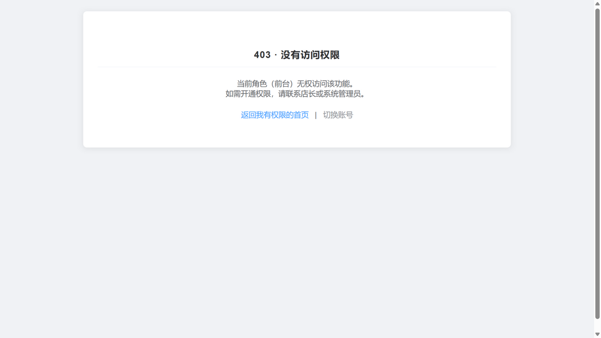
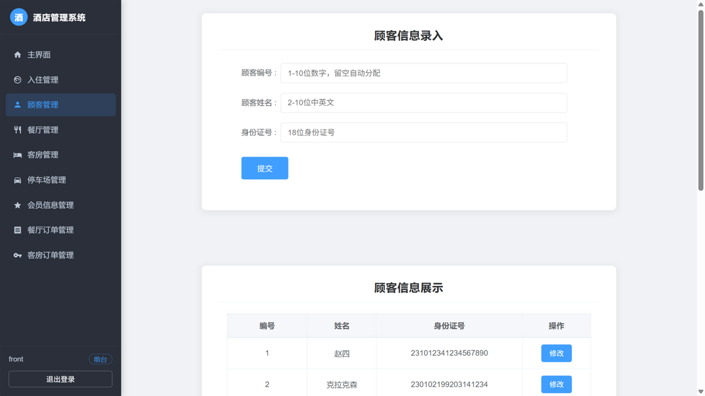
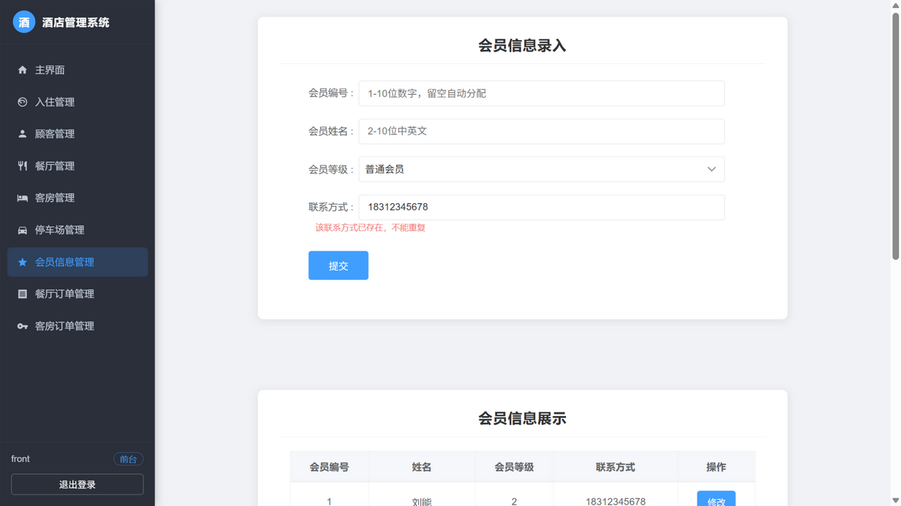
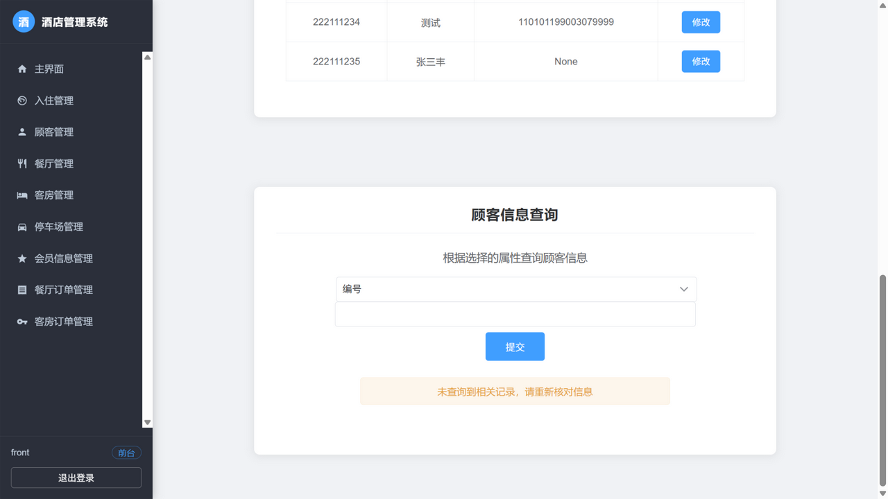
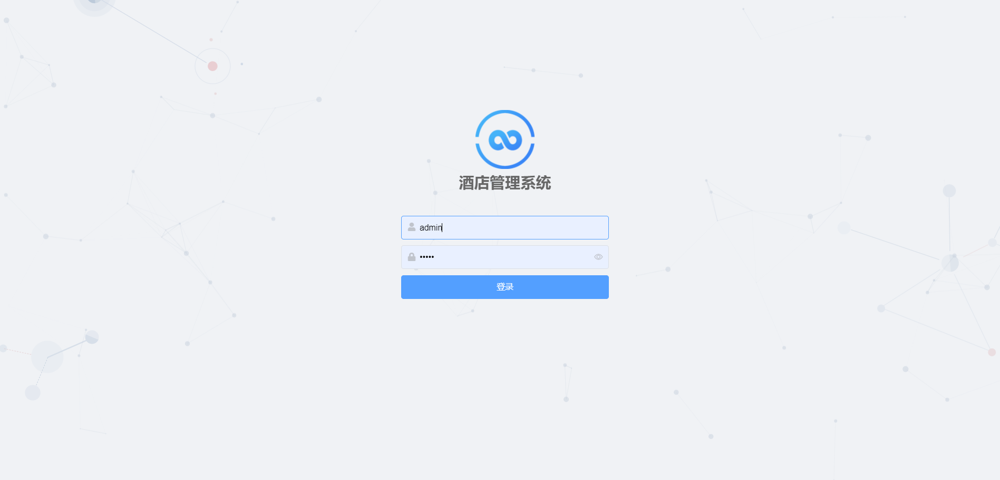
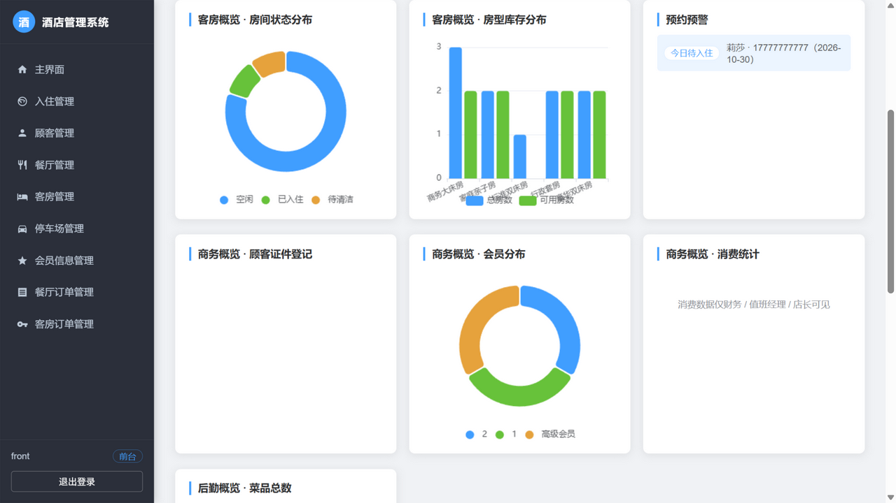

# 酒店管理系统

基于 Django 4.1 的酒店业务管理系统（Browser/Server 架构），覆盖 **员工、顾客、餐厅、客房、停车场、会员、餐饮订单、客房订单** 8 大模块的增删改查，并实现了 **顾客自助预订 → 入住 → 退房 → 冲账 → 财务报表** 的酒店核心业务闭环，同时完成了：

- **输入约束体系**：全部字段格式校验（前端即时拦截 + 后端白名单兜底）、唯一性字段查重（身份证/手机号/菜名/车牌）
- **操作反馈体系**：成功 toast、失败红字提示、删除二次确认、出错字段单独清空并保留已填内容
- **角色权限（RBAC）**：前台 / 值班经理 / 财务 / 店长 四角色 + 超管，页面显隐与接口拦截双层强制
- **界面改版**：simpleui 同款深色侧边栏 + Element UI 配色，与后台观感一致
- **安全与性能**：登录保护、操作审计日志、查询缓存、数据库长连接（Redis/Nginx/Celery 升级路线见 `deploy_notes.md`）

管理后台访问 `/admin/`，前台业务系统访问 `/login/` 登录。

## 界面截图

| 页面 | 截图 |
|---|---|
| 员工管理（侧边栏布局） |  |
| 顾客管理 |  |
| 会员手机号失焦查重提示 |  |
| 查询无结果提示 |  |
| 后台管理（simpleui 主题） |  |
| 主界面数据仪表盘 |  |

## 角色与权限

| 角色 | 账号 / 密码 | 核心操作 | 明确禁止 |
|---|---|---|---|
| 前台 | `front` / `front123456` | 顾客、会员、餐饮订单、客房订单、车位的增改查；菜品、客房查看 | 删除任何记录、员工管理 |
| 值班经理 | `manager` / `manager123456` | 前台全部操作 + 客房改价 + 订单删除（反结账/冲账权） | 员工管理 |
| 财务 | `finance` / `finance123456` | 全部业务模块只读（对账、复核） | 任何增删改 |
| 店长/老板 | `owner` / `owner123456` | 全部模块查看与维护（含员工管理） | 物理删除（行业底线，仅系统超管可执行） |
| 系统超管 | `admin` / `admin` | 全部权限，含物理删除 | — |

实现要点：

- 角色即权限组，定义在 `hotelapp/migrations/0005_role_groups.py`（含权限矩阵与演示账号，可随迁移自动创建）
- 页面显隐：模板通过 `perms.hotelapp.add_xxx` 等控制导航、录入表单、修改/删除按钮
- 接口拦截：视图统一挂 `@staff_required`（登录 + 员工身份）与 `@permission_required('hotelapp.add_xxx', raise_exception=True)`，越权返回 403 提示页（`templates/403.html`）
- 权限校验失败、账号停用等场景均给出中文提示

## 业务流程模块（预订 → 入住 → 退房 → 冲账 → 财务）

在 8 个基础模块之上，实现了酒店核心业务闭环：

| 页面 | 路由 | 说明 |
|---|---|---|
| 主界面工作台 | `/home/` | 数据仪表盘（房间状态环形图、房型库存柱状图、预约预警、顾客证件登记、会员分布、消费统计）+ 按角色显示功能卡片 |
| 顾客自助预订 | `/booking/` | **无需登录**：选房型、填手机号与日期提交预订（同一手机号同日防重复），房间自动转"已预订" |
| 入住管理工作台 | `/checkin/` | 待入住预订 / 在住列表 / 近期退房；前台确认入住（可补录身份证）、退房结算（自动写入财务流水）、冲账 |
| 财务管理 | `/finance/` | 收支流水 + 按日汇总报表（仅财务/值班经理/店长可见）；录入收支仅财务可操作 |
| 注册 | `/register/` | 自助注册，注册即"前台"角色 |

状态流转与行业规范：

```
客房订单：预订 → 已入住 → 已退房，任意状态可「冲账」（状态=已冲账，记录冲账人/时间，不再物理删除）
房间状态：空闲 ↔ 已预订 / 已入住 → 清洁中 → 空闲；跨状态流转需值班经理
反结账：已退房 → 已入住，并自动删除对应收入流水（仅值班经理）
财务报表自动排除「已冲账」记录
```

权限对应：预订/入住/退房 → 前台与值班经理；冲账/反结账 → 值班经理；财务录入 → 财务；全局查看 → 店长。物理删除已从业务角色中移除，符合"删除永远走冲账"的行业底线。

## 字段约束规范（所有模块统一）

### 格式校验（前端 pattern 即时拦截 + 后端白名单正则兜底）

| 字段类型 | 规则 |
|---|---|
| 各类编号（工号/顾客编号/会员编号/菜品编号/车位编号/房间号/订单编号） | 1-10 位纯数字（工号/顾客编号/会员编号留空自动分配） |
| 姓名 | 2-10 位中英文 |
| 菜名 | 2-20 位中英文或数字；客房类型 2-10 位 |
| 月薪 / 菜品价格 | 数字，整数最多 6 位 + 最多 2 位小数 |
| 客房价格 | 1-5 位整数（元/晚） |
| 工龄 | 1-4 位数字 |
| 身份证号 | 18 位，末位可为 X |
| 联系方式 | 11 位手机号（1 开头），输入时自动剔除非数字 |
| 车牌号 | 省份汉字 + 字母 + 5-6 位（如 黑A12345），车位空闲可留空 |
| 入住时间 | 日期选择器，后端校验真实日期 |
| 职务 / 会员等级 / 车位状态 | 只能取规定选项值 |

### 唯一性校验（业务唯一字段）

| 字段 | 说明 |
|---|---|
| 顾客.身份证号 | 全局唯一——同名可以，证件号不行 |
| 会员.联系方式 | 全局唯一——一个手机号对应一个会员 |
| 菜品.菜名 | 全局唯一 |
| 停车场.车辆牌号 | 全局唯一（可空），同一辆车只停一个车位 |

实现分三层：

1. **数据库**：模型 `unique=True`（`0004` 迁移），绕过任何代码直接写库也会被拒
2. **后端**：新增/修改前预检查（修改时排除自身），命中返回精确中文提示；同时注册在 `UNIQUE_FIELDS` 供查重接口使用
3. **前端**：唯一字段输入框失焦即调 `/check_unique/`，输入框旁即时显示绿字"可用"/红字"已存在"；格式不合格时先提示格式错误、不做查重（避免误导）

## 操作反馈规范

| 场景 | 反馈 |
|---|---|
| 录入成功 | 顶部绿色 toast"××添加成功"（自动消失），页面自动滚动到列表区 |
| 录入失败 | 红色错误条精确到字段；**已正确填写的字段全部保留，仅清空出错字段** |
| 行内修改成功 | toast"修改成功"后自动刷新；编辑框自动预填当前值，不改直接保存也能通过 |
| 行内修改失败 | 弹窗展示后端返回的精确原因，保持编辑状态 |
| 删除 | 先弹页面内确认框（"确定删除该条记录吗？删除后不可恢复。"），确认后 toast"删除成功"并刷新 |
| 删除被引用的数据 | 返回 400 并说明原因（如"该员工已被菜品、客房或订单信息引用"） |
| 行内编辑键盘操作 | 编辑行内按 **回车 = 点击"完成"**，所有模块一致 |
| 查询无结果 | 查询区显示"未查询到相关记录，请重新核对信息"，页面停留在查询区（`#search` 锚点） |

## 部署

1. 创建环境并安装依赖

   ```bash
   # Python 3.8+（本项目在 3.9 验证）
   python -m venv venv
   venv\Scripts\pip install -r requirements.txt
   ```

   依赖：`Django==4.1`、`PyMySQL==1.0.2`、`django-simpleui==2022.7.29`

2. MySQL 配置（`hotel/settings.py` 中 DATABASES）

   ```sql
   CREATE DATABASE `hotel` CHARACTER SET 'utf8mb4';
   CREATE USER 'hotelhotel'@'localhost' IDENTIFIED WITH mysql_native_password BY 'hotelhotel';
   GRANT ALL PRIVILEGES ON hotel.* TO 'hotelhotel'@'localhost';
   ```

   演示数据可导入 `hotel.sql`（含 4 个业务演示账号所需的表结构，账号由迁移自动创建）。

3. 初始化并启动

   ```bash
   python manage.py migrate          # 建表 + 创建角色组与演示账号（0005 迁移）
   python manage.py runserver
   ```

4. 访问

   - 前台业务系统：http://127.0.0.1:8000/login/
   - 管理后台：http://127.0.0.1:8000/admin/（账号见上表，超管 `admin/admin`）

## 代码结构与二次开发指引

```
hotel/                    项目配置
  settings.py             数据库/缓存/日志/登录地址（均有注释说明如何换 Redis 等）
  urls.py                 路由表（分组注释）
hotelapp/
  views.py                全部视图。文件头有结构约定：show_/insert_/update_/delete_/search_ 五件套
                          _first_error 字段级校验、_error_context 表单回填、_search 白名单查询、
                          UNIQUE_FIELDS 唯一字段注册表——新增模块照此模式即可
  models.py               8 张业务表（含唯一性约束说明）
  admin.py                后台注册与列表配置
  audit_middleware.py     操作审计中间件（POST/删除请求写入 logs/audit.log）
  migrations/
    0004_...              唯一性约束迁移
    0005_role_groups.py   角色权限矩阵 + 演示账号（权限清单即文档）
templates/                每个页面头部注释说明该页功能；侧边栏/表单/按钮按 perms 显隐
static/css/site.css       全站样式（分节注释：侧边栏/卡片/表单/表格/toast/确认框等）
static/css/login_page.css 登录页专属样式
deploy_notes.md           性能与安全的已落地项、Redis/Nginx/Celery 升级路线
logs/audit.log            操作审计日志（自动生成）
```

**新增一个业务模块的最小步骤**：models 加模型并注册 `UNIQUE_FIELDS`（如需唯一）→ makemigrations + migrate → views.py 按 `show_/insert_/update_/delete_/search_` 五件套 + `_first_error`/`_error_context` 模式实现并挂对应权限装饰器 → urls.py 注册 → 模板复制现有模块结构，菜单加入 `MENU` 列表并包 `` → 在 `0005` 风格的迁移里为各角色分配新权限。

## 历史版本说明

项目原始版本基于 Django 2.x + 服务端模板（原 README 见 git 历史/原仓库）。当前版本的主要变更：

- 环境升级 Django 4.1 + Python 3.9，依赖精简（移除未使用的 SQLAlchemy）
- 修复原版多处缺陷：导航死链、删除/修改按钮失效、eval 注入、列表乱序、失败提示被吞等
- 新增：登录与 RBAC、字段约束与唯一性、操作反馈体系、审计日志、界面改版（详见上文各节）
